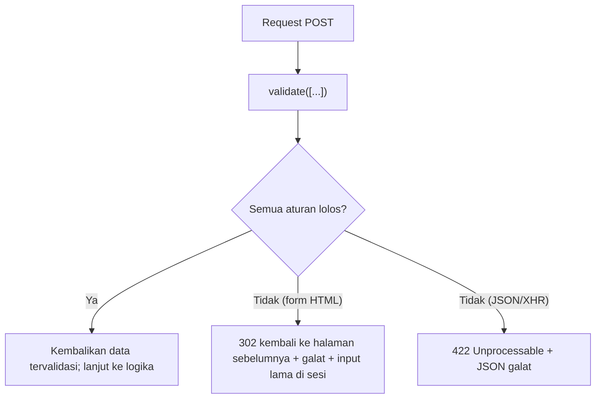

# Pengantar Validasi Form

Setiap kolom form adalah pintu masuk bagi data yang tidak kamu kendalikan. Pengguna bisa salah ketik, lupa mengisi, atau sengaja mengirim data berbahaya. **Validasi** memastikan
data memenuhi aturan **sebelum** dipakai atau disimpan. Sub bab ini menjelaskan mengapa validasi wajib dilakukan di server, bagaimana alurnya di Laravel, dan memulai form latihan yang
dikembangkan sepanjang tujuh sub bab validasi.

## Tujuan Pembelajaran

Setelah menyelesaikan sub bab ini, kamu dapat:

- [ ] Menjelaskan mengapa validasi sisi server wajib walau ada validasi sisi klien.
- [ ] Menyebutkan jenis pemeriksaan: kehadiran, tipe, format, rentang, keunikan, dan hubungan antar kolom.
- [ ] Menjelaskan alur validasi Laravel: gagal → redirect dengan galat dan input lama; sukses → lanjut.
- [ ] Membedakan respons validasi gagal untuk form HTML (302) dan permintaan JSON (422).
- [ ] Membuat form latihan "Pendaftaran Calon Penulis" dengan validasi paling sederhana.
- [ ] Menjelaskan perbedaan validasi, sanitasi, dan otorisasi.

## Prasyarat

- [Blade Forms](../level-03/03-12-blade-forms.md), [Proteksi CSRF](../level-03/03-14-csrf-protection.md), dan [Pesan Error Form](../level-03/03-15-form-error-messages.md).
- Proyek `cms-artikel` dari bab Database (dengan `components/layout.blade.php` dari proyek akhirnya).
- [Objek Request](../level-02/02-15-request-object.md).

## Pengantar

Browser dapat menolak form kosong lewat atribut `required`, tetapi siapa pun dapat mengabaikannya: menonaktifkan JavaScript, mengubah HTML lewat alat pengembang, atau memanggil server langsung
dengan `curl`. Server adalah satu-satunya tempat yang bisa dipercaya untuk menegakkan aturan.

## Penjelasan Konsep

### Dua lapis validasi

| Lapis | Contoh | Tujuan | Dapat dilewati? |
|---|---|---|---|
| Sisi klien | `required`, `type="email"`, `maxlength` | Kenyamanan: umpan balik cepat | **Ya**, oleh siapa pun |
| Sisi server | `$request->validate([...])` | Keamanan dan integritas data | Tidak |

Gunakan keduanya, tetapi anggap hanya lapis server yang menentukan.

### Apa yang diperiksa?

| Jenis | Contoh aturan |
|---|---|
| Kehadiran | `required`, `nullable` |
| Tipe | `string`, `integer`, `boolean`, `array` |
| Format | `email`, `url`, `date`, `regex:...` |
| Rentang | `min`, `max`, `between`, `size` |
| Himpunan nilai | `in:a,b`, `exists:tabel,kolom` |
| Keunikan | `unique:users,email` |
| Hubungan antar kolom | `confirmed`, `same`, `required_if` |
| Berkas | `image`, `mimes`, `max` (ukuran) |

### Alur validasi di Laravel



Menurut dokumentasi, bila validasi gagal Laravel mengalihkan pengguna ke lokasi sebelumnya dan menyimpan galat di sesi; untuk permintaan XHR, ia mengembalikan respons **422** berisi
representasi JSON dari galat.

### Validasi, sanitasi, otorisasi

| Konsep | Pertanyaan | Contoh |
|---|---|---|
| Validasi | "Apakah data ini memenuhi aturan?" | Email berformat benar |
| Sanitasi / normalisasi | "Bagaimana membersihkan atau menyeragamkannya?" | Memangkas spasi, huruf kecil pada email |
| Otorisasi | "Bolehkah pengguna ini melakukan aksi ini?" | Hanya pemilik yang boleh mengubah artikel |

Ketiganya berbeda dan dibahas terpisah; validasi yang lolos tidak berarti aksi diizinkan.

### Kesalahan umum perancangan

- Hanya memvalidasi di JavaScript.
- Memvalidasi tetapi memakai `$request->all()` (bukan data tervalidasi) untuk menyimpan.
- Pesan galat yang membocorkan detail internal.
- Tidak membatasi panjang sehingga data besar membanjiri database.

### Keamanan

- Validasi mengurangi permukaan serangan tetapi bukan pengganti `{{ }}` (XSS), parameter binding (SQL injection), dan `Fillable` (mass assignment); lapis-lapis itu dibahas pada sub bab 05.21–05.23.
- Selalu batasi panjang dan ukuran (`max`) agar tidak terjadi penyalahgunaan sumber daya.

## Cara Kerja

Laravel menjalankan aturan satu per satu untuk setiap kolom, mengumpulkan semua galat, lalu memutuskan: lanjut atau berhenti. Detail penulisan aturan ada pada sub bab berikutnya.

## Contoh Praktik

Kamu membuat halaman `/penulis/daftar` (form "Pendaftaran Calon Penulis") dengan dua kolom (`name`, `email`) dan validasi paling sederhana, lalu mencoba mengirim data buruk lewat browser dan `curl`.

## Penjelasan Kode

File: `routes/web.php` (tambahkan; pastikan `use Illuminate\Http\Request;` ada)

```php-inline
Route::get('/penulis/daftar', fn () => view('penulis.daftar'))->name('penulis.daftar');

Route::post('/penulis/daftar', function (Request $request) {
    $data = $request->validate([
        'name' => 'required|string|max:50',
        'email' => 'required|email|max:100',
    ]);

    return redirect()->route('penulis.daftar')
        ->with('status', 'Terima kasih, '.$data['name'].'! Data kamu valid.');
})->name('penulis.simpan');
```

File: `resources/views/penulis/daftar.blade.php`

```html
<x-layout title="Daftar Calon Penulis">
    <h1 class="text-xl font-bold mb-3">Pendaftaran Calon Penulis</h1>

    <form method="POST" action="{{ route('penulis.simpan') }}" novalidate class="bg-white border rounded p-4">
        @csrf
        <p class="mb-2">
            <label for="name">Nama</label><br>
            <input id="name" name="name" value="{{ old('name') }}" class="border rounded p-2 w-full">
            @error('name') <small class="text-red-600">{{ $message }}</small> @enderror
        </p>
        <p class="mb-2">
            <label for="email">Email</label><br>
            <input id="email" name="email" value="{{ old('email') }}" class="border rounded p-2 w-full">
            @error('email') <small class="text-red-600">{{ $message }}</small> @enderror
        </p>
        <button class="bg-blue-600 text-white rounded px-4 py-2">Kirim</button>
    </form>
</x-layout>
```

| Bagian | Fungsi |
|---|---|
| `$request->validate([...])` | Memvalidasi; mengalihkan kembali bila gagal |
| `$data` | Hanya kolom yang tervalidasi |
| `novalidate` | Mematikan validasi browser agar galat server terlihat |
| `@error` / `old()` | Pesan per kolom dan isian lama |

Layout dari proyek bab Database menampilkan ringkasan semua galat dan pesan `status`.

## Implementasi Langkah demi Langkah

### Langkah 1: tambah route dan view

Tambahkan route dan buat `resources/views/penulis/daftar.blade.php`. Jalankan `php artisan serve` dan `npm run dev`.

### Langkah 2: kirim form kosong

Buka `http://127.0.0.1:8000/penulis/daftar` dan kirim form kosong. Amati ringkasan galat dan pesan per kolom.

### Langkah 3: kirim data buruk

Isi nama 60 karakter dan email `bukan-email`; kirim. Catat pesan untuk masing-masing.

### Langkah 4: kirim data baik

Isi `Budi` dan `budi@contoh.test`; kirim dan lihat pesan hijau.

### Langkah 5: lewati browser dengan curl (JSON)

```bash
curl -s -X POST -H "Accept: application/json" -d "name=" http://127.0.0.1:8000/penulis/daftar
```

Tanpa token CSRF respons `419`. Untuk melihat 422, ambil cookie dan token seperti pada sub bab CSRF:

```bash
TOKEN=$(curl -s -c cj.txt http://127.0.0.1:8000/penulis/daftar | grep -o 'name="_token" value="[^"]*"' | head -1 | sed 's/.*value="//;s/"//')
curl -s -i -b cj.txt -c cj.txt -H "Accept: application/json" -d "_token=$TOKEN&name=" http://127.0.0.1:8000/penulis/daftar
rm cj.txt
```

Perhatikan status `422` dan bentuk JSON.

### Langkah 6: catat di Git

```bash
git add routes resources
git commit -m "Tambah form pendaftaran calon penulis dengan validasi dasar"
```

## Eksekusi dan Verifikasi

| Langkah | Cara memverifikasi |
|---|---|
| 2 | Dua galat `required` tampil dan form kembali |
| 3 | Galat `max` dan `email`; isian lama tetap |
| 4 | Pesan sukses |
| 5 | Status `422` dengan kunci `message` dan `errors` pada JSON |

## Hasil yang Diharapkan

| Permintaan | Hasil |
|---|---|
| Form HTML tidak valid | `302` kembali ke form dengan galat |
| Permintaan JSON tidak valid dengan token | `422` dan JSON galat per kolom |
| Data valid | `302` ke form dengan pesan status |

Teks pesan galat bawaan berbahasa Inggris (diterjemahkan pada 05.04). Hasil ini diturunkan dari dokumentasi dan belum dijalankan oleh penulis materi; cocokkan dengan hasilmu.

## Kesalahan Umum dan Pemecahan Masalah

| Gejala | Penyebab | Cara mengenali | Solusi | Pencegahan |
|---|---|---|---|---|
| Galat tidak muncul | View tidak menampilkan `$errors`/`@error` | Form kembali tanpa pesan | Tambahkan `@error` atau ringkasan | Pakai layout yang menampilkan galat |
| Isian hilang | Lupa `old()` | Form kosong lagi | Tambahkan `old('kolom')` | Template form baku |
| `419` | `@csrf` hilang | Halaman 419 | Tambahkan `@csrf` | Selalu sertakan |
| Validasi browser menutupi galat server | Tidak memakai `novalidate` | Server tak terpanggil | Tambahkan `novalidate` saat uji | Uji dengan `curl` juga |
| `Undefined array key` | Memakai `$request->input` tanpa validasi | Galat | Pakai `$data` hasil validasi | Selalu `validate` dahulu |
| Respons redirect untuk klien JSON | Tidak mengirim `Accept: application/json` | Dapat 302, bukan 422 | Kirim header `Accept` | Klien API wajib set header |

## Latihan Praktik

### Latihan dasar

**D1. Daftar pemeriksaan**
- *Masalah:* ingin memahami jenis pemeriksaan.
- *Persyaratan:* untuk kolom `umur`, `website`, `tanggal_lahir`, dan `tipe` (individu/perusahaan), tuliskan jenis pemeriksaan yang pantas.
- *Perilaku yang diharapkan:* tiap kolom punya minimal dua pemeriksaan beralasan.
- *Tujuan belajar:* merancang aturan.

### Latihan implementasi

**I1. Bypass klien**
- *Masalah:* ingin membuktikan validasi klien tidak cukup.
- *Persyaratan:* tambahkan `required` dan `maxlength="50"` pada input nama, lalu kirim nama 100 karakter lewat `curl` dan tunjukkan server menolaknya.
- *Perilaku yang diharapkan:* galat dari server.
- *Tujuan belajar:* memahami batas validasi klien.

**I2. Respons JSON**
- *Masalah:* klien seluler membaca galat.
- *Persyaratan:* dokumentasikan struktur JSON 422 dari percobaan Langkah 5 (kunci `message` dan `errors`) dan jelaskan bedanya dengan respons redirect.
- *Perilaku yang diharapkan:* dokumentasi akurat.
- *Tujuan belajar:* membaca respons validasi.

### Latihan tantangan

**T1. Audit form**
- *Masalah:* tim punya form yang hanya divalidasi JavaScript.
- *Persyaratan:* tulis daftar risiko, perbaikan, dan satu uji `curl` untuk membuktikannya.
- *Perilaku yang diharapkan:* daftar mencakup injeksi data, data berlebih, dan nilai tak terduga.
- *Tujuan belajar:* menilai form secara kritis.
- *Catatan:* kerjakan mandiri; tidak ada kunci jawaban.

## Uji Pemahaman

1. Mengapa validasi sisi klien tidak cukup?
2. Apa yang terjadi bila `validate()` gagal pada form HTML?
3. Apa respons untuk permintaan JSON yang gagal validasi?
4. Apa beda validasi dan otorisasi?
5. Mengapa memakai data tervalidasi, bukan `$request->all()`?
6. Mengapa membatasi panjang kolom penting?

??? success "Kunci jawaban singkat"
    1. Dapat dilewati oleh siapa pun yang mengirim request langsung.
    2. Redirect ke halaman sebelumnya dengan galat dan input lama di sesi.
    3. Status 422 dengan JSON galat.
    4. Validasi memeriksa data; otorisasi memeriksa hak melakukan aksi.
    5. Karena `all()` memuat kolom tak terduga.
    6. Mencegah data berlebihan dan penyalahgunaan sumber daya.

## Ringkasan

- Validasi server wajib; validasi klien hanya kenyamanan.
- Alur: gagal → redirect (HTML) atau 422 (JSON); lolos → data tervalidasi.
- Validasi berbeda dari sanitasi dan otorisasi.
- Pakai data tervalidasi dan batasi panjang.
- Form latihan `/penulis/daftar` dikembangkan pada sub bab berikutnya.

Selanjutnya: *Validasi Dasar*, cara menulis aturan dan menampilkan galat.

## Referensi Resmi

- [Laravel: Validation](https://laravel.com/docs/13.x/validation)
- [Laravel: Validation Quickstart](https://laravel.com/docs/13.x/validation#validation-quickstart)
- [OWASP: Input Validation Cheat Sheet](https://cheatsheetseries.owasp.org/cheatsheets/Input_Validation_Cheat_Sheet.html)
