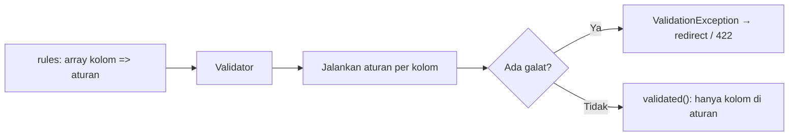

# Validasi Dasar

Sub bab ini mengajarkan cara menulis aturan validasi dengan benar: dua bentuk penulisan aturan, kapan validasi berhenti, mengambil data tervalidasi, memvalidasi array bersarang, memakai
`Validator::make` secara manual, dan menampilkan galat. Form latihan `/penulis/daftar` dikembangkan menjadi form yang lebih lengkap.

## Tujuan Pembelajaran

Setelah menyelesaikan sub bab ini, kamu dapat:

- [ ] Menulis aturan sebagai string `'a|b'` dan sebagai array `['a', 'b']`.
- [ ] Memakai `bail`, `nullable`, dan `sometimes` dengan benar.
- [ ] Mengambil data tervalidasi dengan `validated()` dan `safe()`.
- [ ] Memvalidasi array dan input bersarang dengan notasi titik dan `*`.
- [ ] Memakai `Validator::make` untuk validasi manual dan memeriksa `fails()`.
- [ ] Menampilkan galat di Blade dan memahami bentuk respons JSON.

## Prasyarat

- [Pengantar Validasi Form](05-01-introduction-to-form-validation.md).
- [Array](../level-00/00-13-arrays.md) PHP dan [Pesan Error Form](../level-03/03-15-form-error-messages.md).
- Proyek `cms-artikel` dengan form `/penulis/daftar`.

## Pengantar

Aturan yang ditulis ceroboh menghasilkan dua jenis masalah: data buruk yang lolos, dan data baik yang ditolak. Memahami cara kerja `nullable`, urutan aturan, dan data tervalidasi menghindari keduanya.

## Penjelasan Konsep

### Dua bentuk penulisan aturan

```php-inline
// String dengan pemisah |
'email' => 'required|email|max:100',

// Array: dianjurkan, terutama saat aturan memakai karakter | atau objek
'email' => ['required', 'email', 'max:100'],
```

Bentuk array wajib untuk aturan berupa objek (`Rule::unique(...)`, `Password::min(8)`) dan aturan regex yang memuat `|`.

### Urutan dan `bail`

Aturan dievaluasi berurutan, tetapi **semua** aturan tetap dijalankan walau satu gagal, sehingga satu kolom dapat menghasilkan beberapa galat. Gunakan `bail` untuk berhenti pada kegagalan pertama kolom itu:

```php-inline
'title' => ['bail', 'required', 'string', 'max:200'],
```

### `nullable` dan `sometimes`

| Aturan | Arti |
|---|---|
| `required` | Harus ada dan tidak kosong |
| `nullable` | Boleh `null`/kosong; aturan lain dilewati bila kosong |
| `sometimes` | Validasi hanya bila kolom **ada** di input |

Menurut dokumentasi, string kosong dari form diubah menjadi `null` oleh middleware bawaan, sehingga kolom opsional seperti tanggal sebaiknya memakai `nullable`, kalau tidak
`null` dianggap tidak valid pada aturan seperti `date`.

### Data tervalidasi

```php-inline
$validated = $request->validate([...]);           // array data yang lolos
$validated = $request->safe()->only(['name']);    // hanya sebagian
$validated = $request->safe()->except(['email']); // semua kecuali
```

Hanya kolom yang tercantum di aturan yang masuk ke `$validated`. Gunakan ini, bukan `$request->all()`, untuk menyimpan data.

### Input bersarang dan array

```php-inline
$request->validate([
    'author.name' => 'required|string',
    'tags' => 'required|array|min:1|max:5',
    'tags.*' => 'string|max:20',                 // setiap elemen
    'links.*.url' => 'required|url',             // elemen bersarang
]);
```

Galat untuk elemen array dilaporkan dengan kunci seperti `tags.2`.

### Validasi manual: `Validator::make`

Bila tidak ingin pengalihan otomatis (mis. di command atau saat butuh kontrol):

```php-inline
use Illuminate\Support\Facades\Validator;

$validator = Validator::make($request->all(), [
    'name' => ['required', 'string', 'max:50'],
]);

if ($validator->fails()) {
    return redirect()->route('penulis.daftar')
        ->withErrors($validator)
        ->withInput();
}

$data = $validator->validated();
```

`$validator->errors()` memberi objek `MessageBag`; `$validator->after(fn ($v) => ...)` menambah pemeriksaan tambahan.

### Kantong galat bernama

`$request->validateWithBag('daftar', [...])` menyimpan galat dalam kantong bernama untuk halaman dengan banyak form; baca di Blade dengan `$errors->daftar` atau `@error('email', 'daftar')`.

### Menampilkan galat

Kunci galat dari `$errors` sama dengan nama kolom. Di Blade: `@error('name') ... @enderror`, `$errors->first('name')`, `$errors->all()`, `$errors->has('name')`.

### Bentuk respons JSON 422

```json
{
    "message": "The email field must be a valid email address.",
    "errors": {
        "email": ["The email field must be a valid email address."]
    }
}
```

Bentuk persis pesan bergantung bahasa dan versi.

### Keamanan

- Selalu simpan hasil `validated()`, bukan `all()`.
- Batasi `array` dengan `max` agar pengguna tidak mengirim ribuan elemen.
- Jangan menampilkan nilai input mentah yang dikirim kembali di pesan galat tanpa `{{ }}`.

## Cara Kerja



## Contoh Praktik

Kamu memperluas form `/penulis/daftar` dengan kolom `age`, `website`, dan `tags[]`, memakai bentuk array, `bail`, `nullable`, dan validasi elemen array; lalu membandingkan `validate` dan `Validator::make`.

## Penjelasan Kode

File: `routes/web.php` (ganti route `POST /penulis/daftar`)

```php-inline
Route::post('/penulis/daftar', function (Request $request) {
    $data = $request->validate([
        'name' => ['bail', 'required', 'string', 'max:50'],
        'email' => ['required', 'email', 'max:100'],
        'age' => ['required', 'integer', 'between:17,80'],
        'website' => ['nullable', 'url', 'max:200'],
        'tags' => ['nullable', 'array', 'max:3'],
        'tags.*' => ['string', 'max:20'],
    ]);

    return redirect()->route('penulis.daftar')
        ->with('status', 'Valid: '.json_encode($data));
})->name('penulis.simpan');
```

| Aturan | Arti |
|---|---|
| `bail` | Berhenti di kegagalan pertama untuk `name` |
| `integer`, `between:17,80` | Bilangan bulat 17–80 |
| `nullable`, `url` | Boleh kosong; bila diisi harus URL |
| `array`, `max:3`, `tags.*` | Paling banyak 3 tag dan tiap tag teks ≤ 20 karakter |

Tambahkan di form (`daftar.blade.php`) kolom `age`, `website`, dan tiga input `tags[]`:

```html
<p class="mb-2"><label for="age">Umur</label><br>
    <input id="age" name="age" value="{{ old('age') }}" class="border rounded p-2 w-full">
    @error('age') <small class="text-red-600">{{ $message }}</small> @enderror</p>
<p class="mb-2"><label for="website">Situs web (opsional)</label><br>
    <input id="website" name="website" value="{{ old('website') }}" class="border rounded p-2 w-full">
    @error('website') <small class="text-red-600">{{ $message }}</small> @enderror</p>
@foreach ([0, 1, 2, 3] as $i)
    <p class="mb-1"><input name="tags[]" value="{{ old("tags.$i") }}" placeholder="Tag {{ $i + 1 }}" class="border rounded p-2">
        @error("tags.$i") <small class="text-red-600">{{ $message }}</small> @enderror</p>
@endforeach
```

## Implementasi Langkah demi Langkah

### Langkah 1: perluas route dan form

Ganti route `POST` dan tambah kolom form.

### Langkah 2: uji satu per satu

Kirim form dengan: umur `abc`, umur `10`, umur `30`; situs `bukan url`, situs kosong; empat tag terisi; tag 25 karakter. Catat galat tiap kasus.

### Langkah 3: uji `bail`

Kosongkan nama: lihat satu galat saja. Lepas `bail`, isi nama 60 karakter dan lihat galat `max`.

### Langkah 4: bandingkan `Validator::make`

Salin route menjadi `/penulis/daftar-manual` dengan `Validator::make(...)->fails()` dan `withErrors($validator)->withInput()`; hasilnya harus sama.

### Langkah 5: catat di Git

```bash
git add routes resources
git commit -m "Perluas validasi form calon penulis"
```

## Eksekusi dan Verifikasi

| Langkah | Cara memverifikasi |
|---|---|
| 2 | `age=abc` → galat integer; `10` → galat between; `30` lolos; situs kosong lolos |
| 2 | Empat tag → galat `max`; tag 25 karakter → galat pada `tags.N` |
| 3 | Dengan `bail`, hanya satu galat per kolom |
| 4 | Perilaku sama dengan `validate()` |

## Hasil yang Diharapkan

| Input | Hasil |
|---|---|
| Semua valid | Pesan `Valid: {...}` berisi data tervalidasi saja |
| `age=10` | Galat bahwa umur harus antara 17 dan 80 |
| `website=` (kosong) | Lolos karena `nullable` |
| `tags[]` 4 elemen | Galat bahwa tag tidak boleh lebih dari 3 |

Pesan persis berbahasa Inggris. Hasil ini diturunkan dari dokumentasi dan belum dijalankan oleh penulis materi; cocokkan dengan hasilmu.

## Kesalahan Umum dan Pemecahan Masalah

| Gejala | Penyebab | Cara mengenali | Solusi | Pencegahan |
|---|---|---|---|---|
| Kolom opsional kosong ditolak | Lupa `nullable` | Galat tipe pada nilai kosong | Tambah `nullable` | Tandai semua kolom opsional |
| `validated()` tidak memuat kolom | Kolom tak ada di aturan | Kolom hilang | Tambahkan ke aturan | Daftarkan semua kolom yang dipakai |
| Aturan regex rusak | Karakter pipa sebagai pemisah dalam string | Aturan terpotong | Pakai bentuk array | Array untuk regex |
| Galat array tidak tampil | Memakai `@error('tags')` untuk `tags.0` | Pesan kolom elemen hilang | `@error("tags.$i")` | Gunakan kunci yang tepat |
| Banyak galat untuk satu kolom | Tanpa `bail` | Beberapa pesan | Tambah `bail` bila perlu | Pilih sesuai UX |
| `Validator::make` tak mengalihkan | Tidak memanggil `withErrors` | Form tanpa galat | Tambahkan `withErrors($validator)` | Pola baku |

## Latihan Praktik

### Latihan dasar

**D1. Ubah bentuk**
- *Masalah:* aturan string sulit dibaca.
- *Persyaratan:* tulis ulang `'email' => 'required|email|max:100'` dalam bentuk array dan jelaskan kapan array wajib.
- *Perilaku yang diharapkan:* hasil identik.
- *Tujuan belajar:* dua bentuk aturan.

### Latihan implementasi

**I1. Daftar tautan**
- *Masalah:* kandidat menyertakan sampai lima tautan portofolio.
- *Persyaratan:* validasi `links` (array, 1–5) dengan `links.*.title` (teks) dan `links.*.url` (URL); tampilkan galat per elemen.
- *Perilaku yang diharapkan:* galat menunjuk elemen yang salah.
- *Tujuan belajar:* validasi bersarang.

**I2. Validasi manual**
- *Masalah:* sebuah command Artisan menerima data.
- *Persyaratan:* tulis perintah/Tinker yang memakai `Validator::make` pada array bebas, mencetak semua galat, dan keluar dengan kode non-nol bila gagal.
- *Perilaku yang diharapkan:* galat tercetak tanpa redirect.
- *Tujuan belajar:* memakai validator di luar HTTP.

### Latihan tantangan

**T1. Peta aturan**
- *Masalah:* tim ingin standar aturan.
- *Persyaratan:* buat tabel aturan baku untuk kolom umum (nama, email, telepon, URL, tanggal, harga) dengan alasan batas panjang dan tipe.
- *Perilaku yang diharapkan:* tabel dapat dipakai ulang.
- *Tujuan belajar:* menstandarkan validasi.
- *Catatan:* kerjakan mandiri; tidak ada kunci jawaban.

## Uji Pemahaman

1. Kapan aturan wajib ditulis sebagai array?
2. Apa fungsi `bail`?
3. Apa beda `nullable` dan `sometimes`?
4. Mengapa memakai `validated()` bukan `all()`?
5. Bagaimana memvalidasi tiap elemen array?
6. Kapan memakai `Validator::make`?

??? success "Kunci jawaban singkat"
    1. Saat aturan berupa objek atau mengandung karakter `|`.
    2. Menghentikan evaluasi aturan kolom itu pada kegagalan pertama.
    3. `nullable` mengizinkan nilai kosong; `sometimes` memvalidasi hanya bila kolom ada.
    4. `validated()` hanya memuat kolom yang divalidasi.
    5. Dengan notasi `kolom.*`.
    6. Saat butuh kontrol manual atas pengalihan atau di luar HTTP.

## Ringkasan

- Aturan boleh string atau array; array lebih aman dan dianjurkan.
- `bail`, `nullable`, `sometimes` mengatur alur evaluasi.
- Pakai data tervalidasi; validasi array dengan `*`.
- `Validator::make` untuk validasi manual; galat ada di `$errors`/JSON 422.

Selanjutnya: *Aturan Validasi*, katalog aturan yang paling sering dipakai.

## Referensi Resmi

- [Laravel: Validation](https://laravel.com/docs/13.x/validation)
- [Laravel: Manually Creating Validators](https://laravel.com/docs/13.x/validation#manually-creating-validators)
- [Laravel: Validating Arrays](https://laravel.com/docs/13.x/validation#validating-arrays)
