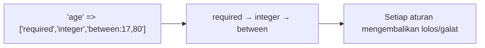

# Aturan Validasi

Laravel menyediakan puluhan aturan bawaan. Kamu tidak perlu menghafal semuanya, tetapi perlu mengenal kelompoknya dan aturan yang paling sering dipakai. Sub bab ini merangkum aturan umum
berdasarkan kegunaan, aturan yang berhubungan dengan database (`unique`, `exists`), aturan untuk kata sandi, dan cara menulis aturan secara fasih dengan kelas `Rule`.

## Tujuan Pembelajaran

Setelah menyelesaikan sub bab ini, kamu dapat:

- [ ] Memilih aturan untuk tipe, format, rentang, himpunan nilai, tanggal, dan konfirmasi.
- [ ] Memakai `unique` dan `exists` dengan `Rule`, termasuk `ignore` dan syarat tambahan.
- [ ] Membuat aturan kata sandi dengan `Password::min(...)`.
- [ ] Menjelaskan perilaku `min`/`max`/`between`/`size` pada tipe berbeda.
- [ ] Mengetahui di mana mencari daftar aturan lengkap.
- [ ] Mengenali jebakan seperti regex, `unique` pada soft delete, dan `exists` tanpa otorisasi.

## Prasyarat

- [Validasi Dasar](05-02-basic-validation.md).
- Tabel `users`, `categories`, dan `articles` dari bab Database.
- [Ekspresi reguler dasar](../level-00/00-15-string-manipulation.md) (opsional).

## Pengantar

Memilih aturan yang tepat adalah gabungan pengetahuan domain dan pengenalan katalog. Sub bab ini memberi peta agar kamu tahu aturan apa yang dicari.

## Penjelasan Konsep

### Kelompok aturan

| Tujuan | Aturan |
|---|---|
| Kehadiran | `required`, `nullable`, `filled`, `present` |
| Tipe | `string`, `integer`, `numeric`, `boolean`, `array`, `date` |
| Format | `email`, `url`, `uuid`, `ip`, `json`, `alpha`, `alpha_dash`, `alpha_num`, `regex:/pola/` |
| Rentang | `min:n`, `max:n`, `between:a,b`, `size:n`, `digits:n`, `digits_between:a,b` |
| Himpunan nilai | `in:a,b`, `not_in:a,b`, `exists:tabel,kolom` |
| Keunikan | `unique:tabel,kolom` |
| Perbandingan kolom | `confirmed`, `same:kolom`, `different:kolom`, `gt:kolom`, `gte:kolom` |
| Tanggal | `date`, `date_format:Y-m-d`, `after:tanggal`, `before:tanggal`, `after_or_equal:`, `before_or_equal:` |

### `min`, `max`, `between`, `size` bergantung tipe

| Tipe nilai | Arti `max:10` |
|---|---|
| String | Maksimal 10 karakter |
| Angka (dengan `integer`/`numeric`) | Nilai paling besar 10 |
| Array | Paling banyak 10 elemen |
| Berkas | Ukuran paling besar 10 kilobyte |

Karena itu sertakan aturan tipe (`string`, `integer`) agar Laravel tahu bagaimana menafsirkan `max`.

### Konfirmasi

`confirmed` mencari kolom `<nama>_confirmation` yang nilainya sama:

```php-inline
'password' => ['required', 'confirmed'],     // input: password dan password_confirmation
```

### `unique` dan `exists`

```php-inline
use Illuminate\Validation\Rule;

'email' => ['required', 'email', 'unique:users,email'],
'email' => ['required', 'email', Rule::unique('users')->ignore($user->id)],      // saat ubah: abaikan diri sendiri
'slug'  => [Rule::unique('articles', 'slug')->withoutTrashed()],                  // abaikan baris soft-deleted
'category_id' => ['nullable', 'exists:categories,id'],
'category_id' => [Rule::exists('categories', 'id')->where('is_active', true)],    // dengan syarat tambahan
```

| Aturan | Pemeriksaan |
|---|---|
| `unique` | Nilai belum ada di tabel (query ke database) |
| `exists` | Nilai ada di tabel; mencegah kunci asing palsu |

!!! warning "`unique` bukan pengganti indeks unik"
    Dua permintaan bersamaan dapat sama-sama lolos `unique` lalu menyimpan duplikat. Tetap pasang **indeks unik** di database; validasi memberi pesan ramah, indeks menjadi pagar terakhir.

### Aturan kata sandi

Kelas `Illuminate\Validation\Rules\Password` menyusun syarat secara fasih:

```php-inline
use Illuminate\Validation\Rules\Password;

'password' => ['required', 'confirmed', Password::min(8)->letters()->mixedCase()->numbers()->symbols()],
```

| Metode | Syarat |
|---|---|
| `min(8)` / `max(256)` | Panjang |
| `letters()` | Minimal satu huruf |
| `mixedCase()` | Huruf besar dan kecil |
| `numbers()` / `symbols()` | Minimal satu angka / simbol |
| `uncompromised()` | Tidak ada dalam kebocoran data publik (memeriksa layanan eksternal tanpa mengirim kata sandi utuh) |

Dokumentasi juga memungkinkan menetapkan aturan bawaan aplikasi dengan `Password::defaults(...)` di `AppServiceProvider::boot()` lalu memakai `Password::defaults()` di tiap form.
Pedoman modern lebih menekankan **panjang** dan pengecekan kebocoran daripada aturan komposisi yang rumit.

### Tanggal

```php-inline
'birth_date' => ['required', 'date', 'before:-17 years'],
'start' => ['required', 'date', 'after_or_equal:today'],
'end' => ['required', 'date', 'after:start'],
```

### `regex`

```php-inline
'phone' => ['required', 'regex:/^(\+62|0)8[0-9]{8,12}$/'],
```

Pakai bentuk array. Hati-hati dengan regex rumit (sulit dirawat, risiko ReDoS); pertimbangkan aturan bawaan dahulu.

### Kelas `Rule` dan aturan kustom (sekilas)

`Rule::in([...])`, `Rule::enum(StatusEnum::class)`, `Rule::requiredIf(...)`, dan lain-lain membuat aturan lebih mudah dibaca dan dites. Aturan kustom dibuat dengan `php artisan make:rule` dan
dibahas di dokumentasi validasi; di sini cukup mengetahui bahwa fitur ini ada.

### Keamanan

- Selalu `max` pada string, array, dan berkas untuk mencegah penyalahgunaan.
- `exists` memastikan kunci asing valid, tetapi tidak menjawab "bolehkah pengguna memakai kategori ini?" (otorisasi).
- `unique` menimbulkan query; jangan mengandalkannya untuk keamanan konkurensi.

## Cara Kerja



## Contoh Praktik

Kamu melengkapi form pendaftaran calon penulis dengan `birth_date`, `password` (+ konfirmasi), `phone`, dan `category_id`, serta aturan `email` yang unik terhadap tabel `users`.

## Penjelasan Kode

```php-inline
use Illuminate\Validation\Rule;
use Illuminate\Validation\Rules\Password;

$data = $request->validate([
    'name' => ['bail', 'required', 'string', 'max:50'],
    'email' => ['required', 'email:rfc', 'max:100', 'unique:users,email'],
    'birth_date' => ['required', 'date', 'before:-17 years'],
    'phone' => ['nullable', 'regex:/^(\+62|0)8[0-9]{8,12}$/'],
    'category_id' => ['nullable', Rule::exists('categories', 'id')],
    'password' => ['required', 'confirmed', Password::min(8)->letters()->numbers()],
]);
```

| Aturan | Arti |
|---|---|
| `email:rfc` | Format email sesuai RFC (variasi `dns` memeriksa catatan DNS dan butuh ekstensi tertentu) |
| `unique:users,email` | Email belum dipakai |
| `before:-17 years` | Tanggal lahir minimal 17 tahun lalu |
| `regex` | Format ponsel Indonesia sederhana |
| `Rule::exists(...)` | Kategori ada di database |
| `Password::min(8)->letters()->numbers()` | Syarat kata sandi |

Tambahkan kolom form yang sesuai (termasuk `password` dan `password_confirmation`, dengan `type="password"` dan tanpa `old()`).

## Implementasi Langkah demi Langkah

### Langkah 1: tambah kolom form dan aturan

Tambahkan kolom `birth_date` (`type="date"`), `phone`, `category_id` (`select` dari kategori), `password`, dan `password_confirmation`.

### Langkah 2: uji tiap aturan

| Uji | Input | Harapan |
|---|---|---|
| Email ganda | email milik pengguna yang ada | galat `unique` |
| Umur | tanggal lahir 10 tahun lalu | galat `before` |
| Ponsel | `12345` | galat `regex` |
| Kategori | `category_id=999` (lewat `curl`) | galat `exists` |
| Konfirmasi | dua kata sandi berbeda | galat `confirmed` |
| Kata sandi lemah | `abc` | galat `min`/`letters`/`numbers` |

### Langkah 3: input kata sandi tidak diisi ulang

Pastikan input `password` tidak memakai `old()`.

### Langkah 4: catat di Git

```bash
git add routes resources
git commit -m "Tambah aturan validasi lengkap pada form calon penulis"
```

## Eksekusi dan Verifikasi

| Langkah | Cara memverifikasi |
|---|---|
| 2 | Tiap uji menghasilkan galat pada kolom yang tepat |
| 3 | Kolom kata sandi kosong setelah galat |

## Hasil yang Diharapkan

| Uji | Hasil |
|---|---|
| Email milik pengguna yang ada | Galat bahwa email sudah dipakai |
| Tanggal lahir 10 tahun lalu | Galat bahwa harus sebelum tanggal batas |
| Data lengkap valid | `302` dengan pesan sukses |

Hasil ini diturunkan dari dokumentasi dan belum dijalankan oleh penulis materi; cocokkan dengan hasilmu.

## Kesalahan Umum dan Pemecahan Masalah

| Gejala | Penyebab | Cara mengenali | Solusi | Pencegahan |
|---|---|---|---|---|
| `max` tidak membatasi panjang | Tidak ada aturan `string` | Angka dibandingkan sebagai nilai | Tambah `string` | Selalu sertakan tipe |
| `unique` menolak data sendiri saat ubah | Lupa `ignore` | Galat saat menyimpan tanpa perubahan | `Rule::unique(...)->ignore($id)` | Pakai pada form ubah |
| `unique` menolak slug milik baris terhapus | Soft delete | Galat tak terduga | `->withoutTrashed()` bila diinginkan, dan pahami indeks DB | Pilih kebijakan unik |
| `confirmed` selalu gagal | Nama kolom konfirmasi salah | Galat konfirmasi | Gunakan `<nama>_confirmation` | Samakan nama |
| Regex gagal pada input benar | Pola terlalu ketat atau bentuk string | Galat regex | Uji pola terpisah; pakai array | Uji dengan banyak contoh |
| Kata sandi kuat ditolak `uncompromised` | Ada di daftar kebocoran | Galat khusus | Pilih kata sandi lain | Jelaskan di UI |
| `email:dns` galat | Ekstensi/jaringan tidak tersedia | Galat saat validasi | Gunakan `email:rfc` di lokal | Pahami syarat variasi |

## Latihan Praktik

### Latihan dasar

**D1. Pilih aturan**
- *Masalah:* tentukan aturan.
- *Persyaratan:* tulis aturan untuk (a) harga (bilangan ≥ 0, maksimal dua desimal), (b) kode pos (5 digit), (c) status (`draft`/`terbit`), (d) tanggal terbit tidak boleh di masa lalu.
- *Perilaku yang diharapkan:* aturan tepat dan beralasan.
- *Tujuan belajar:* memilih aturan.

### Latihan implementasi

**I1. Form ubah profil**
- *Masalah:* pengguna mengubah email tanpa ditolak oleh dirinya sendiri.
- *Persyaratan:* tulis aturan `unique` dengan `ignore($user->id)` dan uji dua skenario (email sendiri dan email orang lain).
- *Perilaku yang diharapkan:* email sendiri diterima, milik orang lain ditolak.
- *Tujuan belajar:* memakai `ignore`.

**I2. Kata sandi bawaan aplikasi**
- *Masalah:* aturan kata sandi tersebar.
- *Persyaratan:* atur `Password::defaults(fn () => Password::min(10)->letters()->numbers())` di `AppServiceProvider::boot()` dan pakai `Password::defaults()` di form.
- *Perilaku yang diharapkan:* satu tempat mengubah kebijakan.
- *Tujuan belajar:* memusatkan aturan.

### Latihan tantangan

**T1. Kebijakan kata sandi**
- *Masalah:* tim berdebat soal komposisi vs panjang.
- *Persyaratan:* tulis rekomendasi 1 halaman (panjang minimum, `uncompromised`, batas maksimum, pesan galat) dengan rujukan pedoman publik (mis. NIST 800-63B).
- *Perilaku yang diharapkan:* rekomendasi beralasan.
- *Tujuan belajar:* menetapkan kebijakan.
- *Catatan:* kerjakan mandiri; tidak ada kunci jawaban.

## Uji Pemahaman

1. Mengapa aturan tipe perlu menyertai `min`/`max`?
2. Apa fungsi `exists`?
3. Bagaimana mengabaikan baris saat ini pada `unique`?
4. Mengapa tetap perlu indeks unik di database?
5. Aturan apa yang membandingkan dua kolom kata sandi?
6. Mengapa menekankan panjang kata sandi?

??? success "Kunci jawaban singkat"
    1. Tipe menentukan arti `min`/`max` (karakter, nilai, elemen, ukuran).
    2. Memastikan nilai ada di tabel (mis. kunci asing valid).
    3. `Rule::unique(...)->ignore($id)`.
    4. Validasi tidak aman terhadap permintaan bersamaan.
    5. `confirmed`.
    6. Panjang meningkatkan ketahanan dibanding aturan komposisi yang mudah ditebak.

## Ringkasan

- Aturan dikelompokkan menurut tujuan; sertakan tipe agar `min`/`max` bermakna.
- `unique` dan `exists` memeriksa database; indeks unik tetap wajib.
- `Password::min(...)` menyusun kebijakan kata sandi; pusatkan dengan `defaults`.
- Gunakan bentuk array untuk regex dan objek `Rule`.

Selanjutnya: *Pesan Validasi Kustom*, menerjemahkan dan menyesuaikan pesan galat.

## Referensi Resmi

- [Laravel: Available Validation Rules](https://laravel.com/docs/13.x/validation#available-validation-rules)
- [Laravel: Validating Passwords](https://laravel.com/docs/13.x/validation#validating-passwords)
- [Laravel: Rule Unique and Exists](https://laravel.com/docs/13.x/validation#rule-unique)
