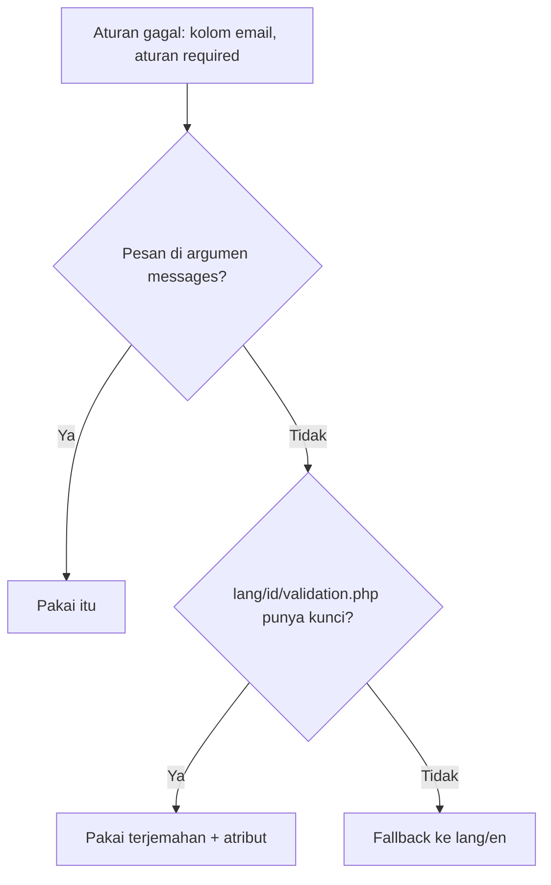

# Pesan Validasi Kustom

Pesan galat bawaan Laravel berbahasa Inggris dan generik. Pengguna Indonesia lebih terbantu dengan pesan berbahasa Indonesia yang jelas ("Email wajib diisi" alih-alih "The email field is
required."). Sub bab ini mengajarkan tiga tingkat penyesuaian: pesan per aturan, nama atribut yang ramah, dan lokalisasi lewat berkas bahasa (`lang/id`).

## Tujuan Pembelajaran

Setelah menyelesaikan sub bab ini, kamu dapat:

- [ ] Memberi pesan khusus per kolom dan aturan dengan argumen ketiga `validate`/array `messages`.
- [ ] Memakai placeholder seperti `:attribute`, `:min`, `:max`.
- [ ] Mengganti nama kolom di pesan dengan `attributes`.
- [ ] Mempublikasikan berkas bahasa dengan `php artisan lang:publish`.
- [ ] Membuat `lang/id/validation.php` dan mengatur `APP_LOCALE=id`.
- [ ] Menulis pesan yang membantu tanpa membocorkan informasi sensitif.

## Prasyarat

- [Aturan Validasi](05-03-validation-rules.md).
- [Environment Variables](../level-01/01-11-environment-variables.md).
- Form `/penulis/daftar`.

## Pengantar

Pesan yang baik menjawab tiga hal: apa yang salah, di kolom mana, dan apa yang harus dilakukan. Pesan bahasa asing yang kaku membuat pengguna menyerah mengisi form.

## Penjelasan Konsep

### Tingkat 1: pesan per aturan

Berikan argumen ketiga untuk `validate`:

```php-inline
$request->validate(
    ['email' => ['required', 'email']],
    [
        'email.required' => 'Email wajib diisi.',
        'email.email' => 'Format email tidak valid.',
        'required' => 'Kolom :attribute wajib diisi.',   // untuk semua kolom
    ]
);
```

Kunci berformat `kolom.aturan`; kunci hanya `aturan` berlaku untuk semua kolom. Placeholder: `:attribute` (nama kolom), `:min`, `:max`, `:size`, `:other`, `:values`, dan lain-lain
(bergantung aturan).

### Tingkat 2: nama atribut

Argumen keempat mengganti nama kolom di pesan:

```php-inline
$request->validate($rules, $messages, [
    'name' => 'nama lengkap',
    'birth_date' => 'tanggal lahir',
]);
```

Pesan "The :attribute field is required." menjadi "The nama lengkap field is required."

### Tingkat 3: berkas bahasa

Proyek baru tidak menyertakan folder `lang`. Publikasikan:

```bash
php artisan lang:publish
```

Perintah ini membuat folder `lang` berisi `en/validation.php` (dan berkas bahasa lain). Buat salinannya untuk bahasa Indonesia:

```text
lang/
  en/validation.php
  id/validation.php      <- buat; terjemahkan pesan yang kamu perlukan
```

File: `lang/id/validation.php` (contoh sebagian; salin semua kunci dari `en/validation.php` lalu terjemahkan)

```php
<?php

return [
    'required' => ':attribute wajib diisi.',
    'email' => ':attribute harus berupa alamat email yang valid.',
    'max' => [
        'string' => ':attribute tidak boleh lebih dari :max karakter.',
        'numeric' => ':attribute tidak boleh lebih besar dari :max.',
        'array' => ':attribute tidak boleh memiliki lebih dari :max item.',
        'file' => ':attribute tidak boleh lebih besar dari :max kilobita.',
    ],
    'min' => [
        'string' => ':attribute minimal :min karakter.',
    ],
    'confirmed' => 'Konfirmasi :attribute tidak cocok.',
    'unique' => ':attribute sudah dipakai.',

    'attributes' => [
        'name' => 'Nama',
        'email' => 'Email',
        'password' => 'Kata sandi',
        'birth_date' => 'Tanggal lahir',
    ],
];
```

Kunci yang tidak diterjemahkan akan jatuh ke bahasa cadangan (`fallback_locale`, bawaan `en`), jadi terjemahan boleh dilakukan bertahap. Bagian `attributes` dalam berkas bahasa mengganti nama
kolom untuk semua pesan.

Aktifkan locale di `.env`:

```ini
APP_LOCALE=id
APP_FALLBACK_LOCALE=en
```

Lalu `php artisan config:clear` bila konfigurasi pernah di-*cache*.

### Mana yang dipakai?

| Kebutuhan | Pilihan |
|---|---|
| Satu form dengan pesan khusus | Argumen `messages` (atau `messages()` di Form Request) |
| Seluruh aplikasi berbahasa Indonesia | `lang/id/validation.php` + `APP_LOCALE=id` |
| Nama kolom ramah di seluruh aplikasi | `attributes` di berkas bahasa |

### Pesan yang baik

- Tulis dalam bentuk yang membantu: "Kata sandi minimal 8 karakter" lebih baik daripada "Kata sandi tidak valid".
- Jangan membocorkan informasi sensitif: untuk login, "Email atau kata sandi salah" (bukan "email tidak terdaftar").
- Hindari menyalin kembali nilai input yang tidak aman ke pesan tanpa escaping (Blade `{{ }}` melakukannya).

### Keamanan

- Pesan yang mengungkap apakah sebuah akun ada memudahkan penyerang menebak akun (*user enumeration*); jaga pesan login dan reset kata sandi tetap umum.
- Berkas bahasa adalah kode; jangan memasukkan data rahasia.

## Cara Kerja



## Contoh Praktik

Kamu mempublikasikan berkas bahasa, membuat `lang/id/validation.php` untuk pesan yang dipakai form calon penulis, mengaktifkan `APP_LOCALE=id`, dan menambah satu pesan khusus pada kolom tertentu.

## Penjelasan Kode

Kode berkas bahasa ada pada bagian konsep. Contoh pesan khusus pada route:

```php-inline
$data = $request->validate($rules, [
    'age.between' => 'Umur harus antara :min dan :max tahun.',
    'email.unique' => 'Email ini sudah terdaftar. Coba masuk, atau pakai email lain.',
]);
```

Pesan `email.unique` yang menyebut "sudah terdaftar" aman untuk form pendaftaran publik hanya bila kamu menerima risiko enumerasi; pada form sensitif, gunakan pesan umum.

## Implementasi Langkah demi Langkah

### Langkah 1: publikasikan bahasa

```bash
cd ~/belajar-laravel/cms-artikel
php artisan lang:publish
ls lang
```

### Langkah 2: buat bahasa Indonesia

Buat `lang/id/validation.php` dari contoh (tambahkan kunci lain yang kamu pakai: `between`, `date`, `before`, `regex`, `url`, `integer`, `string`, `array`, `exists`, dan `password`).

### Langkah 3: aktifkan locale

Ubah `.env`: `APP_LOCALE=id`, jalankan `php artisan config:clear`, dan muat ulang form.

### Langkah 4: uji

Kirim form kosong dan baca pesan; bandingkan sebelum dan sesudah. Kunci yang belum diterjemahkan tampil berbahasa Inggris.

### Langkah 5: pesan khusus

Tambahkan `messages` khusus pada route untuk `age.between` dan `email.unique`, dan uji.

### Langkah 6: catat di Git

```bash
git add lang routes
git commit -m "Tambah terjemahan pesan validasi bahasa Indonesia"
```

`.env` tidak ikut di-*commit*; tulis `APP_LOCALE=id` di `.env.example`.

## Eksekusi dan Verifikasi

| Langkah | Cara memverifikasi |
|---|---|
| 1 | Folder `lang/en` ada |
| 3 | `php artisan tinker --execute="echo app()->getLocale();"` mencetak `id` |
| 4 | Pesan berbahasa Indonesia untuk kunci yang diterjemahkan |
| 5 | Pesan khusus mengalahkan terjemahan umum |

## Hasil yang Diharapkan

| Kasus | Hasil |
|---|---|
| Nama kosong | `Nama wajib diisi.` |
| Umur 10 | Pesan khusus `Umur harus antara 17 dan 80 tahun.` |
| Kunci belum diterjemahkan | Pesan bahasa Inggris (fallback) |

Hasil ini diturunkan dari dokumentasi dan belum dijalankan oleh penulis materi; cocokkan dengan hasilmu.

## Kesalahan Umum dan Pemecahan Masalah

| Gejala | Penyebab | Cara mengenali | Solusi | Pencegahan |
|---|---|---|---|---|
| Pesan tetap Inggris | `APP_LOCALE` belum `id` atau konfigurasi ter-*cache* | `getLocale()` bukan `id` | Atur `.env`, `config:clear` | Periksa locale |
| `:attribute` tampil mentah | Salah ketik placeholder | Teks `:attribute` terlihat | Perbaiki penulisan | Salin dari berkas bahasa |
| Kunci pesan tak berlaku | Format kunci salah | Pesan bawaan tetap tampil | Gunakan `kolom.aturan` | Ikuti format |
| `lang` tidak ada | Belum `lang:publish` | Folder hilang | Jalankan perintah | Dokumentasikan setup |
| Pesan `max` salah tipe | Tidak ada aturan tipe | Pesan untuk "numeric" muncul | Tambah `string` | Selalu sertakan tipe |
| Pesan membocorkan akun | Terlalu spesifik | Enumerasi mungkin | Pakai pesan umum | Tinjau pesan sensitif |

## Latihan Praktik

### Latihan dasar

**D1. Pesan ramah**
- *Masalah:* pesan bawaan terlalu kaku.
- *Persyaratan:* tulis ulang lima pesan galat umum dalam bahasa Indonesia yang membantu.
- *Perilaku yang diharapkan:* pesan jelas dan sopan.
- *Tujuan belajar:* menulis pesan baik.

### Latihan implementasi

**I1. Terjemahkan satu bahasa**
- *Masalah:* seluruh pesan dipakai.
- *Persyaratan:* terjemahkan semua kunci `validation.php` yang dipakai form calon penulis, dan buktikan tidak ada pesan Inggris tersisa.
- *Perilaku yang diharapkan:* semua galat form berbahasa Indonesia.
- *Tujuan belajar:* lokalisasi menyeluruh.

**I2. Nama atribut**
- *Masalah:* pesan menyebut `birth_date`.
- *Persyaratan:* gunakan bagian `attributes` agar pesan menyebut "Tanggal lahir".
- *Perilaku yang diharapkan:* nama kolom ramah.
- *Tujuan belajar:* memakai atribut.

### Latihan tantangan

**T1. Dua bahasa**
- *Masalah:* aplikasi melayani pengguna Indonesia dan Inggris.
- *Persyaratan:* tambahkan pengalih bahasa sederhana (sesi) yang memanggil `app()->setLocale()` lewat middleware, dan tunjukkan pesan validasi berganti bahasa.
- *Perilaku yang diharapkan:* pesan mengikuti pilihan.
- *Tujuan belajar:* lokalisasi dinamis.
- *Catatan:* kerjakan mandiri; tidak ada kunci jawaban.

## Uji Pemahaman

1. Bagaimana memberi pesan khusus untuk `email` dan aturan `required`?
2. Apa fungsi placeholder `:attribute`?
3. Apa fungsi `php artisan lang:publish`?
4. Apa itu locale cadangan?
5. Mengapa pesan login harus umum?
6. Mana yang menang: pesan argumen atau pesan berkas bahasa?

??? success "Kunci jawaban singkat"
    1. Kunci `email.required` pada array messages.
    2. Diganti nama kolom (atau nama dari `attributes`).
    3. Membuat folder `lang` berisi berkas bahasa bawaan.
    4. Bahasa yang dipakai bila kunci tidak ada di locale aktif.
    5. Untuk mencegah enumerasi akun.
    6. Pesan argumen (lebih spesifik).

## Ringkasan

- Pesan dapat diubah per aturan, per kolom, atau lewat berkas bahasa.
- `lang:publish`, `lang/id/validation.php`, dan `APP_LOCALE=id` melokalkan seluruh aplikasi.
- Gunakan `attributes` untuk nama ramah dan fallback untuk terjemahan bertahap.
- Pesan yang baik jelas dan tidak membocorkan informasi.

Selanjutnya: *Validasi Form Request*, memindahkan aturan ke kelas tersendiri.

## Referensi Resmi

- [Laravel: Customizing the Error Messages](https://laravel.com/docs/13.x/validation#customizing-the-error-messages)
- [Laravel: Localization](https://laravel.com/docs/13.x/localization)
- [Laravel: Specifying Custom Attribute Values](https://laravel.com/docs/13.x/validation#specifying-custom-attribute-values-in-language-files)
