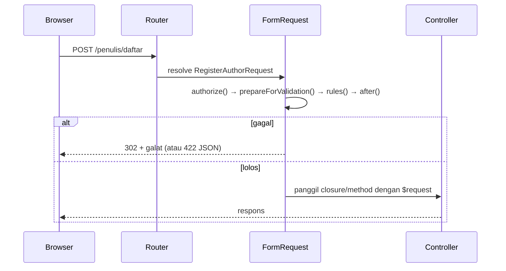

# Validasi dengan Form Request

Saat aturan makin banyak, `validate([...])` di dalam controller membuat controller panjang dan sulit dibaca. **Form Request** memindahkan aturan, pesan, dan otorisasi ke kelas khusus
yang divalidasi **sebelum** controller berjalan. Sub bab ini mengubah form calon penulis menjadi Form Request, termasuk normalisasi input dan validasi tambahan.

## Tujuan Pembelajaran

Setelah menyelesaikan sub bab ini, kamu dapat:

- [ ] Membuat Form Request dengan `php artisan make:request`.
- [ ] Mengisi `rules()`, `authorize()`, `messages()`, dan `attributes()`.
- [ ] Menormalkan input dengan `prepareForValidation()`.
- [ ] Menambah pemeriksaan lanjutan dengan `after()`.
- [ ] Memakai `validated()` dan `safe()` di controller.
- [ ] Memakai atribut seperti `#[StopOnFirstFailure]` dan `#[FailOnUnknownFields]`.

## Prasyarat

- [Validasi Dasar](05-02-basic-validation.md), [Aturan Validasi](05-03-validation-rules.md), dan [Pesan Validasi Kustom](05-04-custom-validation-messages.md).
- [Controller](../level-02/02-12-creating-controllers.md) dan [Objek Request](../level-02/02-15-request-object.md).
- Form `/penulis/daftar` dengan banyak aturan.

## Pengantar

Aturan, pesan, dan pemeriksaan hak akses adalah tanggung jawab yang berbeda dari menyimpan data. Memisahkannya menjadikan controller tipis, aturan mudah dites dan dipakai ulang oleh form tambah dan ubah.

## Penjelasan Konsep

### Membuat Form Request

```bash
php artisan make:request RegisterAuthorRequest
```

Kelas dibuat di `app/Http/Requests`. Setiap Form Request memiliki `authorize()` dan `rules()`.

File: `app/Http/Requests/RegisterAuthorRequest.php`

```php
<?php

namespace App\Http\Requests;

use Illuminate\Foundation\Http\FormRequest;
use Illuminate\Foundation\Http\Attributes\StopOnFirstFailure;
use Illuminate\Validation\Rules\Password;
use Illuminate\Validation\Validator;

#[StopOnFirstFailure]
class RegisterAuthorRequest extends FormRequest
{
    public function authorize(): bool
    {
        return true;
    }

    protected function prepareForValidation(): void
    {
        $this->merge([
            'email' => strtolower(trim((string) $this->input('email'))),
            'name' => trim((string) $this->input('name')),
        ]);
    }

    public function rules(): array
    {
        return [
            'name' => ['required', 'string', 'max:50'],
            'email' => ['required', 'email', 'max:100', 'unique:users,email'],
            'age' => ['required', 'integer', 'between:17,80'],
            'password' => ['required', 'confirmed', Password::min(8)->letters()->numbers()],
        ];
    }

    public function messages(): array
    {
        return [
            'email.unique' => 'Email ini sudah terdaftar.',
            'age.between' => 'Umur harus antara :min dan :max tahun.',
        ];
    }

    public function attributes(): array
    {
        return ['age' => 'umur', 'name' => 'nama'];
    }

    public function after(): array
    {
        return [
            function (Validator $validator) {
                if (str_contains(strtolower($this->input('name', '')), 'admin')) {
                    $validator->errors()->add('name', 'Nama tidak boleh memuat kata "admin".');
                }
            },
        ];
    }
}
```

| Bagian | Fungsi |
|---|---|
| `authorize()` | Menentukan apakah pengguna boleh membuat request ini; `false` menghasilkan 403 |
| `prepareForValidation()` | Menormalkan input **sebelum** validasi (huruf kecil, pangkas spasi) |
| `rules()` | Aturan validasi |
| `messages()` / `attributes()` | Pesan dan nama atribut khusus form ini |
| `after()` | Pemeriksaan tambahan setelah aturan lolos (menerima objek `Validator`) |
| `#[StopOnFirstFailure]` | Berhenti pada kegagalan pertama |

### Memakai di controller

Cukup type-hint request pada route atau method controller; validasi berjalan sebelum kode di dalamnya:

```php-inline
use App\Http\Requests\RegisterAuthorRequest;

Route::post('/penulis/daftar', function (RegisterAuthorRequest $request) {
    $data = $request->validated();                      // data tervalidasi
    // $request->safe()->only(['name', 'email']);       // sebagian
    return redirect()->route('penulis.daftar')->with('status', 'Terima kasih, '.$data['name']);
})->name('penulis.simpan');
```

Bila validasi gagal, pengguna dialihkan kembali dengan galat; untuk XHR/JSON mendapat 422. Bila `authorize()` mengembalikan `false`, hasilnya 403.

### Atribut Form Request

Dokumentasi 13.x menyediakan atribut pada kelas Form Request:

| Atribut | Efek |
|---|---|
| `#[StopOnFirstFailure]` | Hentikan semua validasi pada kegagalan pertama |
| `#[FailOnUnknownFields]` | Tolak kolom yang tidak ada di `rules()` (berguna untuk API ketat) |
| `#[RedirectTo('/url')]` / `#[RedirectToRoute('nama')]` | Tujuan pengalihan saat gagal |
| `#[ErrorBag('login')]` | Simpan galat dalam kantong bernama |

### Satu request untuk tambah dan ubah

Untuk form ubah, aturan `unique` perlu mengabaikan data sendiri. Ambil model dari route:

```php-inline
public function rules(): array
{
    $article = $this->route('article');
    return [
        'slug' => ['nullable', Rule::unique('articles', 'slug')->ignore($article?->id)],
    ];
}
```

Cara lain adalah dua kelas (`StoreArticleRequest`, `UpdateArticleRequest`) yang berbagi aturan lewat trait; pilih yang paling mudah dirawat tim.

### Otorisasi di `authorize()`

`authorize()` cocok untuk pemeriksaan hak sederhana (nanti: `return $this->user()->can('create', Article::class);`). Hak akses dibahas pada sub bab otorisasi; untuk form publik, `return true`.

### Keamanan

- Gunakan `validated()` atau `safe()`, bukan `all()`.
- `prepareForValidation()` untuk normalisasi, bukan untuk menyimpan data ke database.
- `authorize()` yang selalu `true` pada aksi sensitif adalah celah; periksa hak sebenarnya.

## Cara Kerja



## Contoh Praktik

Kamu memindahkan aturan form calon penulis ke `RegisterAuthorRequest`, menormalkan email, menambah pemeriksaan `after`, dan membuktikan controller tidak berisi logika validasi.

## Penjelasan Kode

Kode ada pada bagian konsep. Route kini hanya menerima `RegisterAuthorRequest $request` dan memakai `$request->validated()`.

## Implementasi Langkah demi Langkah

### Langkah 1: buat kelas

```bash
cd ~/belajar-laravel/cms-artikel
php artisan make:request RegisterAuthorRequest
```

### Langkah 2: isi kelas dan ubah route

Isi sesuai bagian konsep dan ganti `Request $request` dengan `RegisterAuthorRequest $request` pada route.

### Langkah 3: uji normalisasi

Kirim email `  BUDI@Contoh.TEST  ` dan periksa `validated()['email']` bernilai `budi@contoh.test` (tampilkan di pesan status).

### Langkah 4: uji `after`

Isi nama `Admin Palsu`; amati galat khusus.

### Langkah 5: uji `StopOnFirstFailure`

Kirim form kosong: hanya satu galat tampil. Lepas atribut, ulangi, dan bandingkan.

### Langkah 6: catat di Git

```bash
git add app routes
git commit -m "Pindahkan validasi calon penulis ke Form Request"
```

## Eksekusi dan Verifikasi

| Langkah | Cara memverifikasi |
|---|---|
| 3 | Email tersimpan dalam huruf kecil tanpa spasi |
| 4 | Galat `Nama tidak boleh memuat kata "admin".` |
| 5 | Dengan atribut: satu galat; tanpa atribut: beberapa |

## Hasil yang Diharapkan

| Kasus | Hasil |
|---|---|
| Email `  BUDI@Contoh.TEST  ` | `budi@contoh.test` |
| Nama `Admin Palsu` | Galat dari `after()` |
| Form kosong dengan `StopOnFirstFailure` | Satu galat |

Hasil ini diturunkan dari dokumentasi dan belum dijalankan oleh penulis materi; cocokkan dengan hasilmu.

## Kesalahan Umum dan Pemecahan Masalah

| Gejala | Penyebab | Cara mengenali | Solusi | Pencegahan |
|---|---|---|---|---|
| 403 pada setiap kiriman | `authorize()` mengembalikan `false` (bawaan generator) | Status 403 | Ubah menjadi `true` atau logika hak | Periksa `authorize()` setelah membuat |
| Aturan tak berjalan | Type-hint `Request` biasa | Tanpa validasi | Gunakan kelas Form Request | Periksa tanda tangan |
| `unique` menolak diri sendiri pada ubah | Tidak ada `ignore` | Galat saat simpan tanpa perubahan | Gunakan `$this->route('model')` | Uji form ubah |
| `trim()` pada `null` menimbulkan peringatan | Input kosong | Peringatan deprecated | Cast `(string)` | Normalisasi aman |
| Galat tidak terlihat | Respons JSON diharapkan tetapi tidak ada header | Tidak ada redirect | Kirim `Accept: application/json` | Klien API |
| Atribut tidak dikenali | Namespace salah | Class not found | `Illuminate\Foundation\Http\Attributes\...` | Periksa `use` |

## Latihan Praktik

### Latihan dasar

**D1. Controller tipis**
- *Masalah:* controller berisi aturan 30 baris.
- *Persyaratan:* jelaskan tiga keuntungan Form Request dibanding aturan di controller.
- *Perilaku yang diharapkan:* terpisahnya tanggung jawab, pemakaian ulang, kemudahan uji.
- *Tujuan belajar:* memahami manfaat.

### Latihan implementasi

**I1. Refactor admin artikel**
- *Masalah:* `Admin\ArticleController` memakai `validated()` privat.
- *Persyaratan:* buat `StoreArticleRequest` dan `UpdateArticleRequest` (aturan dari proyek bab Database) dan pakai di controller; pastikan uji manual tetap lulus.
- *Perilaku yang diharapkan:* controller lebih ringkas, perilaku sama.
- *Tujuan belajar:* refactor ke Form Request.

**I2. Tolak kolom asing**
- *Masalah:* API menerima kolom tak dikenal.
- *Persyaratan:* tambahkan `#[FailOnUnknownFields]` pada request dan kirim kolom `is_admin=1` lewat `curl`; amati penolakan.
- *Perilaku yang diharapkan:* request ditolak.
- *Tujuan belajar:* memakai atribut ketat.

### Latihan tantangan

**T1. Aturan bersama**
- *Masalah:* form tambah dan ubah berbagi 90% aturan.
- *Persyaratan:* rancang satu cara berbagi aturan (trait atau kelas induk) dan jelaskan kekurangan dibanding satu kelas dengan `$this->isMethod('PUT')`.
- *Perilaku yang diharapkan:* rekomendasi beralasan.
- *Tujuan belajar:* mengatur duplikasi aturan.
- *Catatan:* kerjakan mandiri; tidak ada kunci jawaban.

## Uji Pemahaman

1. Kapan Form Request dijalankan relatif terhadap controller?
2. Apa fungsi `authorize()`?
3. Apa fungsi `prepareForValidation()`?
4. Apa fungsi `after()`?
5. Apa efek `authorize()` mengembalikan `false`?
6. Apa fungsi `#[FailOnUnknownFields]`?

??? success "Kunci jawaban singkat"
    1. Sebelum controller berjalan.
    2. Menentukan apakah pengguna boleh melakukan request.
    3. Menormalkan input sebelum aturan dievaluasi.
    4. Menambah pemeriksaan setelah aturan lolos.
    5. Respons 403.
    6. Menolak kolom yang tidak didefinisikan di `rules()`.

## Ringkasan

- Form Request memisahkan aturan, pesan, dan otorisasi dari controller.
- `prepareForValidation()` menormalkan; `after()` memeriksa lanjutan; `validated()` memberi data aman.
- Atribut `#[StopOnFirstFailure]`, `#[FailOnUnknownFields]`, dan lainnya menyesuaikan perilaku.
- Periksa `authorize()` agar tidak selalu `true` pada aksi sensitif.

Selanjutnya: *Validasi Bersyarat*, aturan yang bergantung pada nilai kolom lain.

## Referensi Resmi

- [Laravel: Form Request Validation](https://laravel.com/docs/13.x/validation#form-request-validation)
- [Laravel: Authorizing Form Requests](https://laravel.com/docs/13.x/validation#authorizing-form-requests)
- [Laravel: Preparing Input for Validation](https://laravel.com/docs/13.x/validation#preparing-input-for-validation)
