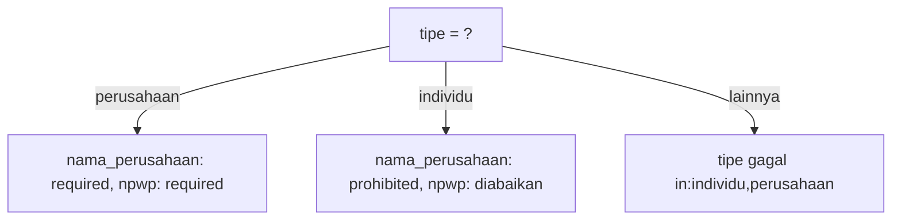

# Validasi Bersyarat

Tidak semua kolom selalu wajib. "Nama perusahaan" hanya relevan bila pendaftar bertipe perusahaan; "alasan penolakan" hanya wajib bila status ditolak. **Validasi bersyarat** menerapkan
aturan hanya saat suatu kondisi terpenuhi. Sub bab ini membahas aturan `required_if` dan kerabatnya, `exclude_if`, `sometimes`, dan `Rule::when` serta `Rule::requiredIf`.

## Tujuan Pembelajaran

Setelah menyelesaikan sub bab ini, kamu dapat:

- [ ] Memakai `required_if`, `required_unless`, `required_with`, dan `required_without`.
- [ ] Memakai `prohibited_if` dan `exclude_if` untuk kolom yang harus kosong atau diabaikan.
- [ ] Memakai `sometimes` untuk memvalidasi hanya kolom yang dikirim.
- [ ] Memakai `Rule::requiredIf` dan `Rule::when` dengan closure.
- [ ] Menyusun aturan dinamis di `rules()` berdasarkan input.
- [ ] Menjelaskan jebakan: nilai dikirim sebagai string, dan data yang diabaikan masih ada di request.

## Prasyarat

- [Validasi Form Request](05-05-form-request-validation.md).
- Form `/penulis/daftar`.
- [Pernyataan Kondisional](../level-00/00-11-conditional-statements.md) PHP.

## Pengantar

Form pendaftaran penulis kini menanyakan tipe pendaftar: **individu** atau **perusahaan**. Perusahaan wajib mengisi nama perusahaan, individu wajib mengisi tautan portofolio atau teks portofolio (salah satu).

## Penjelasan Konsep

### Aturan `required_*`

| Aturan | Wajib bila |
|---|---|
| `required_if:tipe,perusahaan` | Kolom `tipe` bernilai `perusahaan` |
| `required_unless:tipe,individu` | Kolom `tipe` **bukan** `individu` |
| `required_with:a,b` | Salah satu dari `a`, `b` terisi |
| `required_with_all:a,b` | Semua `a`, `b` terisi |
| `required_without:a` | `a` tidak terisi |
| `required_without_all:a,b` | Tidak satu pun `a`, `b` terisi |

Nilai di input form selalu berupa string; bandingkan dengan `'1'`, `'true'`, atau `'perusahaan'`, bukan tipe PHP.

### Melarang atau mengabaikan

| Aturan | Efek |
|---|---|
| `prohibited_if:tipe,individu` | Kolom **tidak boleh** diisi bila tipe individu |
| `exclude_if:tipe,individu` | Kolom diabaikan (tidak ada di `validated()`) bila tipe individu |
| `exclude_unless:...`, `exclude_with:...` | Varian lain |

`exclude_*` mencegah data yang tidak relevan ikut tersimpan; namun kolom itu masih ada di `$request->all()`, jadi tetap pakai `validated()`.

### `sometimes`

```php-inline
'website' => ['sometimes', 'nullable', 'url'],
```

`sometimes` memvalidasi kolom hanya bila ada di input (berguna untuk update parsial / PATCH).

### `Rule::requiredIf` dan `Rule::when`

Untuk kondisi yang tak cukup diungkapkan sebagai string:

```php-inline
use Illuminate\Validation\Rule;

'nama_perusahaan' => [Rule::requiredIf(fn () => $this->input('tipe') === 'perusahaan')],

'portfolio_url' => [
    Rule::when($this->input('tipe') === 'individu', ['required_without:portfolio_text', 'url'], ['prohibited']),
],
```

`Rule::when($kondisi, $aturanJikaBenar, $aturanJikaSalah)` memilih himpunan aturan. Untuk keterbacaan, hitung kondisi di variabel dulu.

### Aturan dinamis di `rules()`

```php-inline
public function rules(): array
{
    $perusahaan = $this->input('tipe') === 'perusahaan';

    return [
        'tipe' => ['required', 'in:individu,perusahaan'],
        'nama_perusahaan' => [$perusahaan ? 'required' : 'prohibited', 'string', 'max:100'],
        'npwp' => ['exclude_unless:tipe,perusahaan', 'required', 'digits:15'],
    ];
}
```

Pastikan `tipe` sendiri divalidasi (`in:`) agar kondisi tidak dipicu nilai liar.

### Validator manual dengan `sometimes`

```php-inline
$validator->sometimes('npwp', 'required|digits:15', fn ($input) => $input->tipe === 'perusahaan');
```

### Keamanan dan keandalan

- Jangan bergantung pada kolom yang "disembunyikan" lewat JavaScript; server harus menegakkan syarat yang sama.
- Kolom yang tidak relevan harus ditolak atau diabaikan, bukan disimpan, agar tidak ada data liar.
- Uji semua cabang kondisi, bukan hanya satu.

## Cara Kerja



## Contoh Praktik

Kamu menambah kolom `tipe`, `nama_perusahaan`, `npwp`, `portfolio_url`, dan `portfolio_text` pada form calon penulis, lengkap dengan aturan bersyarat, lalu menguji setiap kombinasi.

## Penjelasan Kode

Tambahkan ke `rules()` pada `RegisterAuthorRequest`:

```php-inline
$perusahaan = $this->input('tipe') === 'perusahaan';
$individu = $this->input('tipe') === 'individu';

return [
    // ... aturan name, email, age, password dari sub bab sebelumnya
    'tipe' => ['required', 'in:individu,perusahaan'],
    'nama_perusahaan' => [$perusahaan ? 'required' : 'prohibited', 'string', 'max:100'],
    'npwp' => ['exclude_unless:tipe,perusahaan', 'required', 'digits:15'],
    'portfolio_url' => [Rule::when($individu, ['required_without:portfolio_text', 'nullable', 'url', 'max:200'], ['prohibited'])],
    'portfolio_text' => [Rule::when($individu, ['required_without:portfolio_url', 'nullable', 'string', 'max:1000'], ['prohibited'])],
];
```

Tambahkan `use Illuminate\Validation\Rule;` dan kolom form (radio `tipe`, input lain). Tampilkan semua kolom; JavaScript untuk menyembunyikan tidak diwajibkan dalam latihan ini.

| Kolom | Perilaku |
|---|---|
| `nama_perusahaan` | Wajib untuk perusahaan; dilarang untuk individu |
| `npwp` | Diabaikan jika bukan perusahaan; wajib 15 digit untuk perusahaan |
| `portfolio_url` / `portfolio_text` | Untuk individu, minimal salah satu terisi; dilarang untuk perusahaan |

## Implementasi Langkah demi Langkah

### Langkah 1: tambah kolom form

Tambahkan radio `tipe` dan input untuk kolom-kolom baru.

### Langkah 2: tambah aturan bersyarat

Ubah `rules()` seperti di atas.

### Langkah 3: uji matriks

| Skenario | Input | Harapan |
|---|---|---|
| Perusahaan lengkap | tipe=perusahaan, nama, npwp 15 digit | lolos |
| Perusahaan tanpa nama | tipe=perusahaan | galat nama perusahaan wajib |
| Individu tanpa portofolio | tipe=individu, keduanya kosong | galat salah satu wajib |
| Individu isi teks saja | tipe=individu, text terisi | lolos |
| Individu isi nama perusahaan | tipe=individu, nama_perusahaan terisi | galat dilarang |
| Tipe liar | tipe=lain | galat `in` |

### Langkah 4: periksa data tervalidasi

Tampilkan `json_encode($data)` pada pesan sukses dan pastikan `npwp` tidak muncul untuk individu.

### Langkah 5: catat di Git

```bash
git add app resources
git commit -m "Tambah validasi bersyarat tipe pendaftar"
```

## Eksekusi dan Verifikasi

| Langkah | Cara memverifikasi |
|---|---|
| 3 | Setiap skenario menghasilkan hasil yang diharapkan |
| 4 | `npwp` tidak ada pada `validated()` untuk individu |

## Hasil yang Diharapkan

| Skenario | Hasil |
|---|---|
| Perusahaan lengkap | Sukses, `validated()` memuat `nama_perusahaan` dan `npwp` |
| Individu dengan nama perusahaan | Galat bahwa kolom tidak boleh diisi |
| Individu tanpa portofolio | Galat bahwa salah satu portofolio wajib |

Hasil ini diturunkan dari dokumentasi dan belum dijalankan oleh penulis materi; cocokkan dengan hasilmu.

## Kesalahan Umum dan Pemecahan Masalah

| Gejala | Penyebab | Cara mengenali | Solusi | Pencegahan |
|---|---|---|---|---|
| `required_if` tak pernah aktif | Membandingkan dengan nilai salah (mis. `true` vs `1`) | Aturan tidak bekerja | Bandingkan dengan nilai string input | Periksa nilai yang dikirim |
| Kolom yang diabaikan tetap tersimpan | Memakai `all()` | Data liar di database | Pakai `validated()` | Disiplin data tervalidasi |
| Kondisi dipicu nilai liar | `tipe` tidak divalidasi | Cabang tak terduga | Tambah `in:` | Validasi pemicu |
| `prohibited` menolak string kosong | Kolom kosong terkirim | Galat tak terduga | Pakai `exclude_if` atau pastikan kolom tidak terkirim | Pilih aturan sesuai maksud |
| Aturan tak berjalan di `PATCH` | Kolom tidak dikirim | Tidak divalidasi | Tambah `sometimes` | Pahami input parsial |
| Logika kondisi duplikat | Kondisi ditulis berulang | Kode panjang | Hitung variabel sekali | Ekstrak ke variabel |

## Latihan Praktik

### Latihan dasar

**D1. Pilih aturan**
- *Masalah:* tentukan aturan bersyarat.
- *Persyaratan:* untuk (a) alasan penolakan wajib bila status `ditolak`, (b) email atau telepon salah satu wajib, (c) diskon dilarang untuk produk gratis, tulis aturannya.
- *Perilaku yang diharapkan:* `required_if`, `required_without`, `prohibited_if`.
- *Tujuan belajar:* memetakan kebutuhan ke aturan.

### Latihan implementasi

**I1. Status artikel**
- *Masalah:* artikel berstatus `jadwal` perlu tanggal terbit.
- *Persyaratan:* di request artikel tambahkan `status` (`draft`, `terbit`, `jadwal`) dan `publish_at` yang wajib dan harus `after:now` hanya untuk `jadwal`, serta dilarang untuk status lain.
- *Perilaku yang diharapkan:* semua kombinasi sesuai aturan.
- *Tujuan belajar:* validasi bersyarat nyata.

**I2. Validator manual**
- *Masalah:* ingin `sometimes` di luar Form Request.
- *Persyaratan:* tulis `Validator::make(...)` dengan `sometimes` yang mewajibkan `npwp` hanya untuk perusahaan, dan uji dua kasus.
- *Perilaku yang diharapkan:* sama dengan versi Form Request.
- *Tujuan belajar:* memakai `sometimes`.

### Latihan tantangan

**T1. Matriks uji**
- *Masalah:* tim ingin yakin semua cabang teruji.
- *Persyaratan:* buat tabel semua kombinasi tipe × kolom (terisi/kosong) dengan hasil yang diharapkan dan jalankan semuanya dengan `curl` atau skrip Tinker.
- *Perilaku yang diharapkan:* semua baris cocok.
- *Tujuan belajar:* menguji cabang validasi.
- *Catatan:* kerjakan mandiri; tidak ada kunci jawaban.

## Uji Pemahaman

1. Apa beda `required_if` dan `required_with`?
2. Apa beda `prohibited_if` dan `exclude_if`?
3. Kapan memakai `sometimes`?
4. Apa fungsi `Rule::when`?
5. Mengapa pemicu kondisi harus divalidasi?
6. Mengapa JavaScript tidak cukup menyembunyikan kolom?

??? success "Kunci jawaban singkat"
    1. `required_if` bergantung nilai kolom lain; `required_with` bergantung keberadaan kolom lain.
    2. `prohibited_if` menolak bila terisi; `exclude_if` mengabaikan kolom dari data tervalidasi.
    3. Saat memvalidasi hanya kolom yang dikirim (update parsial).
    4. Memilih himpunan aturan berdasarkan kondisi.
    5. Agar nilai liar tidak mengaktifkan cabang tak terduga.
    6. Pengguna dapat mengirim kolom langsung; server harus menegakkan aturan.

## Ringkasan

- Aturan `required_*`, `prohibited_*`, dan `exclude_*` menanggapi nilai kolom lain.
- `sometimes`, `Rule::requiredIf`, dan `Rule::when` menangani kasus dinamis.
- Validasi juga kolom pemicu dan gunakan `validated()`.
- Uji setiap cabang kondisi.

Selanjutnya: *Validasi Unggah Berkas*, memvalidasi gambar dan dokumen.

## Referensi Resmi

- [Laravel: Conditionally Adding Rules](https://laravel.com/docs/13.x/validation#conditionally-adding-rules)
- [Laravel: Rule required_if](https://laravel.com/docs/13.x/validation#rule-required-if)
- [Laravel: Rule prohibited_if](https://laravel.com/docs/13.x/validation#rule-prohibited-if)
- [Laravel: Rule exclude_if](https://laravel.com/docs/13.x/validation#rule-exclude-if)
