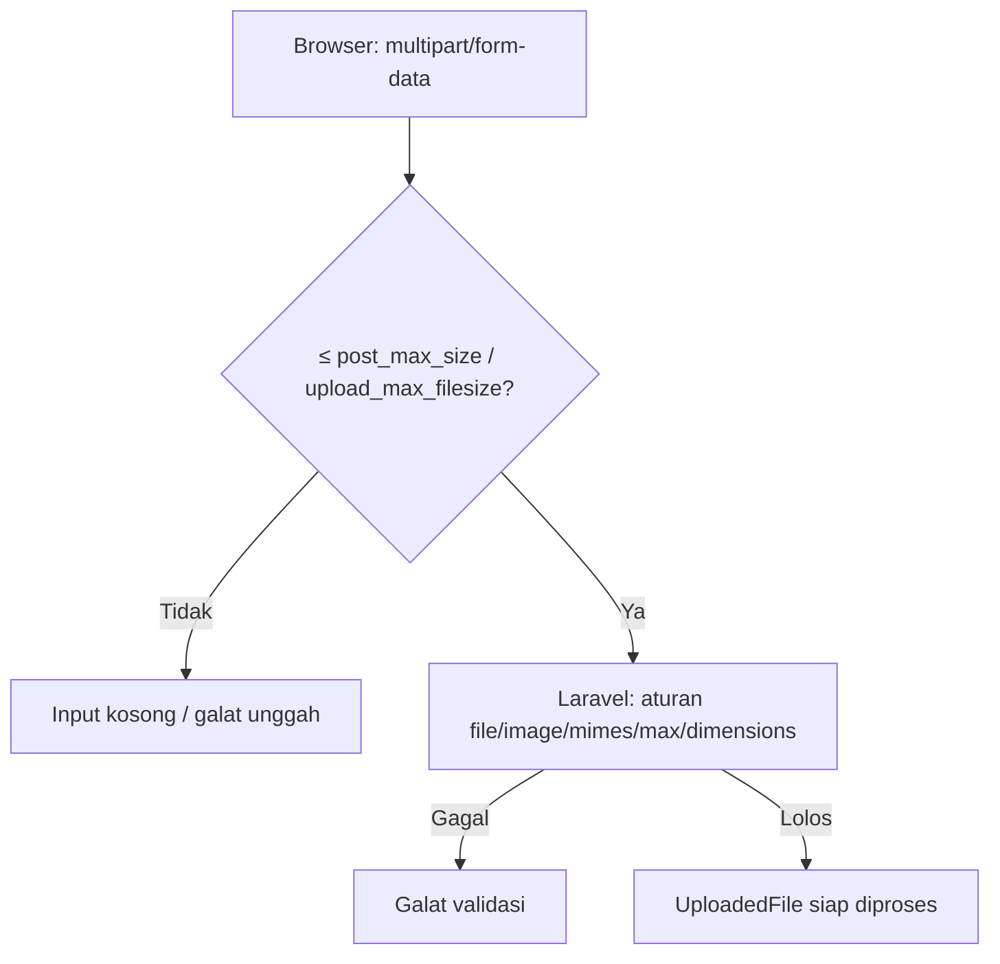

# Validasi Unggah Berkas

Menerima berkas dari pengguna adalah salah satu fitur paling berisiko. Berkas bisa terlalu besar, bertipe salah, atau sengaja berbahaya. Sub bab ini mengajarkan cara menerima unggahan melalui form,
memvalidasi jenis, ukuran, dan dimensi gambar dengan aturan Laravel, serta memahami batas konfigurasi PHP. Menyimpan berkas secara aman dibahas terpisah pada sub bab 05.25.

## Tujuan Pembelajaran

Setelah menyelesaikan sub bab ini, kamu dapat:

- [ ] Membuat form unggah dengan `enctype="multipart/form-data"`.
- [ ] Mengakses berkas dengan `$request->file()` dan `hasFile()`.
- [ ] Memvalidasi dengan `file`, `image`, `mimes`, `mimetypes`, `max`, dan `dimensions`.
- [ ] Memakai `File::image()` dan `File::types()` secara fasih.
- [ ] Menjelaskan batas `upload_max_filesize` dan `post_max_size` serta efeknya pada validasi.
- [ ] Menjelaskan mengapa nama dan ekstensi dari klien tidak boleh dipercaya.

## Prasyarat

- [Validasi Form Request](05-05-form-request-validation.md) dan [Validasi Bersyarat](05-06-conditional-validation.md).
- [Penanganan Form PHP](../level-00/00-16-php-form-handling.md).
- Form `/penulis/daftar`.

## Pengantar

Calon penulis diminta mengunggah foto profil. Tanpa pembatasan, seseorang bisa mengunggah berkas 2 GB, skrip PHP yang diberi ekstensi `.jpg`, atau gambar raksasa yang menghabiskan memori saat diproses.

## Penjelasan Konsep

### Form unggah

```html
<form method="POST" action="{{ route('penulis.simpan') }}" enctype="multipart/form-data">
    @csrf
    <input type="file" name="avatar" accept="image/png,image/jpeg">
</form>
```

Tanpa `enctype="multipart/form-data"`, berkas tidak terkirim. Atribut `accept` hanya petunjuk untuk browser, bukan validasi.

### Mengakses berkas

```php-inline
$request->hasFile('avatar');            // apakah dikirim
$file = $request->file('avatar');       // objek UploadedFile
$file->isValid();                       // unggahan sukses?
$file->getSize();                       // ukuran (byte)
$file->getMimeType();                   // MIME hasil deteksi isi berkas di server
$file->extension();                     // ekstensi dari isi/MIME
$file->getClientOriginalName();         // nama dari klien: TIDAK DIPERCAYA
```

Nilai yang berasal dari klien (`getClientOriginalName`, `getClientMimeType`) dapat dipalsukan; jangan dipakai untuk keputusan keamanan atau nama berkas di disk.

### Aturan validasi berkas

| Aturan | Arti |
|---|---|
| `file` | Harus berkas yang berhasil diunggah |
| `image` | Berkas gambar (jpg, jpeg, png, bmp, gif, webp; **SVG tidak diizinkan secara bawaan**) |
| `mimes:jpg,png` | Ekstensi berdasarkan MIME hasil deteksi isi |
| `mimetypes:image/png,image/jpeg` | Tipe MIME persis |
| `max:2048` | Ukuran maksimum dalam **kilobyte** (2048 KB = 2 MB) |
| `min:10` | Ukuran minimum (KB) |
| `dimensions:min_width=100,max_width=1000` | Batas dimensi gambar |

```php-inline
'avatar' => ['nullable', 'image', 'mimes:jpg,jpeg,png', 'max:2048', 'dimensions:min_width=100,min_height=100,max_width=2000,max_height=2000'],
```

### `File::image()` dan `File::types()`

Cara fasih menyusun aturan berkas:

```php-inline
use Illuminate\Validation\Rule;
use Illuminate\Validation\Rules\File;

'avatar' => ['nullable', File::image()->max(2 * 1024)->dimensions(Rule::dimensions()->maxWidth(2000)->maxHeight(2000))],
'cv'     => ['nullable', File::types(['pdf'])->max('5mb')],
```

`max` menerima kilobyte atau string berisi satuan (`'5mb'`). Dokumentasi menyatakan SVG ditolak oleh `image` karena risiko XSS; mengizinkannya harus keputusan sadar (`File::image(allowSvg: true)`).

### Jangan percaya ekstensi saja

Dokumentasi memperingatkan: lolos `image` tidak mencegah berkas dieksekusi sebagai PHP bila disimpan dengan ekstensi `.php`. Aturan MIME memeriksa isi, tetapi **cara menyimpan** (nama dan lokasi) tetap
menentukan keamanan; itu dibahas pada sub bab 05.25.

### Batas konfigurasi PHP

| Pengaturan `php.ini` | Arti |
|---|---|
| `upload_max_filesize` | Ukuran maksimum satu berkas |
| `post_max_size` | Ukuran maksimum seluruh body request |
| `max_file_uploads` | Jumlah berkas maksimum per request |
| `memory_limit` | Memori yang tersedia (pemrosesan gambar membutuhkannya) |

Jika berkas melebihi `upload_max_filesize`, PHP menandai unggahan gagal dan aturan `file`/`uploaded` melaporkan galat. Jika body melebihi `post_max_size`, seluruh input (termasuk token CSRF) kosong dan
kamu bisa mendapat `419`. Periksa dengan `php --ini` dan `php -i | grep -E "upload_max|post_max"`.

### Berkas banyak

```php-inline
'photos' => ['required', 'array', 'max:5'],
'photos.*' => ['image', 'max:2048'],
```

### Keamanan

- Batasi **ukuran**, **tipe**, dan **dimensi**; dimensi besar dapat menghabiskan memori saat gambar diproses.
- Jangan pernah mempercayai nama atau ekstensi dari klien.
- Jangan memproses (resize, baca) berkas sebelum lolos validasi.
- Simpan di luar folder yang dieksekusi web server dan dengan nama acak (sub bab 05.25).

## Cara Kerja



## Contoh Praktik

Kamu menambah kolom `avatar` (foto profil) dan `cv` (PDF) pada form calon penulis, memvalidasinya, dan menampilkan metadata hasil deteksi server (tanpa menyimpan).

## Penjelasan Kode

Tambahkan ke `rules()`:

```php
use Illuminate\Validation\Rule;
use Illuminate\Validation\Rules\File;

'avatar' => ['nullable', File::image()->max(2 * 1024)->dimensions(Rule::dimensions()->minWidth(100)->minHeight(100)->maxWidth(2000)->maxHeight(2000))],
'cv' => ['nullable', File::types(['pdf'])->max(5 * 1024)],
```

Tambah `enctype="multipart/form-data"` pada form dan input:

```html
<p class="mb-2"><label for="avatar">Foto profil (JPG/PNG, maks 2 MB)</label><br>
    <input type="file" id="avatar" name="avatar" accept="image/png,image/jpeg">
    @error('avatar') <small class="text-red-600">{{ $message }}</small> @enderror</p>
<p class="mb-2"><label for="cv">CV (PDF, maks 5 MB)</label><br>
    <input type="file" id="cv" name="cv" accept="application/pdf">
    @error('cv') <small class="text-red-600">{{ $message }}</small> @enderror</p>
```

Pada route, tampilkan metadata (tanpa menyimpan):

```php-inline
$info = [];
if ($request->hasFile('avatar')) {
    $f = $request->file('avatar');
    $info = ['ukuran_kb' => round($f->getSize() / 1024), 'mime' => $f->getMimeType(), 'ekstensi' => $f->extension()];
}
return redirect()->route('penulis.daftar')->with('status', 'Valid. Avatar: '.json_encode($info));
```

## Implementasi Langkah demi Langkah

### Langkah 1: ubah form dan aturan

Tambahkan `enctype`, dua input berkas, dan aturan di atas.

### Langkah 2: siapkan berkas uji

Siapkan: gambar PNG kecil, gambar > 2 MB, berkas teks yang diganti nama menjadi `.jpg`, dan PDF kecil.

### Langkah 3: uji

| Uji | Harapan |
|---|---|
| PNG kecil | lolos; mime `image/png` |
| Gambar > 2 MB | galat ukuran |
| Teks berekstensi `.jpg` | galat `image` (isi bukan gambar) |
| PDF di kolom `avatar` | galat |
| PDF kecil di `cv` | lolos |

### Langkah 4: uji dengan curl

```bash
curl -s -o /dev/null -w "%{http_code}\n" -F "avatar=@gambar.png" http://127.0.0.1:8000/penulis/daftar
```

Tanpa token CSRF hasilnya `419`; ambil token dan cookie seperti sub bab sebelumnya bila ingin menguji lengkap.

### Langkah 5: periksa batas PHP

```bash
php -i | grep -E "upload_max_filesize|post_max_size"
```

Kirim berkas yang melebihi batas dan catat gejalanya (galat unggah atau `419`).

### Langkah 6: catat di Git

```bash
git add app resources
git commit -m "Tambah validasi unggah avatar dan CV"
```

## Eksekusi dan Verifikasi

| Langkah | Cara memverifikasi |
|---|---|
| 3 | Setiap uji sesuai tabel |
| 5 | Nilai batas PHP tercatat; gejala berkas terlalu besar dipahami |

## Hasil yang Diharapkan

| Uji | Hasil |
|---|---|
| PNG kecil | Pesan status berisi mime `image/png` |
| Teks berekstensi `.jpg` | Galat bahwa avatar harus berupa gambar |
| Berkas melebihi `post_max_size` | Input kosong; bisa `419` atau galat `required` |

Hasil ini diturunkan dari dokumentasi dan belum dijalankan oleh penulis materi; cocokkan dengan hasilmu.

## Kesalahan Umum dan Pemecahan Masalah

| Gejala | Penyebab | Cara mengenali | Solusi | Pencegahan |
|---|---|---|---|---|
| `hasFile` selalu `false` | Tanpa `enctype="multipart/form-data"` | Berkas tidak terkirim | Tambahkan `enctype` | Template form unggah |
| `419` saat unggah besar | Body melebihi `post_max_size` | Token ikut hilang | Perbesar batas atau batasi ukuran di klien | Samakan batas PHP dan aturan |
| `The avatar failed to upload` | Melebihi `upload_max_filesize` | Galat `uploaded` | Perbesar batas | Selaraskan konfigurasi |
| SVG ditolak | `image` tidak menerima SVG | Galat gambar | Sadari alasannya; izinkan hanya bila aman | Hindari SVG dari pengguna |
| Gambar lolos tetapi bukan gambar | Hanya mengandalkan ekstensi | Berkas aneh tersimpan | Gunakan `image`/`mimes` yang memeriksa isi | Validasi isi |
| Memori habis memproses gambar | Dimensi besar | Proses mati | Batasi `dimensions` | Batasi piksel |
| Pesan galat berbahasa Inggris | Terjemahan belum ada | Teks Inggris | Tambah kunci `image`, `mimes`, `uploaded` ke `lang/id` | Lengkapi terjemahan |

## Latihan Praktik

### Latihan dasar

**D1. Konversi satuan**
- *Masalah:* ingin batas 3 MB.
- *Persyaratan:* tulis nilai `max` untuk 3 MB dalam kilobyte dan dengan notasi string.
- *Perilaku yang diharapkan:* `3072` dan `'3mb'`.
- *Tujuan belajar:* memahami satuan `max`.

### Latihan implementasi

**I1. Banyak foto**
- *Masalah:* penulis mengunggah maksimal lima foto portofolio.
- *Persyaratan:* validasi `photos` (array maks 5) dan `photos.*` (gambar maks 2 MB) dan tampilkan galat per berkas.
- *Perilaku yang diharapkan:* berkas bermasalah ditunjuk per indeks.
- *Tujuan belajar:* validasi unggahan banyak.

**I2. Batas konfigurasi**
- *Masalah:* unggahan 8 MB gagal tanpa pesan jelas.
- *Persyaratan:* tentukan batas PHP efektif, selaraskan dengan aturan `max`, dan tulis pesan galat yang menjelaskan batas kepada pengguna.
- *Perilaku yang diharapkan:* pengguna menerima pesan jelas.
- *Tujuan belajar:* menyelaraskan batas.

### Latihan tantangan

**T1. Uji penyusup**
- *Masalah:* seseorang mengunggah skrip dengan ekstensi gambar.
- *Persyaratan:* buat berkas teks berisi `<?php echo 1;` bernama `x.png`, unggah, dan jelaskan mengapa `image` menolaknya; lalu jelaskan satu skenario di mana validasi lolos tetapi penyimpanan tetap berbahaya.
- *Perilaku yang diharapkan:* penjelasan tepat tentang validasi vs penyimpanan.
- *Tujuan belajar:* memahami batas validasi berkas.
- *Catatan:* kerjakan mandiri; tidak ada kunci jawaban.

## Uji Pemahaman

1. Atribut `enctype` apa yang dibutuhkan form unggah?
2. Apa satuan `max` pada aturan berkas?
3. Mengapa `getClientOriginalName()` tidak dipercaya?
4. Apa beda `mimes` dan ekstensi nama berkas?
5. Mengapa SVG ditolak oleh `image`?
6. Apa efek berkas melebihi `post_max_size`?

??? success "Kunci jawaban singkat"
    1. `multipart/form-data`.
    2. Kilobyte (atau string dengan satuan seperti `'5mb'`).
    3. Nilainya dikirim klien dan dapat dipalsukan.
    4. `mimes` memeriksa isi/MIME hasil deteksi, bukan sekadar nama.
    5. SVG dapat memuat skrip (risiko XSS).
    6. Seluruh input kosong sehingga bisa terjadi 419 atau galat `required`.

## Ringkasan

- Form unggah butuh `multipart/form-data`; akses lewat `$request->file()`.
- Validasi jenis (`image`, `mimes`), ukuran (`max`), dan dimensi; `File::image()` merangkumnya.
- Selaraskan aturan dengan `upload_max_filesize` dan `post_max_size`.
- Jangan percaya nama, ekstensi, atau MIME dari klien; keamanan juga bergantung pada cara menyimpan.

Selanjutnya: *Pengantar Autentikasi*, membedakan siapa pengguna dan apa haknya.

## Referensi Resmi

- [Laravel: Validating Files](https://laravel.com/docs/13.x/validation#validating-files)
- [Laravel: Rule image](https://laravel.com/docs/13.x/validation#rule-image)
- [Laravel: File Uploads (Requests)](https://laravel.com/docs/13.x/requests#files)
- [PHP: Handling File Uploads](https://www.php.net/manual/en/features.file-upload.php)
