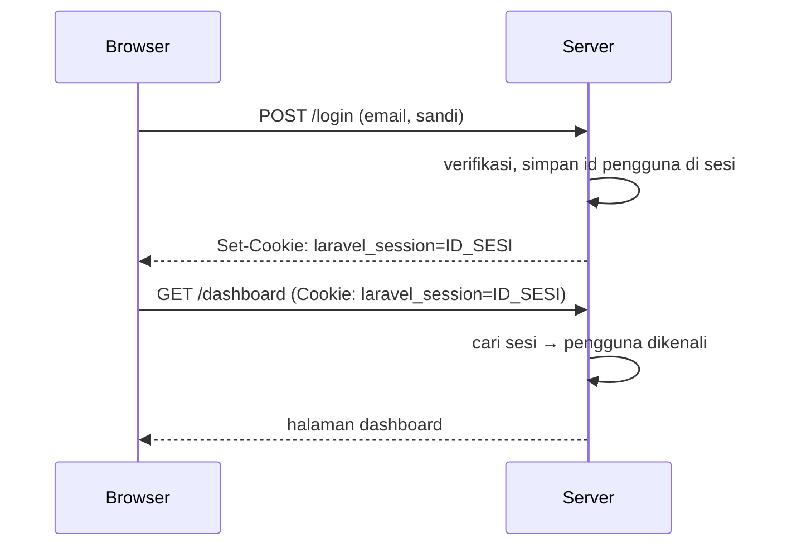

# Pengantar Autentikasi

Sampai sekarang siapa pun bisa membuka `/admin/artikel` dan mengubah data. Aplikasi nyata perlu tahu **siapa** yang mengakses dan membatasi **apa** yang boleh dilakukan. Dua pertanyaan itu
disebut **autentikasi** dan **otorisasi**. Sub bab ini memperkenalkan konsep autentikasi, bagaimana web "mengingat" pengguna lewat sesi dan cookie, dan peta komponen autentikasi Laravel sebelum
kita membangunnya langkah demi langkah.

## Tujuan Pembelajaran

Setelah menyelesaikan sub bab ini, kamu dapat:

- [ ] Membedakan autentikasi (siapa kamu) dan otorisasi (apa yang boleh kamu lakukan).
- [ ] Menjelaskan bagaimana sesi dan cookie membuat HTTP yang *stateless* terasa "ingat pengguna".
- [ ] Menyebutkan faktor autentikasi dan risiko umum (kredensial lemah, pencurian sesi, *brute force*).
- [ ] Menyebutkan komponen autentikasi Laravel: guard, provider, model `User`, sesi.
- [ ] Menjelaskan pilihan membangun autentikasi manual atau memakai starter kit resmi.
- [ ] Memeriksa tabel dan konfigurasi autentikasi bawaan di proyek.

## Prasyarat

- [HTTP dan HTTPS](../level-00/00-03-http-https-fundamentals.md) (cookie, header) dan [Request dan Response](../level-00/00-04-request-and-response.md).
- Bab Database: model `User`, migration `users`, dan factory.
- [Pengantar Validasi Form](05-01-introduction-to-form-validation.md).

## Pengantar

HTTP bersifat *stateless*: setiap request berdiri sendiri, server tidak otomatis ingat request sebelumnya. Supaya pengguna tidak harus mengetik kata sandi di setiap halaman, aplikasi
memberi browser sebuah "tiket" (ID sesi dalam cookie) setelah login, dan memeriksa tiket itu di setiap request berikutnya.

## Penjelasan Konsep

### Autentikasi dan otorisasi

| Istilah | Pertanyaan | Contoh |
|---|---|---|
| **Autentikasi** (*authentication*) | Siapa kamu? | Login dengan email dan kata sandi |
| **Otorisasi** (*authorization*) | Apa yang boleh kamu lakukan? | Hanya penulis artikel yang boleh mengubahnya |

Urutannya: autentikasi dahulu, otorisasi sesudahnya. Pengguna yang belum dikenali tidak bisa diperiksa haknya.

### Faktor autentikasi

| Faktor | Contoh |
|---|---|
| Sesuatu yang kamu **tahu** | Kata sandi, PIN |
| Sesuatu yang kamu **miliki** | Kode OTP di ponsel, kunci keamanan |
| Sesuatu yang kamu **adalah** | Sidik jari, wajah |

Menggabungkan dua faktor (*multi-factor authentication*) jauh lebih aman daripada kata sandi saja.

### Sesi dan cookie



Cookie sesi hanya berisi ID acak; data pengguna disimpan di server (di proyek baru: tabel `sessions`, `SESSION_DRIVER=database`). Siapa pun yang memegang ID sesi valid dapat "menjadi" pengguna
itu, sehingga cookie harus dilindungi (HTTPS, `HttpOnly`, `SameSite`).

### Komponen autentikasi Laravel

| Komponen | Peran |
|---|---|
| **Guard** | Cara mengautentikasi tiap request (mis. `web` memakai sesi) |
| **Provider** | Cara mengambil pengguna dari penyimpanan (mis. model Eloquent `User`) |
| Model `User` | Mewakili akun; mengimplementasikan `Authenticatable` |
| Sesi | Menyimpan identitas pengguna antar-request |
| Middleware `auth` / `guest` | Membatasi route untuk pengguna masuk / tamu |
| `Auth` facade | API: `attempt`, `login`, `logout`, `user`, `check`, `id` |
| Password broker | Alur reset kata sandi |
| `MustVerifyEmail` | Mewajibkan verifikasi email |

Konfigurasi ada di `config/auth.php`. Pada proyek baru, guard `web` memakai provider `users` yang memakai model `App\Models\User`.

### Manual atau starter kit?

Laravel menyediakan *starter kit* resmi yang membuat halaman login, registrasi, reset kata sandi, dan lainnya lengkap dengan frontend. Materi ini **membangun autentikasi secara manual** dengan komponen
inti framework (tanpa menambah dependensi) agar kamu paham setiap bagian. Di proyek nyata, memakai starter kit resmi atau paket yang teruji sering lebih bijak daripada menulis semuanya sendiri; dengan
pemahaman dari bab ini kamu dapat menilai dan menyesuaikannya.

### Risiko yang akan kita tangani

| Risiko | Penanganan | Sub bab |
|---|---|---|
| Kata sandi lemah/disimpan polos | Hashing dan aturan kata sandi | 05.11, 05.12 |
| Pencurian/fiksasi sesi | `session()->regenerate()`, logout benar | 05.10 |
| *Brute force* | Rate limiting | 05.24 |
| Akun palsu | Verifikasi email | 05.14 |
| Akses tanpa login | Middleware `auth` | 05.15 |
| Enumerasi akun | Pesan galat umum | 05.04, 05.10, 05.13 |

### Keamanan

- Jangan membuat skema autentikasi sendiri tanpa memahami risikonya (misalnya menyimpan kata sandi dengan enkripsi dua arah atau hash cepat seperti MD5).
- Semua halaman login dan akun harus melalui HTTPS di produksi.
- Jangan pernah mencatat kata sandi mentah ke log.

## Cara Kerja

Pada tiap request, middleware sesi membaca cookie, memuat sesi, dan guard `web` menanyakan ke sesi: "ID pengguna siapa yang tersimpan?" Lalu provider memuat model `User`-nya. Hasilnya tersedia sebagai
`Auth::user()` atau `$request->user()`.

## Contoh Praktik

Kamu memeriksa model `User`, tabel `users`, `sessions`, dan `password_reset_tokens`, serta konfigurasi `config/auth.php` di proyek `cms-artikel` untuk memetakan komponen di atas ke berkas nyata.

## Penjelasan Kode

Tidak ada kode aplikasi baru. Bagian penting `config/auth.php` (isi persis dapat berbeda antar versi):

```php
'defaults' => ['guard' => 'web', 'passwords' => 'users'],

'guards' => [
    'web' => ['driver' => 'session', 'provider' => 'users'],
],

'providers' => [
    'users' => ['driver' => 'eloquent', 'model' => App\Models\User::class],
],

'passwords' => [
    'users' => ['provider' => 'users', 'table' => 'password_reset_tokens', 'expire' => 60, 'throttle' => 60],
],
```

| Kunci | Arti |
|---|---|
| `guards.web` | Guard berbasis sesi |
| `providers.users` | Mengambil pengguna lewat Eloquent dari model `User` |
| `passwords.users.expire` | Token reset berlaku 60 menit |
| `passwords.users.throttle` | Jeda 60 detik antar permintaan reset |

## Implementasi Langkah demi Langkah

### Langkah 1: lihat konfigurasi

```bash
cd ~/belajar-laravel/cms-artikel
cat config/auth.php
```

### Langkah 2: lihat tabel

```bash
php artisan db:table users
php artisan db:table sessions
php artisan db:table password_reset_tokens
```

### Langkah 3: lihat model `User`

```bash
cat app/Models/User.php
```

Temukan: `extends Authenticatable`, `#[Fillable]`, `#[Hidden]`, dan cast `'password' => 'hashed'`.

### Langkah 4: lihat pengaturan sesi

```bash
grep -n "SESSION_" .env
```

### Langkah 5: siapkan akun uji

```bash
php artisan tinker --execute="App\Models\User::factory()->create(['name' => 'Admin Uji', 'email' => 'admin@contoh.test']);"
```

Kata sandi factory adalah `password` (hanya untuk pengembangan lokal).

## Eksekusi dan Verifikasi

| Langkah | Cara memverifikasi |
|---|---|
| 2 | Ketiga tabel ada dengan kolom yang diharapkan |
| 3 | Model memakai cast `hashed` untuk `password` |
| 5 | `User::where('email', 'admin@contoh.test')->exists()` bernilai `true` |

## Hasil yang Diharapkan

| Perintah | Hasil |
|---|---|
| `db:table sessions` | Kolom `id`, `user_id`, `ip_address`, `user_agent`, `payload`, `last_activity` |
| `db:table password_reset_tokens` | Kolom `email`, `token`, `created_at` |
| Isi `config/auth.php` | Guard `web` (session) dan provider `users` (eloquent) |

Hasil ini diturunkan dari kerangka dan dokumentasi dan belum dijalankan oleh penulis materi; cocokkan dengan hasilmu.

## Kesalahan Umum dan Pemecahan Masalah

| Gejala | Penyebab | Cara mengenali | Solusi | Pencegahan |
|---|---|---|---|---|
| Tabel `sessions` tidak ada | Migrasi dasar belum dijalankan | Galat sesi | `php artisan migrate` | Jalankan migrasi |
| Kolom `password` tersimpan polos | Cast `hashed` hilang dan hash manual terlupa | Nilai tak berawalan `$2y$` | Pertahankan cast; hash dengan `Hash::make` | Jangan hapus cast |
| Selalu logout setelah pindah halaman | Cookie sesi tidak tersimpan (domain/port berubah) | Cookie tidak ada | Samakan domain/port; periksa `SESSION_DOMAIN` | Konsistenkan host lokal |
| Login berhasil tapi hilang di server beda | Sesi di berkas/`array` | Tak persisten | Pakai `database`/`redis` | Konfigurasi driver sesi |

## Latihan Praktik

### Latihan dasar

**D1. Autentikasi atau otorisasi**
- *Masalah:* bedakan kedua istilah.
- *Persyaratan:* klasifikasikan: (a) memasukkan sandi, (b) hanya admin boleh menghapus komentar, (c) memverifikasi token API, (d) memeriksa apakah pengguna pemilik artikel.
- *Perilaku yang diharapkan:* (a), (c) autentikasi; (b), (d) otorisasi.
- *Tujuan belajar:* membedakan konsep.

### Latihan implementasi

**I1. Peta komponen**
- *Masalah:* ingin memahami proyek.
- *Persyaratan:* gambar diagram yang memetakan satu request `GET /dashboard` ke cookie, sesi, guard, provider, dan model `User` di proyekmu.
- *Perilaku yang diharapkan:* diagram sesuai alur.
- *Tujuan belajar:* memahami aliran autentikasi.

### Latihan tantangan

**T1. Ancaman sesi**
- *Masalah:* tim menilai keamanan sesi.
- *Persyaratan:* daftar tiga serangan terhadap sesi (pencurian cookie, fiksasi sesi, CSRF), dampak, dan pertahanan tiap serangan dalam konteks Laravel.
- *Perilaku yang diharapkan:* tabel ancaman-pertahanan benar.
- *Tujuan belajar:* menilai keamanan.
- *Catatan:* kerjakan mandiri; tidak ada kunci jawaban.

## Uji Pemahaman

1. Apa beda autentikasi dan otorisasi?
2. Mengapa HTTP perlu sesi untuk "mengingat" pengguna?
3. Apa isi cookie sesi Laravel?
4. Apa peran guard dan provider?
5. Mengapa kata sandi tidak disimpan dengan enkripsi dua arah?
6. Mengapa MFA lebih aman?

??? success "Kunci jawaban singkat"
    1. Autentikasi membuktikan identitas; otorisasi menentukan hak.
    2. HTTP stateless; sesi menyimpan identitas antar-request.
    3. Hanya ID sesi acak; datanya disimpan di server.
    4. Guard menentukan cara autentikasi per request; provider mengambil pengguna dari penyimpanan.
    5. Enkripsi dapat dibalik; hash satu arah tidak.
    6. Satu faktor yang bocor tidak cukup untuk masuk.

## Ringkasan

- Autentikasi membuktikan identitas; otorisasi menentukan hak.
- Sesi dan cookie menjembatani HTTP yang stateless; lindungi cookie.
- Komponen: guard, provider, model `User`, sesi, middleware, dan `Auth`.
- Materi membangun autentikasi manual; di produksi pertimbangkan starter kit resmi.

Selanjutnya: *Autentikasi Laravel*, memakai fasad `Auth` dan memeriksa status pengguna.

## Referensi Resmi

- [Laravel: Authentication](https://laravel.com/docs/13.x/authentication)
- [Laravel: Starter Kits](https://laravel.com/docs/13.x/starter-kits)
- [OWASP: Authentication Cheat Sheet](https://cheatsheetseries.owasp.org/cheatsheets/Authentication_Cheat_Sheet.html)
