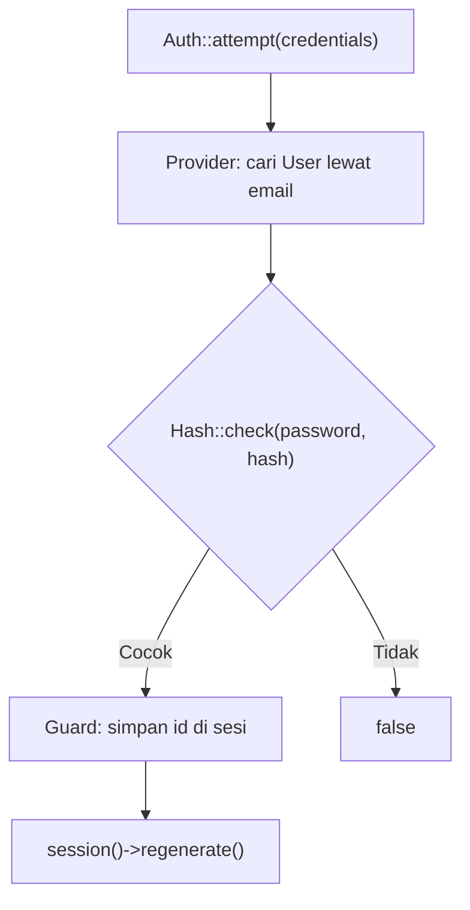

# Autentikasi Laravel

Laravel menyediakan API autentikasi yang ringkas lewat fasad `Auth`: memeriksa siapa yang sedang masuk, mencoba login, memasukkan pengguna secara programatik, dan mengeluarkannya. Sub bab ini
mengajarkan API itu, cara mengakses pengguna di route, controller, dan Blade, serta fitur "ingat saya". Login dan logout lengkap dengan form dibuat pada sub bab berikutnya.

## Tujuan Pembelajaran

Setelah menyelesaikan sub bab ini, kamu dapat:

- [ ] Mengakses pengguna terautentikasi lewat `Auth::user()`, `auth()->user()`, dan `$request->user()`.
- [ ] Memeriksa status dengan `Auth::check()`, `Auth::guest()`, dan `Auth::id()`.
- [ ] Menjelaskan `Auth::attempt`, `Auth::login`, `Auth::loginUsingId`, dan `Auth::logout`.
- [ ] Menjelaskan fitur "remember me" dan cookie ingat-saya.
- [ ] Memakai `@auth` dan `@guest` di Blade.
- [ ] Menjelaskan mengapa sesi harus diregenerasi setelah login.

## Prasyarat

- [Pengantar Autentikasi](05-08-introduction-to-authentication.md).
- Akun uji `admin@contoh.test` (kata sandi `password`).
- [Middleware Route](../level-02/02-08-route-middleware.md).

## Pengantar

Kamu akan memakai API ini di hampir setiap fitur: "tampilkan nama pengguna", "hanya untuk yang sudah masuk", "simpan artikel atas nama pengguna ini". Memahaminya sekali, memakainya di mana-mana.

## Penjelasan Konsep

### Mengakses pengguna

| Cara | Di mana | Keterangan |
|---|---|---|
| `$request->user()` | Controller / closure dengan `Request` | Disarankan |
| `Auth::user()` | Di mana saja | Fasad |
| `auth()->user()` | Di mana saja | Helper |
| `Auth::id()` | Di mana saja | `id` pengguna atau `null` |
| `Auth::check()` | Di mana saja | `true` bila sudah masuk |
| `Auth::guest()` | Di mana saja | `true` bila tamu |

```php-inline
use Illuminate\Support\Facades\Auth;
use Illuminate\Http\Request;

Route::get('/saya', function (Request $request) {
    $user = $request->user();                     // null jika tamu
    return $user ? 'Halo '.$user->name : 'Tamu';
});
```

Di Blade: `{{ auth()->user()->name }}`, `@auth ... @endauth`, `@guest ... @endguest`.

### Mencoba login: `Auth::attempt`

```php-inline
if (Auth::attempt(['email' => $email, 'password' => $password])) {
    $request->session()->regenerate();   // wajib: mencegah fiksasi sesi
    // sukses
}
```

`attempt` mencari pengguna berdasarkan kunci selain `password`, lalu membandingkan kata sandi dengan hash. Argumen kedua `true` mengaktifkan "ingat saya". Kondisi tambahan dapat ditambahkan
pada array, misalnya `['active' => 1]`. Menurut dokumentasi, setelah login berhasil kamu harus meregenerasi sesi untuk mencegah *session fixation*.

### Memasukkan pengguna secara langsung

| Method | Fungsi | Kapan |
|---|---|---|
| `Auth::login($user)` | Memasukkan instance `User` | Setelah registrasi |
| `Auth::login($user, remember: true)` | Dengan ingat-saya | |
| `Auth::loginUsingId(1)` | Memasukkan berdasarkan kunci utama | Pengujian/impersonasi terkendali |
| `Auth::once($credentials)` | Autentikasi satu request, tanpa sesi | Skenario khusus |

### Mengeluarkan pengguna

```php-inline
Auth::logout();
$request->session()->invalidate();       // hapus data sesi
$request->session()->regenerateToken();  // token CSRF baru
```

Dokumentasi menyarankan ketiganya setelah logout.

### Ingat saya (*remember me*)

Dengan `Auth::attempt($credentials, $remember)`, Laravel membuat cookie berumur panjang yang berisi token ingat-saya sehingga pengguna tetap masuk walau sesi berakhir. Kolom `remember_token` di
tabel `users` menyimpannya. `Auth::viaRemember()` memberi tahu apakah pengguna masuk lewat cookie itu. Aksi sensitif (ganti sandi) sebaiknya meminta kata sandi lagi.

### Mengonfigurasi guard

Guard bawaan adalah `web`. Bila memakai lebih dari satu (mis. `admin`), pilih dengan `Auth::guard('admin')->...`. Proyek ini cukup dengan satu guard.

### Pengguna dan cache request

`Auth::user()` memuat pengguna sekali per request lalu menyimpannya; pemanggilan berikutnya tidak menjalankan query lagi.

### Keamanan

- Selalu `session()->regenerate()` setelah login dan `invalidate()` + `regenerateToken()` setelah logout.
- Jangan menyimpan data sensitif di `Auth::user()` yang ikut ter-serialisasi ke JSON; gunakan `#[Hidden]`.
- `loginUsingId` adalah alat kuat; jangan sampai terekspos ke route publik.

## Cara Kerja



## Contoh Praktik

Kamu membuat dua route sementara untuk mengamati perilaku guard: satu memasukkan pengguna (`loginUsingId`), satu menampilkan status. Lalu kamu menguji `@auth/@guest` di layout. Route sementara dihapus setelah selesai.

## Penjelasan Kode

File: `routes/web.php` (sementara; hapus setelah latihan)

```php-inline
use Illuminate\Support\Facades\Auth;

Route::get('/uji-auth/masuk', function (Request $request) {
    $user = \App\Models\User::where('email', 'admin@contoh.test')->firstOrFail();
    Auth::login($user);
    $request->session()->regenerate();
    return 'Masuk sebagai '.Auth::user()->name;
});

Route::get('/uji-auth/status', function (Request $request) {
    return [
        'check' => Auth::check(),
        'id' => Auth::id(),
        'nama' => $request->user()?->name,
        'via_remember' => Auth::viaRemember(),
    ];
});

Route::get('/uji-auth/keluar', function (Request $request) {
    Auth::logout();
    $request->session()->invalidate();
    $request->session()->regenerateToken();
    return 'Keluar';
});
```

| Route | Fungsi |
|---|---|
| `/uji-auth/masuk` | Memasukkan akun uji dan meregenerasi sesi |
| `/uji-auth/status` | Mengembalikan JSON status autentikasi |
| `/uji-auth/keluar` | Mengeluarkan pengguna dengan langkah lengkap |

Peringatan: route `GET` yang mengubah status login hanya untuk latihan lokal. Jangan membuat logout atau login lewat `GET` di aplikasi nyata (lihat sub bab CSRF).

## Implementasi Langkah demi Langkah

### Langkah 1: tambah route sementara

Tambahkan tiga route di atas.

### Langkah 2: amati status sebagai tamu

Buka `/uji-auth/status` di browser: `check: false`, `id: null`.

### Langkah 3: masuk lalu cek

Buka `/uji-auth/masuk`, lalu `/uji-auth/status`: `check: true`, `id`, dan nama terisi. Lihat cookie sesi di alat pengembang dan perhatikan nilainya berubah setelah login (hasil `regenerate`).

### Langkah 4: keluar lalu cek

Buka `/uji-auth/keluar`, lalu `/uji-auth/status`: kembali ke tamu.

### Langkah 5: uji `@auth` / `@guest`

Tambahkan ke `components/layout.blade.php` pada `<nav>`:

```html
@auth
    <span>Halo, {{ auth()->user()->name }}</span>
@endauth
@guest
    <span>Anda tamu</span>
@endguest
```

Muat halaman `/artikel` saat masuk dan saat keluar.

### Langkah 6: hapus route sementara

Hapus ketiga route (simpan blok `@auth/@guest` bila diinginkan, akan dipakai pada sub bab berikutnya).

## Eksekusi dan Verifikasi

| Langkah | Cara memverifikasi |
|---|---|
| 2 | JSON `check: false` |
| 3 | JSON `check: true` dan nama `Admin Uji`; cookie sesi berganti nilai |
| 4 | Kembali `check: false` |
| 5 | Teks sesuai status |

## Hasil yang Diharapkan

| Kondisi | `/uji-auth/status` |
|---|---|
| Tamu | `{"check":false,"id":null,"nama":null,"via_remember":false}` |
| Masuk | `{"check":true,"id":1,"nama":"Admin Uji","via_remember":false}` (id bergantung data) |

Hasil ini diturunkan dari dokumentasi dan belum dijalankan oleh penulis materi; cocokkan dengan hasilmu.

## Kesalahan Umum dan Pemecahan Masalah

| Gejala | Penyebab | Cara mengenali | Solusi | Pencegahan |
|---|---|---|---|---|
| `Auth::user()` selalu `null` | Route tidak memakai grup `web` (tanpa sesi) | Sesi tak terbaca | Letakkan di `routes/web.php` | Pahami middleware `web` |
| `Attempt to read property "name" on null` | Mengakses `auth()->user()->name` sebagai tamu | Galat null | Cek `@auth` / `?->` | Selalu tangani tamu |
| Login hilang di request berikutnya | Cookie tidak tersimpan / driver sesi salah | Selalu tamu | Periksa cookie dan `SESSION_DRIVER` | Uji sesi |
| Sesi tidak diregenerasi | Lupa `regenerate()` | ID sesi sama sebelum/sesudah | Tambahkan | Pola login baku |
| `auth()->id()` salah di API | Guard berbeda | Nilai `null` | Gunakan `Auth::guard(...)` | Pahami guard |
| Logout via `GET` terpicu prefetch | Memakai `GET` untuk logout | Pengguna terlempar sendiri | Gunakan `POST` + CSRF | Jangan ubah status lewat `GET` |

## Latihan Praktik

### Latihan dasar

**D1. Cara mengakses pengguna**
- *Masalah:* ingin memahami pilihan.
- *Persyaratan:* tulis tiga cara mengambil nama pengguna di sebuah route dan satu keunggulan `$request->user()`.
- *Perilaku yang diharapkan:* tiga cara tertulis benar.
- *Tujuan belajar:* mengenal API.

### Latihan implementasi

**I1. Salam di layout**
- *Masalah:* nav perlu menyapa pengguna.
- *Persyaratan:* tampilkan "Halo, {nama}" dan inisial pengguna di nav hanya untuk yang masuk, dan "Masuk" untuk tamu (tautan belum berfungsi).
- *Perilaku yang diharapkan:* tampilan sesuai status.
- *Tujuan belajar:* memakai `@auth/@guest`.

**I2. Amati regenerasi**
- *Masalah:* ingin bukti regenerasi sesi.
- *Persyaratan:* catat nilai cookie sesi sebelum dan sesudah `/uji-auth/masuk` dan jelaskan mengapa berbeda.
- *Perilaku yang diharapkan:* nilai berubah.
- *Tujuan belajar:* memahami pencegahan fiksasi.

### Latihan tantangan

**T1. Tamu atau masuk**
- *Masalah:* sebuah halaman publik memberi konten tambahan bagi anggota.
- *Persyaratan:* rancang halaman yang menampilkan teaser untuk tamu dan konten penuh untuk yang masuk, tanpa memuat data penuh untuk tamu (hindari kebocoran lewat HTML tersembunyi).
- *Perilaku yang diharapkan:* konten penuh tidak ada di HTML tamu.
- *Tujuan belajar:* mengontrol data sesuai status.
- *Catatan:* kerjakan mandiri; tidak ada kunci jawaban.

## Uji Pemahaman

1. Sebutkan tiga cara mengambil pengguna terautentikasi.
2. Apa yang dilakukan `Auth::attempt`?
3. Mengapa sesi diregenerasi setelah login?
4. Langkah apa saja untuk logout yang benar?
5. Apa fungsi `remember_token`?
6. Mengapa logout tidak boleh lewat `GET`?

??? success "Kunci jawaban singkat"
    1. `$request->user()`, `Auth::user()`, `auth()->user()`.
    2. Mencari pengguna dan membandingkan hash kata sandi; bila cocok, memasukkan pengguna ke sesi.
    3. Mencegah serangan fiksasi sesi.
    4. `Auth::logout()`, `session()->invalidate()`, `session()->regenerateToken()`.
    5. Menyimpan token cookie ingat-saya.
    6. `GET` dapat terpicu tanpa sengaja (prefetch, tautan), dan tidak terlindungi CSRF.

## Ringkasan

- Ambil pengguna dengan `$request->user()`/`Auth::user()`; periksa status dengan `check/guest/id`.
- `attempt` memverifikasi kredensial; `login` memasukkan pengguna; selalu regenerasi sesi setelah login.
- Logout lengkap = `logout` + `invalidate` + `regenerateToken`.
- `@auth/@guest` mengatur tampilan; ingat-saya memakai cookie dan `remember_token`.

Selanjutnya: *Login dan Logout*, membangun form dan controller lengkap.

## Referensi Resmi

- [Laravel: Authentication](https://laravel.com/docs/13.x/authentication)
- [Laravel: Manually Authenticating Users](https://laravel.com/docs/13.x/authentication#authenticating-users)
- [Laravel: Remembering Users](https://laravel.com/docs/13.x/authentication#remembering-users)
- [Laravel: Logging Out](https://laravel.com/docs/13.x/authentication#logging-out)
