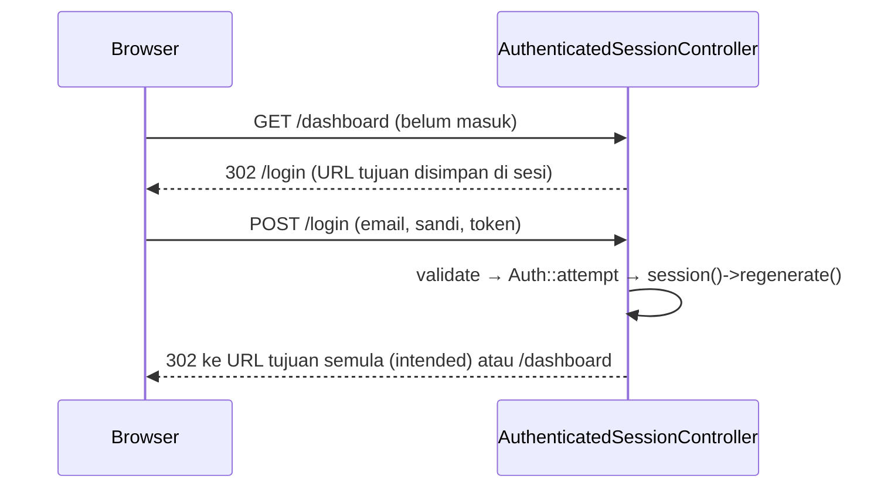

# Login dan Logout

Sekarang kamu menyatukan pengetahuan sebelumnya menjadi fitur utuh: form login, controller yang memverifikasi kredensial, pengalihan ke halaman yang dituju semula, dan logout yang aman.
Perhatian khusus diberikan pada detail keamanan kecil yang sering terlewat: pesan galat umum, regenerasi sesi, dan logout lewat `POST`.

## Tujuan Pembelajaran

Setelah menyelesaikan sub bab ini, kamu dapat:

- [ ] Membuat controller login dan logout (`AuthenticatedSessionController`).
- [ ] Membuat form login dengan `@csrf`, `old('email')`, dan "ingat saya".
- [ ] Memakai `redirect()->intended()` untuk kembali ke halaman tujuan semula.
- [ ] Menampilkan pesan galat umum yang tidak membocorkan keberadaan akun.
- [ ] Mengimplementasikan logout `POST` yang lengkap.
- [ ] Mengatur nav dengan `@auth/@guest` dan route `dashboard` terlindungi.

## Prasyarat

- [Autentikasi Laravel](05-09-laravel-authentication.md).
- [Validasi Form Request](05-05-form-request-validation.md).
- Akun uji `admin@contoh.test` (kata sandi `password`) dan layout dari bab Database.

## Pengantar

Form login adalah target utama penyerang: tebak kata sandi, selidiki akun mana yang ada, atau curi sesi. Beberapa kebiasaan kecil di controller menutup sebagian besar celah itu.

## Penjelasan Konsep

### Alur login



### Controller

File: `app/Http/Controllers/Auth/AuthenticatedSessionController.php`

```php
<?php

namespace App\Http\Controllers\Auth;

use App\Http\Controllers\Controller;
use Illuminate\Http\RedirectResponse;
use Illuminate\Http\Request;
use Illuminate\Support\Facades\Auth;
use Illuminate\View\View;

class AuthenticatedSessionController extends Controller
{
    public function create(): View
    {
        return view('auth.login');
    }

    public function store(Request $request): RedirectResponse
    {
        $credentials = $request->validate([
            'email' => ['required', 'email'],
            'password' => ['required', 'string'],
        ]);

        if (! Auth::attempt($credentials, $request->boolean('remember'))) {
            return back()
                ->withErrors(['email' => 'Email atau kata sandi salah.'])
                ->onlyInput('email');
        }

        $request->session()->regenerate();

        return redirect()->intended(route('dashboard'));
    }

    public function destroy(Request $request): RedirectResponse
    {
        Auth::logout();

        $request->session()->invalidate();
        $request->session()->regenerateToken();

        return redirect()->route('login');
    }
}
```

| Bagian | Fungsi |
|---|---|
| `validate([...])` | Memastikan email dan sandi ada dan berformat benar |
| `Auth::attempt($credentials, $remember)` | Memverifikasi dan masuk; argumen kedua dari kotak centang |
| Pesan `Email atau kata sandi salah.` | Sama untuk email tak terdaftar dan sandi salah (cegah enumerasi) |
| `onlyInput('email')` | Mengembalikan hanya email (bukan sandi) ke form |
| `session()->regenerate()` | Cegah fiksasi sesi |
| `redirect()->intended(...)` | Ke URL tujuan semula bila ada; bila tidak, ke `dashboard` |
| `destroy` | Logout lengkap |

### Route

File: `routes/web.php`

```php-inline
use App\Http\Controllers\Auth\AuthenticatedSessionController;

Route::middleware('guest')->group(function () {
    Route::get('/login', [AuthenticatedSessionController::class, 'create'])->name('login');
    Route::post('/login', [AuthenticatedSessionController::class, 'store'])->name('login.store');
});

Route::middleware('auth')->group(function () {
    Route::post('/logout', [AuthenticatedSessionController::class, 'destroy'])->name('logout');
    Route::get('/dashboard', fn () => view('dashboard'))->name('dashboard');
});
```

Route bernama `login` penting: middleware `auth` mengalihkan tamu ke route bernama `login`, dan middleware `guest` mengalihkan pengguna yang sudah masuk ke `dashboard`. Keduanya dapat diubah
lewat `redirectGuestsTo` dan `redirectUsersTo` di `bootstrap/app.php` (sub bab 05.15).

### View login

File: `resources/views/auth/login.blade.php`

```html
<x-layout title="Masuk">
    <h1 class="text-xl font-bold mb-3">Masuk</h1>

    <form method="POST" action="{{ route('login.store') }}" class="bg-white border rounded p-4 max-w-md">
        @csrf
        <p class="mb-2">
            <label for="email">Email</label><br>
            <input id="email" name="email" type="email" value="{{ old('email') }}" autocomplete="username" class="border rounded p-2 w-full">
            @error('email') <small class="text-red-600">{{ $message }}</small> @enderror
        </p>
        <p class="mb-2">
            <label for="password">Kata sandi</label><br>
            <input id="password" name="password" type="password" autocomplete="current-password" class="border rounded p-2 w-full">
        </p>
        <p class="mb-3">
            <label><input type="checkbox" name="remember" value="1"> Ingat saya</label>
        </p>
        <button class="bg-blue-600 text-white rounded px-4 py-2">Masuk</button>
    </form>
</x-layout>
```

Atribut `autocomplete` membantu pengelola kata sandi. Kolom sandi tidak memakai `old()`.

### Dashboard dan nav

File: `resources/views/dashboard.blade.php`

```html
<x-layout title="Dashboard">
    <h1 class="text-xl font-bold mb-3">Dashboard</h1>
    <p>Selamat datang, {{ auth()->user()->name }}.</p>
</x-layout>
```

Di `components/layout.blade.php` ganti blok sapaan sub bab sebelumnya dengan:

```html
@auth
    <a href="{{ route('dashboard') }}">Dashboard</a>
    <form method="POST" action="{{ route('logout') }}" class="inline">
        @csrf
        <button class="underline">Keluar ({{ auth()->user()->name }})</button>
    </form>
@endauth
@guest
    <a href="{{ route('login') }}">Masuk</a>
@endguest
```

### Keamanan

- Pesan galat umum agar tidak membocorkan akun terdaftar.
- Jangan pernah mengembalikan kata sandi ke form (`onlyInput('email')`).
- Logout `POST` dengan token CSRF; jangan lewat `GET`.
- Batasi percobaan login (rate limiting, sub bab 05.24); tanpa itu *brute force* leluasa.
- `redirect()->intended()` hanya menerima URL internal yang disimpan Laravel; jangan membuat pengalihan dari parameter `?redirect=` yang dikirim pengguna (celah *open redirect*).

## Cara Kerja

Middleware `auth` menyimpan URL yang diminta ke sesi sebelum mengalihkan ke `/login`. Setelah `attempt` sukses, `intended()` membaca URL itu dan mengalihkan, atau memakai nilai bawaan bila tidak ada.

## Contoh Praktik

Kamu membuat login dan logout lengkap, menguji kredensial benar dan salah, pengalihan tujuan semula, "ingat saya", dan memastikan logout hanya lewat `POST`.

## Penjelasan Kode

Seluruh kode ada pada bagian konsep. Tambahkan juga `Route::get('/dashboard')` bila belum ada dan pastikan tautan `Masuk` dan tombol `Keluar` tampil di layout.

## Implementasi Langkah demi Langkah

### Langkah 1: buat controller dan view

```bash
cd ~/belajar-laravel/cms-artikel
php artisan make:controller Auth/AuthenticatedSessionController
```

Isi controller; buat `auth/login.blade.php` dan `dashboard.blade.php`.

### Langkah 2: tambah route dan perbarui layout

Tambahkan route (hapus `route:list` duplikat bila ada) dan blok `@auth/@guest` di nav.

```bash
php artisan route:list --name=login
php artisan route:list --name=logout
```

### Langkah 3: uji login gagal

Buka `/login`, masukkan email yang tidak terdaftar, lalu email benar dengan sandi salah. Pastikan pesan sama dan email terisi ulang tetapi sandi tidak.

### Langkah 4: uji login sukses dan tujuan semula

Sebagai tamu buka `/dashboard`: kamu dialihkan ke `/login`. Masuk dengan `admin@contoh.test` / `password`: kamu kembali ke `/dashboard`.

### Langkah 5: uji ingat saya

Masuk dengan kotak "Ingat saya" dicentang, periksa cookie berumur panjang (`remember_web_...`) di alat pengembang.

### Langkah 6: uji logout

Klik **Keluar**, lalu buka `/dashboard`: kembali ke `/login`. Coba juga `GET /logout`: harus `405`.

### Langkah 7: catat di Git

```bash
git add app resources routes
git commit -m "Tambah login dan logout"
```

## Eksekusi dan Verifikasi

| Langkah | Cara memverifikasi |
|---|---|
| 3 | Pesan sama untuk email tak ada dan sandi salah |
| 4 | Pengalihan ke `/login`, lalu kembali ke `/dashboard` |
| 5 | Cookie ingat-saya muncul |
| 6 | Setelah logout `/dashboard` mengalihkan ke login; `GET /logout` → 405 |

## Hasil yang Diharapkan

| Aksi | Hasil |
|---|---|
| Kredensial salah | Kembali ke form, galat `Email atau kata sandi salah.` |
| Kredensial benar | `302` ke tujuan semula atau `/dashboard` |
| `GET /logout` | `405 Method Not Allowed` |
| `POST /logout` tanpa token | `419` |

Hasil ini diturunkan dari dokumentasi dan belum dijalankan oleh penulis materi; cocokkan dengan hasilmu.

## Kesalahan Umum dan Pemecahan Masalah

| Gejala | Penyebab | Cara mengenali | Solusi | Pencegahan |
|---|---|---|---|---|
| `Route [login] not defined` | Route tidak diberi nama `login` | Galat saat tamu membuka halaman terlindungi | Tambah `->name('login')` | Nama route baku |
| Login tidak mengalihkan ke tujuan semula | Memakai `redirect('/dashboard')` | Selalu ke dashboard | `redirect()->intended()` | Pola baku |
| Selalu gagal walau benar | Kata sandi di database tidak ter-hash | Nilai bukan `$2y$` | Simpan dengan cast `hashed` atau `Hash::make` | Gunakan cast |
| `419` saat login | `@csrf` hilang/sesi baru | Halaman 419 | Tambah `@csrf`; muat ulang | Template form |
| Pengguna terlempar terus | Cookie sesi tidak persisten | Selalu tamu | Periksa domain/driver | Konsistenkan host |
| `GET /logout` berfungsi | Route logout `GET` | Logout tanpa form | Ganti `POST` | Jangan `GET` |
| Email tampil di URL | Form memakai `GET` | Parameter di alamat | Gunakan `POST` | Selalu `POST` |

## Latihan Praktik

### Latihan dasar

**D1. Pesan umum**
- *Masalah:* ingin memastikan pesan tidak membocorkan akun.
- *Persyaratan:* uji tiga kasus (email tak ada, sandi salah, email salah format) dan bandingkan pesannya.
- *Perilaku yang diharapkan:* dua kasus pertama identik.
- *Tujuan belajar:* mencegah enumerasi.

### Latihan implementasi

**I1. Halaman terlindungi lain**
- *Masalah:* ingin memastikan `intended` bekerja pada URL berparameter.
- *Persyaratan:* lindungi `/admin/artikel?sampah=1` dengan `auth`, buka sebagai tamu, login, dan pastikan kembali ke URL lengkap termasuk query.
- *Perilaku yang diharapkan:* kembali ke URL semula.
- *Tujuan belajar:* memahami `intended`.

**I2. Form Request login**
- *Masalah:* controller sebaiknya tipis.
- *Persyaratan:* pindahkan aturan ke `LoginRequest` dengan metode `authenticate()` yang menjalankan `Auth::attempt`, dan kembalikan galat bila gagal.
- *Perilaku yang diharapkan:* perilaku sama.
- *Tujuan belajar:* mengorganisasi autentikasi.

### Latihan tantangan

**T1. Audit login**
- *Masalah:* rekan menulis login dengan `GET`, pesan "email tidak terdaftar", dan tanpa regenerasi sesi.
- *Persyaratan:* tulis daftar masalah, serangan terkait, dan perbaikan.
- *Perilaku yang diharapkan:* daftar mencakup CSRF/log, enumerasi, dan fiksasi sesi.
- *Tujuan belajar:* menilai kode autentikasi.
- *Catatan:* kerjakan mandiri; tidak ada kunci jawaban.

## Uji Pemahaman

1. Mengapa `redirect()->intended()` dipakai?
2. Mengapa pesan login harus umum?
3. Apa langkah wajib setelah `Auth::attempt` sukses?
4. Apa langkah logout lengkap?
5. Mengapa route bernama `login` dibutuhkan?
6. Mengapa tidak mengembalikan kata sandi ke form?

??? success "Kunci jawaban singkat"
    1. Mengembalikan pengguna ke halaman yang semula dituju.
    2. Mencegah penyerang mengetahui akun mana yang terdaftar.
    3. `session()->regenerate()`.
    4. `Auth::logout()`, `invalidate()`, `regenerateToken()`.
    5. Middleware `auth` mengalihkan tamu ke route itu.
    6. Kata sandi tidak boleh muncul kembali di HTML.

## Ringkasan

- Login: validasi → `attempt` → `regenerate` → `intended`; logout: `logout` → `invalidate` → `regenerateToken`.
- Pesan galat umum dan `onlyInput('email')` mencegah kebocoran.
- Route `login` bernama dan `guest`/`auth` mengatur akses.
- Rate limiting dan HTTPS melengkapi keamanan login.

Selanjutnya: *Registrasi Pengguna*, membuat akun baru dengan aman.

## Referensi Resmi

- [Laravel: Authenticating Users](https://laravel.com/docs/13.x/authentication#authenticating-users)
- [Laravel: Redirecting Intended](https://laravel.com/docs/13.x/redirects)
- [Laravel: Logging Out](https://laravel.com/docs/13.x/authentication#logging-out)
- [OWASP: Session Management Cheat Sheet](https://cheatsheetseries.owasp.org/cheatsheets/Session_Management_Cheat_Sheet.html)
