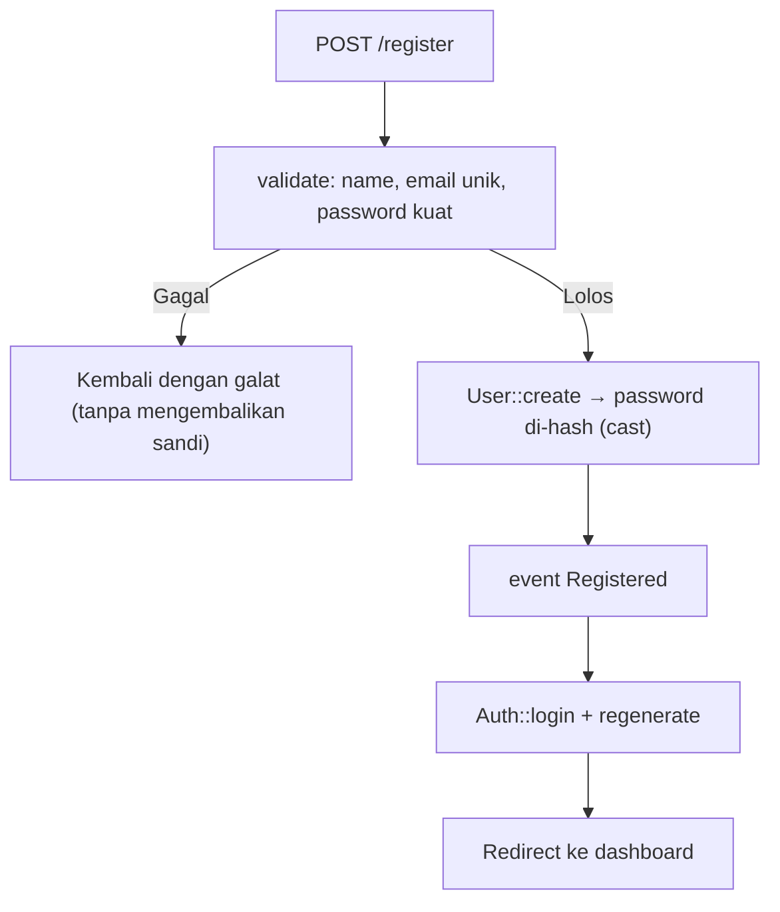

# Registrasi Pengguna

Registrasi adalah pintu masuk akun baru. Ia mempertemukan validasi (email unik, kata sandi kuat), penyimpanan aman (hash), dan keputusan desain (apakah langsung masuk, peran awal, verifikasi email).
Sub bab ini membangun halaman registrasi lengkap dan membahas bahaya klasik seperti *mass assignment* pada kolom peran.

## Tujuan Pembelajaran

Setelah menyelesaikan sub bab ini, kamu dapat:

- [ ] Membuat controller dan view registrasi.
- [ ] Memvalidasi nama, email unik, dan kata sandi terkonfirmasi dengan `Password::defaults()`.
- [ ] Menyimpan pengguna dengan kata sandi ter-hash lewat cast `hashed`.
- [ ] Memicu event `Registered` dan memasukkan pengguna dengan `Auth::login`.
- [ ] Menjelaskan mengapa kolom `role` tidak boleh diisi dari input registrasi.
- [ ] Menimbang pesan galat untuk email yang sudah terdaftar.

## Prasyarat

- [Login dan Logout](05-10-login-and-logout.md) dan [Aturan Validasi](05-03-validation-rules.md).
- Model `User` dengan `#[Fillable(['name', 'email', 'password'])]` dan cast `hashed`.
- [Mass assignment](../level-04/04-13-creating-models.md).

## Pengantar

Registrasi yang ceroboh melahirkan akun berisi data kacau, kata sandi lemah, atau yang lebih buruk: pengguna yang menyuntikkan `role=admin` lewat kolom tersembunyi. Setiap keputusan di sini
berdampak pada keamanan seluruh aplikasi.

## Penjelasan Konsep

### Aturan validasi registrasi

```php-inline
use Illuminate\Validation\Rules\Password;

$data = $request->validate([
    'name' => ['required', 'string', 'max:50'],
    'email' => ['required', 'email:rfc', 'max:100', 'unique:users,email'],
    'password' => ['required', 'confirmed', Password::defaults()],
]);
```

Atur kebijakan kata sandi sekali di `AppServiceProvider::boot()`:

```php-inline
use Illuminate\Validation\Rules\Password;

Password::defaults(fn () => Password::min(8)->letters()->numbers());
```

Tambahkan `->uncompromised()` bila koneksi internet tersedia di lingkungan produksi.

### Menyimpan pengguna

```php-inline
$user = User::create($data);
```

`$data` hanya berisi `name`, `email`, `password`. Model `User` bawaan memiliki `#[Fillable(['name','email','password'])]` dan cast `'password' => 'hashed'`, sehingga kata sandi otomatis di-hash saat
disimpan. Kolom `role` (ditambahkan pada 05.19) **tidak** masuk `Fillable`; ia diberi nilai bawaan di database atau diatur eksplisit oleh kode tepercaya.

### Event `Registered`

```php-inline
use Illuminate\Auth\Events\Registered;

event(new Registered($user));
```

Event ini memberi tahu bagian lain aplikasi (misalnya listener yang mengirim email verifikasi bila `User` mengimplementasikan `MustVerifyEmail`, sub bab 05.14).

### Controller

File: `app/Http/Controllers/Auth/RegisteredUserController.php`

```php
<?php

namespace App\Http\Controllers\Auth;

use App\Http\Controllers\Controller;
use App\Models\User;
use Illuminate\Auth\Events\Registered;
use Illuminate\Http\RedirectResponse;
use Illuminate\Http\Request;
use Illuminate\Support\Facades\Auth;
use Illuminate\Validation\Rules\Password;
use Illuminate\View\View;

class RegisteredUserController extends Controller
{
    public function create(): View
    {
        return view('auth.register');
    }

    public function store(Request $request): RedirectResponse
    {
        $data = $request->validate([
            'name' => ['required', 'string', 'max:50'],
            'email' => ['required', 'email:rfc', 'max:100', 'unique:users,email'],
            'password' => ['required', 'confirmed', Password::defaults()],
        ]);

        $user = User::create($data);

        event(new Registered($user));

        Auth::login($user);
        $request->session()->regenerate();

        return redirect()->route('dashboard');
    }
}
```

| Bagian | Fungsi |
|---|---|
| `Password::defaults()` | Kebijakan kata sandi terpusat |
| `User::create($data)` | Menyimpan; kata sandi di-hash oleh cast |
| `event(new Registered($user))` | Memicu efek samping (email verifikasi, dan sebagainya) |
| `Auth::login` + `regenerate` | Langsung masuk dengan sesi baru |

### Route dan view

```php-inline
use App\Http\Controllers\Auth\RegisteredUserController;

Route::middleware('guest')->group(function () {
    Route::get('/register', [RegisteredUserController::class, 'create'])->name('register');
    Route::post('/register', [RegisteredUserController::class, 'store'])->name('register.store');
});
```

File: `resources/views/auth/register.blade.php`

```html
<x-layout title="Daftar">
    <h1 class="text-xl font-bold mb-3">Daftar</h1>

    <form method="POST" action="{{ route('register.store') }}" class="bg-white border rounded p-4 max-w-md">
        @csrf
        <p class="mb-2"><label for="name">Nama</label><br>
            <input id="name" name="name" value="{{ old('name') }}" autocomplete="name" class="border rounded p-2 w-full">
            @error('name') <small class="text-red-600">{{ $message }}</small> @enderror</p>
        <p class="mb-2"><label for="email">Email</label><br>
            <input id="email" name="email" type="email" value="{{ old('email') }}" autocomplete="username" class="border rounded p-2 w-full">
            @error('email') <small class="text-red-600">{{ $message }}</small> @enderror</p>
        <p class="mb-2"><label for="password">Kata sandi</label><br>
            <input id="password" name="password" type="password" autocomplete="new-password" class="border rounded p-2 w-full">
            @error('password') <small class="text-red-600">{{ $message }}</small> @enderror</p>
        <p class="mb-3"><label for="password_confirmation">Ulangi kata sandi</label><br>
            <input id="password_confirmation" name="password_confirmation" type="password" autocomplete="new-password" class="border rounded p-2 w-full"></p>
        <button class="bg-blue-600 text-white rounded px-4 py-2">Daftar</button>
    </form>
</x-layout>
```

Tambahkan tautan `Daftar` pada blok `@guest` di nav layout.

### Pesan untuk email yang sudah terdaftar

Pesan "email sudah dipakai" membantu pengguna tetapi mengungkap bahwa email itu punya akun. Untuk aplikasi biasa ini kompromi yang lazim diterima; untuk aplikasi sensitif, alternatifnya
mengirim email "registrasi diterima" tanpa memberi tahu di halaman apakah akun sudah ada. Pilih sadar sesuai risiko.

### Keamanan

- Jangan mengisi `role`, `is_admin`, atau `email_verified_at` dari input pengguna; jaga `Fillable` tetap sempit.
- Terapkan rate limiting pada registrasi (sub bab 05.24) untuk mencegah pembuatan akun massal.
- Pertimbangkan verifikasi email (05.14) dan CAPTCHA bila perlu.
- Pastikan halaman registrasi hanya lewat HTTPS di produksi.

## Cara Kerja



## Contoh Praktik

Kamu membuat registrasi, mendaftar akun baru, memeriksa kata sandi tersimpan sebagai hash, menguji penolakan data buruk, dan membuktikan bahwa `role` yang dikirim lewat `curl` diabaikan.

## Penjelasan Kode

Seluruh kode ada pada bagian konsep. Perhatikan bahwa controller tidak pernah memanggil `Hash::make`: cast `hashed` pada model `User` melakukannya.

## Implementasi Langkah demi Langkah

### Langkah 1: buat controller dan view

```bash
cd ~/belajar-laravel/cms-artikel
php artisan make:controller Auth/RegisteredUserController
```

Isi controller; buat `auth/register.blade.php`; tambah route dan tautan nav.

### Langkah 2: atur kebijakan kata sandi

Tambahkan `Password::defaults(...)` ke `AppServiceProvider::boot()`.

### Langkah 3: daftar akun baru

Buka `/register`, isi data valid, dan pastikan kamu langsung di `/dashboard`.

### Langkah 4: periksa hash

```bash
php artisan tinker --execute="echo App\Models\User::latest('id')->first()->password;"
```

Nilai berawalan `$2y$` (bcrypt) dan bukan kata sandi asli.

### Langkah 5: uji penolakan

| Input | Harapan |
|---|---|
| Email sudah terdaftar | galat `unique` |
| Kata sandi `abc` | galat panjang/huruf/angka |
| Konfirmasi tidak cocok | galat `confirmed` |
| Nama kosong | galat `required` |

### Langkah 6: uji `role` palsu (setelah 05.19; sekarang cukup dipahami)

Kirim kolom tambahan lewat `curl` dan pastikan tidak masuk ke database karena tidak ada di `validated()`/`Fillable`:

```bash
TOKEN=$(curl -s -c cj.txt http://127.0.0.1:8000/register | grep -o 'name="_token" value="[^"]*"' | head -1 | sed 's/.*value="//;s/"//')
curl -s -o /dev/null -w "%{http_code}\n" -b cj.txt -c cj.txt -d "_token=$TOKEN&name=Uji&email=uji@contoh.test&password=Rahasia123&password_confirmation=Rahasia123&role=admin&is_admin=1" http://127.0.0.1:8000/register
rm cj.txt
```

### Langkah 7: catat di Git

```bash
git add app resources routes
git commit -m "Tambah registrasi pengguna"
```

## Eksekusi dan Verifikasi

| Langkah | Cara memverifikasi |
|---|---|
| 3 | Redirect ke `/dashboard`, nav menampilkan nama |
| 4 | Hash bcrypt tersimpan |
| 5 | Semua penolakan sesuai tabel |
| 6 | Status `302`; kolom `role`/`is_admin` tidak berpengaruh |

## Hasil yang Diharapkan

| Aksi | Hasil |
|---|---|
| Registrasi valid | `302` ke `/dashboard`; baris baru di `users` dengan hash `$2y$...` |
| Email ganda | Kembali dengan galat unik |
| Kolom ekstra (`role`) | Diabaikan |

Hasil ini diturunkan dari dokumentasi dan belum dijalankan oleh penulis materi; cocokkan dengan hasilmu.

## Kesalahan Umum dan Pemecahan Masalah

| Gejala | Penyebab | Cara mengenali | Solusi | Pencegahan |
|---|---|---|---|---|
| Kata sandi tersimpan polos | Cast `hashed` dihapus, tanpa `Hash::make` | Nilai tak berawalan `$2y$` | Pulihkan cast | Jangan ubah cast bawaan |
| Kata sandi ter-hash dua kali | `Hash::make` + cast pada versi lama | Login selalu gagal | Biarkan cast bekerja (versi 13 mengenali hash) | Satu tempat hashing |
| `MassAssignmentException` | Menambah kolom tak ada di `Fillable` | Galat | Jangan isi massal; atur eksplisit | Pertahankan allow-list |
| Email ganda dengan huruf besar/kecil beda | Email tidak dinormalkan | Dua akun serupa | Ubah ke huruf kecil sebelum validasi | `prepareForValidation` |
| Pengguna tidak langsung masuk | Lupa `Auth::login` | Redirect ke login | Tambahkan | Alur baku |
| Pembuatan akun massal | Tanpa rate limit | Banyak akun palsu | Terapkan `throttle` | Sub bab 05.24 |

## Latihan Praktik

### Latihan dasar

**D1. Kebijakan kata sandi**
- *Masalah:* ingin memastikan kebijakan berlaku.
- *Persyaratan:* uji lima kata sandi (pendek, tanpa angka, tanpa huruf, umum, kuat) dan catat hasil.
- *Perilaku yang diharapkan:* sesuai `Password::defaults()`.
- *Tujuan belajar:* memahami kebijakan.

### Latihan implementasi

**I1. Normalisasi email**
- *Masalah:* `Budi@Contoh.test` dan `budi@contoh.test` dianggap beda.
- *Persyaratan:* buat `RegisterUserRequest` yang mengubah email menjadi huruf kecil di `prepareForValidation` dan buktikan duplikat terdeteksi.
- *Perilaku yang diharapkan:* satu email, satu akun.
- *Tujuan belajar:* normalisasi input.

**I2. Persetujuan syarat**
- *Masalah:* pengguna harus setuju syarat.
- *Persyaratan:* tambah kotak `terms` dengan aturan `accepted` dan pesan Indonesia.
- *Perilaku yang diharapkan:* tanpa centang, registrasi ditolak.
- *Tujuan belajar:* validasi persetujuan.

### Latihan tantangan

**T1. Serangan `role`**
- *Masalah:* seorang penyerang menyuntikkan `role=admin`.
- *Persyaratan:* tulis dua cara kode bisa rentan (`User::create($request->all())`, `Fillable` memuat `role`) dan buktikan serangan dengan `curl` pada versi yang sengaja rentan di cabang lokal; lalu perbaiki.
- *Perilaku yang diharapkan:* serangan berhasil pada versi rentan, gagal pada versi aman.
- *Tujuan belajar:* memahami mass assignment secara praktis.
- *Catatan:* kerjakan mandiri; tidak ada kunci jawaban.

## Uji Pemahaman

1. Siapa yang melakukan hashing kata sandi pada registrasi ini?
2. Mengapa `role` tidak ada di `Fillable`?
3. Apa fungsi event `Registered`?
4. Mengapa registrasi perlu rate limiting?
5. Apa kompromi pesan "email sudah terdaftar"?
6. Mengapa `Password::defaults()` berguna?

??? success "Kunci jawaban singkat"
    1. Cast `hashed` pada model `User`.
    2. Agar pengguna tidak dapat menaikkan hak lewat input.
    3. Memicu efek samping seperti email verifikasi.
    4. Mencegah pembuatan akun massal.
    5. Membantu pengguna tetapi mengungkap keberadaan akun.
    6. Memusatkan kebijakan sehingga konsisten.

## Ringkasan

- Registrasi: validasi → `User::create` (hash otomatis) → `Registered` → `login` + regenerasi.
- Jaga `Fillable` tetap sempit; jangan menerima `role` dari input.
- Pusatkan kebijakan kata sandi dan normalkan email.
- Tambahkan rate limiting dan verifikasi email.

Selanjutnya: *Hashing Kata Sandi*, memahami mengapa dan bagaimana hash melindungi kata sandi.

## Referensi Resmi

- [Laravel: Authentication](https://laravel.com/docs/13.x/authentication)
- [Laravel: Validating Passwords](https://laravel.com/docs/13.x/validation#validating-passwords)
- [Laravel: Registered Event](https://laravel.com/docs/13.x/verification)
- [OWASP: Password Storage Cheat Sheet](https://cheatsheetseries.owasp.org/cheatsheets/Password_Storage_Cheat_Sheet.html)
