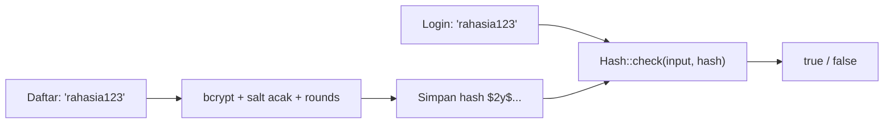

# Hashing Kata Sandi

Kata sandi tidak boleh disimpan apa adanya: bila database bocor, semua akun ikut jatuh, termasuk akun pengguna di layanan lain yang memakai kata sandi sama. Solusinya adalah **hashing**: mengubah
kata sandi menjadi string acak satu arah. Sub bab ini menjelaskan hash vs enkripsi, cara Laravel melakukannya (`Hash`), faktor kerja (*work factor*), `needsRehash`, dan membuat fitur ganti kata sandi yang benar.

## Tujuan Pembelajaran

Setelah menyelesaikan sub bab ini, kamu dapat:

- [ ] Membedakan hashing, enkripsi, dan encoding.
- [ ] Menjelaskan mengapa hash kata sandi harus lambat dan ber-*salt*.
- [ ] Memakai `Hash::make`, `Hash::check`, dan `Hash::needsRehash`.
- [ ] Mengatur faktor kerja bcrypt (`BCRYPT_ROUNDS`).
- [ ] Menjelaskan peran cast `'password' => 'hashed'` pada model `User`.
- [ ] Membuat fitur ganti kata sandi dengan aturan `current_password`.

## Prasyarat

- [Registrasi Pengguna](05-11-user-registration.md).
- Konsep fungsi satu arah dari [Manipulasi String](../level-00/00-15-string-manipulation.md) (opsional).
- Akun uji dan Tinker.

## Pengantar

Penyerang yang mencuri tabel `users` mencoba menebak kata sandi dengan mencocokkan hash dari daftar kata sandi umum. Hash yang cepat (MD5, SHA-1) bisa dicoba miliaran kali per detik; hash kata sandi
yang baik sengaja dibuat lambat dan unik per pengguna.

## Penjelasan Konsep

### Hash, enkripsi, encoding

| Konsep | Dapat dibalik? | Kunci | Pemakaian |
|---|---|---|---|
| Encoding (Base64) | Ya, tanpa kunci | Tidak | Format data, **bukan** keamanan |
| Enkripsi (`Crypt`) | Ya, dengan kunci | Ya | Data yang perlu dibaca kembali (token, pesan) |
| Hash kata sandi | Tidak | Tidak (ada *salt*) | Verifikasi kata sandi |

Kata sandi hanya perlu **diverifikasi**, tidak pernah dibaca kembali; karena itu hash, bukan enkripsi.

### Sifat hash kata sandi yang baik

- **Satu arah**: tidak ada cara membalik.
- **Salt acak**: dua pengguna dengan kata sandi sama menghasilkan hash berbeda.
- **Lambat dan dapat disetel**: faktor kerja membuat tebakan massal mahal.

Laravel memakai **bcrypt** secara bawaan; **Argon2** (`argon`, `argon2id`) juga didukung.

### API `Hash`

```php-inline
use Illuminate\Support\Facades\Hash;

$hash = Hash::make('rahasia123');                 // hash baru (salt acak)
Hash::check('rahasia123', $hash);                 // true
Hash::check('salah', $hash);                      // false
Hash::needsRehash($hash);                         // true jika faktor kerja sekarang berbeda
Hash::make('rahasia123', ['rounds' => 12]);       // setel faktor kerja bcrypt
```

Hasil bcrypt berawalan `$2y$`, diikuti faktor kerja dan salt, sehingga panjang tetap (60 karakter) dan `Hash::check` tahu parameter yang dipakai.

### Faktor kerja

Variabel `BCRYPT_ROUNDS` di `.env` (bawaan `12` pada `.env.example` kerangka) mengatur biaya. Setiap kenaikan 1 menggandakan waktu hash. Pilih nilai sehingga hash memakan waktu
yang wajar di servermu (kira-kira puluhan sampai ratusan milidetik) tanpa memperlambat login berlebihan.

### Cast `hashed`

Model `User` bawaan:

```php
protected function casts(): array
{
    return [
        'email_verified_at' => 'datetime',
        'password' => 'hashed',
    ];
}
```

Saat atribut `password` diisi nilai polos, cast `hashed` meng-hash-nya sebelum disimpan. Karena itu `User::create(['password' => 'rahasia123'])` aman. Cast ini mengenali nilai yang sudah ter-hash
sehingga tidak di-hash dua kali.

### Meng-hash ulang saat login (`needsRehash`)

Jika kamu menaikkan faktor kerja, hash lama tetap berlaku tetapi sebaiknya diperbarui saat pengguna berhasil login. Dokumentasi memperlihatkan pemakaian `Hash::needsRehash`. Laravel dapat melakukannya
otomatis pada autentikasi; untuk kontrol manual:

```php-inline
if (Hash::needsRehash($user->password)) {
    $user->update(['password' => $plainPassword]);   // cast hashed menghitung ulang
}
```

### Fitur ganti kata sandi

Ganti kata sandi harus meminta kata sandi **saat ini** (mencegah pembajakan sesi yang terbuka) dan menolak kata sandi yang sama:

```php-inline
$request->validate([
    'current_password' => ['required', 'current_password'],
    'password' => ['required', 'confirmed', Password::defaults(), 'different:current_password'],
]);

$request->user()->update(['password' => $request->input('password')]);
```

Aturan `current_password` membandingkan masukan dengan kata sandi pengguna yang sedang masuk. Setelah mengganti kata sandi, Laravel dapat mengeluarkan sesi di perangkat lain dengan
`Auth::logoutOtherDevices($currentPassword)` (butuh middleware `auth.session`, sub bab 05.15).

### Yang tidak boleh dilakukan

- Menyimpan kata sandi polos atau terenkripsi.
- Memakai MD5, SHA-1, atau SHA-256 mentah untuk kata sandi.
- Mencatat kata sandi di log atau pesan galat.
- Mengirim kata sandi lewat email.
- Menulis algoritma hash sendiri.

### Keamanan

- Kata sandi lama yang bocor di tempat lain tetap berisiko; gunakan pemeriksaan `uncompromised()` dan MFA bila perlu.
- Jangan membatasi kata sandi secara aneh (panjang maksimum terlalu kecil, melarang karakter tertentu).
- Bcrypt memotong masukan pada 72 byte; untuk kata sandi sangat panjang pertimbangkan Argon2 (atau biarkan batas `max` 72 di validasi).

## Cara Kerja



## Contoh Praktik

Kamu bereksperimen dengan `Hash` di Tinker (salt berbeda, `check`, waktu, `needsRehash`), lalu membuat halaman ganti kata sandi yang memakai `current_password`.

## Penjelasan Kode

File: `app/Http/Controllers/Auth/PasswordController.php`

```php
<?php

namespace App\Http\Controllers\Auth;

use App\Http\Controllers\Controller;
use Illuminate\Http\RedirectResponse;
use Illuminate\Http\Request;
use Illuminate\Validation\Rules\Password;
use Illuminate\View\View;

class PasswordController extends Controller
{
    public function edit(): View
    {
        return view('auth.password');
    }

    public function update(Request $request): RedirectResponse
    {
        $data = $request->validate([
            'current_password' => ['required', 'current_password'],
            'password' => ['required', 'confirmed', Password::defaults(), 'different:current_password'],
        ]);

        $request->user()->update(['password' => $data['password']]);

        return back()->with('status', 'Kata sandi diperbarui.');
    }
}
```

Route (di grup `auth`): `Route::get('/akun/sandi', [PasswordController::class, 'edit'])->name('password.edit');` dan `Route::put('/akun/sandi', [PasswordController::class, 'update'])->name('password.change');`.
(Nama `password.update` dipakai alur reset pada sub bab berikutnya, sehingga di sini digunakan `password.change`.)

View `auth/password.blade.php`: form `PUT` (`@csrf`, `@method('PUT')`) dengan tiga input kata sandi (`current_password`, `password`, `password_confirmation`) tanpa `old()`.

## Implementasi Langkah demi Langkah

### Langkah 1: eksperimen Hash

```bash
php artisan tinker
```

```php-inline
use Illuminate\Support\Facades\Hash;

$a = Hash::make('rahasia123');
$b = Hash::make('rahasia123');
$a === $b;                       // false: salt berbeda
Hash::check('rahasia123', $a);   // true
Hash::check('rahasia123', $b);   // true
strlen($a);                      // 60
```

### Langkah 2: ukur waktu faktor kerja

```php-inline
foreach ([4, 10, 12, 14] as $r) { $t = microtime(true); Hash::make('x', ['rounds' => $r]); echo "$r rounds: ".round((microtime(true)-$t)*1000)." ms\n"; }
```

### Langkah 3: `needsRehash`

```php-inline
$lemah = Hash::make('x', ['rounds' => 4]);
Hash::needsRehash($lemah);            // true bila faktor kerja bawaan lebih tinggi
Hash::needsRehash(Hash::make('x'));   // false
```

### Langkah 4: cast `hashed`

```php-inline
$u = App\Models\User::factory()->create(['password' => 'baru12345']);
$u->password;                       // hash, bukan 'baru12345'
Hash::check('baru12345', $u->password);
```

### Langkah 5: halaman ganti kata sandi

Buat controller, route, dan view; masuk sebagai pengguna, ubah kata sandi dengan kata sandi lama salah (harus ditolak), sama dengan lama (ditolak), lalu benar.

### Langkah 6: catat di Git

```bash
git add app resources routes
git commit -m "Tambah ganti kata sandi dengan current_password"
```

## Eksekusi dan Verifikasi

| Langkah | Cara memverifikasi |
|---|---|
| 1 | Dua hash berbeda tetapi sama-sama lolos `check`; panjang 60 |
| 2 | Waktu naik kira-kira dua kali lipat per tambahan rounds |
| 3 | `needsRehash` benar untuk hash dengan faktor lebih rendah |
| 4 | Atribut `password` berupa hash |
| 5 | Penolakan dan penerimaan sesuai skenario |

## Hasil yang Diharapkan

| Perintah | Hasil |
|---|---|
| `Hash::make('x') === Hash::make('x')` | `false` |
| `strlen(Hash::make('x'))` | `60` (bcrypt) |
| Ganti sandi dengan sandi lama salah | Galat bahwa kata sandi saat ini tidak cocok |
| Sandi baru sama dengan lama | Galat `different` |

Waktu hashing bergantung perangkat keras. Hasil ini diturunkan dari dokumentasi dan belum dijalankan oleh penulis materi; cocokkan dengan hasilmu.

## Kesalahan Umum dan Pemecahan Masalah

| Gejala | Penyebab | Cara mengenali | Solusi | Pencegahan |
|---|---|---|---|---|
| Login gagal setelah ganti sandi | Hash ganda atau tersimpan polos | Nilai bukan hash tunggal | Biarkan cast bekerja | Satu tempat hashing |
| `Hash::check` selalu `false` | Membandingkan dua hash | Pemakaian salah | `check($polos, $hash)` | Urutan argumen benar |
| Login sangat lambat | `rounds` terlalu tinggi | Waktu hash lama | Turunkan `BCRYPT_ROUNDS` | Ukur di server |
| Kata sandi panjang >72 byte dipotong | Batas bcrypt | Dua sandi beda yang awalnya sama lolos | Batasi `max:72` atau pakai Argon2 | Pahami batas |
| `current_password` selalu gagal | Pengguna belum masuk / guard salah | Galat saat validasi | Pastikan route di grup `auth` | Lindungi route |
| Pengguna lain tetap masuk setelah ganti sandi | Sesi lain tidak dicabut | Perangkat lain tetap login | `logoutOtherDevices` + `auth.session` | Terapkan pada aksi sensitif |

## Latihan Praktik

### Latihan dasar

**D1. Hash atau enkripsi**
- *Masalah:* tentukan alat yang tepat.
- *Persyaratan:* pilih hash, enkripsi, atau encoding untuk (a) kata sandi, (b) nomor kartu yang harus ditampilkan sebagian, (c) tautan dalam email berisi data, (d) ekspor data ke JSON, beserta alasannya.
- *Perilaku yang diharapkan:* (a) hash, (b) enkripsi, (c) token bertanda tangan, (d) encoding.
- *Tujuan belajar:* memilih alat.

### Latihan implementasi

**I1. Rehash otomatis**
- *Masalah:* faktor kerja dinaikkan dari 10 ke 12.
- *Persyaratan:* buat pengguna dengan hash `rounds=10`, naikkan `BCRYPT_ROUNDS` ke 12, login lewat form, dan tunjukkan hash diperbarui (`needsRehash` dari `true` menjadi `false`).
- *Perilaku yang diharapkan:* hash diperbarui setelah login.
- *Tujuan belajar:* migrasi faktor kerja.

**I2. Cabut sesi lain**
- *Masalah:* setelah ganti sandi, perangkat lain harus keluar.
- *Persyaratan:* tambahkan middleware `auth.session` pada grup route, panggil `Auth::logoutOtherDevices($data['current_password'])` di `update`, dan buktikan dengan dua browser.
- *Perilaku yang diharapkan:* sesi di browser lain tidak valid.
- *Tujuan belajar:* mencabut sesi.

### Latihan tantangan

**T1. Eksperimen serangan**
- *Masalah:* ingin merasakan mengapa hash lambat penting.
- *Persyaratan:* di Tinker, ukur berapa kali `hash('sha256', ...)` vs `Hash::make` dapat dijalankan dalam 1 detik dan simpulkan implikasinya untuk serangan tebak.
- *Perilaku yang diharapkan:* SHA-256 jutaan kali lebih cepat daripada bcrypt.
- *Tujuan belajar:* memahami faktor kerja.
- *Catatan:* kerjakan mandiri; tidak ada kunci jawaban.

## Uji Pemahaman

1. Mengapa kata sandi di-hash, bukan dienkripsi?
2. Mengapa dua hash dari kata sandi sama berbeda?
3. Apa fungsi `Hash::needsRehash`?
4. Apa peran cast `hashed`?
5. Mengapa ganti sandi meminta kata sandi saat ini?
6. Mengapa MD5 tidak cocok untuk kata sandi?

??? success "Kunci jawaban singkat"
    1. Kata sandi hanya perlu diverifikasi, tidak pernah dibaca kembali.
    2. Salt acak berbeda setiap pembuatan.
    3. Memeriksa apakah hash dibuat dengan parameter lama sehingga perlu diperbarui.
    4. Meng-hash otomatis saat atribut diisi.
    5. Mencegah pembajakan sesi terbuka mengganti sandi.
    6. Terlalu cepat sehingga mudah ditebak massal.

## Ringkasan

- Hash kata sandi: satu arah, bersalt, dan lambat; Laravel memakai bcrypt (Argon2 opsional).
- `Hash::make`, `check`, dan `needsRehash`; cast `hashed` meng-hash otomatis.
- Faktor kerja diatur `BCRYPT_ROUNDS`; perbarui hash lama saat login.
- Ganti sandi: `current_password`, `confirmed`, `different`, dan cabut sesi lain.

Selanjutnya: *Reset Kata Sandi*, membantu pengguna yang lupa tanpa membuka celah.

## Referensi Resmi

- [Laravel: Hashing](https://laravel.com/docs/13.x/hashing)
- [Laravel: Rule current_password](https://laravel.com/docs/13.x/validation#rule-current-password)
- [Laravel: Invalidating Sessions on Other Devices](https://laravel.com/docs/13.x/authentication#invalidating-sessions-on-other-devices)
- [OWASP: Password Storage Cheat Sheet](https://cheatsheetseries.owasp.org/cheatsheets/Password_Storage_Cheat_Sheet.html)
