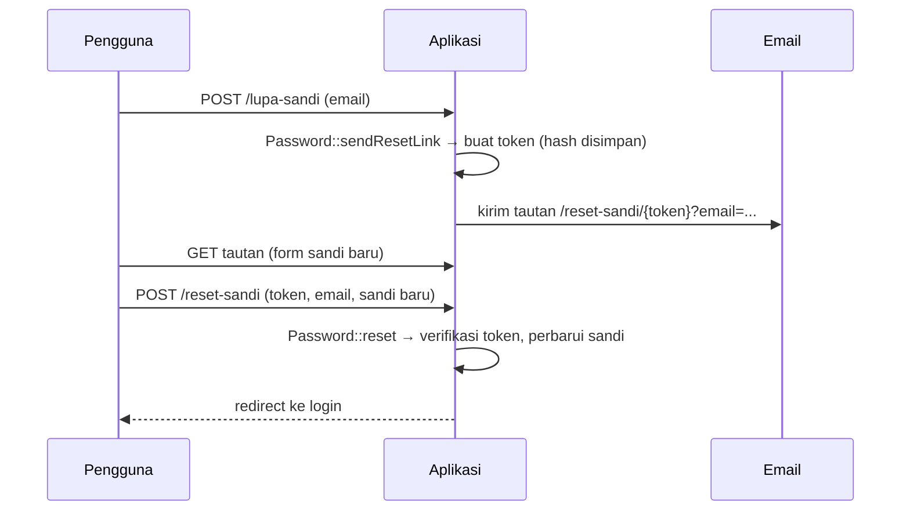

# Reset Kata Sandi

Pengguna pasti ada yang lupa kata sandi. Alur reset yang buruk adalah pintu belakang paling umum untuk membajak akun: tautan yang bisa ditebak, token yang tidak kedaluwarsa, atau pesan yang
mengungkap akun terdaftar. Laravel menyediakan *password broker* yang menangani token aman; tugasmu menyambungkan route, view, dan pesan yang tepat. Sub bab ini membangunnya, memakai driver email `log`
sehingga kamu dapat membaca email tanpa server SMTP.

## Tujuan Pembelajaran

Setelah menyelesaikan sub bab ini, kamu dapat:

- [ ] Menjelaskan alur reset: minta tautan → email berisi token → form sandi baru → perbarui.
- [ ] Mengimplementasikan empat route reset dengan `Password::sendResetLink` dan `Password::reset`.
- [ ] Membaca email di `storage/logs/laravel.log` dengan `MAIL_MAILER=log`.
- [ ] Menjelaskan tabel `password_reset_tokens`, kedaluwarsa, dan *throttle*.
- [ ] Menulis respons yang tidak membocorkan keberadaan akun.
- [ ] Menerjemahkan pesan broker lewat `lang/id/passwords.php`.

## Prasyarat

- [Hashing Kata Sandi](05-12-password-hashing.md) dan [Login dan Logout](05-10-login-and-logout.md).
- Tabel `password_reset_tokens` dan `config/auth.php` (sub bab 05.08).
- [Environment Variables](../level-01/01-11-environment-variables.md).

## Pengantar

Reset kata sandi adalah *login sementara lewat email*. Siapa pun yang menguasai email pengguna dapat mengambil alih akun, jadi seluruh alur harus tahan terhadap tebakan, pengulangan, dan penyalahgunaan.

## Penjelasan Konsep

### Alur



Token acak dibuat lalu hash-nya disimpan di tabel `password_reset_tokens`; versi polos hanya ada di email. Token berlaku sesuai `passwords.users.expire` di `config/auth.php` (bawaan 60 menit) dan permintaan beruntun dibatasi `throttle` (bawaan 60 detik).

### Email di lingkungan lokal

Pastikan `.env`:

```ini
MAIL_MAILER=log
```

Dengan driver `log`, email tidak dikirim; isinya ditulis ke `storage/logs/laravel.log`. Cari tautan bertuliskan `reset-sandi` di sana. (Di produksi, atur SMTP/penyedia email dan **jangan** commit kredensial.)

### Route dan controller

File: `routes/web.php`

```php-inline
use App\Http\Controllers\Auth\NewPasswordController;
use App\Http\Controllers\Auth\PasswordResetLinkController;

Route::middleware('guest')->group(function () {
    Route::get('/lupa-sandi', [PasswordResetLinkController::class, 'create'])->name('password.request');
    Route::post('/lupa-sandi', [PasswordResetLinkController::class, 'store'])->name('password.email');
    Route::get('/reset-sandi/{token}', [NewPasswordController::class, 'create'])->name('password.reset');
    Route::post('/reset-sandi', [NewPasswordController::class, 'store'])->name('password.update');
});
```

Nama route `password.reset` wajib: tautan di email dibuat Laravel memakai nama itu.

File: `app/Http/Controllers/Auth/PasswordResetLinkController.php`

```php
<?php

namespace App\Http\Controllers\Auth;

use App\Http\Controllers\Controller;
use Illuminate\Http\RedirectResponse;
use Illuminate\Http\Request;
use Illuminate\Support\Facades\Password;
use Illuminate\View\View;

class PasswordResetLinkController extends Controller
{
    public function create(): View
    {
        return view('auth.forgot-password');
    }

    public function store(Request $request): RedirectResponse
    {
        $request->validate(['email' => ['required', 'email']]);

        Password::sendResetLink($request->only('email'));

        // Respons sama apa pun hasilnya: tidak membocorkan apakah email terdaftar.
        return back()->with('status', 'Jika email terdaftar, tautan reset kata sandi telah dikirim.');
    }
}
```

Contoh dokumentasi mengembalikan pesan berbeda untuk email yang tidak ditemukan; di sini hasil `sendResetLink` sengaja diabaikan demi mencegah enumerasi akun. Kompromi: pengguna yang salah mengetik email tidak
diberi tahu, jadi pesan menyarankan memeriksa kotak masuk dan ejaan.

File: `app/Http/Controllers/Auth/NewPasswordController.php`

```php
<?php

namespace App\Http\Controllers\Auth;

use App\Http\Controllers\Controller;
use App\Models\User;
use Illuminate\Auth\Events\PasswordReset;
use Illuminate\Http\RedirectResponse;
use Illuminate\Http\Request;
use Illuminate\Support\Facades\Hash;
use Illuminate\Support\Facades\Password;
use Illuminate\Support\Str;
use Illuminate\Validation\Rules\Password as PasswordRule;
use Illuminate\View\View;

class NewPasswordController extends Controller
{
    public function create(Request $request, string $token): View
    {
        return view('auth.reset-password', ['token' => $token, 'email' => $request->query('email')]);
    }

    public function store(Request $request): RedirectResponse
    {
        $request->validate([
            'token' => ['required'],
            'email' => ['required', 'email'],
            'password' => ['required', 'confirmed', PasswordRule::defaults()],
        ]);

        $status = Password::reset(
            $request->only('email', 'password', 'password_confirmation', 'token'),
            function (User $user, string $password) {
                $user->forceFill(['password' => Hash::make($password)])
                    ->setRememberToken(Str::random(60));
                $user->save();

                event(new PasswordReset($user));
            }
        );

        return $status === Password::PasswordReset
            ? redirect()->route('login')->with('status', __($status))
            : back()->withErrors(['email' => __($status)])->onlyInput('email');
    }
}
```

| Bagian | Fungsi |
|---|---|
| `Password::sendResetLink` | Membuat token dan mengirim email bila pengguna ada |
| `Password::reset` | Memverifikasi token dan email, lalu memanggil closure untuk memperbarui sandi |
| `setRememberToken(Str::random(60))` | Mencabut cookie "ingat saya" lama |
| `event(new PasswordReset($user))` | Memberi tahu bagian lain (mis. mengirim notifikasi) |
| `__($status)` | Pesan terjemahan dari `lang/*/passwords.php` |

### Terjemahan pesan

Hasil `Password::reset` adalah kunci seperti `passwords.reset`, `passwords.token`, `passwords.user`, dan `passwords.throttled`. Jalankan `php artisan lang:publish` (bila belum) lalu buat `lang/id/passwords.php`:

```php
<?php

return [
    'reset' => 'Kata sandi kamu telah direset.',
    'sent' => 'Tautan reset kata sandi telah dikirim.',
    'throttled' => 'Mohon tunggu sebelum mencoba lagi.',
    'token' => 'Token reset kata sandi tidak valid atau sudah kedaluwarsa.',
    'user' => 'Kami tidak dapat memproses permintaan ini.',
];
```

Pesan `user` sengaja dibuat umum.

### Membersihkan token kedaluwarsa

Token kedaluwarsa tetap berada di tabel; hapus dengan `php artisan auth:clear-resets` (bisa dijadwalkan).

### Keamanan

- Respons permintaan tautan harus sama untuk akun ada atau tidak.
- Token sekali pakai dan berumur pendek; jangan memperpanjang tanpa alasan.
- Tautan reset melewati HTTPS di produksi; jangan mencatat token di log aplikasi.
- Batasi permintaan reset (bawaan `throttle` broker, ditambah `throttle` route, sub bab 05.24).
- Setelah reset, cabut sesi/ingat-saya lama (`setRememberToken`).

## Cara Kerja

Broker menyimpan `hash(token)` dan waktu pembuatan. Saat reset, ia membandingkan token dari tautan dengan hash tersimpan, memeriksa umur token, dan hanya bila cocok memanggil closure.

## Contoh Praktik

Kamu membangun alur reset lengkap, memicu email ke log, membuka tautan dari log, mengganti sandi, dan menguji token kedaluwarsa/dipakai ulang serta respons yang seragam.

## Penjelasan Kode

Tambahkan dua view: `auth/forgot-password.blade.php` (form `POST` ke `password.email` dengan input `email`) dan `auth/reset-password.blade.php` (form `POST` ke `password.update` dengan input tersembunyi
`token`, input `email` (nilai `$email`), `password`, `password_confirmation`). Tambahkan tautan "Lupa kata sandi?" pada halaman login.

## Implementasi Langkah demi Langkah

### Langkah 1: siapkan email lokal

Pastikan `MAIL_MAILER=log` pada `.env` dan `php artisan config:clear`.

### Langkah 2: buat controller, route, view, terjemahan

Lengkapi semua komponen di atas.

### Langkah 3: minta tautan

Buka `/lupa-sandi`, masukkan `admin@contoh.test`, kirim. Lalu:

```bash
grep -o "http://[^ \"]*reset-sandi[^ \"<]*" storage/logs/laravel.log | tail -1
```

Pada email berbentuk teks mungkin ada tanda `=` atau pemisah baris; bila tautan terpotong, salin manual dari berkas log.

### Langkah 4: ganti sandi

Buka tautan, isi sandi baru, kirim. Kamu diarahkan ke login dengan pesan sukses; masuk dengan sandi baru.

### Langkah 5: uji penyalahgunaan

| Uji | Harapan |
|---|---|
| Email tidak terdaftar | pesan status sama seperti akun ada |
| Tautan dipakai dua kali | pesan token tidak valid |
| Token diubah satu karakter | pesan token tidak valid |
| Dua permintaan beruntun | permintaan kedua dibatasi throttle (tidak mengirim email baru) |

### Langkah 6: periksa tabel

```bash
php artisan tinker --execute="dd(DB::table('password_reset_tokens')->get());"
```

Perhatikan bahwa kolom `token` berisi hash, bukan token pada tautan.

### Langkah 7: catat di Git

```bash
git add app resources routes lang
git commit -m "Tambah reset kata sandi"
```

## Eksekusi dan Verifikasi

| Langkah | Cara memverifikasi |
|---|---|
| 3 | Tautan reset ada di `laravel.log` |
| 4 | Sandi baru berfungsi; sandi lama tidak |
| 5 | Semua uji sesuai tabel |
| 6 | Token tersimpan sebagai hash |

## Hasil yang Diharapkan

| Aksi | Hasil |
|---|---|
| Minta tautan (akun ada/tidak) | Pesan status identik |
| Reset dengan token valid | Redirect ke login dengan pesan `Kata sandi kamu telah direset.` |
| Token tidak valid/dipakai ulang | Galat pada kolom email: token tidak valid |

Format email di log dan teks pesan bergantung versi dan terjemahan. Hasil ini diturunkan dari dokumentasi dan belum dijalankan oleh penulis materi; cocokkan dengan hasilmu.

## Kesalahan Umum dan Pemecahan Masalah

| Gejala | Penyebab | Cara mengenali | Solusi | Pencegahan |
|---|---|---|---|---|
| `Route [password.reset] not defined` | Nama route salah | Galat saat mengirim email | Beri nama `password.reset` | Gunakan nama baku |
| Tidak ada email di log | `MAIL_MAILER` bukan `log` / konfigurasi ter-*cache* | Log kosong | Atur `.env`; `config:clear` | Periksa konfigurasi |
| Selalu "token tidak valid" | Email di form tidak sama dengan di tautan | Galat token | Gunakan `email` dari tautan | Teruskan `email` ke form |
| Tautan kedaluwarsa cepat | `expire` kecil | Token invalid | Sesuaikan `config/auth.php` | Pilih umur wajar |
| Pesan dalam bahasa Inggris | `lang/id/passwords.php` belum ada | Teks Inggris | Buat berkas terjemahan | `lang:publish` |
| Pengguna tidak tahu emailnya salah | Respons seragam | Tidak ada email datang | Beri petunjuk di pesan | Kompromi desain |
| Sesi lama tetap aktif | Tidak mencabut ingat-saya | Perangkat lain tetap masuk | `setRememberToken` | Ikuti pola baku |

## Latihan Praktik

### Latihan dasar

**D1. Urutan alur**
- *Masalah:* ingin memahami alur.
- *Persyaratan:* gambar alur reset lengkap dengan siapa menyimpan apa (token polos vs hash).
- *Perilaku yang diharapkan:* token polos hanya di email; hash di database.
- *Tujuan belajar:* memahami keamanan token.

### Latihan implementasi

**I1. Notifikasi setelah reset**
- *Masalah:* pemilik akun perlu tahu sandinya berubah.
- *Persyaratan:* buat listener untuk event `PasswordReset` yang menulis `Log::warning` (pengganti email) berisi id pengguna dan IP; buktikan tercatat.
- *Perilaku yang diharapkan:* log muncul setelah reset.
- *Tujuan belajar:* memakai event autentikasi.

**I2. Durasi token**
- *Masalah:* ingin token berlaku 15 menit.
- *Persyaratan:* ubah `expire` menjadi 15, minta tautan, ubah `created_at` di database mundur 20 menit, dan buktikan tautan ditolak.
- *Perilaku yang diharapkan:* token kedaluwarsa ditolak.
- *Tujuan belajar:* memahami kedaluwarsa.

### Latihan tantangan

**T1. Ancaman reset**
- *Masalah:* tim menilai alur reset.
- *Persyaratan:* daftar lima ancaman (enumerasi, token ditebak, pembajakan email, penyalahgunaan kirim email, tautan bocor lewat header `Referer`) dan mitigasi masing-masing.
- *Perilaku yang diharapkan:* daftar lengkap dengan mitigasi relevan.
- *Tujuan belajar:* menilai ancaman.
- *Catatan:* kerjakan mandiri; tidak ada kunci jawaban.

## Uji Pemahaman

1. Apa yang disimpan di tabel `password_reset_tokens`?
2. Mengapa respons permintaan tautan harus sama untuk semua email?
3. Apa fungsi `setRememberToken(Str::random(60))`?
4. Apa fungsi driver email `log`?
5. Berapa lama token berlaku secara bawaan?
6. Mengapa route harus bernama `password.reset`?

??? success "Kunci jawaban singkat"
    1. Email, hash token, dan waktu pembuatan.
    2. Mencegah enumerasi akun.
    3. Mencabut cookie ingat-saya lama.
    4. Menulis email ke log, tanpa mengirim.
    5. 60 menit (`config/auth.php`).
    6. Laravel membuat tautan di email dengan nama route itu.

## Ringkasan

- Reset memakai token acak (hash disimpan), email berisi tautan, dan `Password::reset`.
- `MAIL_MAILER=log` memudahkan pengembangan; respons permintaan dibuat seragam.
- Terjemahkan `passwords.php`; cabut sesi lama setelah reset.
- Batasi permintaan dan jaga tautan dari kebocoran.

Selanjutnya: *Verifikasi Email*, memastikan alamat email benar milik pengguna.

## Referensi Resmi

- [Laravel: Resetting Passwords](https://laravel.com/docs/13.x/passwords)
- [Laravel: Mail (log driver)](https://laravel.com/docs/13.x/mail#log-driver)
- [OWASP: Forgot Password Cheat Sheet](https://cheatsheetseries.owasp.org/cheatsheets/Forgot_Password_Cheat_Sheet.html)
