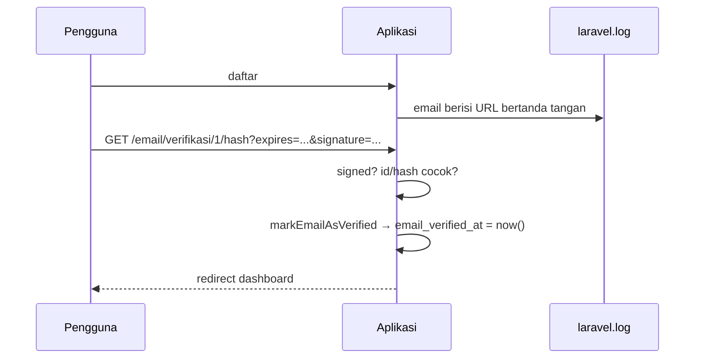

# Verifikasi Email

Tanpa verifikasi, siapa pun dapat mendaftar dengan email milik orang lain, membuat akun palsu, atau salah mengetik email sehingga reset kata sandi tidak pernah sampai. **Verifikasi email** membuktikan
bahwa pemilik akun menguasai alamat itu. Laravel menyediakan antarmuka `MustVerifyEmail`, middleware `verified`, dan URL bertanda tangan (*signed URL*). Sub bab ini mengaktifkannya langkah demi langkah.

## Tujuan Pembelajaran

Setelah menyelesaikan sub bab ini, kamu dapat:

- [ ] Mengaktifkan verifikasi email dengan `implements MustVerifyEmail` pada model `User`.
- [ ] Membuat tiga route: pemberitahuan, verifikasi, dan kirim ulang.
- [ ] Melindungi route dengan middleware `verified`.
- [ ] Menjelaskan URL bertanda tangan dan mengapa tautan verifikasi tidak dapat dipalsukan.
- [ ] Menguji alur lengkap dengan driver email `log`.
- [ ] Menangani perubahan email (verifikasi ulang).

## Prasyarat

- [Registrasi Pengguna](05-11-user-registration.md) dan [Reset Kata Sandi](05-13-password-reset.md) (cara membaca email di log).
- Kolom `email_verified_at` pada tabel `users` (bawaan).
- [Middleware Route](../level-02/02-08-route-middleware.md).

## Pengantar

Kolom `email_verified_at` bernilai `NULL` sampai pengguna mengeklik tautan di email. Aplikasi lalu dapat membatasi fitur sampai email terverifikasi.

## Penjelasan Konsep

### Mengaktifkan di model

File: `app/Models/User.php`

```php
use Illuminate\Contracts\Auth\MustVerifyEmail;

class User extends Authenticatable implements MustVerifyEmail
{
    // ...
}
```

Dengan antarmuka ini, saat event `Registered` dipicu (sub bab 05.11) Laravel mengirim email verifikasi otomatis. Metode `markEmailAsVerified()` dan `sendEmailVerificationNotification()` tersedia dari kelas
dasar `Authenticatable`.

### Tiga route

File: `routes/web.php`

```php-inline
use Illuminate\Foundation\Auth\EmailVerificationRequest;
use Illuminate\Http\Request;

Route::middleware('auth')->group(function () {
    // 1. Pemberitahuan: "periksa email kamu"
    Route::get('/email/verifikasi', fn () => view('auth.verify-email'))->name('verification.notice');

    // 2. Menangani tautan di email
    Route::get('/email/verifikasi/{id}/{hash}', function (EmailVerificationRequest $request) {
        $request->fulfill();
        return redirect()->route('dashboard')->with('status', 'Email berhasil diverifikasi.');
    })->middleware('signed')->name('verification.verify');

    // 3. Kirim ulang
    Route::post('/email/verifikasi/kirim-ulang', function (Request $request) {
        $request->user()->sendEmailVerificationNotification();
        return back()->with('status', 'Tautan verifikasi baru telah dikirim.');
    })->middleware('throttle:6,1')->name('verification.send');
});
```

| Route | Nama wajib | Fungsi |
|---|---|---|
| Pemberitahuan | `verification.notice` | Tujuan pengalihan middleware `verified` bagi pengguna belum terverifikasi |
| Verifikasi | `verification.verify` | Memakai `EmailVerificationRequest` (memeriksa `id` dan `hash`) dan `signed` |
| Kirim ulang | `verification.send` | Mengirim email baru, dibatasi 6 per menit |

`EmailVerificationRequest` adalah Form Request bawaan yang memvalidasi parameter `id` dan `hash` dan, melalui `fulfill()`, memanggil `markEmailAsVerified()` lalu memicu event `Verified`.

### URL bertanda tangan

Tautan verifikasi dibuat dengan `URL::temporarySignedRoute`, menambahkan parameter `expires` dan `signature` (HMAC dengan `APP_KEY`). Middleware `signed` menolak tautan yang diubah atau kedaluwarsa dengan 403.
Karena memakai `APP_KEY`, kunci itu harus dirahasiakan.

### Middleware `verified`

```php-inline
Route::middleware(['auth', 'verified'])->group(function () {
    Route::get('/dashboard', fn () => view('dashboard'))->name('dashboard');
    // route admin lainnya
});
```

Pengguna yang belum terverifikasi dialihkan ke `verification.notice`.

### View pemberitahuan

File: `resources/views/auth/verify-email.blade.php`

```html
<x-layout title="Verifikasi Email">
    <h1 class="text-xl font-bold mb-3">Periksa email kamu</h1>
    <p class="mb-3">Kami telah mengirim tautan verifikasi. Klik tautan itu untuk melanjutkan.</p>
    <form method="POST" action="{{ route('verification.send') }}">
        @csrf
        <button class="bg-blue-600 text-white rounded px-4 py-2">Kirim ulang email</button>
    </form>
</x-layout>
```

### Mengubah email

Bila pengguna mengganti email, set `email_verified_at` menjadi `null` dan kirim verifikasi baru, agar email lama yang bocor tidak mengesahkan alamat baru:

```php-inline
$user->forceFill(['email' => $new, 'email_verified_at' => null])->save();
$user->sendEmailVerificationNotification();
```

### Keamanan

- Verifikasi email bukan bukti identitas orang; ia hanya bukti penguasaan kotak surat.
- Tautan bertanda tangan harus ber-kedaluwarsa (bawaan 60 menit); jangan membuat tautan abadi.
- Batasi kirim ulang (`throttle`) agar tidak dipakai membanjiri kotak masuk orang lain.
- `APP_KEY` tidak boleh bocor; jika berubah, tautan lama tidak berlaku.

## Cara Kerja



## Contoh Praktik

Kamu mengaktifkan verifikasi, mendaftar akun baru, membaca tautan dari log, memverifikasi, mencoba mengakses halaman `verified` sebelum dan sesudah, dan menguji tautan yang dipalsukan.

## Penjelasan Kode

Seluruh kode ada pada bagian konsep. Ubah juga route `dashboard` dan route admin ke grup `['auth', 'verified']`.

## Implementasi Langkah demi Langkah

### Langkah 1: aktifkan di model dan route

Tambahkan `implements MustVerifyEmail`, tiga route, view, dan pindahkan `dashboard` ke grup `['auth', 'verified']`.

### Langkah 2: daftar akun baru

Buka `/register` dan daftar. Kamu seharusnya dialihkan ke dashboard lalu ke `/email/verifikasi`.

### Langkah 3: ambil tautan dari log

```bash
grep -o "http://[^ \"]*email/verifikasi[^ \"<]*" storage/logs/laravel.log | tail -1
```

### Langkah 4: uji tautan palsu

Ubah satu karakter pada `signature` atau `hash` lalu buka: harus `403`.

### Langkah 5: verifikasi

Buka tautan asli (saat masuk sebagai akun yang sama). Kamu dialihkan ke dashboard dengan pesan sukses; periksa `email_verified_at` terisi.

### Langkah 6: kirim ulang dan throttle

Klik **Kirim ulang email** lebih dari 6 kali dalam semenit dan amati respons `429`.

### Langkah 7: catat di Git

```bash
git add app resources routes
git commit -m "Tambah verifikasi email"
```

## Eksekusi dan Verifikasi

| Langkah | Cara memverifikasi |
|---|---|
| 2 | Pengguna baru tidak dapat membuka `/dashboard` sebelum verifikasi |
| 4 | Tautan yang diubah menghasilkan 403 |
| 5 | `email_verified_at` terisi dan `/dashboard` terbuka |
| 6 | Setelah beberapa kali, status 429 |

## Hasil yang Diharapkan

| Kondisi | Hasil |
|---|---|
| Belum terverifikasi → `/dashboard` | `302` ke `/email/verifikasi` |
| Tautan asli | `302` ke dashboard dan `email_verified_at` terisi |
| Tautan diubah | `403 Invalid signature` |
| Kirim ulang >6/menit | `429 Too Many Requests` |

Hasil ini diturunkan dari dokumentasi dan belum dijalankan oleh penulis materi; cocokkan dengan hasilmu.

## Kesalahan Umum dan Pemecahan Masalah

| Gejala | Penyebab | Cara mengenali | Solusi | Pencegahan |
|---|---|---|---|---|
| Email verifikasi tidak terkirim | `User` tidak `implements MustVerifyEmail` / event `Registered` tidak dipicu | Tak ada email di log | Tambahkan antarmuka; panggil `event(new Registered($user))` | Ikuti pola registrasi |
| `Route [verification.notice] not defined` | Nama route salah | Galat saat `verified` mengalihkan | Beri nama persis | Nama baku |
| `403 Invalid signature` pada tautan asli | `APP_URL` berbeda dari host yang dipakai membuka | Tautan memakai host lain | Samakan `APP_URL` dengan alamat akses | Konfigurasi URL |
| Tautan tidak berlaku setelah beberapa waktu | Kedaluwarsa | 403 | Kirim ulang | Beri tahu pengguna |
| Akses fitur tanpa verifikasi | Lupa middleware `verified` | Halaman terbuka | Tambahkan | Lindungi grup route |
| Tautan berpindah akun | Membuka tautan saat masuk sebagai pengguna lain | 403 | Masuk dengan akun yang benar | `EmailVerificationRequest` memeriksa kecocokan |

## Latihan Praktik

### Latihan dasar

**D1. Apa yang dibuktikan?**
- *Masalah:* ingin memahami batas verifikasi.
- *Persyaratan:* tulis apa yang dibuktikan dan tidak dibuktikan oleh verifikasi email.
- *Perilaku yang diharapkan:* membuktikan akses ke kotak surat, bukan identitas nyata.
- *Tujuan belajar:* memahami cakupan.

### Latihan implementasi

**I1. Ganti email**
- *Masalah:* pengguna mengganti email.
- *Persyaratan:* buat form ganti email yang menge-`null`-kan `email_verified_at`, mengirim ulang verifikasi, dan membatasi akses fitur sampai terverifikasi lagi.
- *Perilaku yang diharapkan:* alamat baru harus diverifikasi.
- *Tujuan belajar:* menangani perubahan email.

**I2. Batasi fitur**
- *Masalah:* komentar hanya untuk pengguna terverifikasi.
- *Persyaratan:* beri middleware `verified` pada route komentar yang memerlukan akun (atau tolak lewat kebijakan) dan uji dua kondisi.
- *Perilaku yang diharapkan:* pengguna belum terverifikasi ditolak.
- *Tujuan belajar:* menggunakan `verified`.

### Latihan tantangan

**T1. Umur tautan**
- *Masalah:* ingin tautan 15 menit.
- *Persyaratan:* telusuri cara Laravel membuat tautan verifikasi dan konfigurasi umurnya (rujuk dokumentasi dan kode `VerifyEmail`), ubah menjadi 15 menit, dan buktikan tautan kedaluwarsa ditolak.
- *Perilaku yang diharapkan:* tautan kedaluwarsa ditolak.
- *Tujuan belajar:* menyesuaikan perilaku bawaan.
- *Catatan:* kerjakan mandiri; tidak ada kunci jawaban.

## Uji Pemahaman

1. Apa fungsi antarmuka `MustVerifyEmail`?
2. Apa fungsi middleware `signed`?
3. Apa yang dilakukan `EmailVerificationRequest::fulfill()`?
4. Mengapa tiga route harus bernama tertentu?
5. Mengapa kirim ulang dibatasi?
6. Mengapa `APP_KEY` penting di sini?

??? success "Kunci jawaban singkat"
    1. Mengaktifkan pengiriman email verifikasi dan pemeriksaan `verified`.
    2. Menolak URL yang diubah atau kedaluwarsa.
    3. Menandai email terverifikasi dan memicu event `Verified`.
    4. Middleware dan notifikasi bergantung pada nama itu.
    5. Mencegah pembanjiran email.
    6. Dipakai menandatangani URL; bocornya kunci memungkinkan pemalsuan.

## Ringkasan

- `MustVerifyEmail` + tiga route + middleware `verified` mengaktifkan verifikasi.
- URL bertanda tangan melindungi tautan; batasi kirim ulang.
- Ganti email harus me-reset verifikasi.
- Verifikasi hanya membuktikan penguasaan kotak surat.

Selanjutnya: *Middleware Autentikasi*, mengatur siapa boleh mengakses route.

## Referensi Resmi

- [Laravel: Email Verification](https://laravel.com/docs/13.x/verification)
- [Laravel: Signed URLs](https://laravel.com/docs/13.x/urls#signed-urls)
- [Laravel: Protecting Routes](https://laravel.com/docs/13.x/verification#protecting-routes)
