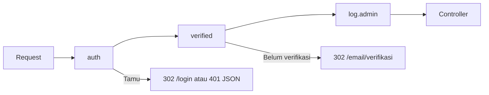

# Middleware Autentikasi

Middleware adalah penjaga gerbang route. Untuk autentikasi, Laravel menyediakan `auth` (hanya yang sudah masuk), `guest` (hanya tamu), `verified` (email terverifikasi), dan `auth.session`
(sesi harus valid di semua perangkat). Sub bab ini menunjukkan cara memakainya pada route dan grup, mengatur tujuan pengalihan di `bootstrap/app.php`, perilaku untuk permintaan JSON, dan membuat middleware sendiri.

## Tujuan Pembelajaran

Setelah menyelesaikan sub bab ini, kamu dapat:

- [ ] Memasang `auth`, `guest`, dan `verified` pada route dan grup.
- [ ] Mengatur tujuan pengalihan dengan `redirectGuestsTo` dan `redirectUsersTo`.
- [ ] Menjelaskan perbedaan respons untuk permintaan HTML (302) dan JSON (401).
- [ ] Menjelaskan fungsi `auth.session` dan `logoutOtherDevices`.
- [ ] Membuat middleware kustom dan mendaftarkan aliasnya.
- [ ] Melindungi seluruh area admin proyek `cms-artikel`.

## Prasyarat

- [Login dan Logout](05-10-login-and-logout.md) dan [Verifikasi Email](05-14-email-verification.md).
- [Middleware Route](../level-02/02-08-route-middleware.md) dan [Grup Route](../level-02/02-06-route-groups.md).
- Proyek `cms-artikel` dengan route admin dari bab Database.

## Pengantar

Saat ini `/admin/artikel` terbuka untuk siapa pun. Dengan middleware, satu baris pada grup route membuat seluruh area admin hanya terbuka bagi pengguna yang masuk dan terverifikasi.

## Penjelasan Konsep

### Middleware autentikasi bawaan

| Alias | Efek |
|---|---|
| `auth` | Hanya pengguna masuk; tamu dialihkan ke `login` (HTML) atau mendapat 401 (JSON) |
| `guest` | Hanya tamu; pengguna masuk dialihkan ke `dashboard` |
| `verified` | Email harus terverifikasi; bila tidak, dialihkan ke `verification.notice` |
| `auth.session` | `AuthenticateSession`: membatalkan sesi bila kata sandi berubah di perangkat lain |
| `throttle` | Pembatasan laju (sub bab 05.24) |
| `signed` | URL bertanda tangan harus valid |

```php-inline
Route::get('/dashboard', fn () => view('dashboard'))->middleware(['auth', 'verified']);

Route::middleware(['auth', 'verified'])->prefix('admin')->name('admin.')->group(function () {
    // semua route admin di sini
});
```

### Melindungi area admin

Ubah grup admin pada `routes/web.php`:

```php-inline
Route::middleware(['auth', 'verified'])->prefix('admin')->name('admin.')->group(function () {
    // ... route artikel, kategori, komentar admin
});
```

Route publik (`/artikel`, `/artikel/{slug}`, komentar) tetap terbuka.

### Tujuan pengalihan

Secara bawaan tamu diarahkan ke route bernama `login` dan pengguna masuk dari halaman tamu ke `dashboard`. Ubah di `bootstrap/app.php`:

```php
use Illuminate\Http\Request;

->withMiddleware(function (Middleware $middleware): void {
    $middleware->redirectGuestsTo(fn (Request $request) => route('login'));
    $middleware->redirectUsersTo(fn (Request $request) => route('dashboard'));
})
```

### HTML vs JSON

Untuk permintaan yang mengharapkan JSON (`Accept: application/json`), `auth` mengembalikan **401 Unauthenticated** bukan pengalihan. Klien API perlu header ini.

```bash
curl -s -i -H "Accept: application/json" http://127.0.0.1:8000/admin/artikel
```

### `auth.session` dan `logoutOtherDevices`

Pasang `auth.session` pada grup yang butuh jaminan sesi; lalu `Auth::logoutOtherDevices($password)` (misalnya setelah ganti sandi) membatalkan sesi di perangkat lain:

```php-inline
Route::middleware(['auth', 'auth.session', 'verified'])->group(function () { /* ... */ });
```

### Middleware kustom

```bash
php artisan make:middleware LogAdminAccess
```

File: `app/Http/Middleware/LogAdminAccess.php`

```php
<?php

namespace App\Http\Middleware;

use Closure;
use Illuminate\Http\Request;
use Illuminate\Support\Facades\Log;
use Symfony\Component\HttpFoundation\Response;

class LogAdminAccess
{
    public function handle(Request $request, Closure $next): Response
    {
        Log::info('Akses admin', [
            'user_id' => $request->user()?->id,
            'method' => $request->method(),
            'path' => $request->path(),
            'ip' => $request->ip(),
        ]);

        return $next($request);
    }
}
```

Daftarkan alias di `bootstrap/app.php` dan pakai setelah `auth` agar `user()` tersedia:

```php
->withMiddleware(function (Middleware $middleware): void {
    $middleware->alias(['log.admin' => \App\Http\Middleware\LogAdminAccess::class]);
})
```

```php-inline
Route::middleware(['auth', 'verified', 'log.admin'])->prefix('admin')->name('admin.')->group(/* ... */);
```

Jangan mencatat kata sandi atau seluruh isi request di log.

### Urutan middleware

Urutan penulisan dalam array menentukan urutan eksekusi: `auth` harus sebelum middleware yang membutuhkan pengguna.

### Keamanan

- Mengandalkan `auth` saja bukan otorisasi: pengguna masuk belum tentu berhak (sub bab 05.16).
- Pastikan **semua** route sensitif berada di dalam grup terlindungi; periksa `php artisan route:list -v` untuk melihat middleware tiap route.
- Jangan membuat route "uji" tanpa middleware di lingkungan produksi.

## Cara Kerja



## Contoh Praktik

Kamu melindungi area admin dengan `auth` dan `verified`, menambah middleware `log.admin`, menguji perilaku tamu (HTML dan JSON), dan memeriksa daftar middleware tiap route.

## Penjelasan Kode

Kode ada pada bagian konsep. Setelah menambah alias dan grup, perhatikan bahwa route komentar publik tetap berada di luar grup.

## Implementasi Langkah demi Langkah

### Langkah 1: lindungi grup admin

Tambahkan `['auth', 'verified']` pada grup `admin`.

### Langkah 2: buat middleware dan alias

```bash
php artisan make:middleware LogAdminAccess
```

Isi, daftarkan alias, dan tambahkan `'log.admin'` ke grup.

### Langkah 3: periksa middleware route

```bash
php artisan route:list --path=admin -v
```

Setiap route admin memuat `auth`, `verified`, dan `log.admin`.

### Langkah 4: uji sebagai tamu

```bash
curl -s -o /dev/null -w "%{http_code}\n" http://127.0.0.1:8000/admin/artikel
curl -s -o /dev/null -w "%{http_code}\n" -H "Accept: application/json" http://127.0.0.1:8000/admin/artikel
```

### Langkah 5: uji sebagai pengguna masuk

Masuk lewat browser, buka `/admin/artikel`, lalu periksa log:

```bash
grep "Akses admin" storage/logs/laravel.log | tail -2
```

### Langkah 6: uji `guest`

Saat masuk, buka `/login`: kamu dialihkan ke `dashboard`.

### Langkah 7: catat di Git

```bash
git add app bootstrap routes
git commit -m "Lindungi area admin dengan middleware autentikasi"
```

## Eksekusi dan Verifikasi

| Langkah | Cara memverifikasi |
|---|---|
| 3 | Kolom middleware memuat tiga alias |
| 4 | HTML: `302`; JSON: `401` |
| 5 | Log berisi `user_id`, `path`, dan `ip` |
| 6 | `/login` mengalihkan pengguna masuk |

## Hasil yang Diharapkan

| Permintaan | Hasil |
|---|---|
| `GET /admin/artikel` (tamu) | `302` ke `/login` |
| `GET /admin/artikel` dengan `Accept: application/json` (tamu) | `401` |
| Pengguna masuk membuka `/login` | `302` ke `/dashboard` |

Hasil ini diturunkan dari dokumentasi dan belum dijalankan oleh penulis materi; cocokkan dengan hasilmu.

## Kesalahan Umum dan Pemecahan Masalah

| Gejala | Penyebab | Cara mengenali | Solusi | Pencegahan |
|---|---|---|---|---|
| Route admin masih terbuka | Route di luar grup | `route:list -v` tanpa `auth` | Pindahkan ke grup | Periksa daftar route |
| `Route [login] not defined` | Route login tidak bernama | Galat saat tamu diarahkan | Beri nama `login` | Nama baku |
| `$request->user()` null di middleware kustom | Dipasang sebelum `auth` | Log `user_id` null | Letakkan setelah `auth` | Perhatikan urutan |
| Loop redirect | `login` dilindungi `auth` | Browser mengeluh | Letakkan login di `guest`/publik | Pisahkan route |
| 401 tidak muncul pada API | Header `Accept` tidak dikirim | Mendapat 302 | Kirim `Accept: application/json` | Klien API |
| Alias tidak dikenal | Salah ketik atau tidak terdaftar | `Target class [..] does not exist` | Daftarkan di `bootstrap/app.php` | Ejaan alias |

## Latihan Praktik

### Latihan dasar

**D1. Pilih middleware**
- *Masalah:* tentukan middleware.
- *Persyaratan:* untuk (a) halaman login, (b) dashboard, (c) kirim ulang verifikasi, (d) halaman publik artikel, pilih middleware yang tepat.
- *Perilaku yang diharapkan:* (a) `guest`, (b) `auth`+`verified`, (c) `auth`+`throttle`, (d) tidak ada.
- *Tujuan belajar:* memilih penjaga.

### Latihan implementasi

**I1. Audit route**
- *Masalah:* ingin memastikan tak ada route sensitif terbuka.
- *Persyaratan:* gunakan `route:list -v --json` (atau tabel) untuk membuat daftar semua route tanpa `auth`, lalu klasifikasikan mana yang memang publik.
- *Perilaku yang diharapkan:* hanya route publik yang tanpa `auth`.
- *Tujuan belajar:* mengaudit akses.

**I2. Middleware `EnsureUserIsActive`**
- *Masalah:* akun yang dinonaktifkan tidak boleh masuk.
- *Persyaratan:* tambah kolom `disabled_at` (nullable) lewat migration, buat middleware yang mengeluarkan pengguna dengan `disabled_at` terisi (logout lengkap + pesan), dan pasang setelah `auth`.
- *Perilaku yang diharapkan:* akun nonaktif ditendang.
- *Tujuan belajar:* middleware kustom pada autentikasi.

### Latihan tantangan

**T1. Rancang area berlapis**
- *Masalah:* area `member`, `editor`, dan `admin` berbeda tingkat.
- *Persyaratan:* rancang peta route dan middleware tiap area dan jelaskan perbedaan "terautentikasi" dan "berwenang".
- *Perilaku yang diharapkan:* peta menyiapkan jalan untuk sub bab otorisasi.
- *Tujuan belajar:* merancang akses berlapis.
- *Catatan:* kerjakan mandiri; tidak ada kunci jawaban.

## Uji Pemahaman

1. Apa beda `auth` dan `guest`?
2. Apa respons `auth` untuk permintaan JSON?
3. Bagaimana mengubah tujuan pengalihan tamu?
4. Mengapa urutan middleware penting?
5. Apa fungsi `auth.session`?
6. Mengapa `auth` bukan otorisasi?

??? success "Kunci jawaban singkat"
    1. `auth` hanya untuk pengguna masuk; `guest` hanya untuk tamu.
    2. 401 Unauthenticated.
    3. `redirectGuestsTo()` di `bootstrap/app.php`.
    4. Middleware berjalan berurutan; yang butuh pengguna harus setelah `auth`.
    5. Membatalkan sesi yang tidak valid setelah kata sandi berubah di perangkat lain.
    6. Pengguna masuk belum tentu berhak melakukan aksi tertentu.

## Ringkasan

- `auth`, `guest`, `verified`, `auth.session` mengatur akses; pasang pada grup.
- Pengalihan dikonfigurasi di `bootstrap/app.php`; permintaan JSON mendapat 401.
- Middleware kustom didaftarkan sebagai alias; perhatikan urutan.
- Autentikasi bukan otorisasi; lanjut ke sub bab berikutnya.

Selanjutnya: *Otorisasi*, menentukan siapa boleh melakukan apa.

## Referensi Resmi

- [Laravel: Protecting Routes](https://laravel.com/docs/13.x/authentication#protecting-routes)
- [Laravel: Middleware](https://laravel.com/docs/13.x/middleware)
- [Laravel: Invalidating Sessions on Other Devices](https://laravel.com/docs/13.x/authentication#invalidating-sessions-on-other-devices)
