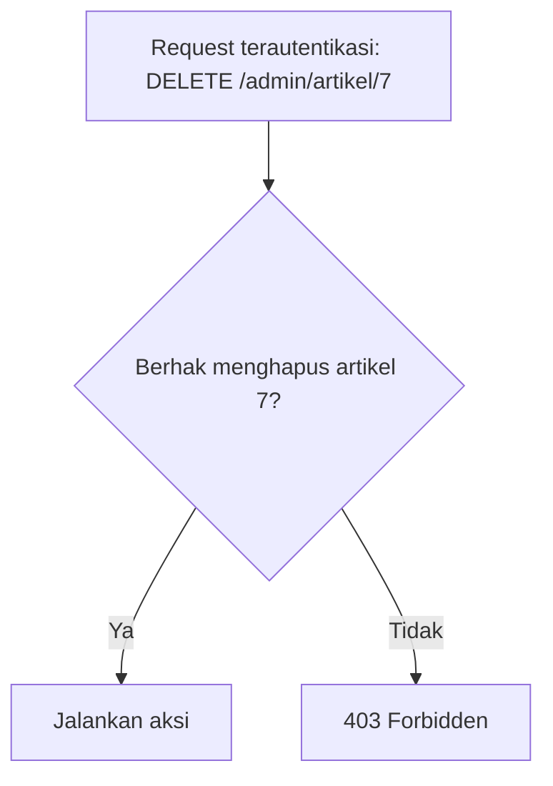

# Otorisasi

Setelah aplikasi tahu **siapa** pengguna (autentikasi), ia harus memutuskan **apa yang boleh** dilakukannya. Pengguna biasa tidak boleh menghapus artikel orang lain; penulis tidak boleh membuka
panel admin. Sub bab ini memperkenalkan konsep otorisasi, kode status yang tepat (401, 403, 404), dan pilihan alat Laravel (Gate, Policy, middleware `can`) sebelum dipelajari satu per satu.

## Tujuan Pembelajaran

Setelah menyelesaikan sub bab ini, kamu dapat:

- [ ] Membedakan 401, 403, dan 404 serta kapan memakainya.
- [ ] Menjelaskan otorisasi berbasis kepemilikan dan berbasis peran.
- [ ] Menyebutkan tiga alat otorisasi Laravel: Gate, Policy, dan middleware `can`.
- [ ] Menulis pemeriksaan sederhana dengan `abort_unless` dan `abort(403)`.
- [ ] Menjelaskan celah IDOR (*Insecure Direct Object Reference*) dan cara mencegahnya.
- [ ] Menemukan celah otorisasi di area admin `cms-artikel`.

## Prasyarat

- [Middleware Autentikasi](05-15-authentication-middleware.md).
- Area admin yang dilindungi `auth` dan `verified`.
- Model `Article` dengan `user_id`.

## Pengantar

Saat ini semua pengguna yang masuk dapat mengubah atau menghapus artikel siapa pun hanya dengan mengubah ID di URL. Itu bukan masalah autentikasi (mereka sudah masuk) melainkan otorisasi.

## Penjelasan Konsep

### Kode status yang tepat

| Kode | Arti | Contoh |
|---|---|---|
| 401 Unauthorized | Belum terautentikasi | Tamu membuka area terlindungi (API) |
| 403 Forbidden | Terautentikasi, tetapi tidak berhak | Penulis A mengubah artikel penulis B |
| 404 Not Found | Sumber tidak ada, atau sengaja disembunyikan | Menyembunyikan keberadaan data yang tak boleh diketahui |

Memakai 404 alih-alih 403 untuk data pribadi mencegah pengunjung tahu bahwa data itu ada.

### Jenis aturan

| Jenis | Pertanyaan | Contoh |
|---|---|---|
| Berbasis kepemilikan | Apakah ini milikmu? | Hanya penulis boleh mengubah artikelnya |
| Berbasis peran | Apa perananmu? | Admin boleh menghapus komentar siapa pun |
| Berbasis atribut/status | Apakah kondisi terpenuhi? | Artikel yang sudah terbit tak boleh dihapus penulis |

Aturan nyata biasanya gabungan.

### IDOR: celah paling umum

*Insecure Direct Object Reference*: aplikasi menerima `id` dari URL dan langsung bertindak tanpa memeriksa hak.

```php-inline
// RENTAN: siapa pun yang masuk bisa menghapus artikel mana pun
Route::delete('/admin/artikel/{article}', function (Article $article) {
    $article->delete();
});
```

Mengganti angka di URL cukup untuk menyerang artikel orang lain.

### Alat otorisasi Laravel

| Alat | Cocok untuk |
|---|---|
| **Gate** | Aksi umum tanpa model tertentu ("bolehkah mengelola kategori?") |
| **Policy** | Aksi pada model tertentu ("bolehkah mengubah artikel ini?") |
| Middleware `can` | Menerapkan Gate/Policy pada route |
| `@can`, `@cannot` | Menyembunyikan/menampilkan elemen di Blade |
| `$user->can(...)` / `Gate::authorize(...)` | Pemeriksaan di kode |

Dua sub bab berikutnya membahas Gate dan Policy; sub bab setelahnya menyusun peran.

### Pemeriksaan manual sederhana

```php-inline
abort_unless($request->user()->id === $article->user_id, 403);
```

Cukup untuk satu tempat, tetapi tersebar di banyak controller akan sulit dirawat dan mudah terlupa. Karena itu aturan dipusatkan di Gate/Policy.

### Prinsip

- **Tolak secara bawaan**: izinkan hanya yang eksplisit diizinkan.
- **Periksa di server**: menyembunyikan tombol di UI bukan keamanan.
- **Periksa setiap aksi**: termasuk baca, ubah, hapus, pulihkan, dan ekspor.
- **Hak terkecil** (*least privilege*): beri peran hanya yang diperlukan.

### Keamanan

- IDOR masuk dalam daftar risiko utama OWASP (*Broken Access Control* adalah salah satu kategori teratas); uji dengan mengganti ID.
- Jangan mengandalkan data tersembunyi di form (`user_id` hidden) untuk menentukan pemilik.
- Catat percobaan akses ditolak untuk pemantauan.

## Cara Kerja



## Contoh Praktik

Kamu membuktikan celah IDOR di area admin dengan dua pengguna, lalu menambah pemeriksaan manual `abort_unless` sebagai perbaikan sementara sebelum menggantinya dengan Policy.

## Penjelasan Kode

Pada `Admin\ArticleController::update` dan `destroy` tambahkan (sementara):

```php
abort_unless($request->user()->id === $article->user_id, 403);
```

Untuk `destroy` yang tidak menerima `Request`, gunakan `auth()->id()`:

```php
abort_unless(auth()->id() === $article->user_id, 403);
```

## Implementasi Langkah demi Langkah

### Langkah 1: siapkan dua pengguna

```bash
php artisan tinker --execute="\$a = App\Models\User::factory()->create(['email'=>'ani@contoh.test']); \$b = App\Models\User::factory()->create(['email'=>'budi@contoh.test']); App\Models\Article::factory()->for(\$a)->create(['title'=>'Artikel Ani']); App\Models\Article::factory()->for(\$b)->create(['title'=>'Artikel Budi']);"
```

Kata sandi factory: `password`.

### Langkah 2: buktikan IDOR

Masuk sebagai Ani, buka `/admin/artikel`, ubah (atau hapus) **Artikel Budi**. Operasi berhasil: ini celah.

### Langkah 3: tambahkan pemeriksaan sementara

Tambahkan `abort_unless(...)` pada `update` dan `destroy`.

### Langkah 4: uji ulang

Sebagai Ani, ubah Artikel Ani (berhasil) dan Artikel Budi (403).

### Langkah 5: catat celah lain

Tulis daftar aksi admin lain yang belum diperiksa haknya (`restore`, `edit`, `create`, hapus komentar, kelola kategori). Daftar ini dikerjakan pada sub bab berikutnya.

### Langkah 6: catat di Git

```bash
git add app
git commit -m "Tambah pemeriksaan kepemilikan sementara pada artikel"
```

## Eksekusi dan Verifikasi

| Langkah | Cara memverifikasi |
|---|---|
| 2 | Ani berhasil mengubah artikel Budi (bukti celah) |
| 4 | Ani mengubah artikel miliknya sukses, milik Budi `403` |
| 5 | Daftar celah tercatat |

## Hasil yang Diharapkan

| Aksi | Sebelum perbaikan | Sesudah |
|---|---|---|
| Ani mengubah artikel Budi | Berhasil | `403 Forbidden` |
| Ani mengubah artikelnya | Berhasil | Berhasil |

Hasil ini diturunkan dari dokumentasi dan belum dijalankan oleh penulis materi; cocokkan dengan hasilmu.

## Kesalahan Umum dan Pemecahan Masalah

| Gejala | Penyebab | Cara mengenali | Solusi | Pencegahan |
|---|---|---|---|---|
| Artikel tanpa pemilik tak bisa diubah siapa pun | `user_id` `null` | 403 untuk semua | Tentukan aturan untuk data yatim | Rancang kasus `null` |
| Admin tak bisa mengubah artikel orang | Hanya cek kepemilikan | 403 untuk admin | Tambahkan aturan peran | Sub bab 05.19 |
| 403 muncul untuk tamu | Urutan: otorisasi sebelum auth | Pesan tak sesuai | Pasang `auth` dahulu | Urutan middleware |
| UI menyembunyikan tombol tetapi URL tetap bisa dipakai | Hanya menyembunyikan di UI | Akses langsung berhasil | Periksa di server | Server selalu memeriksa |
| Kebocoran lewat pesan galat | Pesan menyebut data milik orang lain | Informasi bocor | Pakai 404/umum | Pesan netral |

## Latihan Praktik

### Latihan dasar

**D1. Pilih kode status**
- *Masalah:* tentukan 401/403/404.
- *Persyaratan:* untuk (a) tamu membuka `/admin`, (b) penulis A menghapus artikel B, (c) pengunjung meminta `/pesanan/99` milik orang lain yang tidak boleh diketahui keberadaannya, pilih kode dan alasannya.
- *Perilaku yang diharapkan:* (a) 401/redirect, (b) 403, (c) 404.
- *Tujuan belajar:* memilih kode.

### Latihan implementasi

**I1. Uji IDOR**
- *Masalah:* ingin memastikan tak ada IDOR tersisa.
- *Persyaratan:* untuk setiap route admin yang memakai `{id}`, uji dengan akun berbeda lewat `curl`/browser dan catat hasilnya dalam tabel.
- *Perilaku yang diharapkan:* tabel menunjukkan route mana yang masih rentan.
- *Tujuan belajar:* menguji kontrol akses.

**I2. Data yatim**
- *Masalah:* artikel tanpa penulis.
- *Persyaratan:* putuskan siapa boleh mengubah artikel dengan `user_id` `null` dan tuliskan alasannya.
- *Perilaku yang diharapkan:* keputusan eksplisit.
- *Tujuan belajar:* menangani kasus tepi.

### Latihan tantangan

**T1. Matriks hak akses**
- *Masalah:* tim ingin kejelasan.
- *Persyaratan:* buat matriks peran × aksi (lihat, buat, ubah, hapus, pulihkan) untuk artikel, komentar, dan kategori, untuk peran tamu, penulis, editor, admin.
- *Perilaku yang diharapkan:* matriks lengkap, dipakai sebagai spesifikasi di sub bab RBAC.
- *Tujuan belajar:* merancang hak akses.
- *Catatan:* kerjakan mandiri; tidak ada kunci jawaban.

## Uji Pemahaman

1. Apa beda 401 dan 403?
2. Apa itu IDOR?
3. Mengapa menyembunyikan tombol di UI tidak cukup?
4. Apa itu prinsip hak terkecil?
5. Kapan 404 dipilih alih-alih 403?
6. Sebutkan tiga alat otorisasi Laravel.

??? success "Kunci jawaban singkat"
    1. 401: belum terautentikasi; 403: terautentikasi tetapi tidak berhak.
    2. Aplikasi bertindak atas ID dari pengguna tanpa memeriksa hak.
    3. Pengguna masih bisa memanggil URL langsung.
    4. Beri hak seminimal yang diperlukan.
    5. Untuk menyembunyikan keberadaan data.
    6. Gate, Policy, middleware `can` (serta `@can`).

## Ringkasan

- Otorisasi memutuskan hak setelah autentikasi; 403 untuk tidak berhak, 404 untuk menyembunyikan.
- IDOR terjadi bila hak tidak diperiksa; uji dengan mengganti ID.
- Gate untuk aksi umum, Policy untuk aksi pada model; pusatkan aturan.
- Tolak secara bawaan dan periksa di server.

Selanjutnya: *Gate*, aturan otorisasi berbentuk closure.

## Referensi Resmi

- [Laravel: Authorization](https://laravel.com/docs/13.x/authorization)
- [OWASP Top 10: Broken Access Control](https://owasp.org/Top10/)
- [OWASP: IDOR Prevention Cheat Sheet](https://cheatsheetseries.owasp.org/cheatsheets/Insecure_Direct_Object_Reference_Prevention_Cheat_Sheet.html)
