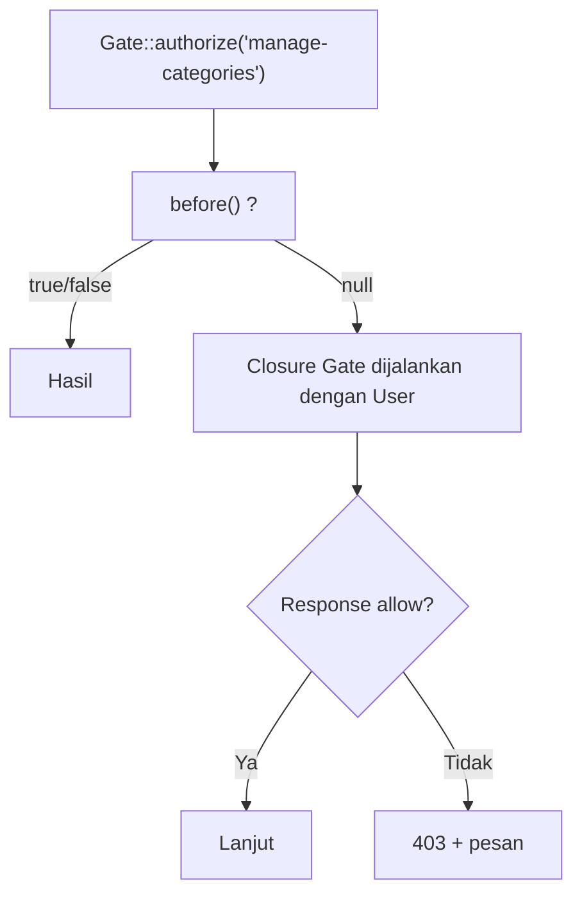

# Gate

**Gate** adalah aturan otorisasi berbentuk closure: "apakah pengguna ini boleh melakukan aksi X?" Ia cocok untuk aksi yang tidak terikat pada satu model, misalnya "melihat panel admin" atau
"mengelola kategori". Sub bab ini mengajarkan mendefinisikan Gate, memeriksanya di kode, route, dan Blade, memberi pesan penolakan, dan memakai `Gate::before`.

## Tujuan Pembelajaran

Setelah menyelesaikan sub bab ini, kamu dapat:

- [ ] Mendefinisikan Gate dengan `Gate::define` di `AppServiceProvider::boot()`.
- [ ] Memeriksa Gate dengan `Gate::allows`, `denies`, `authorize`, `inspect`, dan `$user->can`.
- [ ] Memasang Gate pada route dengan `can` dan di Blade dengan `@can`/`@cannot`.
- [ ] Mengembalikan respons penolakan dengan pesan memakai `Response::deny`.
- [ ] Memakai `Gate::before` dan `Gate::after` untuk aturan menyeluruh.
- [ ] Menjelaskan kapan memilih Gate dan kapan Policy.

## Prasyarat

- [Otorisasi](05-16-authorization.md).
- [Service Provider](../level-01/01-14-service-container-overview.md) (gambaran) dan [Class dan Objek](../level-00/00-19-classes-and-objects.md).
- Akun uji `admin@contoh.test` dan akun lain.

## Pengantar

Hanya admin yang boleh mengelola kategori. Aturan itu dipakai di controller, di route, dan di navigasi. Dengan Gate bernama `manage-categories`, aturannya ditulis sekali dan dipakai di semua tempat.

## Penjelasan Konsep

### Mendefinisikan Gate

File: `app/Providers/AppServiceProvider.php`

```php-inline
use App\Models\User;
use Illuminate\Support\Facades\Gate;

public function boot(): void
{
    Gate::define('manage-categories', function (User $user): bool {
        return $user->isAdmin();
    });

    Gate::define('view-admin-area', fn (User $user): bool => $user->hasVerifiedEmail());
}
```

Closure otomatis menerima pengguna yang sedang masuk sebagai argumen pertama. Gate hanya dievaluasi untuk pengguna terautentikasi (tamu selalu ditolak kecuali tipe pengguna dibuat opsional).

Untuk sementara tambahkan di model `User` (peran sebenarnya dibuat pada sub bab 05.19):

```php-inline
public function isAdmin(): bool
{
    return $this->email === 'admin@contoh.test';
}
```

### Memeriksa Gate

| Cara | Hasil |
|---|---|
| `Gate::allows('manage-categories')` | `true`/`false` |
| `Gate::denies('manage-categories')` | Kebalikannya |
| `Gate::authorize('manage-categories')` | Melempar `AuthorizationException` (403) bila ditolak |
| `$user->can('manage-categories')` | Untuk pengguna tertentu |
| `$user->cannot(...)` | Kebalikannya |
| `Gate::inspect('manage-categories')` | Respons berisi pesan/ alasan |

```php-inline
public function index(): View
{
    Gate::authorize('manage-categories');   // 403 bila tidak berhak
    // ...
}
```

Gate dengan argumen tambahan (model, nilai) menerimanya setelah pengguna: `Gate::define('edit-settings', fn (User $user, Setting $setting) => ...)`, dipanggil `Gate::allows('edit-settings', $setting)`.

### Pada route

Pakai middleware `can` (atau method `can()` pada route):

```php-inline
Route::get('/admin/kategori', [AdminCategoryController::class, 'index'])
    ->middleware('can:manage-categories');

Route::post('/admin/kategori', [AdminCategoryController::class, 'store'])
    ->can('manage-categories');
```

Bila ditolak, pengguna mendapat 403.

### Di Blade

```html
@can('manage-categories')
    <a href="{{ route('admin.categories.index') }}">Admin Kategori</a>
@endcan

@cannot('manage-categories')
    <span class="text-gray-400">Admin Kategori (tidak tersedia)</span>
@endcannot
```

`@can` hanya mengatur tampilan. Pemeriksaan di server (route/controller) tetap wajib.

### Pesan penolakan

Kembalikan `Response` untuk pesan khusus:

```php-inline
use Illuminate\Auth\Access\Response;

Gate::define('manage-categories', function (User $user): Response {
    return $user->isAdmin()
        ? Response::allow()
        : Response::deny('Hanya admin yang boleh mengelola kategori.');
});
```

```php-inline
$response = Gate::inspect('manage-categories');
$response->allowed();    // bool
$response->message();    // pesan penolakan
```

`Gate::authorize` menyertakan pesan ini pada respons 403. Variasi `Response::denyAsNotFound()` menghasilkan 404.

### `before` dan `after`

`Gate::before` dijalankan sebelum semua pemeriksaan lain; mengembalikan `true` memberi izin, `false` menolak, `null` melanjutkan:

```php-inline
Gate::before(function (User $user, string $ability) {
    if ($user->isAdmin()) {
        return true;   // admin boleh semuanya
    }
});
```

Hati-hati: `before` yang membolehkan segalanya membuat sulit membatasi admin; dokumentasikan keputusan ini.

### Gate atau Policy?

| Gate | Policy |
|---|---|
| Aksi umum tanpa model | Aksi pada model tertentu |
| Closure sederhana | Kelas terorganisasi per model |
| Sedikit aturan | Banyak aturan per model |

### Keamanan

- Tolak secara bawaan; kembalikan `false` untuk kasus yang tidak dikenali.
- Pesan penolakan tidak boleh membocorkan detail internal.
- Jangan menaruh pemeriksaan hak hanya di `@can`; server harus memeriksa juga.

## Cara Kerja



## Contoh Praktik

Kamu mendefinisikan Gate `manage-categories`, memakainya di controller, route, dan navigasi, serta membuktikan bahwa pengguna non-admin mendapat 403 dengan pesan khusus.

## Penjelasan Kode

Gate dan metode `isAdmin()` ada pada bagian konsep. Terapkan pada route kategori:

```php-inline
Route::middleware(['auth', 'verified', 'log.admin'])->prefix('admin')->name('admin.')->group(function () {
    // ... route artikel
    Route::get('/kategori', [AdminCategoryController::class, 'index'])->can('manage-categories')->name('categories.index');
    Route::post('/kategori', [AdminCategoryController::class, 'store'])->can('manage-categories')->name('categories.store');
    Route::delete('/kategori/{category}', [AdminCategoryController::class, 'destroy'])->can('manage-categories')->name('categories.destroy');
});
```

Di nav layout, bungkus tautan "Admin Kategori" dengan `@can('manage-categories') ... @endcan`.

## Implementasi Langkah demi Langkah

### Langkah 1: definisikan Gate dan `isAdmin()`

Tambahkan ke `AppServiceProvider` dan `User`.

### Langkah 2: pasang pada route dan nav

Gunakan `->can('manage-categories')` pada route kategori dan `@can` di nav.

### Langkah 3: uji sebagai admin

Masuk sebagai `admin@contoh.test` dan buka `/admin/kategori`: terbuka.

### Langkah 4: uji sebagai non-admin

Masuk sebagai `ani@contoh.test`: tautan tidak tampil; buka `/admin/kategori` langsung: `403`.

### Langkah 5: pesan penolakan

Ubah Gate memakai `Response::deny('...')` dan lihat pesan pada halaman 403 (di mode `APP_DEBUG=true` atau dengan view `errors/403`).

### Langkah 6: uji `inspect` di Tinker

```php-inline
$u = App\Models\User::where('email', 'ani@contoh.test')->first();
Illuminate\Support\Facades\Gate::forUser($u)->inspect('manage-categories')->message();
Illuminate\Support\Facades\Gate::forUser($u)->allows('manage-categories');
```

### Langkah 7: catat di Git

```bash
git add app resources routes
git commit -m "Tambah Gate manage-categories"
```

## Eksekusi dan Verifikasi

| Langkah | Cara memverifikasi |
|---|---|
| 3 | Halaman kategori terbuka untuk admin |
| 4 | Non-admin: tautan tersembunyi, URL langsung 403 |
| 6 | `allows` false untuk Ani; pesan penolakan muncul |

## Hasil yang Diharapkan

| Pengguna | `/admin/kategori` |
|---|---|
| Admin | `200` |
| Non-admin | `403` |
| Tamu | `302` ke login |

Hasil ini diturunkan dari dokumentasi dan belum dijalankan oleh penulis materi; cocokkan dengan hasilmu.

## Kesalahan Umum dan Pemecahan Masalah

| Gejala | Penyebab | Cara mengenali | Solusi | Pencegahan |
|---|---|---|---|---|
| Gate tak dikenali | Definisi tidak dimuat (salah tempat) | `@can` selalu false | Definisikan di `boot()` provider | Letakkan di `AppServiceProvider` |
| Selalu 403 untuk admin | `isAdmin()` salah | Admin ditolak | Periksa logika | Uji di Tinker |
| Tamu mendapat 403 bukan login | `can` sebelum `auth` | Pesan salah | Pasang `auth` lebih dulu | Urutan middleware |
| `before` memberi akses berlebihan | Mengembalikan `true` tanpa syarat | Aturan Policy tak berlaku untuk admin | Batasi syarat | Dokumentasikan |
| Pesan penolakan tak tampil | Debug mati / tidak ada view | Halaman 403 generik | Buat `resources/views/errors/403.blade.php` | Sediakan halaman galat |
| `@can` menyembunyikan tombol tetapi aksi masih bisa dilakukan | Tidak ada pemeriksaan server | URL langsung berhasil | Tambahkan `can` pada route | Server wajib memeriksa |

## Latihan Praktik

### Latihan dasar

**D1. Tiga cara memeriksa**
- *Masalah:* ingin memahami pilihan.
- *Persyaratan:* tulis contoh `Gate::allows`, `Gate::authorize`, dan `$user->can` untuk Gate yang sama dan jelaskan perbedaannya.
- *Perilaku yang diharapkan:* `authorize` melempar 403, lainnya mengembalikan boolean.
- *Tujuan belajar:* memilih pemeriksaan.

### Latihan implementasi

**I1. Gate dengan argumen**
- *Masalah:* hanya pemilik atau admin boleh melihat draf.
- *Persyaratan:* definisikan `view-draft` yang menerima `Article`, izinkan admin atau pemilik, dan pakai di halaman artikel.
- *Perilaku yang diharapkan:* draf hanya terlihat oleh pemilik/admin.
- *Tujuan belajar:* Gate berparameter.

**I2. Respons khusus**
- *Masalah:* pesan penolakan yang ramah.
- *Persyaratan:* gunakan `Response::deny` dan `denyAsNotFound` pada dua Gate dan bandingkan hasilnya (403 vs 404).
- *Perilaku yang diharapkan:* kode status sesuai.
- *Tujuan belajar:* menyesuaikan respons.

### Latihan tantangan

**T1. Audit `before`**
- *Masalah:* seseorang menambah `Gate::before` yang mengizinkan admin segalanya.
- *Persyaratan:* jelaskan dua risiko (admin tak bisa dibatasi, aksi berbahaya tak teraudit) dan rancang alternatif yang lebih aman.
- *Perilaku yang diharapkan:* analisis dengan alternatif.
- *Tujuan belajar:* menilai desain otorisasi.
- *Catatan:* kerjakan mandiri; tidak ada kunci jawaban.

## Uji Pemahaman

1. Di mana Gate didefinisikan?
2. Apa beda `Gate::allows` dan `Gate::authorize`?
3. Apa fungsi `Gate::before`?
4. Bagaimana memasang Gate pada route?
5. Mengapa `@can` saja tidak cukup?
6. Kapan memilih Policy?

??? success "Kunci jawaban singkat"
    1. Di `boot()` `AppServiceProvider` dengan `Gate::define`.
    2. `allows` mengembalikan boolean; `authorize` melempar 403 bila ditolak.
    3. Menjalankan pemeriksaan sebelum yang lain dan dapat langsung mengizinkan/menolak.
    4. `->middleware('can:nama')` atau `->can('nama')`.
    5. Hanya mengatur tampilan; server harus memeriksa.
    6. Saat aksi terikat pada model tertentu dengan banyak aturan.

## Ringkasan

- Gate adalah closure otorisasi; definisikan di `AppServiceProvider`.
- Periksa dengan `allows/denies/authorize/inspect`, middleware `can`, dan `@can`.
- `Response::deny` memberi pesan; `before` membuat aturan menyeluruh (hati-hati).
- Gate untuk aksi umum; Policy untuk aksi pada model.

Selanjutnya: *Policy*, otorisasi untuk model seperti `Article`.

## Referensi Resmi

- [Laravel: Gates](https://laravel.com/docs/13.x/authorization#gates)
- [Laravel: Authorizing Actions](https://laravel.com/docs/13.x/authorization#authorizing-actions)
- [Laravel: Gate Responses](https://laravel.com/docs/13.x/authorization#gate-responses)
