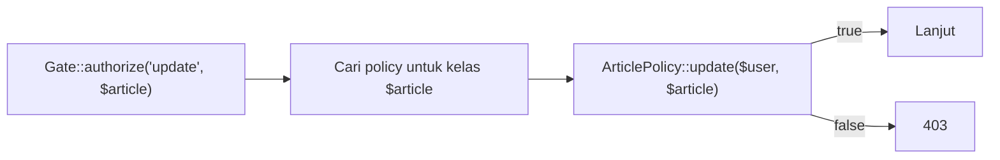

# Policy

**Policy** adalah kelas yang mengelompokkan seluruh aturan otorisasi untuk satu model: siapa boleh melihat, membuat, mengubah, menghapus, memulihkan, atau menghapus permanen. Dibanding banyak Gate lepas,
Policy lebih terorganisasi dan otomatis ditemukan oleh Laravel. Sub bab ini membuat `ArticlePolicy`, memakainya di controller, route, dan Blade, serta menggantikan pemeriksaan manual sementara dari sub bab 05.16.

## Tujuan Pembelajaran

Setelah menyelesaikan sub bab ini, kamu dapat:

- [ ] Membuat Policy dengan `php artisan make:policy ArticlePolicy --model=Article`.
- [ ] Menulis metode Policy (`viewAny`, `view`, `create`, `update`, `delete`, `restore`, `forceDelete`).
- [ ] Menjelaskan penemuan otomatis Policy dan atribut `#[UsePolicy]`.
- [ ] Memanggil Policy dengan `Gate::authorize`, `$user->can`, `@can`, dan middleware `can`.
- [ ] Menangani aksi tanpa model (`create`) dan tamu (pengguna opsional).
- [ ] Memakai metode `before` pada Policy secara hati-hati.

## Prasyarat

- [Gate](05-17-gates.md) dan [Otorisasi](05-16-authorization.md).
- Model `Article` dengan `user_id`, soft delete, dan `Admin\ArticleController`.
- Pemeriksaan sementara `abort_unless` dari sub bab 05.16.

## Pengantar

Aturan untuk artikel muncul di banyak tempat: daftar, form ubah, simpan, hapus, tempat sampah. Satu kelas `ArticlePolicy` menjadi sumber kebenaran tunggal yang mudah dibaca, diuji, dan diubah.

## Penjelasan Konsep

### Membuat Policy

```bash
php artisan make:policy ArticlePolicy --model=Article
```

File dibuat di `app/Policies/ArticlePolicy.php` dengan kerangka metode standar.

File: `app/Policies/ArticlePolicy.php`

```php
<?php

namespace App\Policies;

use App\Models\Article;
use App\Models\User;

class ArticlePolicy
{
    public function viewAny(User $user): bool
    {
        return true;
    }

    public function view(User $user, Article $article): bool
    {
        return $article->is_published || $this->owns($user, $article) || $user->isAdmin();
    }

    public function create(User $user): bool
    {
        return true;
    }

    public function update(User $user, Article $article): bool
    {
        return $this->owns($user, $article) || $user->isAdmin();
    }

    public function delete(User $user, Article $article): bool
    {
        return $this->owns($user, $article) || $user->isAdmin();
    }

    public function restore(User $user, Article $article): bool
    {
        return $user->isAdmin();
    }

    public function forceDelete(User $user, Article $article): bool
    {
        return $user->isAdmin();
    }

    private function owns(User $user, Article $article): bool
    {
        return $article->user_id !== null && $article->user_id === $user->id;
    }
}
```

Parameter pertama selalu `User`; parameter kedua adalah model (kecuali `viewAny` dan `create`, yang tidak memerlukan instance). `isAdmin()` masih sementara (peran sebenarnya di sub bab 05.19).

### Registrasi Policy

Laravel menemukan Policy secara otomatis bila mengikuti konvensi: `App\Policies\ArticlePolicy` untuk `App\Models\Article`. Cara eksplisit di 13.x memakai atribut pada model:

```php-inline
use App\Policies\ArticlePolicy;
use Illuminate\Database\Eloquent\Attributes\UsePolicy;

#[UsePolicy(ArticlePolicy::class)]
class Article extends Model
{
    // ...
}
```

Alternatif lain: `Gate::policy(Article::class, ArticlePolicy::class)` di `AppServiceProvider::boot()`.

### Memakai di controller

```php-inline
use Illuminate\Support\Facades\Gate;

public function edit(Article $article): View
{
    Gate::authorize('update', $article);
    // ...
}

public function create(): View
{
    Gate::authorize('create', Article::class);   // tanpa instance: beri nama kelas
    // ...
}
```

`Gate::authorize('update', $article)` memetakan ke `ArticlePolicy::update`. Bila ditolak: 403. Alternatif: `$request->user()->can('update', $article)` yang mengembalikan boolean.

### Memakai di route

```php-inline
Route::get('/artikel/{article}/ubah', [AdminArticleController::class, 'edit'])->can('update', 'article');
Route::post('/artikel', [AdminArticleController::class, 'store'])->can('create', Article::class);
```

Argumen kedua `'article'` adalah nama parameter route yang di-*bind* menjadi model. Cocok untuk route yang kodenya tidak ingin memeriksa sendiri; bagi controller dengan banyak metode,
dokumentasi 13.x juga menyediakan atribut `#[Authorize('update', 'article')]` untuk metode controller.

### Memakai di Blade

```html
@can('update', $article)
    <a href="{{ route('admin.articles.edit', $article) }}">Ubah</a>
@endcan

@can('create', App\Models\Article::class)
    <a href="{{ route('admin.articles.create') }}">Artikel baru</a>
@endcan
```

### Tamu dan pengguna opsional

Secara bawaan, Gate dan Policy menolak tamu tanpa menjalankan metode. Untuk mengizinkan tamu (mis. melihat artikel terbit), buat tipe pengguna opsional: `public function view(?User $user, Article $article)`.

### Metode `before`

```php-inline
public function before(User $user, string $ability): ?bool
{
    return $user->isAdmin() ? true : null;
}
```

Mengembalikan `true`/`false` memutuskan langsung; `null` meneruskan ke metode biasa. Pakai hanya bila "admin boleh semuanya" memang aturan bisnismu; kalau tidak, tulis admin di tiap metode agar eksplisit.

### Soft delete dan pemulihan

Aksi `restore` dan `forceDelete` memiliki metode sendiri sehingga pemulihan dapat dibatasi lebih ketat dari penghapusan biasa.

### Keamanan

- Tangani `user_id === null` secara eksplisit agar data yatim tidak terbuka bagi pengguna acak.
- Otorisasi **setiap** aksi controller, termasuk `restore` yang menerima ID mentah (`findOrFail($id)` lalu `authorize`).
- Jangan mempercayai input untuk menentukan pemilik; gunakan `$request->user()`.

## Cara Kerja



## Contoh Praktik

Kamu membuat `ArticlePolicy`, menerapkannya di `Admin\ArticleController` (menggantikan `abort_unless`), di route, dan di tampilan daftar admin, lalu menguji dengan akun Ani, Budi, dan admin.

## Penjelasan Kode

Perubahan di `Admin\ArticleController`:

```php-inline
use Illuminate\Support\Facades\Gate;

public function create(): View
{
    Gate::authorize('create', Article::class);
    // ...
}

public function store(Request $request): RedirectResponse
{
    Gate::authorize('create', Article::class);
    // ...
}

public function edit(Article $article): View
{
    Gate::authorize('update', $article);
    // ...
}

public function update(Request $request, Article $article): RedirectResponse
{
    Gate::authorize('update', $article);
    // ...
}

public function destroy(Article $article): RedirectResponse
{
    Gate::authorize('delete', $article);
    // ...
}

public function restore(int $id): RedirectResponse
{
    $article = Article::onlyTrashed()->findOrFail($id);
    Gate::authorize('restore', $article);
    // ...
}
```

Hapus `abort_unless(...)` sementara. Pada daftar admin, tampilkan tombol dengan `@can('update', $article)` dan `@can('delete', $article)`; tombol **Pulihkan** dengan `@can('restore', $article)`.
Pada `store`, tetapkan penulis dari pengguna yang masuk (`$request->user()->id`) kecuali admin, bukan dari input form.

## Implementasi Langkah demi Langkah

### Langkah 1: buat Policy

```bash
php artisan make:policy ArticlePolicy --model=Article
```

Isi dengan kode pada bagian konsep.

### Langkah 2: terapkan di controller

Tambahkan `Gate::authorize(...)` pada metode di atas dan hapus pemeriksaan manual.

### Langkah 3: terapkan di tampilan

Bungkus tombol Ubah/Hapus/Pulihkan dengan `@can`.

### Langkah 4: uji dengan tiga akun

| Pelaku | Aksi | Harapan |
|---|---|---|
| Ani | Ubah artikel Ani | berhasil |
| Ani | Ubah artikel Budi | 403 |
| Ani | Hapus artikel sendiri | berhasil (soft delete) |
| Ani | Pulihkan artikel | 403 |
| Admin | Ubah/hapus/pulihkan artikel siapa pun | berhasil |

### Langkah 5: uji dengan Tinker

```php-inline
$ani = App\Models\User::where('email','ani@contoh.test')->first();
$a = App\Models\Article::where('title','Artikel Budi')->first();
$ani->can('update', $a);
$ani->can('create', App\Models\Article::class);
```

### Langkah 6: periksa route

Tambahkan `->can('update', 'article')` pada route `edit` dan lihat middleware dengan `route:list -v`.

### Langkah 7: catat di Git

```bash
git add app resources routes
git commit -m "Tambah ArticlePolicy dan terapkan pada admin artikel"
```

## Eksekusi dan Verifikasi

| Langkah | Cara memverifikasi |
|---|---|
| 4 | Seluruh baris tabel sesuai |
| 5 | `can('update', artikel Budi)` false untuk Ani; `can('create', ...)` true |
| 6 | `route:list -v` memuat `can:update,article` |

## Hasil yang Diharapkan

| Uji | Hasil |
|---|---|
| Ani mengubah artikel Budi | `403 This action is unauthorized.` |
| Ani melihat tombol Ubah pada artikel Budi | Tidak ada |
| Admin memulihkan artikel | Berhasil |

Teks pesan 403 bergantung versi dan bahasa. Hasil ini diturunkan dari dokumentasi dan belum dijalankan oleh penulis materi; cocokkan dengan hasilmu.

## Kesalahan Umum dan Pemecahan Masalah

| Gejala | Penyebab | Cara mengenali | Solusi | Pencegahan |
|---|---|---|---|---|
| Policy tidak dipakai | Nama/namespace tidak mengikuti konvensi | Selalu 403 / aturan tak berjalan | Pakai `#[UsePolicy]` atau `Gate::policy` | Ikuti konvensi |
| `create` selalu 403 | Memanggil `authorize('create')` tanpa kelas | Pesan tak sesuai | `authorize('create', Article::class)` | Beri nama kelas |
| Tamu tak pernah diizinkan | Tipe `User` non-opsional | 403 untuk tamu | `?User` bila perlu | Putuskan sadar |
| `before` mengizinkan segalanya | Mengembalikan `true` tanpa syarat | Pembatasan tak bekerja | Batasi atau hapus | Dokumentasi |
| Artikel yatim dapat diubah semua orang | `null === null` | Aturan bocor | Periksa `user_id !== null` | Tangani `null` |
| Tombol tampil tetapi 403 | Aturan `@can` dan server tak sama | Perilaku tak konsisten | Pakai Policy yang sama di keduanya | Satu sumber kebenaran |

## Latihan Praktik

### Latihan dasar

**D1. Petakan metode**
- *Masalah:* ingin memahami pemetaan.
- *Persyaratan:* tulis metode Policy yang dipanggil oleh: daftar artikel, lihat detail, form baru, simpan, ubah, hapus, pulihkan, hapus permanen.
- *Perilaku yang diharapkan:* `viewAny`, `view`, `create`, `create`, `update`, `delete`, `restore`, `forceDelete`.
- *Tujuan belajar:* memetakan aksi ke metode.

### Latihan implementasi

**I1. Policy komentar**
- *Masalah:* pemilik artikel dan admin boleh menghapus komentar di artikelnya.
- *Persyaratan:* buat `CommentPolicy::delete` yang mengizinkan admin atau pemilik artikel induk; terapkan di `Admin\CommentController` dan tampilan.
- *Perilaku yang diharapkan:* pengguna acak ditolak.
- *Tujuan belajar:* Policy pada relasi.

**I2. Policy kategori**
- *Masalah:* kategori memakai Gate; ingin Policy.
- *Persyaratan:* buat `CategoryPolicy` dengan `viewAny`, `create`, `delete` dan ganti Gate `manage-categories`.
- *Perilaku yang diharapkan:* perilaku sama dengan struktur lebih rapi.
- *Tujuan belajar:* membandingkan Gate dan Policy.

### Latihan tantangan

**T1. Uji Policy**
- *Masalah:* tim ingin menguji aturan tanpa HTTP.
- *Persyaratan:* di Tinker/skrip, tulis tabel kebenaran (pengguna × aksi × pemilik/bukan) yang memanggil `$user->can(...)` dan bandingkan dengan hasil yang diharapkan.
- *Perilaku yang diharapkan:* semua sel cocok.
- *Tujuan belajar:* memverifikasi aturan.
- *Catatan:* kerjakan mandiri; tidak ada kunci jawaban.

## Uji Pemahaman

1. Apa keuntungan Policy dibanding Gate?
2. Bagaimana Laravel menemukan `ArticlePolicy`?
3. Mengapa `create` dipanggil dengan nama kelas?
4. Bagaimana mengizinkan tamu pada Policy?
5. Kapan `before` berbahaya?
6. Mengapa `restore` perlu otorisasi terpisah?

??? success "Kunci jawaban singkat"
    1. Aturan satu model terorganisasi dalam satu kelas dan ditemukan otomatis.
    2. Lewat konvensi nama/namespace, atau `#[UsePolicy]`/`Gate::policy`.
    3. Tidak ada instance model saat membuat.
    4. Jadikan parameter pengguna opsional (`?User`).
    5. Bila mengizinkan segalanya tanpa syarat sehingga aturan lain tak berlaku.
    6. Pemulihan bisa lebih sensitif daripada penghapusan biasa.

## Ringkasan

- Policy mengelompokkan aturan otorisasi per model; dibuat dengan `make:policy --model`.
- Dipanggil lewat `Gate::authorize`, `$user->can`, `@can`, dan `can` pada route.
- Tangani `create` (nama kelas), tamu (`?User`), dan data yatim.
- Gunakan `before` hati-hati; otorisasi setiap aksi.

Selanjutnya: *Role-Based Access Control*, menyusun peran admin, editor, dan penulis.

## Referensi Resmi

- [Laravel: Creating Policies](https://laravel.com/docs/13.x/authorization#creating-policies)
- [Laravel: Registering Policies](https://laravel.com/docs/13.x/authorization#registering-policies)
- [Laravel: Authorizing Actions Using Policies](https://laravel.com/docs/13.x/authorization#authorizing-actions-using-policies)
- [Laravel: Authorizing Actions via Middleware](https://laravel.com/docs/13.x/authorization#via-middleware)
