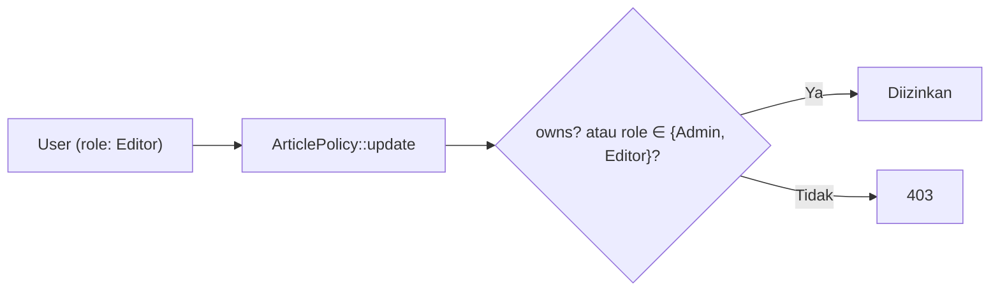

# Role-Based Access Control

**RBAC** (*Role-Based Access Control*) mengatur hak akses berdasarkan **peran** yang dimiliki pengguna, bukan per individu. Daripada memutuskan hak setiap orang satu per satu, kamu menentukan peran
(admin, editor, penulis) beserta hak tiap peran, lalu menetapkan peran kepada pengguna. Sub bab ini mengimplementasikan RBAC sederhana tanpa paket tambahan: kolom `role`, `enum` PHP, Policy yang sadar peran, dan halaman admin untuk mengelola peran dengan aman.

## Tujuan Pembelajaran

Setelah menyelesaikan sub bab ini, kamu dapat:

- [ ] Menjelaskan RBAC, prinsip hak terkecil, dan perbedaannya dari izin per pengguna.
- [ ] Menambahkan kolom `role` dan memetakannya ke `enum` PHP dengan cast Eloquent.
- [ ] Menulis metode bantu `hasRole`, `isAdmin`, dan `isEditor` pada `User`.
- [ ] Memperbarui Gate dan Policy agar memakai peran.
- [ ] Membuat halaman admin untuk mengubah peran dengan perlindungan (tidak mengubah diri sendiri, admin terakhir).
- [ ] Mencegah kenaikan hak lewat *mass assignment*.

## Prasyarat

- [Gate](05-17-gates.md) dan [Policy](05-18-policies.md).
- [Mass Assignment (bab Database)](../level-04/04-13-creating-models.md).
- Model `User`, `Article`, dan `ArticlePolicy` dengan `isAdmin()` sementara.

## Pengantar

Tim redaksi punya tiga peran: **admin** (mengelola semua), **editor** (mengubah semua artikel, mengelola kategori), dan **penulis** (menulis dan mengelola artikelnya sendiri). Peran menjadikan aturan
mudah dijelaskan dan diaudit.

## Penjelasan Konsep

### Matriks hak

| Aksi | Tamu | Penulis | Editor | Admin |
|---|---|---|---|---|
| Baca artikel terbit | Ya | Ya | Ya | Ya |
| Buat artikel | - | Ya | Ya | Ya |
| Ubah artikel | - | Milik sendiri | Semua | Semua |
| Hapus artikel (tempat sampah) | - | Milik sendiri | Milik sendiri | Semua |
| Pulihkan / hapus permanen | - | - | - | Ya |
| Kelola kategori | - | - | Ya | Ya |
| Kelola pengguna dan peran | - | - | - | Ya |

Matriks seperti ini adalah spesifikasi: tulis dulu, baru kodekan.

### Kolom `role` dan `enum`

```bash
php artisan make:migration add_role_to_users_table --table=users
```

```php
public function up(): void
{
    Schema::table('users', function (Blueprint $table) {
        $table->string('role', 20)->default('author')->index();
    });
}

public function down(): void
{
    Schema::table('users', function (Blueprint $table) {
        $table->dropColumn('role');
    });
}
```

Dipilih `string` (bukan `enum` database) agar portabel; keabsahan nilai dijaga `enum` PHP.

File: `app/Enums/UserRole.php`

```php
<?php

namespace App\Enums;

enum UserRole: string
{
    case Admin = 'admin';
    case Editor = 'editor';
    case Author = 'author';

    public function label(): string
    {
        return match ($this) {
            self::Admin => 'Admin',
            self::Editor => 'Editor',
            self::Author => 'Penulis',
        };
    }
}
```

### Model `User`

```php
use App\Enums\UserRole;

protected function casts(): array
{
    return [
        'email_verified_at' => 'datetime',
        'password' => 'hashed',
        'role' => UserRole::class,
    ];
}

public function hasRole(UserRole ...$roles): bool
{
    return in_array($this->role, $roles, true);
}

public function isAdmin(): bool
{
    return $this->hasRole(UserRole::Admin);
}

public function isEditor(): bool
{
    return $this->hasRole(UserRole::Editor);
}
```

**Jangan** memasukkan `role` ke `#[Fillable]`. Atur peran lewat kode tepercaya: `$user->role = UserRole::Editor; $user->save();`. Cast mengubah string database menjadi enum.

### Gate dan Policy berbasis peran

```php
// AppServiceProvider::boot()
Gate::define('manage-categories', fn (User $user) => $user->hasRole(UserRole::Admin, UserRole::Editor));
Gate::define('manage-users', fn (User $user) => $user->isAdmin());
```

Perbarui `ArticlePolicy`:

```php
public function view(User $user, Article $article): bool
{
    return $article->is_published || $this->owns($user, $article) || $user->hasRole(UserRole::Admin, UserRole::Editor);
}

public function update(User $user, Article $article): bool
{
    return $this->owns($user, $article) || $user->hasRole(UserRole::Admin, UserRole::Editor);
}

public function delete(User $user, Article $article): bool
{
    return $this->owns($user, $article) || $user->isAdmin();
}
```

`restore` dan `forceDelete` tetap hanya admin.

### Mengelola peran dengan aman

File: `app/Http/Controllers/Admin/UserController.php`

```php
<?php

namespace App\Http\Controllers\Admin;

use App\Enums\UserRole;
use App\Http\Controllers\Controller;
use App\Models\User;
use Illuminate\Http\RedirectResponse;
use Illuminate\Http\Request;
use Illuminate\Support\Facades\Gate;
use Illuminate\Validation\Rule;
use Illuminate\View\View;

class UserController extends Controller
{
    public function index(): View
    {
        Gate::authorize('manage-users');

        return view('admin.users.index', [
            'users' => User::orderBy('name')->paginate(15),
            'roles' => UserRole::cases(),
        ]);
    }

    public function updateRole(Request $request, User $user): RedirectResponse
    {
        Gate::authorize('manage-users');

        $data = $request->validate(['role' => ['required', Rule::enum(UserRole::class)]]);
        $newRole = UserRole::from($data['role']);

        if ($user->is($request->user())) {
            return back()->withErrors(['role' => 'Kamu tidak dapat mengubah perananmu sendiri.']);
        }

        if ($user->isAdmin() && $newRole !== UserRole::Admin
            && User::where('role', UserRole::Admin->value)->count() <= 1) {
            return back()->withErrors(['role' => 'Tidak boleh menurunkan admin terakhir.']);
        }

        $user->role = $newRole;
        $user->save();

        return back()->with('status', "Peran {$user->name} menjadi {$newRole->label()}.");
    }
}
```

| Perlindungan | Alasan |
|---|---|
| `Gate::authorize('manage-users')` | Hanya admin |
| `Rule::enum(UserRole::class)` | Nilai harus salah satu peran sah |
| Tolak mengubah diri sendiri | Cegah mengunci diri atau eskalasi lewat kesalahan |
| Admin terakhir | Pastikan selalu ada admin |
| Atur `role` secara eksplisit | Bukan lewat mass assignment |

Route (dalam grup admin): `Route::get('/pengguna', ...)->name('users.index');` dan `Route::patch('/pengguna/{user}/peran', ...)->name('users.role');`.

### Seeder dan factory

Tambahkan state di `UserFactory`:

```php
public function admin(): static
{
    return $this->state(fn () => ['role' => UserRole::Admin]);
}

public function editor(): static
{
    return $this->state(fn () => ['role' => UserRole::Editor]);
}
```

Factory mengabaikan perlindungan mass assignment, sehingga atribut `role` dapat diisi. Pada seeder: `User::factory()->admin()->create(['email' => 'admin@contoh.test'])`.

### Batas RBAC sederhana

Satu kolom `role` berarti satu peran per pengguna. Untuk kebutuhan lebih rumit (banyak peran, izin granular yang bisa diatur lewat UI), pertimbangkan tabel `roles`/`permissions` atau paket yang teruji;
pada saat itu prinsipnya (Gate/Policy memeriksa izin) tetap sama.

### Keamanan

- Eskalasi hak lewat mass assignment adalah celah klasik: pastikan `role` tidak pernah bisa diisi dari input pengguna biasa.
- Jangan mempercayai peran dari sisi klien (cookie, field tersembunyi).
- Catat perubahan peran (audit) dan batasi pada admin.
- Prinsip hak terkecil: peran bawaan pendaftar adalah yang paling rendah (`author`).

## Cara Kerja



## Contoh Praktik

Kamu menambah peran, memperbarui Gate dan Policy, menyiapkan tiga akun (admin, editor, penulis), membuat halaman pengguna admin, dan menguji matriks hak serta perlindungan perubahan peran.

## Penjelasan Kode

Semua kode ada pada bagian konsep. Tampilan `admin/users/index.blade.php`: tabel pengguna dengan form `PATCH` per baris berisi `select` peran (`@foreach ($roles as $r) <option value="{{ $r->value }}" @selected($user->role === $r)>{{ $r->label() }}</option>`), `@csrf`, `@method('PATCH')`, dan tautan nav dibungkus `@can('manage-users')`.

## Implementasi Langkah demi Langkah

### Langkah 1: migration dan enum

Buat migration, enum, cast, dan metode di `User`; jalankan `php artisan migrate`.

### Langkah 2: perbarui Gate, Policy, dan factory

Ubah sesuai bagian konsep; hapus `isAdmin()` berbasis email.

### Langkah 3: seed akun

```bash
php artisan tinker --execute="
App\Models\User::where('email','admin@contoh.test')->update(['role' => 'admin']);
App\Models\User::factory()->editor()->create(['email' => 'editor@contoh.test']);
"
```

Pengguna lain (`ani@`, `budi@`) otomatis berperan `author` (nilai bawaan kolom). `update(['role' => ...])` pada query massal melewati pengisian massal model sehingga tetap berfungsi untuk operasi administratif ini.

### Langkah 4: halaman pengguna

Buat controller, route, dan view; tambahkan tautan nav dengan `@can('manage-users')`.

### Langkah 5: uji matriks

Masuk sebagai tiap peran dan coba semua aksi pada matriks hak. Catat hasil dalam tabel.

### Langkah 6: uji perlindungan

| Uji | Harapan |
|---|---|
| Admin menurunkan diri sendiri | galat |
| Admin tunggal diturunkan | galat |
| Penulis memanggil `PATCH /admin/pengguna/1/peran` | 403 |
| Peran bernilai `superadmin` | galat validasi |

### Langkah 7: uji eskalasi

Daftar akun baru dengan `role=admin` lewat `curl` pada form registrasi; periksa bahwa peran tetap `author`.

### Langkah 8: catat di Git

```bash
git add app database resources routes
git commit -m "Tambah RBAC: peran admin, editor, penulis"
```

## Eksekusi dan Verifikasi

| Langkah | Cara memverifikasi |
|---|---|
| 3 | `User::pluck('role','email')` menampilkan peran yang diharapkan |
| 5 | Matriks cocok dengan spesifikasi |
| 6 | Semua perlindungan berfungsi |
| 7 | Akun baru berperan `author` |

## Hasil yang Diharapkan

| Aktor | Aksi | Hasil |
|---|---|---|
| Editor | Ubah artikel orang lain | Berhasil |
| Editor | Hapus artikel orang lain | 403 |
| Penulis | Buka `/admin/kategori` | 403 |
| Admin | Ubah peran Ani menjadi Editor | Berhasil, pesan status |
| Pengguna baru | Registrasi dengan `role=admin` | Peran tetap `author` |

Hasil ini diturunkan dari dokumentasi dan belum dijalankan oleh penulis materi; cocokkan dengan hasilmu.

## Kesalahan Umum dan Pemecahan Masalah

| Gejala | Penyebab | Cara mengenali | Solusi | Pencegahan |
|---|---|---|---|---|
| `"admin" is not a valid backing value` | Nilai database di luar enum | Galat cast | Perbaiki data atau enum | Validasi nilai |
| `$user->role` berupa string | Cast belum ditambahkan | `=== UserRole::Admin` selalu false | Tambahkan cast | Cast untuk kolom enum |
| Tidak ada admin sama sekali | Menurunkan admin terakhir | Panel tak terjangkau | Perbaiki lewat Tinker/seeder | Perlindungan admin terakhir |
| Penulis menjadi admin lewat registrasi | `role` ada di `Fillable` | Peran tak sesuai | Hapus dari `Fillable` | Allow-list sempit |
| `Gate::before` melewati batasan editor | Terlalu longgar | Editor bisa semuanya | Hapus/batasi | Hindari `before` luas |
| Peran tak berubah di UI | Cache/relasi lama | Nilai lama | Muat ulang pengguna | `refresh()` |
| Perubahan peran tak tercatat | Tanpa audit | Sulit dilacak | Tambahkan log | Catat perubahan hak |

## Latihan Praktik

### Latihan dasar

**D1. Lengkapi matriks**
- *Masalah:* kebutuhan baru: peran `moderator` hanya menghapus komentar.
- *Persyaratan:* perluas matriks hak dan tentukan perubahan pada enum, Gate/Policy, dan UI.
- *Perilaku yang diharapkan:* rancangan lengkap.
- *Tujuan belajar:* mengembangkan RBAC.

### Latihan implementasi

**I1. Peran moderator**
- *Masalah:* implementasikan `moderator`.
- *Persyaratan:* tambah kasus enum, `CommentPolicy::delete` yang mengizinkan moderator, dan uji.
- *Perilaku yang diharapkan:* moderator menghapus komentar tetapi tidak mengubah artikel.
- *Tujuan belajar:* menambah peran.

**I2. Log audit**
- *Masalah:* perubahan peran harus tercatat.
- *Persyaratan:* tulis `Log::info` berisi pelaku, sasaran, peran lama, dan baru pada `updateRole`, tanpa data sensitif.
- *Perilaku yang diharapkan:* jejak audit di log.
- *Tujuan belajar:* audit perubahan hak.

### Latihan tantangan

**T1. Dari satu peran ke izin**
- *Masalah:* satu kolom peran tidak cukup.
- *Persyaratan:* rancang skema `roles`, `permissions`, `role_user`, dan `permission_role` (banyak-ke-banyak) dan jelaskan bagaimana Gate dinamis memeriksanya; tanpa harus mengimplementasikan.
- *Perilaku yang diharapkan:* rancangan konsisten dan menyebut kompromi (kompleksitas, cache).
- *Tujuan belajar:* memahami evolusi RBAC.
- *Catatan:* kerjakan mandiri; tidak ada kunci jawaban.

## Uji Pemahaman

1. Apa beda RBAC dan izin per pengguna?
2. Mengapa `role` tidak boleh di `Fillable`?
3. Apa fungsi cast `UserRole::class`?
4. Mengapa melarang mengubah peran diri sendiri?
5. Mengapa melindungi admin terakhir?
6. Apa batas satu kolom `role`?

??? success "Kunci jawaban singkat"
    1. RBAC memberi hak lewat peran yang ditetapkan ke pengguna; izin per pengguna diatur satu per satu.
    2. Agar pengguna tak bisa menaikkan haknya lewat input.
    3. Mengubah string database menjadi enum PHP.
    4. Mencegah kesalahan fatal dan eskalasi tak sengaja.
    5. Menjamin selalu ada yang dapat mengelola sistem.
    6. Hanya satu peran per pengguna dan izin tidak granular.

## Ringkasan

- RBAC memberi hak berdasarkan peran; mulai dari matriks hak.
- Simpan peran sebagai kolom `string` yang dicast ke `enum`; jangan ada di `Fillable`.
- Gate dan Policy memeriksa peran; halaman admin mengubah peran dengan perlindungan.
- Gunakan hak terkecil dan catat perubahan hak.

Selanjutnya: *Perlindungan CSRF*, meninjau ulang dari sudut keamanan.

## Referensi Resmi

- [Laravel: Authorization](https://laravel.com/docs/13.x/authorization)
- [Laravel: Enum Casting](https://laravel.com/docs/13.x/eloquent-mutators#enum-casting)
- [Laravel: Rule enum](https://laravel.com/docs/13.x/validation#rule-enum)
- [OWASP: Authorization Cheat Sheet](https://cheatsheetseries.owasp.org/cheatsheets/Authorization_Cheat_Sheet.html)
