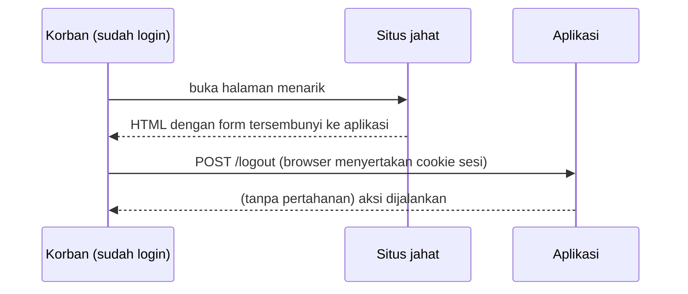
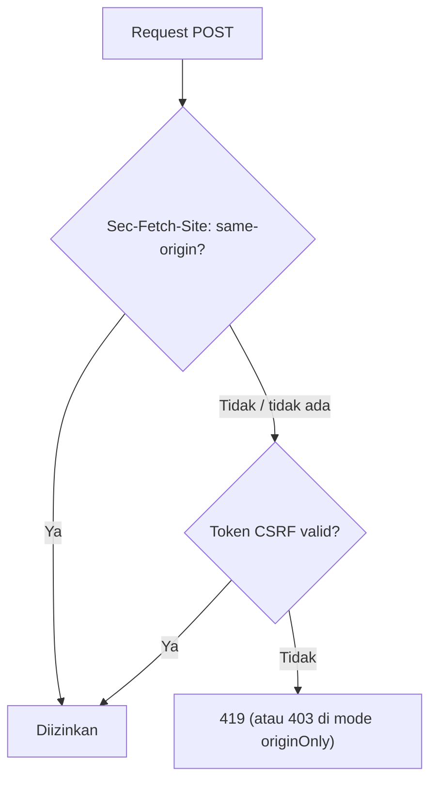

# Perlindungan CSRF

Kamu sudah memakai `@csrf` sejak bab Blade. Sub bab ini meninjaunya dari sudut keamanan: bagaimana serangan CSRF sebenarnya berjalan terhadap aplikasi yang sudah punya login, lapisan pertahanan di Laravel 13
(verifikasi asal, token, dan cookie `SameSite`), pengaturan sesi yang relevan, serta daftar periksa audit. Fokusnya memahami ancaman dan mengonfigurasi dengan benar, bukan sekadar menempel `@csrf`.

## Tujuan Pembelajaran

Setelah menyelesaikan sub bab ini, kamu dapat:

- [ ] Menjelaskan bagaimana CSRF memanfaatkan sesi login korban.
- [ ] Menyebutkan tiga lapis pertahanan: verifikasi `Sec-Fetch-Site`, token CSRF, dan cookie `SameSite`.
- [ ] Mengatur `SESSION_SAME_SITE`, `SESSION_SECURE_COOKIE`, dan `SESSION_HTTP_ONLY` dengan benar.
- [ ] Mensimulasikan serangan CSRF dari situs asing dan membaca hasilnya.
- [ ] Mengaudit aplikasi: form, AJAX, pengecualian, dan aksi yang mengubah data lewat `GET`.
- [ ] Menjelaskan batas perlindungan CSRF (XSS tetap dapat melewatinya).

## Prasyarat

- [Proteksi CSRF (bab Blade)](../level-03/03-14-csrf-protection.md) dan [Login dan Logout](05-10-login-and-logout.md).
- [HTTP dan HTTPS](../level-00/00-03-http-https-fundamentals.md) (cookie, header).
- Dua alamat lokal berbeda (mis. `localhost` dan `127.0.0.1`) untuk simulasi.

## Pengantar

Kini ada login. Artinya browser pengguna menyimpan cookie sesi yang sah, dan situs mana pun yang dibuka pengguna dapat menyuruh browser itu mengirim request ke aplikasimu. Tanpa pertahanan, request palsu
itu dijalankan dengan hak pengguna.

## Penjelasan Konsep

### Anatomi serangan



Syarat serangan: (1) korban sedang login, (2) aksi dapat dipicu lewat request yang bisa ditebak penyerang, (3) tidak ada rahasia yang harus diketahui. Pertahanan memutus syarat 3.

### Tiga lapis pertahanan

| Lapis | Mekanisme | Catatan |
|---|---|---|
| 1. Verifikasi asal | Middleware `PreventRequestForgery` memeriksa header `Sec-Fetch-Site` dari browser | Mengizinkan bila asal *same-origin*; hanya dikirim lewat koneksi aman (HTTPS) menurut dokumentasi |
| 2. Token CSRF | Token acak per sesi di `@csrf` / header `X-CSRF-TOKEN` | Cadangan bila lapis 1 tidak tersedia |
| 3. Cookie `SameSite` | Browser tidak mengirim cookie pada request lintas situs tertentu | `Lax` bawaan Laravel; ditegakkan browser |

Ketiganya saling melengkapi; tidak ada yang cukup sendirian.

### Pengaturan sesi yang relevan

Di `.env` / `config/session.php`:

| Variabel | Fungsi | Rekomendasi |
|---|---|---|
| `SESSION_SAME_SITE` | Kebijakan `SameSite` cookie | `lax` (bawaan); `strict` bila alur tidak butuh tautan masuk dari situs lain |
| `SESSION_SECURE_COOKIE` | Cookie hanya lewat HTTPS | `true` di produksi |
| `SESSION_HTTP_ONLY` | Cookie tak terbaca JavaScript | `true` (bawaan) |
| `SESSION_LIFETIME` | Umur sesi (menit) | Pendek untuk aplikasi sensitif |
| `SESSION_DOMAIN` | Cakupan domain cookie | Sempit; jangan terlalu luas |

### Mode hanya-asal dan pengecualian

Dokumentasi 13.x menyediakan `preventRequestForgery(originOnly: true)` (tanpa token, hasil gagal 403), `allowSameSite: true` (subdomain), dan `except: [...]` untuk URI tertentu. Setiap pengecualian memperlebar
permukaan serangan: pastikan alasannya sah (mis. webhook), sempit, dan diverifikasi dengan cara lain (tanda tangan webhook).

### Aturan perancangan yang melengkapi CSRF

- Aksi yang mengubah data **tidak boleh** lewat `GET` (CSRF tidak melindungi `GET`).
- Gunakan `POST`/`PUT`/`PATCH`/`DELETE` dengan token untuk logout, hapus, dan ubah.
- API token-bearer tanpa cookie tidak terkena CSRF (tetapi punya risiko lain).

### Batas perlindungan

CSRF mencegah situs **lain** memalsukan request. Jika penyerang dapat menjalankan JavaScript di **situsmu** (XSS), ia dapat membaca token dan melakukan apa saja. Karena itu XSS (sub bab berikutnya)
harus dicegah juga.

### Keamanan: daftar periksa audit

- [ ] Semua form `POST/PUT/PATCH/DELETE` memuat `@csrf`.
- [ ] Permintaan AJAX membawa header `X-CSRF-TOKEN` atau `X-XSRF-TOKEN`.
- [ ] Tidak ada aksi pengubah data di route `GET`.
- [ ] Pengecualian CSRF minimal dan dibenarkan.
- [ ] `SESSION_SECURE_COOKIE=true` dan HTTPS aktif di produksi.
- [ ] Logout `POST`, bukan tautan.

## Cara Kerja



Cookie `SameSite=Lax` bekerja lebih awal di browser: pada banyak request lintas situs, cookie sesi tidak ikut sehingga pengguna terlihat sebagai tamu.

## Contoh Praktik

Kamu membuat halaman "situs jahat" lokal yang mengirim form otomatis ke aplikasi, mengamati hasilnya pada korban yang sedang login, lalu memeriksa pengaturan sesi dan membuat daftar audit untuk proyek.

## Penjelasan Kode

Halaman penyerang (disimpan di folder terpisah di luar proyek Laravel, mis. `~/belajar-laravel/situs-jahat/index.html`):

```html
<!DOCTYPE html>
<html><body>
<p>Menang hadiah! Memuat...</p>
<form id="f" method="POST" action="http://127.0.0.1:8000/logout"></form>
<script>document.getElementById('f').submit();</script>
</body></html>
```

Layani dari asal berbeda dengan PHP bawaan (di terminal lain):

```bash
cd ~/belajar-laravel/situs-jahat
php -S localhost:9000
```

Aplikasi berjalan di `http://127.0.0.1:8000` sedangkan halaman jahat di `http://localhost:9000`: host berbeda, jadi *cross-site*.

## Implementasi Langkah demi Langkah

### Langkah 1: siapkan korban

Masuk ke aplikasi di `http://127.0.0.1:8000` pada satu tab browser.

### Langkah 2: jalankan situs jahat

Buat berkas dan jalankan `php -S localhost:9000`. Di tab yang sama (browser yang sama), buka `http://localhost:9000`.

### Langkah 3: amati hasil

Catat respons: biasanya halaman `419` atau galat karena token CSRF tidak ada. Kembali ke tab aplikasi dan periksa apakah kamu masih login (muat ulang). Hasil dapat berbeda antar browser dan versi (perilaku
`SameSite` dan header `Sec-Fetch-Site`); catat yang kamu amati.

### Langkah 4: bandingkan dengan perlindungan dimatikan (hanya di salinan lokal sementara)

Di cabang percobaan, kecualikan `logout` dari perlindungan (`preventRequestForgery(except: ['logout'])`), ulangi Langkah 2, dan amati bahwa tanpa token serangan dapat berhasil bila cookie ikut terkirim.
**Kembalikan perubahan** dan jangan di-*commit*.

### Langkah 5: periksa pengaturan sesi

```bash
grep -n "SESSION_" .env
php artisan config:show session.same_site
php artisan config:show session.http_only
php artisan config:show session.secure
```

### Langkah 6: audit proyek

Gunakan daftar periksa untuk memeriksa form, AJAX, dan route `GET` proyek. Cari route `GET` yang mengubah data:

```bash
php artisan route:list --method=GET --path=hapus
```

### Langkah 7: catat di Git

```bash
git status
```

Pastikan percobaan Langkah 4 tidak ikut. Tidak ada perubahan permanen yang perlu di-*commit*, kecuali dokumen audit bila dibuat.

## Eksekusi dan Verifikasi

| Langkah | Cara memverifikasi |
|---|---|
| 3 | Serangan tidak berhasil mengeluarkan korban pada konfigurasi normal |
| 4 | Dengan pengecualian, perilaku berbeda (hanya percobaan lokal) |
| 5 | Nilai `same_site` = `lax`, `http_only` = true |
| 6 | Tidak ada route `GET` pengubah data |

## Hasil yang Diharapkan

| Skenario | Hasil |
|---|---|
| Form lintas situs ke `POST /logout` | Ditolak (`419`) atau cookie tidak terkirim sehingga korban dianggap tamu |
| Pengecualian CSRF pada `logout` (percobaan) | Serangan mungkin berhasil bergantung perilaku `SameSite` browser |
| Konfigurasi bawaan | `SameSite=lax`, `HttpOnly=true` |

Hasil bergantung browser dan versi; ini percobaan pembelajaran dan diturunkan dari dokumentasi, belum dijalankan oleh penulis materi. Catat hasilmu.

## Kesalahan Umum dan Pemecahan Masalah

| Gejala | Penyebab | Cara mengenali | Solusi | Pencegahan |
|---|---|---|---|---|
| `419` pada form sah | `@csrf` hilang / sesi habis | Halaman 419 | Tambah `@csrf`; muat ulang | Template form baku |
| AJAX `419` | Header token tidak dikirim | Network tab | Kirim `X-CSRF-TOKEN` | Pusatkan helper `fetch` |
| Simulasi tidak berasal dari situs berbeda | `localhost` dan `127.0.0.1` dianggap sama? | Hasil tak konsisten | Pastikan host benar-benar berbeda | Uji dengan domain berbeda |
| Cookie tidak dikirim di HTTPS produksi | `SESSION_SECURE_COOKIE` tidak diatur / proxy | Sesi hilang | Atur `true` dan konfigurasi proxy tepercaya | Uji setelah deploy |
| Pengecualian terlalu luas | `except: ['*']` | Perlindungan lumpuh | Persempit | Review berkala |
| Aksi hapus lewat `GET` | Tautan hapus | Terpicu prefetch/penyerang | Ubah ke `DELETE` + token | Tinjau route |

## Latihan Praktik

### Latihan dasar

**D1. Syarat serangan**
- *Masalah:* ingin memahami logika serangan.
- *Persyaratan:* tulis tiga syarat CSRF berhasil dan lapis pertahanan yang memutus masing-masing.
- *Perilaku yang diharapkan:* pemetaan benar.
- *Tujuan belajar:* memahami ancaman.

### Latihan implementasi

**I1. Audit `GET` pengubah**
- *Masalah:* memastikan tidak ada aksi berbahaya via `GET`.
- *Persyaratan:* tinjau `route:list`, daftar route `GET` yang menghapus/mengubah/mengeluarkan, dan ubah menjadi metode yang benar.
- *Perilaku yang diharapkan:* tidak ada lagi.
- *Tujuan belajar:* mengaudit rute.

**I2. Pengecualian webhook**
- *Masalah:* layanan eksternal memanggil `POST /webhook/uji`.
- *Persyaratan:* kecualikan hanya URI itu, tambahkan verifikasi tanda tangan HMAC sederhana (`hash_hmac` dengan rahasia di `.env`) di controller, dan tolak bila tidak cocok.
- *Perilaku yang diharapkan:* request tanpa tanda tangan benar ditolak.
- *Tujuan belajar:* mengganti token CSRF dengan verifikasi lain.

### Latihan tantangan

**T1. Strict atau Lax**
- *Masalah:* tim ragu memilih `SameSite`.
- *Persyaratan:* bandingkan `lax` dan `strict` dari sisi keamanan dan pengalaman pengguna (tautan masuk dari email/situs lain), lalu rekomendasikan satu untuk aplikasi ini.
- *Perilaku yang diharapkan:* rekomendasi beralasan.
- *Tujuan belajar:* menimbang kompromi.
- *Catatan:* kerjakan mandiri; tidak ada kunci jawaban.

## Uji Pemahaman

1. Apa tiga syarat serangan CSRF?
2. Sebutkan tiga lapis pertahanan di Laravel 13.
3. Apa fungsi `SameSite=Lax`?
4. Mengapa aksi pengubah tidak boleh lewat `GET`?
5. Mengapa XSS dapat melewati perlindungan CSRF?
6. Mengapa pengecualian CSRF harus sempit?

??? success "Kunci jawaban singkat"
    1. Korban login, aksi dapat dipicu lewat request yang bisa ditebak, dan tidak ada rahasia yang dibutuhkan.
    2. Verifikasi `Sec-Fetch-Site`, token CSRF, dan cookie `SameSite`.
    3. Membatasi pengiriman cookie pada request lintas situs tertentu.
    4. CSRF tidak melindungi `GET` dan `GET` dapat terpicu tanpa sengaja.
    5. Penyerang menjalankan JavaScript di situs yang sama dan dapat membaca token.
    6. Setiap pengecualian melemahkan perlindungan.

## Ringkasan

- CSRF memanfaatkan sesi login korban; pertahanan memutus kebutuhan akan "rahasia".
- Laravel 13: verifikasi asal + token + cookie `SameSite`; atur sesi dengan benar di produksi.
- Aksi pengubah tidak lewat `GET`; audit form, AJAX, dan pengecualian.
- XSS tetap harus dicegah.

Selanjutnya: *Pencegahan XSS*, menjaga agar skrip pihak lain tidak berjalan di halamanmu.

## Referensi Resmi

- [Laravel: CSRF Protection](https://laravel.com/docs/13.x/csrf)
- [Laravel: Session Configuration](https://laravel.com/docs/13.x/session#configuration)
- [OWASP: CSRF Prevention Cheat Sheet](https://cheatsheetseries.owasp.org/cheatsheets/Cross-Site_Request_Forgery_Prevention_Cheat_Sheet.html)
- [MDN: SameSite cookies](https://developer.mozilla.org/en-US/docs/Web/HTTP/Cookies#samesite_cookies)
