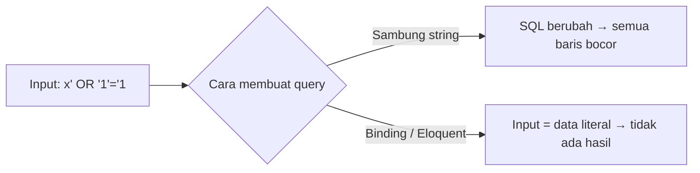

# Pencegahan SQL Injection

**SQL injection** terjadi ketika input pengguna menjadi bagian dari perintah SQL sehingga penyerang dapat mengubah makna query: membaca seluruh tabel, melewati login, atau menghapus data. Query Builder dan
Eloquent melindungi nilai lewat *parameter binding*, tetapi ada beberapa celah yang tetap terbuka bagi pengembang: SQL mentah dengan penyambungan string, nama kolom atau arah urutan dari input, dan
`LIKE` yang tak di-escape. Sub bab ini mempraktikkannya dengan demonstrasi terkendali di database lokal.

## Tujuan Pembelajaran

Setelah menyelesaikan sub bab ini, kamu dapat:

- [ ] Menjelaskan bagaimana penyambungan string membuka SQL injection dengan contoh.
- [ ] Menjelaskan parameter binding dan prepared statement.
- [ ] Menggunakan Query Builder/Eloquent dan binding pada query mentah dengan benar.
- [ ] Mengenali titik rawan: `whereRaw`, `orderByRaw`, `DB::raw`, nama kolom, dan arah urutan dari input.
- [ ] Menerapkan *allow-list* untuk kolom dan arah urutan.
- [ ] Menjelaskan pertahanan berlapis (hak database minimum, validasi, pesan galat).

## Prasyarat

- [Query Builder (bab Database)](../level-04/04-15-query-builder.md) dan [Dasar Database Relasional](../level-04/04-02-relational-database-fundamentals.md).
- [Validasi Dasar](05-02-basic-validation.md).
- Tinker dan database lokal `cms-artikel` (jangan lakukan percobaan pada data penting).

## Pengantar

Sebuah halaman pencarian membuat query `select * from articles where title like '%{$q}%'`. Penyerang mengetik `' OR 1=1 --` dan seluruh tabel keluar, bahkan draf. Pada query yang lebih berbahaya,
penyerang dapat membaca tabel `users` atau menghapus data.

## Penjelasan Konsep

### Bagaimana injeksi terjadi

```php-inline
// RENTAN: nilai disambung langsung ke string SQL
$q = $_GET['q'];
$hasil = DB::select("select * from articles where title = '$q' and is_published = 1");
```

Jika `$q = "x' OR '1'='1"`, SQL berubah menjadi `... title = 'x' OR '1'='1' and is_published = 1`, dan kondisi `OR '1'='1'` selalu benar. Dengan `--` (komentar SQL) penyerang bahkan memotong sisa
query, menghilangkan `is_published = 1`.

### Parameter binding

```php-inline
$hasil = DB::select('select * from articles where title = ? and is_published = 1', [$q]);
$hasil = DB::select('select * from articles where title = :t and is_published = 1', ['t' => $q]);
```

Dengan binding, struktur SQL dikirim terpisah dari nilai (*prepared statement*). Apa pun isi `$q`, ia diperlakukan sebagai **data**, bukan kode SQL.

### Query Builder dan Eloquent aman untuk nilai

```php-inline
Article::where('title', $q)->get();
Article::where('title', 'like', '%'.$q.'%')->get();
DB::table('articles')->where('slug', $slug)->first();
```

Semua nilai di `where` otomatis di-*binding*. Karena itu cara paling aman adalah tetap memakai Eloquent/Query Builder.

### Yang TIDAK di-binding

| Hal | Mengapa rawan | Penanganan |
|---|---|---|
| Nama kolom (`orderBy($request->kolom)`, `where($request->kolom, ...)`) | Nama identifier tidak bisa di-binding | *Allow-list* kolom |
| Arah urutan (`orderBy('id', $request->arah)`) | Disisipkan ke SQL | Batasi `asc`/`desc` |
| `DB::raw($input)`, `whereRaw("... $input")`, `orderByRaw`, `selectRaw` | Penyambungan string | Binding: `whereRaw('a > ?', [$x])`, jangan sambung |
| `DB::unprepared($sql)` | Tanpa binding | Jangan pernah dengan input pengguna |
| `LIKE` dengan `%` dan `_` dari pengguna | Bukan injeksi, tetapi pola liar | Escape karakter wildcard |

### Allow-list untuk urutan

```php-inline
$kolomBoleh = ['title', 'published_at', 'id'];
$kolom = in_array($request->query('urut'), $kolomBoleh, true) ? $request->query('urut') : 'id';
$arah = $request->query('arah') === 'asc' ? 'asc' : 'desc';

Article::orderBy($kolom, $arah)->paginate(10);
```

Jangan menolak dengan galat yang membocorkan struktur tabel; cukup jatuh ke nilai bawaan.

### Validasi sebagai lapis kedua

Aturan `in:title,published_at,id` dan `in:asc,desc` menolak nilai liar sebelum mencapai query. Validasi membantu, tetapi binding dan allow-list tetap menjadi pertahanan inti.

### Pertahanan berlapis

- **Hak minimum database**: pengguna aplikasi tidak perlu `DROP`, `GRANT`, atau akses ke database lain.
- **Pesan galat umum**: `APP_DEBUG=false` di produksi agar SQL tidak bocor di halaman galat.
- **Pemantauan**: catat query/kesalahan tak biasa.
- **Pembaruan**: perbarui framework dan driver.

### Mengenali `LIKE` yang aman

```php-inline
$term = addcslashes($q, '%_\\');                   // escape wildcard dari pengguna
Article::where('title', 'like', "%{$term}%")->get();
```

Binding mencegah injeksi, tetapi tanpa escape pengguna bisa memakai `%` untuk mencocokkan semuanya atau memicu query lambat.

### Keamanan

- Jangan pernah menyambung input ke SQL, termasuk dalam `orderByRaw` atau `DB::raw`.
- Anggap nama kolom, tabel, dan arah dari luar sebagai input tidak tepercaya.
- ORM bukan jaminan mutlak; pelanggaran biasanya ada di bagian mentah.

## Cara Kerja



## Contoh Praktik

Kamu mensimulasikan injeksi pada query yang sengaja rentan di Tinker (database lokal), memperbaikinya dengan binding, lalu membuat pengurutan dinamis yang aman dengan *allow-list* dan menguji payload.

## Penjelasan Kode

Demonstrasi di Tinker (hanya lokal):

```php-inline
use Illuminate\Support\Facades\DB;

$payload = "x' OR '1'='1";

// RENTAN (jangan ditiru)
DB::select("select title from articles where title = '$payload' and is_published = 1");

// AMAN
DB::select('select title from articles where title = ? and is_published = 1', [$payload]);

// AMAN (Eloquent)
App\Models\Article::where('title', $payload)->where('is_published', true)->pluck('title');
```

Pengurutan aman:

```php-inline
// ArticleController::index
$kolom = in_array($request->query('urut'), ['title', 'published_at'], true) ? $request->query('urut') : 'published_at';
$arah = $request->query('arah') === 'asc' ? 'asc' : 'desc';

$articles = Article::published()->orderBy($kolom, $arah)->paginate(6)->withQueryString();
```

## Implementasi Langkah demi Langkah

### Langkah 1: siapkan data

Pastikan ada artikel terbit dan draf (mis. `Article::factory()->count(5)->published()->create(); Article::factory()->count(3)->create();`).

### Langkah 2: jalankan demonstrasi

Jalankan tiga query pada bagian di atas. Bandingkan jumlah baris: versi rentan mengembalikan **semua** artikel terbit **atau** semua baris (tergantung payload), versi aman mengembalikan kosong.

### Langkah 3: payload komentar

Coba payload `x' OR 1=1 --`. Perhatikan bagaimana `--` memotong sisa query pada versi rentan sehingga draf ikut keluar.

### Langkah 4: pengurutan dari input

Tambahkan parameter `urut` dan `arah` pada daftar publik seperti kode aman di atas. Uji:

```bash
curl -s -o /dev/null -w "%{http_code}\n" "http://127.0.0.1:8000/artikel?urut=title&arah=asc"
curl -s -o /dev/null -w "%{http_code}\n" "http://127.0.0.1:8000/artikel?urut=title;drop%20table%20articles&arah=asc"
curl -s -o /dev/null -w "%{http_code}\n" "http://127.0.0.1:8000/artikel?urut=password"
```

Ketiganya `200` dan tabel utuh: nilai liar jatuh ke bawaan.

### Langkah 5: versi rentan (percobaan)

Pada cabang lokal, ubah sementara menjadi `->orderByRaw($request->query('urut'))` dan kirim `?urut=(select%20case%20when%201=1%20then%20title%20else%20id%20end)`; amati bahwa input kini memengaruhi query. **Kembalikan.**

### Langkah 6: audit

```bash
grep -rn "DB::raw\|whereRaw\|orderByRaw\|selectRaw\|havingRaw\|DB::unprepared\|DB::statement" app routes
```

Tinjau tiap hasil: apakah ada input pengguna yang tersambung?

### Langkah 7: catat di Git

```bash
git add app
git commit -m "Pengurutan aman dengan allow-list"
```

## Eksekusi dan Verifikasi

| Langkah | Cara memverifikasi |
|---|---|
| 2 | Query rentan mengembalikan baris yang seharusnya tidak; query aman kosong |
| 4 | Ketiga permintaan `200`; tabel `articles` utuh |
| 6 | Tidak ada penyambungan input di bagian mentah |

## Hasil yang Diharapkan

| Uji | Hasil |
|---|---|
| Payload `x' OR '1'='1` pada query rentan | Banyak baris tak semestinya |
| Payload sama pada binding/Eloquent | Tidak ada baris |
| `?urut=password` | Diabaikan; urut bawaan |

Hasil ini diturunkan dari dokumentasi dan perilaku SQL, dan belum dijalankan oleh penulis materi; cocokkan dengan hasilmu.

## Kesalahan Umum dan Pemecahan Masalah

| Gejala | Penyebab | Cara mengenali | Solusi | Pencegahan |
|---|---|---|---|---|
| Galat SQL dari input aneh | Nama kolom dari input | Galat sintaks | Allow-list | Jangan terima kolom bebas |
| Pencarian mengembalikan semua | Wildcard `%` dari pengguna | Hasil terlalu banyak | `addcslashes` | Escape wildcard |
| `APP_DEBUG=true` di produksi | Konfigurasi | Halaman galat memuat SQL | Matikan | Periksa `.env` produksi |
| Mengira `whereRaw` aman | Menyambung variabel | Query berubah dengan input | Gunakan binding `?` | Tinjau semua `*Raw` |
| Validasi dianggap cukup | Mengabaikan binding | Celah tetap ada | Pakai binding + validasi | Pertahanan berlapis |
| Pengguna DB berhak `DROP` | Hak berlebihan | Dampak besar saat bocor | Cabut hak | Hak minimum |

## Latihan Praktik

### Latihan dasar

**D1. Temukan injeksi**
- *Masalah:* tinjau kode.
- *Persyaratan:* tunjukkan bagian rentan: `DB::select("select * from users where email = '".$request->email."'")` dan perbaiki dengan binding.
- *Perilaku yang diharapkan:* versi aman memakai `?` dan array.
- *Tujuan belajar:* mengenali injeksi.

### Latihan implementasi

**I1. Pencarian aman**
- *Masalah:* pencarian judul dengan wildcard.
- *Persyaratan:* tulis pencarian yang meng-escape `%`, `_`, dan `\` pada input lalu mengujinya dengan `100%`, `a_b`, dan `x' OR 1=1 --`.
- *Perilaku yang diharapkan:* input diperlakukan literal.
- *Tujuan belajar:* pencarian `LIKE` aman.

**I2. Filter dinamis**
- *Masalah:* daftar admin memfilter berdasarkan kolom pilihan pengguna.
- *Persyaratan:* implementasikan filter dengan *allow-list* kolom dan operator (`=`, `like`), tolak lainnya, dan uji payload.
- *Perilaku yang diharapkan:* kolom/operator liar diabaikan.
- *Tujuan belajar:* filter dinamis aman.

### Latihan tantangan

**T1. Audit proyek**
- *Masalah:* tim ingin kepastian.
- *Persyaratan:* audit semua `*Raw`, `DB::select/statement/unprepared`, dan `orderBy`/`where` berparameter kolom di proyek, buat tabel temuan (lokasi, risiko, perbaikan).
- *Perilaku yang diharapkan:* temuan terdokumentasi dan diperbaiki.
- *Tujuan belajar:* mengaudit akses data.
- *Catatan:* kerjakan mandiri; tidak ada kunci jawaban.

## Uji Pemahaman

1. Mengapa penyambungan string ke SQL berbahaya?
2. Apa itu parameter binding?
3. Apa yang tidak dilindungi binding?
4. Bagaimana mengamankan pengurutan dinamis?
5. Mengapa `APP_DEBUG=false` di produksi?
6. Apa peran hak minimum database?

??? success "Kunci jawaban singkat"
    1. Input dapat mengubah struktur SQL.
    2. Mengirim nilai terpisah dari SQL sehingga diperlakukan sebagai data.
    3. Nama kolom/tabel, arah urutan, dan bagian SQL mentah.
    4. Allow-list kolom dan arah.
    5. Agar SQL dan detail internal tidak bocor di halaman galat.
    6. Membatasi kerusakan bila terjadi celah.

## Ringkasan

- SQL injection terjadi bila input menjadi bagian SQL; binding menjadikannya data.
- Eloquent/Query Builder aman untuk nilai; waspadai `*Raw`, nama kolom, dan arah urutan.
- Gunakan allow-list, escape wildcard `LIKE`, dan validasi sebagai lapis tambahan.
- Terapkan hak minimum database dan matikan debug di produksi.

Selanjutnya: *Perlindungan Mass Assignment*, mencegah pengguna mengubah kolom yang bukan haknya.

## Referensi Resmi

- [Laravel: Query Builder, SQL Injection Prevention](https://laravel.com/docs/13.x/queries#introduction)
- [Laravel: Raw Expressions](https://laravel.com/docs/13.x/queries#raw-expressions)
- [OWASP: SQL Injection Prevention Cheat Sheet](https://cheatsheetseries.owasp.org/cheatsheets/SQL_Injection_Prevention_Cheat_Sheet.html)
- [PHP: PDO Prepared Statements](https://www.php.net/manual/en/pdo.prepared-statements.php)
