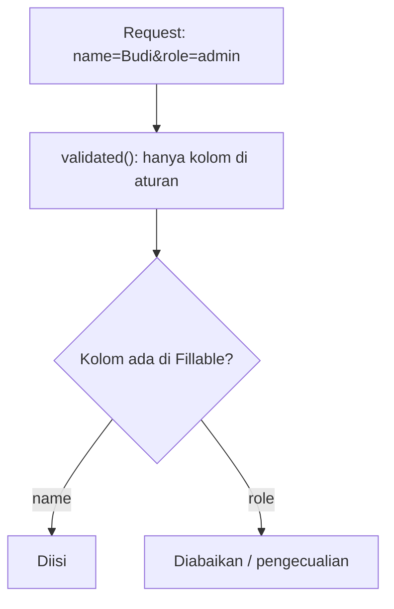

# Perlindungan Mass Assignment

*Mass assignment* adalah pengisian banyak atribut model sekaligus dari array, misalnya `User::create($request->all())`. Praktis, tetapi berbahaya: penyerang menambahkan kolom ekstra pada request
(`role=admin`, `is_verified=1`, `user_id=1`) dan, bila kolom itu boleh diisi, mengubah data yang bukan haknya. Eloquent melindungi secara bawaan dengan *allow-list*. Sub bab ini mempraktikkan serangannya dan
tiga lapis pertahanan: `#[Fillable]`, data tervalidasi, dan penugasan eksplisit.

## Tujuan Pembelajaran

Setelah menyelesaikan sub bab ini, kamu dapat:

- [ ] Menjelaskan mass assignment dan celah eskalasi hak yang ditimbulkannya.
- [ ] Menggunakan `#[Fillable]` (allow-list) dan memahami `#[Guarded]` serta `#[Unguarded]`.
- [ ] Memakai `$request->validated()`/`safe()` daripada `$request->all()`.
- [ ] Menetapkan kolom sensitif secara eksplisit lewat kode tepercaya.
- [ ] Mengaktifkan `Model::preventSilentlyDiscardingAttributes`.
- [ ] Mengenali pola berbahaya (`forceFill`, `Unguarded`, `unguard()`, `$request->all()`).

## Prasyarat

- [Membuat Model (bab Database)](../level-04/04-13-creating-models.md) dan [Registrasi Pengguna](05-11-user-registration.md).
- [Role-Based Access Control](05-19-role-based-access-control.md) (kolom `role`).
- [Validasi Form Request](05-05-form-request-validation.md).

## Pengantar

Form pembaruan profil hanya menampilkan kolom `name` dan `email`. Tetapi penyerang tidak memakai form: ia mengirim `name=…&email=…&role=admin` dengan `curl`. Jika controller memanggil
`$user->update($request->all())` dan `role` boleh diisi, penyerang resmi menjadi admin.

## Penjelasan Konsep

### Perlindungan bawaan Eloquent

Menurut dokumentasi 13.x, semua model Eloquent dilindungi dari mass assignment secara bawaan; sebelum memakai `create`, kamu harus menentukan atribut `Fillable` atau `Guarded`. Atribut di luar `Fillable` diabaikan
diam-diam (kecuali kamu mengaktifkan pengecualian).

| Pendekatan | Atribut | Arti | Rekomendasi |
|---|---|---|---|
| Allow-list | `#[Fillable(['name','email'])]` | Hanya kolom ini boleh diisi massal | **Disarankan** |
| Deny-list | `#[Guarded(['role'])]` | Semua boleh kecuali ini | Rawan: kolom baru otomatis terbuka |
| Matikan perlindungan | `#[Unguarded]` / `Model::unguard()` | Semua boleh diisi | Hindari |

### Allow-list sempit

```php-inline
#[Fillable(['name', 'email', 'password'])]
class User extends Authenticatable { /* ... */ }
```

`role`, `email_verified_at`, `is_admin`, dan kunci asing sensitif tidak masuk daftar.

### Pola serangan

```php-inline
// RENTAN jika 'role' ada di Fillable, atau jika perlindungan dimatikan
$user->update($request->all());
User::create($request->all());
```

Request `name=Budi&role=admin` mengubah peran. Bahkan bila `role` tidak ada di `Fillable`, `$request->all()` adalah kebiasaan buruk: ia membuka pintu begitu seseorang menambahkan kolom ke `Fillable`.

### Lapis pertahanan

1. **`Fillable` sempit** pada model.
2. **Data tervalidasi**: ambil hanya kolom yang lolos aturan.
3. **Penugasan eksplisit** untuk kolom sensitif:

```php-inline
$user->update($request->validated());                 // hanya name, email, ...

$article = new Article($request->safe()->only(['title', 'body']));
$article->user()->associate($request->user());        // pemilik dari sesi, bukan input
$article->save();

$user->role = UserRole::Editor;                       // kode tepercaya
$user->save();
```

4. **Deteksi dini**: di `AppServiceProvider::boot()`

```php-inline
use Illuminate\Database\Eloquent\Model;

Model::preventSilentlyDiscardingAttributes(! $this->app->isProduction());
```

Dengan ini, mengisi kolom di luar `Fillable` melempar pengecualian saat pengembangan sehingga celah ketahuan cepat. Di produksi dibiarkan diam agar request liar tidak menjatuhkan halaman.

### `forceFill` dan `unguard`

`$model->forceFill([...])` mengabaikan `Fillable`. Cocok untuk kode tepercaya (seeder, reset sandi, aksi admin), **bukan** untuk input pengguna. `Model::unguard()` mematikan perlindungan secara global;
dokumentasi mengingatkan untuk menghindarinya kecuali sangat terkendali (mis. seeder).

### Kolom JSON dan relasi

Pada kolom JSON, kunci yang boleh diisi harus disebut lengkap di `Fillable` (mis. `'options->enabled'`). Kunci asing seperti `user_id` dan `category_id` sebaiknya ditetapkan lewat relasi (`associate`),
bukan lewat input.

### Keamanan: daftar periksa audit

- [ ] Tidak ada `$request->all()` pada `create`/`update`/`fill`.
- [ ] `Fillable` sempit; tidak memuat `role`, `is_admin`, `*_verified_at`, kunci asing sensitif.
- [ ] Tidak ada `#[Unguarded]` atau `Model::unguard()` di kode aplikasi.
- [ ] `forceFill` hanya di kode tepercaya.
- [ ] Pemilik data ditetapkan dari `$request->user()`.

## Cara Kerja



## Contoh Praktik

Kamu membuat form profil, menyerangnya dengan `role=admin` pada versi yang sengaja rentan (cabang lokal), lalu memperbaikinya dengan `Fillable` sempit, `validated()`, dan penugasan eksplisit.

## Penjelasan Kode

Controller profil:

File: `app/Http/Controllers/ProfileController.php`

```php
<?php

namespace App\Http\Controllers;

use Illuminate\Http\RedirectResponse;
use Illuminate\Http\Request;
use Illuminate\Validation\Rule;
use Illuminate\View\View;

class ProfileController extends Controller
{
    public function edit(Request $request): View
    {
        return view('profile.edit', ['user' => $request->user()]);
    }

    public function update(Request $request): RedirectResponse
    {
        $data = $request->validate([
            'name' => ['required', 'string', 'max:50'],
            'email' => ['required', 'email', 'max:100', Rule::unique('users', 'email')->ignore($request->user()->id)],
        ]);

        $request->user()->update($data);

        return back()->with('status', 'Profil diperbarui.');
    }
}
```

Route dalam grup `auth`: `Route::get('/profil', ...)->name('profile.edit');` dan `Route::put('/profil', ...)->name('profile.update');`. View `profile/edit.blade.php`: form `PUT` dengan `name` dan `email`.

Versi rentan (hanya percobaan lokal sementara): `$request->user()->forceFill($request->all())->save();` yang mengabaikan perlindungan.

## Implementasi Langkah demi Langkah

### Langkah 1: buat form profil aman

Buat controller, route, dan view; uji sebagai pengguna `ani@contoh.test`.

### Langkah 2: serang versi aman

Lewat `curl` dengan sesi dan token (atau alat pengembang browser, menambah input tersembunyi `role`):

```bash
# ambil cookie dan token dari halaman profil setelah login lewat browser dan salin nilainya,
# atau tambahkan input tersembunyi <input name="role" value="admin"> di DevTools lalu kirim form
```

Kirim `role=admin` bersama `name` dan `email`. Periksa `User::where('email','ani@contoh.test')->value('role')`: tetap `author`.

### Langkah 3: simulasikan versi rentan

Ubah sementara menjadi `forceFill($request->all())`, ulangi serangan, dan lihat peran berubah menjadi `admin`. **Kembalikan** dan jangan di-*commit*.

### Langkah 4: aktifkan deteksi dini

Tambahkan `Model::preventSilentlyDiscardingAttributes(...)` ke `AppServiceProvider` dan coba `User::create([... 'role' => 'admin'])` di Tinker: pengecualian dilempar.

### Langkah 5: audit

```bash
grep -rn "request->all()\|forceFill\|unguard\|Unguarded\|\$guarded" app
```

Tinjau setiap hasil.

### Langkah 6: catat di Git

```bash
git add app routes resources
git commit -m "Tambah form profil aman dari mass assignment"
```

## Eksekusi dan Verifikasi

| Langkah | Cara memverifikasi |
|---|---|
| 2 | Peran tetap `author` setelah serangan |
| 3 | Pada versi rentan peran menjadi `admin` (dibatalkan setelah percobaan) |
| 4 | Pengecualian `MassAssignmentException`/sejenis di Tinker |
| 5 | Tidak ada pola berbahaya tersisa |

## Hasil yang Diharapkan

| Skenario | Hasil |
|---|---|
| Form aman + `role=admin` | Diabaikan |
| `forceFill($request->all())` | Peran berubah (rentan) |
| `User::create([... 'role' => 'admin'])` dengan deteksi dini | Pengecualian |

Nama kelas pengecualian dapat berbeda antar versi. Hasil ini diturunkan dari dokumentasi dan belum dijalankan oleh penulis materi; cocokkan dengan hasilmu.

## Kesalahan Umum dan Pemecahan Masalah

| Gejala | Penyebab | Cara mengenali | Solusi | Pencegahan |
|---|---|---|---|---|
| Peran berubah dari form | `role` di `Fillable` / `forceFill($request->all())` | Peran tak sesuai | Hapus dari `Fillable`; pakai `validated()` | Allow-list sempit |
| Data tidak tersimpan, tanpa galat | Kolom tak ada di `Fillable` | Kolom `NULL` | Tambahkan kolom aman | Aktifkan deteksi dini |
| `$guarded = []` ditemukan | Proyek lama memakai deny-list kosong | Semua kolom terbuka | Ganti dengan `Fillable` | Audit |
| Kunci asing dipalsukan | `user_id` diterima dari input | Data milik orang lain | Gunakan `associate` | Penugasan eksplisit |
| `Model::unguard()` di seeder bocor ke aplikasi | Dipanggil global | Perlindungan mati | `Model::unguarded(fn () => ...)` atau factory | Batasi ruang lingkup |
| Validasi lolos tetapi kolom ekstra masuk | Memakai `all()` setelah validasi | Kolom liar tersimpan | Pakai `validated()` | Disiplin data tervalidasi |

## Latihan Praktik

### Latihan dasar

**D1. Tandai yang berbahaya**
- *Masalah:* tinjau empat baris kode.
- *Persyaratan:* tandai mana yang berbahaya: `User::create($request->all())`, `$user->update($request->validated())`, `$article->fill($request->only('title'))`, `$user->forceFill($request->all())`.
- *Perilaku yang diharapkan:* baris 1 dan 4 berbahaya.
- *Tujuan belajar:* mengenali pola.

### Latihan implementasi

**I1. Form artikel aman**
- *Masalah:* form artikel menerima `user_id` dari input hidden.
- *Persyaratan:* hapus `user_id` dari form, tetapkan pemilik dari `$request->user()`, dan buktikan `user_id` palsu diabaikan.
- *Perilaku yang diharapkan:* pemilik selalu pengguna yang masuk.
- *Tujuan belajar:* penugasan eksplisit.

**I2. Deteksi di CI**
- *Masalah:* ingin memperingatkan tim sebelum celah masuk.
- *Persyaratan:* tulis skrip pemeriksa sederhana (grep) yang gagal bila menemukan `request->all()` pada `create|update|fill`, dan jalankan pada proyek.
- *Perilaku yang diharapkan:* skrip melaporkan temuan.
- *Tujuan belajar:* otomasi audit.

### Latihan tantangan

**T1. Peran dan Fillable**
- *Masalah:* seorang rekan menambah `role` ke `Fillable` agar "lebih mudah".
- *Persyaratan:* tulis penjelasan risiko, bukti serangan, dan tiga alternatif aman untuk mengubah peran.
- *Perilaku yang diharapkan:* penjelasan meyakinkan dengan bukti.
- *Tujuan belajar:* mengomunikasikan risiko.
- *Catatan:* kerjakan mandiri; tidak ada kunci jawaban.

## Uji Pemahaman

1. Apa itu mass assignment?
2. Mengapa allow-list lebih aman daripada deny-list?
3. Mengapa `$request->all()` berbahaya?
4. Bagaimana menetapkan pemilik data dengan aman?
5. Apa fungsi `preventSilentlyDiscardingAttributes`?
6. Kapan `forceFill` boleh dipakai?

??? success "Kunci jawaban singkat"
    1. Mengisi banyak atribut model sekaligus dari array.
    2. Kolom baru tidak otomatis terbuka.
    3. Memuat kolom tak terduga dari penyerang.
    4. Dari `$request->user()` lewat `associate` atau penugasan eksplisit.
    5. Melempar pengecualian saat kolom di luar `Fillable` diisi (deteksi dini).
    6. Pada kode tepercaya (seeder, aksi admin), bukan input pengguna.

## Ringkasan

- Mass assignment memudahkan pengisian tetapi membuka eskalasi hak bila tak dijaga.
- Pakai `#[Fillable]` sempit, `validated()`, dan penugasan eksplisit untuk kolom sensitif.
- Hindari `all()`, `unguard`, `Unguarded`; batasi `forceFill`.
- Aktifkan deteksi dini di pengembangan dan audit berkala.

Selanjutnya: *Pembatasan Laju*, melindungi aplikasi dari penyalahgunaan dan serangan *brute force*.

## Referensi Resmi

- [Laravel: Mass Assignment](https://laravel.com/docs/13.x/eloquent#mass-assignment)
- [Laravel: Mass Assignment Exceptions](https://laravel.com/docs/13.x/eloquent#mass-assignment-exceptions)
- [OWASP: Mass Assignment Cheat Sheet](https://cheatsheetseries.owasp.org/cheatsheets/Mass_Assignment_Cheat_Sheet.html)
