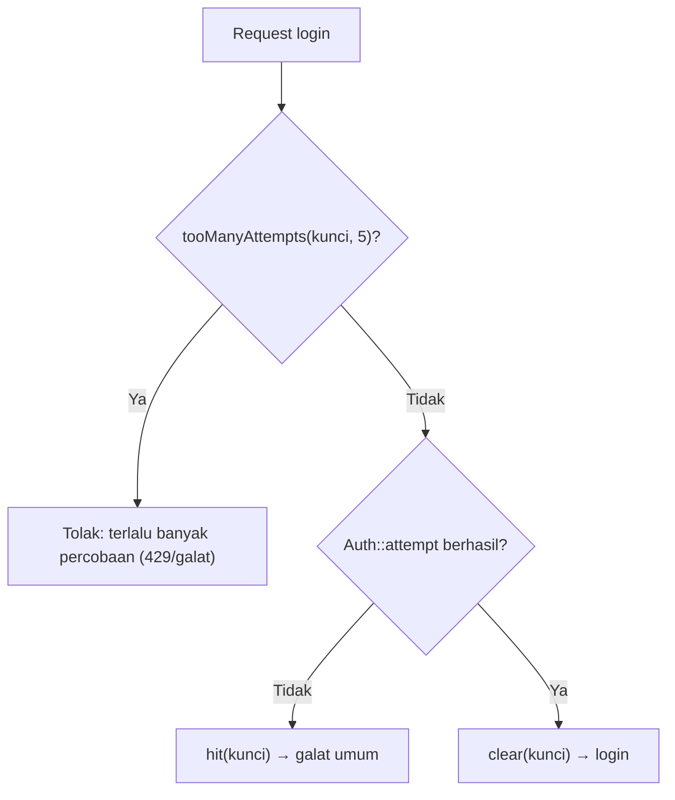

# Pembatasan Laju (Rate Limiting)

Tanpa batas, siapa pun dapat mencoba 10.000 kata sandi per menit, membanjiri form komentar, atau memicu ribuan email reset. **Rate limiting** membatasi berapa kali sebuah aksi boleh dilakukan dalam jangka
waktu tertentu per pengguna, IP, atau kunci lain. Laravel menyediakan middleware `throttle`, pembatas bernama lewat `RateLimiter::for`, dan API `RateLimiter` untuk kontrol manual. Sub bab ini
melindungi login, komentar, dan reset kata sandi.

## Tujuan Pembelajaran

Setelah menyelesaikan sub bab ini, kamu dapat:

- [ ] Menjelaskan mengapa rate limiting penting (brute force, spam, penyalahgunaan sumber daya).
- [ ] Memakai middleware `throttle:jumlah,menit` pada route.
- [ ] Mendefinisikan pembatas bernama dengan `RateLimiter::for` dan `Limit::perMinute`.
- [ ] Memilih kunci pembatas (`by`) yang tepat: IP, pengguna, email, atau gabungan.
- [ ] Melindungi login dengan `RateLimiter::tooManyAttempts`, `hit`, dan `clear`.
- [ ] Membaca respons `429` dan header `Retry-After`.

## Prasyarat

- [Login dan Logout](05-10-login-and-logout.md) dan [Reset Kata Sandi](05-13-password-reset.md).
- [Middleware Autentikasi](05-15-authentication-middleware.md).
- Cache aplikasi berfungsi (proyek baru memakai `CACHE_STORE=database`; tabel `cache` ada dari migrasi bawaan).

## Pengantar

Form login tanpa batas memungkinkan *brute force*: penyerang mencoba daftar kata sandi umum pada satu email. Dengan batas 5 percobaan per menit per kombinasi email dan IP, serangan menjadi tidak praktis.

## Penjelasan Konsep

### Middleware `throttle`

```php-inline
Route::post('/artikel/{article:slug}/komentar', [CommentController::class, 'store'])
    ->middleware('throttle:5,1');         // 5 permintaan per 1 menit
```

Format `throttle:maks,menit`. Batas dihitung per pengguna (bila masuk) atau per IP (tamu). Saat terlampaui, Laravel menjawab **429 Too Many Requests** dengan header `Retry-After` (detik) serta
`X-RateLimit-Limit` dan `X-RateLimit-Remaining`.

### Pembatas bernama

Definisikan di `AppServiceProvider::boot()`:

```php-inline
use Illuminate\Cache\RateLimiting\Limit;
use Illuminate\Http\Request;
use Illuminate\Support\Facades\RateLimiter;

RateLimiter::for('komentar', function (Request $request) {
    return Limit::perMinute(5)->by($request->user()?->id ?: $request->ip());
});

RateLimiter::for('login', function (Request $request) {
    return [
        Limit::perMinute(20)->by($request->ip()),                 // batas kasar per IP
        Limit::perMinute(5)->by(strtolower((string) $request->input('email'))), // per akun
    ];
});
```

Pakai di route dengan `throttle:nama`:

```php-inline
->middleware('throttle:komentar');
->middleware('throttle:login');
```

| Metode | Arti |
|---|---|
| `Limit::perSecond($n)`, `perMinute`, `perHour`, `perDay` | Jendela waktu |
| `->by($kunci)` | Menentukan siapa yang dihitung |
| `->response(fn (Request $r, array $headers) => ...)` | Respons 429 kustom |
| Array `Limit` | Beberapa batas sekaligus; semuanya harus terpenuhi |

### Memilih kunci

| Kunci | Kelebihan | Risiko |
|---|---|---|
| IP | Sederhana | Banyak pengguna berbagi IP (kantor, NAT); penyerang memakai banyak IP |
| ID pengguna | Adil per akun | Hanya untuk yang sudah masuk |
| Email (input) | Melindungi akun tertentu | Penyerang dapat mengunci akun orang lain (*lockout*) |
| Gabungan email + IP | Menyeimbangkan keduanya | Lebih kompleks |

Di belakang proxy, pastikan IP asli dibaca benar (konfigurasi *trusted proxies*), jika tidak semua pengguna tampak berasal dari IP yang sama.

### Kontrol manual untuk login

Hitung hanya kegagalan dan reset saat sukses:

File: `app/Http/Controllers/Auth/AuthenticatedSessionController.php` (ubah `store`)

```php-inline
use Illuminate\Support\Facades\RateLimiter;
use Illuminate\Support\Str;

public function store(Request $request): RedirectResponse
{
    $credentials = $request->validate([
        'email' => ['required', 'email'],
        'password' => ['required', 'string'],
    ]);

    $key = Str::transliterate(Str::lower($credentials['email']).'|'.$request->ip());

    if (RateLimiter::tooManyAttempts($key, 5)) {
        $detik = RateLimiter::availableIn($key);

        return back()
            ->withErrors(['email' => "Terlalu banyak percobaan. Coba lagi dalam {$detik} detik."])
            ->onlyInput('email');
    }

    if (! Auth::attempt($credentials, $request->boolean('remember'))) {
        RateLimiter::hit($key, 60);

        return back()->withErrors(['email' => 'Email atau kata sandi salah.'])->onlyInput('email');
    }

    RateLimiter::clear($key);
    $request->session()->regenerate();

    return redirect()->intended(route('dashboard'));
}
```

| Method | Fungsi |
|---|---|
| `tooManyAttempts($key, $max)` | Apakah sudah melebihi batas? |
| `hit($key, $detik)` | Menambah hitungan, kedaluwarsa setelah `$detik` |
| `availableIn($key)` | Detik sampai boleh mencoba lagi |
| `clear($key)` | Mereset hitungan |
| `RateLimiter::attempt($key, $max, $callback, $detik)` | Menjalankan callback bila belum melebihi batas |

### Rute yang perlu dibatasi

| Rute | Alasan | Saran |
|---|---|---|
| Login | Brute force | 5/menit per email+IP |
| Registrasi | Akun massal | 5/jam per IP |
| Lupa kata sandi / kirim ulang verifikasi | Email massal | 6/menit |
| Komentar/form publik | Spam | 5/menit |
| Pencarian berat / unduhan | Beban server | 30/menit |
| API | Penyalahgunaan | Per token/pengguna |

### Penyimpanan

Pembatas memakai cache aplikasi. Pada beberapa server, gunakan penyimpanan terpusat (`database`, `redis`); cache `array`/berkas tidak dibagi antar server sehingga batas tidak efektif.

### Keamanan

- Pesan 429 tidak boleh membocorkan apakah akun ada (gunakan pesan yang sama untuk email apa pun).
- Rate limiting bukan pengganti kata sandi kuat dan MFA.
- Batas berbasis email dapat dipakai penyerang mengunci akun korban; pertimbangkan penundaan bertahap atau CAPTCHA.

## Cara Kerja



## Contoh Praktik

Kamu membatasi komentar dengan pembatas bernama, melindungi login dengan hitungan kegagalan, membatasi reset kata sandi, lalu menguji dengan skrip `curl` hingga memicu respons 429.

## Penjelasan Kode

Kode pembatas bernama dan controller login ada pada bagian konsep. Terapkan:

```php-inline
Route::post('/artikel/{article:slug}/komentar', [CommentController::class, 'store'])
    ->middleware('throttle:komentar')->name('comments.store');

Route::post('/lupa-sandi', [PasswordResetLinkController::class, 'store'])
    ->middleware(['guest', 'throttle:6,1'])->name('password.email');

Route::post('/register', [RegisteredUserController::class, 'store'])
    ->middleware(['guest', 'throttle:5,60'])->name('register.store');
```

Format `throttle:5,60` berarti 5 permintaan per 60 menit.

## Implementasi Langkah demi Langkah

### Langkah 1: definisikan pembatas

Tambahkan `RateLimiter::for('komentar', ...)` dan `'login'` ke `AppServiceProvider::boot()`.

### Langkah 2: pasang pada route

Tambahkan middleware `throttle` seperti di atas.

### Langkah 3: ubah login

Terapkan kontrol manual pada `AuthenticatedSessionController::store`.

### Langkah 4: uji komentar

```bash
for i in 1 2 3 4 5 6 7; do curl -s -o /dev/null -w "%{http_code} " -X POST -d "author_name=Uji&body=Halo" http://127.0.0.1:8000/artikel/slug-apa-saja/komentar; done; echo
```

Tanpa token CSRF respons `419` datang lebih dulu dan menghalangi pengujian. Gunakan pola cookie dan token dari sub bab sebelumnya agar permintaan mencapai pembatas. Setelah batas terlampaui, respons berubah menjadi `429`.

### Langkah 5: uji login

Salah masukkan kata sandi 5 kali untuk `admin@contoh.test`: percobaan ke-6 menampilkan pesan terlalu banyak percobaan dengan hitungan detik. Tunggu atau reset (`php artisan cache:clear`) dan coba lagi dengan kata sandi benar.

### Langkah 6: baca header

Ulangi permintaan komentar pada Langkah 4 (dengan cookie dan token) menggunakan `curl -s -i` dan saring header:

```bash
curl -s -i -b cj.txt -c cj.txt -d "_token=$TOKEN&author_name=Uji&body=Halo" http://127.0.0.1:8000/artikel/SLUG/komentar | grep -i -E "^HTTP/|retry-after|x-ratelimit"
```

Ganti `SLUG` dengan slug artikel terbit. Pada respons sukses terlihat `X-RateLimit-Remaining`; pada `429` terlihat `Retry-After`.

### Langkah 7: catat di Git

```bash
git add app routes
git commit -m "Tambah rate limiting pada login, komentar, dan reset sandi"
```

## Eksekusi dan Verifikasi

| Langkah | Cara memverifikasi |
|---|---|
| 4 | Permintaan ke-6 komentar dengan token mendapat `429` |
| 5 | Percobaan ke-6 login ditolak dengan pesan dan detik tunggu |
| 6 | Header `Retry-After` dan `X-RateLimit-*` muncul |

## Hasil yang Diharapkan

| Skenario | Hasil |
|---|---|
| 6 komentar dalam semenit (batas 5) | Lima pertama diproses, keenam `429 Too Many Requests` |
| 6 login gagal | Pesan batas terlampaui sebelum memeriksa kata sandi |
| Login benar setelah menunggu | Berhasil dan hitungan di-reset |

Hasil ini diturunkan dari dokumentasi dan belum dijalankan oleh penulis materi; cocokkan dengan hasilmu.

## Kesalahan Umum dan Pemecahan Masalah

| Gejala | Penyebab | Cara mengenali | Solusi | Pencegahan |
|---|---|---|---|---|
| Batas tidak pernah terpicu | Cache `array` atau tidak ada tabel `cache` | Hitungan tak bertambah | Pakai `database`/`redis` dan migrasikan | Periksa `CACHE_STORE` |
| Semua pengguna terkena batas yang sama | Semua tampak berasal dari satu IP (proxy) | Pengguna berbeda ditolak | Konfigurasi trusted proxies | Uji di belakang proxy |
| Pengguna sah terkunci | Kunci hanya email | Akun terkunci oleh penyerang | Gunakan email+IP dan penundaan | Pertimbangkan CAPTCHA |
| `419` menutupi `429` | CSRF diperiksa lebih dulu | Pengujian curl gagal | Sertakan token dan cookie | Uji dengan klien lengkap |
| Pembatas bernama tidak ditemukan | Nama salah / belum didefinisikan | Galat `RateLimiter` | Samakan nama | Definisikan di `boot()` |
| Batas tak berlaku di route | Middleware tidak dipasang | Tak ada header ratelimit | Tambahkan `throttle` | Audit route sensitif |
| Pesan membocorkan akun | Pesan berbeda untuk email ada/tidak | Perilaku berbeda | Satu pesan umum | Pesan seragam |

## Latihan Praktik

### Latihan dasar

**D1. Tentukan batas**
- *Masalah:* tentukan batas wajar.
- *Persyaratan:* tulis batas dan kunci untuk login, registrasi, komentar, pencarian, dan unduh PDF, dengan alasan.
- *Perilaku yang diharapkan:* tabel beralasan.
- *Tujuan belajar:* merancang batas.

### Latihan implementasi

**I1. Respons 429 kustom**
- *Masalah:* pesan 429 default tidak ramah.
- *Persyaratan:* gunakan `->response(...)` pada pembatas `komentar` yang mengembalikan pesan Indonesia dan header `Retry-After`.
- *Perilaku yang diharapkan:* pesan kustom pada 429.
- *Tujuan belajar:* menyesuaikan respons.

**I2. Pembatas bertingkat**
- *Masalah:* pengguna terverifikasi diberi batas lebih longgar.
- *Persyaratan:* buat pembatas `komentar` yang memberi 20/menit untuk pengguna masuk dan 5/menit untuk tamu (`by` ID atau IP).
- *Perilaku yang diharapkan:* batas berbeda sesuai status.
- *Tujuan belajar:* batas dinamis.

### Latihan tantangan

**T1. Lockout dan DoS akun**
- *Masalah:* batas per email memungkinkan penyerang mengunci akun korban.
- *Persyaratan:* jelaskan serangannya, usulkan mitigasi (kunci gabungan, penundaan bertahap, notifikasi, CAPTCHA), dan implementasikan penundaan bertahap sederhana.
- *Perilaku yang diharapkan:* desain yang menyeimbangkan keamanan dan kemudahan.
- *Tujuan belajar:* memahami kompromi rate limiting.
- *Catatan:* kerjakan mandiri; tidak ada kunci jawaban.

## Uji Pemahaman

1. Mengapa login perlu rate limiting?
2. Apa arti `throttle:5,1`?
3. Apa respons saat batas terlampaui?
4. Apa fungsi `RateLimiter::hit` dan `clear`?
5. Mengapa memilih kunci hati-hati?
6. Mengapa cache harus terpusat pada banyak server?

??? success "Kunci jawaban singkat"
    1. Mencegah brute force kata sandi.
    2. 5 permintaan per 1 menit.
    3. 429 Too Many Requests dengan `Retry-After`.
    4. `hit` menambah hitungan; `clear` meresetnya.
    5. IP bisa dibagi banyak orang dan email dapat dipakai mengunci akun orang.
    6. Agar hitungan dibagi antar server.

## Ringkasan

- `throttle` dan `RateLimiter::for` membatasi laju; `RateLimiter` manual untuk logika khusus seperti login.
- Pilih kunci (`by`) dan batas sesuai risiko; gunakan cache terpusat.
- Respons 429 membawa `Retry-After`; pesan jangan membocorkan akun.
- Rate limiting melengkapi, bukan menggantikan, kata sandi kuat dan MFA.

Selanjutnya: *Unggah Berkas yang Aman*, menyimpan dan menyajikan berkas pengguna dengan benar.

## Referensi Resmi

- [Laravel: Rate Limiting](https://laravel.com/docs/13.x/routing#rate-limiting)
- [Laravel: Cache](https://laravel.com/docs/13.x/cache)
- [OWASP: Blocking Brute Force Attacks](https://owasp.org/www-community/controls/Blocking_Brute_Force_Attacks)
