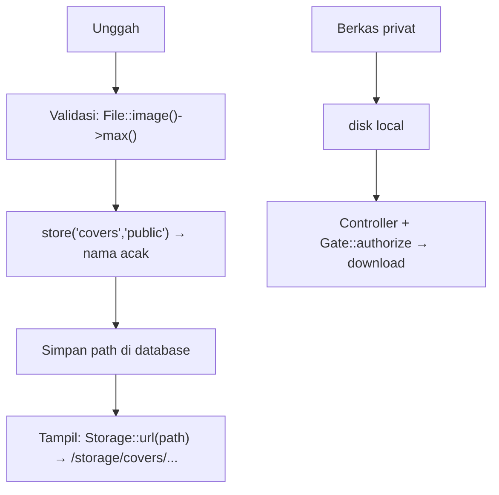

# Unggah Berkas yang Aman

Validasi (sub bab 05.07) hanya separuh pekerjaan. Cara kamu **menyimpan** dan **menyajikan** berkas menentukan apakah unggahan aman: nama acak, lokasi di luar jangkauan eksekusi, disk yang tepat,
otorisasi unduhan, dan pembersihan berkas lama. Sub bab ini menambahkan gambar sampul pada artikel dengan penyimpanan aman, serta pola untuk berkas pribadi yang hanya boleh diunduh pemiliknya.

## Tujuan Pembelajaran

Setelah menyelesaikan sub bab ini, kamu dapat:

- [ ] Menjelaskan risiko unggahan: eksekusi kode, XSS lewat SVG/HTML, *path traversal*, penimpaan berkas, dan penyalahgunaan penyimpanan.
- [ ] Membedakan disk `local` (privat) dan `public`, serta menjalankan `php artisan storage:link`.
- [ ] Menyimpan berkas dengan `store()` yang memberi nama acak, tanpa memakai nama dari klien.
- [ ] Menghapus berkas lama saat diganti atau saat model dihapus.
- [ ] Menyajikan berkas privat lewat controller yang memeriksa otorisasi.
- [ ] Mengenali pengaturan server yang mencegah eksekusi berkas unggahan.

## Prasyarat

- [Validasi Unggah Berkas](05-07-file-upload-validation.md) dan [Policy](05-18-policies.md).
- [Pencegahan XSS](05-21-xss-prevention.md) (SVG dan header `nosniff`).
- Model `Article` dan form admin artikel.

## Pengantar

Penyerang mengunggah `kuitansi.php.jpg` atau `x.svg` berisi skrip, atau menamai berkas `../../public/index.php` berharap menimpa berkas penting. Penyimpanan yang aman membuat semua upaya itu sia-sia walau
satu lapis validasi terlewat.

## Penjelasan Konsep

### Risiko dan penangkalnya

| Risiko | Contoh | Penangkal |
|---|---|---|
| Eksekusi kode | Berkas `.php` diunggah ke folder yang dapat dieksekusi | Simpan di luar `public` atau di disk khusus; server tidak mengeksekusi folder unggahan |
| XSS | SVG/HTML berisi skrip disajikan dari domain aplikasi | Tolak SVG; sajikan sebagai unduhan; `nosniff` |
| Path traversal | Nama berkas `../../x` | Jangan pakai nama klien; pakai nama acak |
| Penimpaan berkas | Dua pengguna unggah `foto.jpg` | Nama unik acak |
| Penyalahgunaan penyimpanan | Berkas raksasa/bertubi-tubi | Batas ukuran, jumlah, dan rate limiting |
| Kebocoran privasi | URL berkas pribadi bisa ditebak | Disk privat + otorisasi |

### Disk penyimpanan

Konfigurasi di `config/filesystems.php` dan `FILESYSTEM_DISK` di `.env`:

| Disk | Lokasi | Dapat diakses publik? | Untuk |
|---|---|---|---|
| `local` | `storage/app/private` (pada kerangka terbaru) | Tidak | Berkas pribadi (CV, dokumen) |
| `public` | `storage/app/public` | Ya, lewat tautan simbolik `public/storage` | Gambar sampul, avatar |

Buat tautan simbolik untuk disk `public`:

```bash
php artisan storage:link
```

Path persis disk `local` dapat berbeda antar versi kerangka; lihat `config/filesystems.php`.

### Menyimpan dengan nama acak

```php-inline
$path = $request->file('cover')->store('covers', 'public');
// contoh hasil: covers/Xy3kQ...abc.png
```

`store()` membuat nama acak (hash) dengan ekstensi berdasarkan **MIME hasil deteksi isi**, bukan nama dari klien, dan mengembalikan path relatif. Simpan path itu di database (`cover_path`), bukan URL penuh.
Hindari `storeAs()` dengan nama dari `getClientOriginalName()`.

### Menyajikan berkas publik

```php-inline
Storage::disk('public')->url($article->cover_path);   // /storage/covers/Xy3k...png
```

Di Blade: `url($article->cover_path) }}" alt="Sampul {{ $article->title }}">`. Pastikan `APP_URL` benar agar URL tepat.

### Mengganti dan menghapus berkas lama

```php-inline
use Illuminate\Support\Facades\Storage;

if ($article->cover_path) {
    Storage::disk('public')->delete($article->cover_path);
}
$article->cover_path = $request->file('cover')->store('covers', 'public');
```

Berkas yatim memboroskan ruang dan dapat menyimpan data yang seharusnya hilang. Hapus berkas saat artikel dihapus permanen (observer `forceDeleted`, sub bab 04.28).

### Berkas privat dengan otorisasi

```php
use Illuminate\Support\Facades\Gate;
use Illuminate\Support\Facades\Storage;

public function cv(User $user)
{
    Gate::authorize('download-cv', $user);        // pemilik atau admin

    abort_unless($user->cv_path && Storage::disk('local')->exists($user->cv_path), 404);

    return Storage::disk('local')->download($user->cv_path, 'cv-'.$user->id.'.pdf');
}
```

`download` mengirim berkas sebagai unduhan dengan nama yang kamu tentukan. Nama itu dibuat server, bukan dari klien. Untuk menampilkan PDF di browser gunakan `Storage::disk('local')->response($path)` dan
tetap sertakan `X-Content-Type-Options: nosniff`.

### Pengaturan server

- Web server tidak boleh mengeksekusi skrip di folder unggahan. Tautan `public/storage` hanya berisi berkas statis; pada Nginx/Apache pastikan tidak ada aturan yang meneruskan `.php` dari folder itu ke PHP.
- Selaraskan batas `upload_max_filesize`, `post_max_size` PHP dan batas server (`client_max_body_size` pada Nginx).
- Pertimbangkan memindai virus (mis. ClamAV) bila aplikasi menerima berkas dari publik; ini membutuhkan komponen tambahan di luar cakupan materi.

### Memproses ulang gambar (opsional)

Mengubah ukuran atau meng-*encode* ulang gambar (dengan GD atau pustaka gambar) menghilangkan metadata EXIF dan muatan tersembunyi. Ini bagus tetapi bukan syarat; karena butuh pustaka dan ekstensi
tambahan, sebutkan sebagai pertimbangan, dan jangan menambah dependensi tanpa persetujuan.

### Keamanan: daftar periksa

- [ ] Validasi ukuran, tipe (isi), dan dimensi.
- [ ] Nama acak dari server; jangan pernah nama dari klien.
- [ ] Disimpan di disk yang tepat; berkas pribadi tidak publik.
- [ ] Tidak ada eksekusi skrip di folder unggahan.
- [ ] SVG ditolak atau disajikan sebagai unduhan.
- [ ] Berkas lama dibersihkan.
- [ ] Rate limiting pada endpoint unggah.

## Cara Kerja



## Contoh Praktik

Kamu menambah `cover_path` pada artikel, mengunggah sampul di form admin dengan penyimpanan aman, menampilkannya, menghapus berkas lama saat diganti atau dihapus permanen, dan membuat unduhan CV privat yang diotorisasi.

## Penjelasan Kode

Migration:

```bash
php artisan make:migration add_cover_path_to_articles_table --table=articles
```

```php
Schema::table('articles', function (Blueprint $table) {
    $table->string('cover_path')->nullable();
});
```

Aturan (di request/controller):

```php
use Illuminate\Validation\Rule;
use Illuminate\Validation\Rules\File;

'cover' => ['nullable', File::image()->max(2 * 1024)->dimensions(Rule::dimensions()->maxWidth(3000)->maxHeight(3000))],
```

Di `Admin\ArticleController` (`store`/`update`), setelah menyimpan artikel:

```php
use Illuminate\Support\Facades\Storage;

if ($request->hasFile('cover')) {
    if ($article->cover_path) {
        Storage::disk('public')->delete($article->cover_path);
    }
    $article->cover_path = $request->file('cover')->store('covers', 'public');
    $article->save();
}
```

Pada `ArticleObserver::forceDeleted`:

```php
if ($article->cover_path) {
    Storage::disk('public')->delete($article->cover_path);
}
```

Form: tambahkan `enctype="multipart/form-data"` dan `<input type="file" name="cover" accept="image/png,image/jpeg">`. Tampilan: `url($article->cover_path) }}" alt="Sampul {{ $article->title }}">` dalam `@if ($article->cover_path)`.

`cover_path` **tidak** ditambahkan ke `#[Fillable]`; ia diatur lewat kode controller setelah validasi.

## Implementasi Langkah demi Langkah

### Langkah 1: migration dan tautan penyimpanan

```bash
php artisan migrate
php artisan storage:link
ls -l public/storage
```

### Langkah 2: perbarui form dan controller

Tambahkan `enctype`, input berkas, aturan, dan kode penyimpanan.

### Langkah 3: unggah dan periksa

Unggah PNG kecil. Lalu:

```bash
ls storage/app/public/covers
php artisan tinker --execute="echo App\Models\Article::latest('id')->first()->cover_path;"
```

Perhatikan nama acak, bukan nama berkas aslimu.

### Langkah 4: tampilkan

Buka halaman artikel dan pastikan gambar tampil dari `/storage/covers/...`.

### Langkah 5: uji penolakan

| Berkas | Harapan |
|---|---|
| Teks bernama `x.png` | ditolak (`image`) |
| PNG 5 MB | ditolak (`max`) |
| SVG | ditolak (`image` tanpa `allowSvg`) |
| PDF | ditolak |

### Langkah 6: penggantian dan penghapusan

Ganti sampul: berkas lama hilang dari `storage/app/public/covers`. Hapus permanen artikel (via Tinker `forceDelete`): berkas ikut hilang (setelah observer ditambah).

### Langkah 7: berkas privat

Tambahkan kolom `cv_path` pada `users` (nullable), simpan CV (`File::types(['pdf'])`) ke disk `local` dengan `store('cv')`, definisikan Gate `download-cv`, dan buat route `GET /pengguna/{user}/cv` yang memanggil `download`.
Uji: pemilik berhasil, pengguna lain `403`, tamu dialihkan ke login, dan `/storage/...` tidak menyajikan CV.

### Langkah 8: catat di Git

```bash
git add app database resources routes
git commit -m "Tambah sampul artikel dan unduhan CV dengan penyimpanan aman"
```

`storage/app/public/*` tidak di-*commit*.

## Eksekusi dan Verifikasi

| Langkah | Cara memverifikasi |
|---|---|
| 1 | `public/storage` adalah tautan ke `storage/app/public` |
| 3 | Nama berkas acak; path tersimpan di database |
| 5 | Semua berkas tak sah ditolak |
| 6 | Berkas lama terhapus saat diganti dan saat hapus permanen |
| 7 | Hanya pemilik/admin dapat mengunduh CV |

## Hasil yang Diharapkan

| Skenario | Hasil |
|---|---|
| Unggah `foto_saya.png` | Tersimpan sebagai `covers/<acak>.png` |
| SVG dengan skrip | Ditolak validasi |
| Pengguna lain meminta `/pengguna/1/cv` | `403` |
| Mengakses `/storage/cv/...` | `404` (tidak publik) |

Nama berkas dan struktur folder disk dapat berbeda antar versi kerangka. Hasil ini diturunkan dari dokumentasi dan belum dijalankan oleh penulis materi; cocokkan dengan hasilmu.

## Kesalahan Umum dan Pemecahan Masalah

| Gejala | Penyebab | Cara mengenali | Solusi | Pencegahan |
|---|---|---|---|---|
| Gambar tidak tampil | Lupa `storage:link` atau `APP_URL` salah | 404 di `/storage/...` | `php artisan storage:link`; atur `APP_URL` | Bagian setup |
| Berkas menimpa yang lain | Memakai `storeAs` dengan nama klien | Gambar tertukar | Pakai `store()` | Jangan nama klien |
| Berkas tertinggal setelah artikel dihapus | Tidak ada pembersihan | Folder membengkak | Observer/`delete` | Bersihkan siklus hidup |
| CV bisa dibuka lewat URL | Disimpan di disk `public` | Akses langsung berhasil | Pindah ke `local` + controller | Pilih disk dengan sengaja |
| `The cover failed to upload` | Batas PHP | Galat unggah | Selaraskan `upload_max_filesize` | Konfigurasi konsisten |
| Gambar besar menghabiskan memori | Tanpa batas dimensi | Proses mati | `dimensions` | Batasi piksel |
| Tautan simbolik hilang setelah deploy | Tidak dibuat di server | 404 | Jalankan `storage:link` saat deploy | Bagian prosedur deploy |

## Latihan Praktik

### Latihan dasar

**D1. Pilih disk**
- *Masalah:* tentukan penyimpanan.
- *Persyaratan:* pilih `public` atau `local` untuk (a) avatar, (b) faktur PDF, (c) sampul artikel, (d) ekspor laporan sementara, beserta alasan.
- *Perilaku yang diharapkan:* (a) public, (b) local, (c) public, (d) local.
- *Tujuan belajar:* memilih disk.

### Latihan implementasi

**I1. Avatar pengguna**
- *Masalah:* pengguna ingin foto profil.
- *Persyaratan:* tambahkan `avatar_path` pada `users`, unggah dengan validasi gambar (maks 1 MB, 100–1000 px) dan penyimpanan aman, tampilkan di nav, dan hapus berkas lama saat diganti.
- *Perilaku yang diharapkan:* avatar tampil; hanya satu berkas per pengguna tersisa.
- *Tujuan belajar:* siklus hidup berkas.

**I2. Rate limit unggah**
- *Masalah:* unggahan berulang membebani server.
- *Persyaratan:* tambahkan pembatas bernama `unggah` (10/jam per pengguna) pada route yang menerima berkas dan uji `429`.
- *Perilaku yang diharapkan:* unggahan ke-11 ditolak.
- *Tujuan belajar:* membatasi unggahan.

### Latihan tantangan

**T1. Audit unggahan**
- *Masalah:* tim ingin kepastian.
- *Persyaratan:* untuk setiap titik unggah di proyek, isi tabel (aturan validasi, disk, penamaan, pembersihan, otorisasi unduh, rate limit) dan perbaiki kekurangannya.
- *Perilaku yang diharapkan:* semua baris memenuhi daftar periksa.
- *Tujuan belajar:* mengaudit fitur unggah.
- *Catatan:* kerjakan mandiri; tidak ada kunci jawaban.

## Uji Pemahaman

1. Mengapa nama berkas dari klien tidak dipakai?
2. Apa beda disk `local` dan `public`?
3. Apa fungsi `php artisan storage:link`?
4. Bagaimana menyajikan berkas privat dengan aman?
5. Mengapa berkas lama perlu dihapus?
6. Mengapa SVG berisiko?

??? success "Kunci jawaban singkat"
    1. Dapat berisi path berbahaya atau menimpa berkas; nama acak dibuat server.
    2. `local` privat; `public` dapat diakses lewat `public/storage`.
    3. Membuat tautan simbolik dari `public/storage` ke `storage/app/public`.
    4. Simpan di disk `local` dan sajikan lewat controller yang memeriksa otorisasi.
    5. Menghemat ruang dan mencegah data lama bertahan.
    6. SVG dapat memuat skrip yang dieksekusi browser (XSS).

## Ringkasan

- Validasi dan penyimpanan sama-sama penting: nama acak dari `store()`, disk yang tepat, tanpa eksekusi di folder unggahan.
- Berkas publik lewat `storage:link`; berkas pribadi di disk `local` dengan controller berotorisasi.
- Bersihkan berkas lama; tolak SVG; batasi ukuran, dimensi, dan laju.
- Path disimpan di database; `cover_path` tidak masuk `Fillable`.

Selanjutnya: proyek penutup bab ini, *Dashboard Manajemen Artikel Berbasis Peran*.

## Referensi Resmi

- [Laravel: File Storage](https://laravel.com/docs/13.x/filesystem)
- [Laravel: File Uploads](https://laravel.com/docs/13.x/filesystem#file-uploads)
- [Laravel: The Public Disk](https://laravel.com/docs/13.x/filesystem#the-public-disk)
- [OWASP: File Upload Cheat Sheet](https://cheatsheetseries.owasp.org/cheatsheets/File_Upload_Cheat_Sheet.html)
