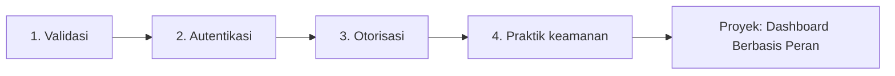

# Peta Belajar: Validasi Form, Autentikasi, dan Keamanan

Bab utama ini menjawab pertanyaan: *bagaimana membuat aplikasi yang hanya menerima data benar dan hanya melayani orang yang berhak?* Kamu akan belajar memvalidasi input, membangun autentikasi
(login, registrasi, reset kata sandi, verifikasi email), mengatur otorisasi dengan Gate, Policy, dan peran, serta menerapkan praktik keamanan: CSRF, XSS, SQL injection, mass assignment, rate limiting, dan unggah berkas aman.
Semua dikerjakan pada proyek `cms-artikel`.

## Tujuan Pembelajaran

Setelah menyelesaikan bab utama ini, kamu dapat:

- [ ] Memvalidasi input dengan aturan, Form Request, pesan kustom, dan validasi bersyarat.
- [ ] Membangun autentikasi: registrasi, login, logout, reset kata sandi, dan verifikasi email.
- [ ] Menerapkan otorisasi berbasis Gate, Policy, dan peran (RBAC).
- [ ] Menerapkan praktik keamanan: CSRF, XSS, SQL injection, mass assignment, rate limiting, dan unggah berkas.

## Prasyarat

- Bab utama [Database dan Eloquent ORM](../level-04/index.md), terutama proyek akhirnya.
- Bab Blade untuk form, CSRF, dan layout.

## Gambaran Besar

## Peta Sub Bab

| Sub bab | Yang kamu pelajari | Status |
|---|---|---|
| [Pengantar Validasi Form](05-01-introduction-to-form-validation.md) | Mengapa validasi server wajib dan alurnya | Draf |
| [Validasi Dasar](05-02-basic-validation.md) | Penulisan aturan, `bail`, `nullable`, data tervalidasi | Draf |
| [Aturan Validasi](05-03-validation-rules.md) | Katalog aturan, `unique`/`exists`, kata sandi | Draf |
| [Pesan Validasi Kustom](05-04-custom-validation-messages.md) | Pesan kustom, atribut, dan `lang/id` | Draf |
| [Validasi dengan Form Request](05-05-form-request-validation.md) | Form Request, normalisasi, `after` | Draf |
| [Validasi Bersyarat](05-06-conditional-validation.md) | `required_if`, `prohibited_if`, `Rule::when` | Draf |
| [Validasi Unggah Berkas](05-07-file-upload-validation.md) | `image`, `mimes`, `max`, dimensi, batas PHP | Draf |
| [Pengantar Autentikasi](05-08-introduction-to-authentication.md) | Autentikasi vs otorisasi, sesi, komponen | Draf |
| [Autentikasi Laravel](05-09-laravel-authentication.md) | `Auth` facade, `attempt`, `login`, remember me | Draf |
| [Login dan Logout](05-10-login-and-logout.md) | Form login, `intended`, logout lengkap | Draf |
| [Registrasi Pengguna](05-11-user-registration.md) | Registrasi aman dan `Registered` | Draf |
| [Hashing Kata Sandi](05-12-password-hashing.md) | Bcrypt, cast `hashed`, ganti sandi | Draf |
| [Reset Kata Sandi](05-13-password-reset.md) | Password broker, token, email log | Draf |
| [Verifikasi Email](05-14-email-verification.md) | `MustVerifyEmail`, URL bertanda tangan, `verified` | Draf |
| [Middleware Autentikasi](05-15-authentication-middleware.md) | `auth`, `guest`, `verified`, middleware kustom | Draf |
| [Otorisasi](05-16-authorization.md) | 401/403/404, IDOR, alat otorisasi | Draf |
| [Gate](05-17-gates.md) | `Gate::define`, `authorize`, `@can` | Draf |
| [Policy](05-18-policies.md) | `ArticlePolicy`, penemuan otomatis, `UsePolicy` | Draf |
| [Role-Based Access Control](05-19-role-based-access-control.md) | Peran admin/editor/penulis dengan enum | Draf |
| [Perlindungan CSRF](05-20-csrf-protection.md) | Serangan CSRF, tiga lapis pertahanan, audit | Draf |
| [Pencegahan XSS](05-21-xss-prevention.md) | Escaping per konteks, Markdown aman, CSP | Draf |
| [Pencegahan SQL Injection](05-22-sql-injection-prevention.md) | Binding, allow-list kolom, query mentah | Draf |
| [Perlindungan Mass Assignment](05-23-mass-assignment-protection.md) | `Fillable`, data tervalidasi, penugasan eksplisit | Draf |
| [Pembatasan Laju (Rate Limiting)](05-24-rate-limiting.md) | `throttle`, `RateLimiter`, perlindungan login | Draf |
| [Unggah Berkas yang Aman](05-25-secure-file-upload.md) | Nama acak, disk privat/publik, unduhan berotorisasi | Draf |

### Proyek Praktik

| Proyek | Hasil akhir | Status |
|---|---|---|
| [Dashboard Manajemen Artikel Berbasis Peran](proyek-dashboard-artikel-berbasis-peran.md) | Aplikasi artikel dengan login, peran, Policy, dan kontrol keamanan terverifikasi | Draf |

## Kriteria Penyelesaian

- [ ] Mampu menerapkan validasi form.
- [ ] Mampu menerapkan autentikasi.
- [ ] Mampu menerapkan otorisasi berbasis peran.
- [ ] Mampu menerapkan praktik pengodean aman.

## Cara Belajar yang Disarankan

1. Buka dokumentasi Laravel versi **13.x** dan OWASP saat mencari referensi.
2. Lanjutkan proyek `cms-artikel`; commit di Git setiap selesai satu sub bab.
3. Uji setiap kontrol keamanan dengan menyerangnya sendiri (di lingkungan lokal) sebelum menganggapnya aman.
4. Gunakan akun uji untuk tiap peran dan catat hasil dalam tabel.

!!! warning "Keamanan"
    Latihan penyerangan (XSS, SQL injection, mass assignment, CSRF) hanya dilakukan pada aplikasimu sendiri di komputer lokal. Jangan mencoba teknik ini pada sistem milik orang lain tanpa izin tertulis.

!!! info "Status materi"
    Semua dua puluh lima sub bab pada bab utama ini sudah tersedia (berstatus **DRAFT**), beserta proyek praktik penutup. Kode belum dijalankan penulis pada aplikasi Laravel sungguhan; hasil yang
    diharapkan diturunkan dari dokumentasi dan perlu kamu cocokkan.

## Referensi Resmi

- [Laravel: Validation](https://laravel.com/docs/13.x/validation)
- [Laravel: Authentication](https://laravel.com/docs/13.x/authentication)
- [Laravel: Authorization](https://laravel.com/docs/13.x/authorization)
- [OWASP Top 10](https://owasp.org/Top10/)
