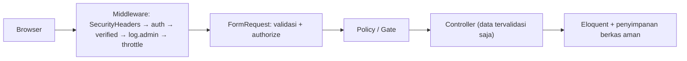

# Proyek Praktik: Dashboard Manajemen Artikel Berbasis Peran

Kamu sudah menyelesaikan seluruh sub bab **Validasi Form, Autentikasi, dan Keamanan**. Pada proyek ini semuanya dipakai bersama untuk mengamankan `cms-artikel` menjadi **Dashboard Manajemen Artikel Berbasis Peran**:
pendaftaran dan login dengan verifikasi email dan reset kata sandi, tiga peran (admin, editor, penulis) dengan Policy, validasi lewat Form Request, pembatasan laju, unggah sampul yang aman, dashboard yang
menyesuaikan diri dengan peran, dan skrip verifikasi keamanan otomatis.

## Tujuan Pembelajaran

Setelah menyelesaikan proyek ini, kamu dapat:

- [ ] Mengintegrasikan registrasi, login, logout, verifikasi email, dan reset kata sandi dalam satu aplikasi.
- [ ] Menerapkan RBAC dengan enum, Gate, dan Policy pada seluruh aksi admin.
- [ ] Memindahkan seluruh validasi artikel ke Form Request yang aman dari mass assignment.
- [ ] Menerapkan rate limiting, header keamanan, dan penyimpanan berkas yang aman.
- [ ] Membuat dashboard yang datanya bergantung pada peran tanpa kebocoran.
- [ ] Memverifikasi kontrol keamanan secara otomatis dengan skrip `curl`.

## Prasyarat

Proyek ini memakai seluruh bab ini. Kondisi awal `~/belajar-laravel/cms-artikel`:

| Komponen | Keterangan |
|---|---|
| Sistem artikel bab Database | Model, relasi, seeder, factory, `Admin\ArticleController`, view admin, paginasi |
| Auth dasar | Login, logout, registrasi, ganti sandi, reset sandi, verifikasi email (sub bab 05.09–05.14) |
| Peran | Kolom `role`, `UserRole`, Gate, `ArticlePolicy` (sub bab 05.16–05.19) |
| Keamanan | Rate limiting, header keamanan, unggah sampul (sub bab 05.20–05.25) |
| Lingkungan | PHP 8.3+, Composer, Node.js, terminal Bash, `MAIL_MAILER=log` |

Jika ada bagian yang belum kamu punya, kembali ke sub bab terkait. Proyek ini terutama **menyatukan dan memperkuat**; kode yang sama dengan sub bab tidak diulang secara lengkap.

## Pengantar

Aplikasi aman bukan hasil satu fitur, melainkan banyak lapis yang saling menutup celah. Proyek ini adalah latihan memastikan lapis-lapis itu benar-benar bekerja bersama, dibuktikan dengan pengujian, bukan sekadar
diasumsikan.

## Penjelasan Konsep

### Spesifikasi hak akses

| Aksi | Tamu | Penulis | Editor | Admin |
|---|---|---|---|---|
| Baca artikel terbit, komentar | Ya | Ya | Ya | Ya |
| Dashboard | Login | Statistik miliknya | Statistik semua | Statistik semua + jumlah pengguna |
| Daftar artikel admin | Login | Milik sendiri | Semua | Semua |
| Buat artikel | - | Ya | Ya | Ya |
| Ubah artikel | - | Milik sendiri | Semua | Semua |
| Hapus (tempat sampah) | - | Milik sendiri | Milik sendiri | Semua |
| Pulihkan / hapus permanen | - | - | - | Ya |
| Kelola kategori | - | - | Ya | Ya |
| Kelola pengguna dan peran | - | - | - | Ya |
| Hapus komentar | - | Di artikel sendiri | Semua | Semua |

### Rancangan

| Bagian | Peran |
|---|---|
| `StoreArticleRequest`, `UpdateArticleRequest` | Validasi artikel (termasuk sampul) tanpa mass assignment berbahaya |
| `ArticlePolicy`, `CommentPolicy`, Gate `manage-categories`, `manage-users` | Otorisasi |
| `DashboardController` | Statistik sesuai peran |
| Middleware `auth`, `verified`, `log.admin`, `SecurityHeaders` | Perlindungan lintas route |
| `RateLimiter` `login`/`komentar`, `throttle` | Batas laju |
| `scripts/verifikasi-keamanan.sh` | Pengujian otomatis |

## Cara Kerja



## Contoh Praktik

### Struktur akhir (berkas yang kamu tambah atau ubah)

```text
app/Http/Controllers/DashboardController.php
app/Http/Requests/StoreArticleRequest.php
app/Http/Requests/UpdateArticleRequest.php
app/Http/Controllers/Admin/ArticleController.php   (ubah: Form Request, Policy, cakupan per peran, sampul)
app/Policies/CommentPolicy.php
routes/web.php                                      (konsolidasi)
resources/views/dashboard.blade.php
scripts/verifikasi-keamanan.sh
```

## Penjelasan Kode

### Form Request artikel

File: `app/Http/Requests/StoreArticleRequest.php`

```php
<?php

namespace App\Http\Requests;

use App\Models\Article;
use Illuminate\Foundation\Http\FormRequest;
use Illuminate\Validation\Rule;
use Illuminate\Validation\Rules\File;

class StoreArticleRequest extends FormRequest
{
    public function authorize(): bool
    {
        return $this->user()->can('create', Article::class);
    }

    public function rules(): array
    {
        return [
            'title' => ['required', 'string', 'max:200'],
            'slug' => ['nullable', 'string', 'max:200', Rule::unique('articles', 'slug')->ignore($this->route('article')?->id)],
            'body' => ['required', 'string'],
            'category_id' => ['nullable', 'exists:categories,id'],
            'tags' => ['nullable', 'array', 'max:10'],
            'tags.*' => ['integer', 'exists:tags,id'],
            'is_published' => ['sometimes', 'boolean'],
            'cover' => ['nullable', File::image()->max(2 * 1024)->dimensions(Rule::dimensions()->maxWidth(3000)->maxHeight(3000))],
        ];
    }
}
```

`UpdateArticleRequest` mewarisi `StoreArticleRequest` dan menimpa `authorize()`:

```php-inline
class UpdateArticleRequest extends StoreArticleRequest
{
    public function authorize(): bool
    {
        return $this->user()->can('update', $this->route('article'));
    }
}
```

Perhatikan: **tidak ada** `user_id` pada aturan. Pemilik ditetapkan dari pengguna yang masuk (penulis) atau dipilih admin dengan Gate khusus. Contoh sederhana: penulis dan editor selalu menjadi pemilik artikel
barunya; admin tetap dapat memindahkan pemilik lewat fitur tersendiri jika diperlukan (tidak dalam proyek ini).

### Controller admin artikel (bagian penting)

File: `app/Http/Controllers/Admin/ArticleController.php`

```php-inline
public function index(Request $request): View
{
    Gate::authorize('viewAny', Article::class);
    $user = $request->user();

    $articles = Article::query()
        ->when($request->boolean('sampah'), fn ($q) => $q->onlyTrashed())
        ->when(! $user->hasRole(UserRole::Admin, UserRole::Editor), fn ($q) => $q->where('user_id', $user->id))
        ->with(['category:id,name', 'user:id,name'])
        ->withCount('comments')
        ->latest()
        ->paginate(10)
        ->withQueryString();

    return view('admin.articles.index', ['articles' => $articles, 'sampah' => $request->boolean('sampah')]);
}

public function store(StoreArticleRequest $request): RedirectResponse
{
    $data = $request->validated();

    $article = DB::transaction(function () use ($data, $request) {
        $article = new Article(Arr::only($data, ['title', 'slug', 'body']));
        $article->is_published = $request->boolean('is_published');
        $article->user()->associate($request->user());
        $article->category()->associate($data['category_id'] ?? null);

        if ($request->hasFile('cover')) {
            $article->cover_path = $request->file('cover')->store('covers', 'public');
        }

        $article->save();
        $article->tags()->sync($data['tags'] ?? []);

        return $article;
    });

    return redirect()->route('admin.articles.index')->with('status', "Artikel \"{$article->title}\" dibuat.");
}
```

`update` serupa tetapi tidak mengubah pemilik, mengganti sampul dengan menghapus berkas lama, dan memakai `UpdateArticleRequest`. `destroy` dan `restore` memakai `Gate::authorize('delete'|'restore', ...)`.
Daftar sudah dibatasi sehingga penulis hanya melihat artikelnya; `Gate::authorize('update', ...)` di Form Request tetap menolak percobaan mengakses ID milik orang lain secara langsung.

### Policy komentar

File: `app/Policies/CommentPolicy.php`

```php-inline
public function delete(User $user, Comment $comment): bool
{
    return $user->hasRole(UserRole::Admin, UserRole::Editor)
        || $comment->article->user_id === $user->id;
}
```

Terapkan di `Admin\CommentController::destroy` dengan `Gate::authorize('delete', $comment)` dan di tampilan dengan `@can('delete', $comment)`.

### Dashboard sesuai peran

File: `app/Http/Controllers/DashboardController.php`

```php
<?php

namespace App\Http\Controllers;

use App\Enums\UserRole;
use App\Models\Article;
use App\Models\Comment;
use App\Models\User;
use Illuminate\Http\Request;
use Illuminate\View\View;

class DashboardController extends Controller
{
    public function __invoke(Request $request): View
    {
        $user = $request->user();

        $scope = Article::query()->when(
            ! $user->hasRole(UserRole::Admin, UserRole::Editor),
            fn ($q) => $q->where('user_id', $user->id)
        );

        return view('dashboard', [
            'stats' => [
                'total' => (clone $scope)->count(),
                'terbit' => (clone $scope)->where('is_published', true)->count(),
                'draf' => (clone $scope)->where('is_published', false)->count(),
                'komentar' => Comment::whereIn('article_id', (clone $scope)->select('id'))->count(),
            ],
            'terbaru' => (clone $scope)->with('category:id,name')->latest()->limit(5)->get(),
            'jumlahPengguna' => $user->isAdmin() ? User::count() : null,
        ]);
    }
}
```

File: `resources/views/dashboard.blade.php`

```html
<x-layout title="Dashboard">
    <h1 class="text-xl font-bold mb-3">Dashboard ({{ auth()->user()->role->label() }})</h1>

    <div class="grid grid-cols-2 md:grid-cols-4 gap-3 mb-6">
        @foreach (['total' => 'Artikel', 'terbit' => 'Terbit', 'draf' => 'Draf', 'komentar' => 'Komentar'] as $kunci => $label)
            <div class="bg-white border rounded p-3">
                <div class="text-sm text-gray-500">{{ $label }}</div>
                <div class="text-2xl font-bold">{{ $stats[$kunci] }}</div>
            </div>
        @endforeach
        @if ($jumlahPengguna !== null)
            <div class="bg-white border rounded p-3">
                <div class="text-sm text-gray-500">Pengguna</div>
                <div class="text-2xl font-bold">{{ $jumlahPengguna }}</div>
            </div>
        @endif
    </div>

    <h2 class="font-semibold mb-2">Artikel terbaru</h2>
    <ul class="list-disc ml-5">
        @forelse ($terbaru as $a)
            <li>{{ $a->title }} <small class="text-gray-500">({{ $a->category?->name ?? 'tanpa kategori' }})</small></li>
        @empty
            <li>Belum ada artikel.</li>
        @endforelse
    </ul>
</x-layout>
```

Jumlah pengguna hanya dikirim ke view bila admin; nilai `null` untuk yang lain sehingga tidak bocor lewat HTML tersembunyi.

### Routing terkonsolidasi

File: `routes/web.php`

```php-inline
use App\Http\Controllers\Admin\ArticleController as AdminArticleController;
use App\Http\Controllers\Admin\CategoryController as AdminCategoryController;
use App\Http\Controllers\Admin\CommentController as AdminCommentController;
use App\Http\Controllers\Admin\UserController as AdminUserController;
use App\Http\Controllers\ArticleController;
use App\Http\Controllers\Auth\AuthenticatedSessionController;
use App\Http\Controllers\Auth\NewPasswordController;
use App\Http\Controllers\Auth\PasswordController;
use App\Http\Controllers\Auth\PasswordResetLinkController;
use App\Http\Controllers\Auth\RegisteredUserController;
use App\Http\Controllers\CommentController;
use App\Http\Controllers\DashboardController;
use App\Http\Controllers\ProfileController;
use Illuminate\Foundation\Auth\EmailVerificationRequest;
use Illuminate\Http\Request;
use Illuminate\Support\Facades\Route;

// Publik
Route::redirect('/', '/artikel');
Route::get('/artikel', [ArticleController::class, 'index'])->name('articles.index');
Route::get('/artikel/{article:slug}', [ArticleController::class, 'show'])->name('articles.show');
Route::post('/artikel/{article:slug}/komentar', [CommentController::class, 'store'])
    ->middleware('throttle:komentar')->name('comments.store');

// Tamu
Route::middleware('guest')->group(function () {
    Route::get('/login', [AuthenticatedSessionController::class, 'create'])->name('login');
    Route::post('/login', [AuthenticatedSessionController::class, 'store'])->name('login.store');
    Route::get('/register', [RegisteredUserController::class, 'create'])->name('register');
    Route::post('/register', [RegisteredUserController::class, 'store'])->middleware('throttle:5,60')->name('register.store');
    Route::get('/lupa-sandi', [PasswordResetLinkController::class, 'create'])->name('password.request');
    Route::post('/lupa-sandi', [PasswordResetLinkController::class, 'store'])->middleware('throttle:6,1')->name('password.email');
    Route::get('/reset-sandi/{token}', [NewPasswordController::class, 'create'])->name('password.reset');
    Route::post('/reset-sandi', [NewPasswordController::class, 'store'])->name('password.update');
});

// Pengguna masuk
Route::middleware('auth')->group(function () {
    Route::post('/logout', [AuthenticatedSessionController::class, 'destroy'])->name('logout');

    Route::get('/email/verifikasi', fn () => view('auth.verify-email'))->name('verification.notice');
    Route::get('/email/verifikasi/{id}/{hash}', function (EmailVerificationRequest $request) {
        $request->fulfill();
        return redirect()->route('dashboard')->with('status', 'Email berhasil diverifikasi.');
    })->middleware('signed')->name('verification.verify');
    Route::post('/email/verifikasi/kirim-ulang', function (Request $request) {
        $request->user()->sendEmailVerificationNotification();
        return back()->with('status', 'Tautan verifikasi baru telah dikirim.');
    })->middleware('throttle:6,1')->name('verification.send');
});

// Pengguna masuk dan terverifikasi
Route::middleware(['auth', 'auth.session', 'verified'])->group(function () {
    Route::get('/dashboard', DashboardController::class)->name('dashboard');
    Route::get('/profil', [ProfileController::class, 'edit'])->name('profile.edit');
    Route::put('/profil', [ProfileController::class, 'update'])->name('profile.update');
    Route::get('/akun/sandi', [PasswordController::class, 'edit'])->name('password.edit');
    Route::put('/akun/sandi', [PasswordController::class, 'update'])->name('password.change');

    Route::prefix('admin')->name('admin.')->middleware('log.admin')->group(function () {
        Route::get('/artikel', [AdminArticleController::class, 'index'])->name('articles.index');
        Route::get('/artikel/baru', [AdminArticleController::class, 'create'])->name('articles.create');
        Route::post('/artikel', [AdminArticleController::class, 'store'])->name('articles.store');
        Route::get('/artikel/{article}/ubah', [AdminArticleController::class, 'edit'])->whereNumber('article')->name('articles.edit');
        Route::put('/artikel/{article}', [AdminArticleController::class, 'update'])->whereNumber('article')->name('articles.update');
        Route::delete('/artikel/{article}', [AdminArticleController::class, 'destroy'])->whereNumber('article')->name('articles.destroy');
        Route::patch('/artikel/{id}/pulihkan', [AdminArticleController::class, 'restore'])->whereNumber('id')->name('articles.restore');

        Route::delete('/komentar/{comment}', [AdminCommentController::class, 'destroy'])->whereNumber('comment')->name('comments.destroy');

        Route::middleware('can:manage-categories')->group(function () {
            Route::get('/kategori', [AdminCategoryController::class, 'index'])->name('categories.index');
            Route::post('/kategori', [AdminCategoryController::class, 'store'])->name('categories.store');
            Route::delete('/kategori/{category}', [AdminCategoryController::class, 'destroy'])->whereNumber('category')->name('categories.destroy');
        });

        Route::middleware('can:manage-users')->group(function () {
            Route::get('/pengguna', [AdminUserController::class, 'index'])->name('users.index');
            Route::patch('/pengguna/{user}/peran', [AdminUserController::class, 'updateRole'])->whereNumber('user')->name('users.role');
        });
    });
});
```

Catatan penting: route komentar publik menerima komentar tanpa login; moderasi ada di area admin. Nama route `password.update` untuk alur reset dan `password.change` untuk ganti sandi dipisahkan.

### Skrip verifikasi keamanan

File: `scripts/verifikasi-keamanan.sh`

```bash
#!/usr/bin/env bash
# Jalankan dengan server aktif: php artisan serve. Data uji: admin@contoh.test, ani@contoh.test, budi@contoh.test (sandi 'password').
BASE=${BASE:-http://127.0.0.1:8000}
GAGAL=0
JAR_ANI=$(mktemp); JAR_ADMIN=$(mktemp)

status() { curl -s -o /dev/null -w "%{http_code}" "$@"; }

cek() {
  if [ "$2" = "$3" ]; then echo "OK    $1 ($3)"; else echo "GAGAL $1 (harapan $2, dapat $3)"; GAGAL=1; fi
}

masuk() { # email jar
  local token
  token=$(curl -s -c "$2" "$BASE/login" | grep -o 'name="_token" value="[^"]*"' | head -1 | sed 's/.*value="//;s/"//')
  curl -s -o /dev/null -b "$2" -c "$2" -d "_token=$token&email=$1&password=password" "$BASE/login"
}

masuk ani@contoh.test "$JAR_ANI"
masuk admin@contoh.test "$JAR_ADMIN"

ID_BUDI=$(php artisan tinker --execute='echo App\Models\Article::whereHas("user", fn ($q) => $q->where("email", "budi@contoh.test"))->value("id");' 2>/dev/null | tail -1)

cek "tamu ke /admin/artikel dialihkan" 302 "$(status $BASE/admin/artikel)"
cek "tamu JSON ke /admin/artikel" 401 "$(status -H 'Accept: application/json' $BASE/admin/artikel)"
cek "penulis membuka /admin/artikel" 200 "$(status -b $JAR_ANI $BASE/admin/artikel)"
cek "penulis membuka kategori" 403 "$(status -b $JAR_ANI $BASE/admin/kategori)"
cek "penulis membuka pengguna" 403 "$(status -b $JAR_ANI $BASE/admin/pengguna)"
cek "penulis mengubah artikel Budi" 403 "$(status -b $JAR_ANI $BASE/admin/artikel/$ID_BUDI/ubah)"
cek "admin membuka pengguna" 200 "$(status -b $JAR_ADMIN $BASE/admin/pengguna)"
cek "admin mengubah artikel Budi" 200 "$(status -b $JAR_ADMIN $BASE/admin/artikel/$ID_BUDI/ubah)"
cek "logout via GET ditolak" 405 "$(status $BASE/logout)"
cek "logout POST tanpa token" 419 "$(status -X POST -b $JAR_ANI $BASE/logout)"
cek "header nosniff ada" 1 "$(curl -sI $BASE/artikel | grep -ci 'x-content-type-options: nosniff')"

for i in 1 2 3 4 5 6; do
  TOKEN=$(curl -s -c cj_bf.txt "$BASE/login" | grep -o 'name="_token" value="[^"]*"' | head -1 | sed 's/.*value="//;s/"//')
  RESP=$(curl -s -b cj_bf.txt -c cj_bf.txt -L -d "_token=$TOKEN&email=korban@contoh.test&password=salah$i" "$BASE/login")
done
cek "percobaan login ke-6 dibatasi" 1 "$(echo "$RESP" | grep -c 'Terlalu banyak percobaan')"

rm -f "$JAR_ANI" "$JAR_ADMIN" cj_bf.txt
exit $GAGAL
```

Skrip ini memakai kata sandi `password` hanya karena data uji lokal. Jangan menjalankannya pada server nyata.

## Implementasi Langkah demi Langkah

### Langkah 1: periksa kondisi awal

```bash
cd ~/belajar-laravel/cms-artikel
git status
php artisan migrate:status
```

### Langkah 2: siapkan data

```bash
php artisan migrate:fresh --seed
php artisan tinker
```

Di Tinker:

```php-inline
use App\Models\{Article, User};

User::where('email', 'admin@contoh.test')->exists() || User::factory()->admin()->create(['name' => 'Admin', 'email' => 'admin@contoh.test']);
$ani = User::where('email', 'ani@contoh.test')->first() ?? User::factory()->create(['name' => 'Ani', 'email' => 'ani@contoh.test']);
$budi = User::where('email', 'budi@contoh.test')->first() ?? User::factory()->create(['name' => 'Budi', 'email' => 'budi@contoh.test']);
Article::factory()->for($ani)->create(['title' => 'Artikel Ani']);
Article::factory()->for($budi)->create(['title' => 'Artikel Budi']);
```

Factory mengisi `email_verified_at` (akun terverifikasi), kata sandi `password`, dan peran `author` (nilai bawaan kolom); state `admin()` mengatur peran admin. Factory melewati perlindungan mass assignment sehingga aman dipakai untuk data uji lokal.

### Langkah 3: terapkan Form Request dan Policy pada admin artikel

Buat `StoreArticleRequest`, `UpdateArticleRequest`, `CommentPolicy`; ubah `Admin\ArticleController` seperti di atas.

### Langkah 4: dashboard dan routing

Buat `DashboardController`, view, dan ganti `routes/web.php`.

### Langkah 5: periksa route

```bash
php artisan route:list --except-vendor -v
```

Pastikan setiap route sensitif memuat `auth`, `verified`, dan (untuk kategori/pengguna) `can:...`.

### Langkah 6: uji manual per peran

Masuk sebagai penulis, editor, dan admin. Isi tabel hasil: dashboard, daftar artikel, ubah artikel orang lain, kategori, pengguna, hapus komentar, pulihkan artikel.

### Langkah 7: jalankan skrip verifikasi

```bash
php artisan serve &
chmod +x scripts/verifikasi-keamanan.sh
./scripts/verifikasi-keamanan.sh
```

Semua baris harus berawalan `OK`. Bersihkan batas laju sebelum mengulang (`php artisan cache:clear`).

### Langkah 8: audit akhir

```bash
grep -rn "request->all()\|{!!\|forceFill\|unguard\|DB::raw\|whereRaw\|orderByRaw" app resources routes
```

Tinjau setiap temuan.

### Langkah 9: build produksi dan Git

```bash
npm run build
git status
git add app database resources routes scripts lang
git commit -m "Tambah dashboard manajemen artikel berbasis peran"
```

Pastikan `.env`, `node_modules`, `public/build`, dan `storage/app/public/*` tidak ikut.

## Eksekusi dan Verifikasi

| Langkah | Cara memverifikasi |
|---|---|
| 5 | Middleware sesuai rancangan |
| 6 | Hasil sesuai spesifikasi hak akses |
| 7 | Semua pemeriksaan skrip `OK` |
| 8 | Tidak ada pola berbahaya yang tak terjustifikasi |
| 9 | `git status` bersih |

## Hasil yang Diharapkan

| Pemeriksaan | Hasil |
|---|---|
| Tamu ke `/admin/artikel` | `302` (HTML) / `401` (JSON) |
| Penulis ke `/admin/kategori`, `/admin/pengguna` | `403` |
| Penulis mengubah artikel Budi | `403` |
| Admin ke `/admin/pengguna` | `200` |
| `GET /logout` | `405` |
| `POST /logout` tanpa token | `419` |
| Percobaan login ke-6 | Pesan terlalu banyak percobaan |
| Header respons | `X-Content-Type-Options: nosniff` |

Hasil ini diturunkan dari dokumentasi dan perilaku Laravel, dan belum dijalankan oleh penulis materi; cocokkan dengan hasilmu. Bila ada baris yang gagal, periksa tabel di bawah.

## Kesalahan Umum dan Pemecahan Masalah

| Gejala | Penyebab | Cara mengenali | Solusi | Pencegahan |
|---|---|---|---|---|
| Skrip login tak berhasil (semua 302 ke login) | Email belum terverifikasi → dialihkan ke `/email/verifikasi` | Akses ditolak walau login | Set `email_verified_at` untuk akun uji | Verifikasi akun uji |
| `403` untuk admin | Kolom `role` belum `admin` | Admin ditolak | `update(['role' => 'admin'])` | Seeder |
| `419` pada login skrip | Token tidak terambil (cookie) | Status 419 | Pastikan `-c`/`-b` konsisten | Gunakan jar yang sama |
| Penulis melihat artikel orang lain | Daftar tidak dibatasi per peran | Artikel milik orang lain tampil | Tambahkan `when` per peran | Uji tiap peran |
| Sampul tak tampil | `storage:link` belum | 404 pada `/storage/...` | Jalankan `storage:link` | Prosedur setup |
| Pembatas login tidak terpicu | Cache bukan terpusat / email berbeda tiap percobaan | Tidak ada pesan | Pakai email sama dan cache `database` | Uji dengan kunci tetap |
| Pesan 403 bocor detail | `APP_DEBUG=true` | Jejak muncul | Matikan debug saat uji produksi | Konfigurasi produksi |
| Konflik nama route `password.update` | Dua route bernama sama | Tautan salah | Pisahkan nama (`password.change`) | Cek `route:list` |

## Latihan Praktik

### Latihan dasar

**D1. Isi matriks**
- *Masalah:* spesifikasi harus terbukti.
- *Persyaratan:* jalankan setiap sel matriks hak akses dan catat hasil nyata dalam tabel; tandai selisih dengan spesifikasi.
- *Perilaku yang diharapkan:* tidak ada selisih, atau selisih dijelaskan dan diperbaiki.
- *Tujuan belajar:* memverifikasi kontrol akses.

### Latihan implementasi

**I1. Perpanjang skrip**
- *Masalah:* skrip perlu mencakup lebih banyak kontrol.
- *Persyaratan:* tambahkan pemeriksaan untuk pemulihan artikel oleh penulis (403), hapus komentar oleh editor (berhasil), unggah SVG sebagai sampul (ditolak), dan `?urut=password` (tetap 200).
- *Perilaku yang diharapkan:* semua pemeriksaan baru `OK`.
- *Tujuan belajar:* menulis uji keamanan otomatis.

**I2. Audit log perubahan peran**
- *Masalah:* perubahan peran harus dapat dilacak.
- *Persyaratan:* catat setiap perubahan peran (pelaku, sasaran, lama, baru) ke log dan tunjukkan entri setelah mengubah peran dari panel.
- *Perilaku yang diharapkan:* jejak audit tersedia.
- *Tujuan belajar:* akuntabilitas.

### Latihan tantangan

**T1. Tinjau ancaman**
- *Masalah:* sebelum rilis, tim melakukan telaah ancaman.
- *Persyaratan:* buat tabel ancaman (OWASP: akses, injeksi, XSS, CSRF, autentikasi, unggahan, konfigurasi) dengan kontrol yang sudah ada di proyek dan celah yang tersisa, serta rencana perbaikan berprioritas.
- *Perilaku yang diharapkan:* dokumen jujur tentang celah tersisa (mis. tanpa MFA, tanpa pemindaian virus).
- *Tujuan belajar:* menilai keamanan secara menyeluruh.
- *Catatan:* kerjakan mandiri; tidak ada kunci jawaban.

## Uji Pemahaman

1. Mengapa daftar artikel penulis dibatasi di query, bukan hanya lewat Policy?
2. Mengapa `user_id` tidak ada di aturan Form Request?
3. Mengapa jumlah pengguna dikirim ke view hanya untuk admin?
4. Apa fungsi `auth.session` pada grup route?
5. Mengapa akun uji perlu `email_verified_at`?
6. Apa keterbatasan skrip verifikasi ini?

??? success "Kunci jawaban singkat"
    1. Policy melindungi aksi per objek; pembatasan query mencegah data milik orang lain tampil di daftar.
    2. Pemilik ditetapkan server dari pengguna yang masuk agar tak dapat dipalsukan.
    3. Agar data tidak bocor melalui HTML.
    4. Membatalkan sesi di perangkat lain setelah kata sandi berubah.
    5. Route dilindungi `verified`.
    6. Hanya menguji sebagian kontrol dengan data lokal; bukan pengganti uji keamanan dan tinjauan kode menyeluruh.

## Ringkasan

- Proyek ini menyatukan validasi, autentikasi, RBAC, rate limiting, header keamanan, dan unggah aman.
- Hak akses dibuktikan dengan matriks dan skrip `curl`, bukan asumsi.
- Daftar harus dibatasi per peran dan aksi diotorisasi per objek; pemilik ditetapkan server.
- Keamanan berlapis: tidak ada satu kontrol pun yang cukup sendirian.

Selanjutnya: bab utama *Pengembangan REST API*.

## Referensi Resmi

- [Laravel: Authentication](https://laravel.com/docs/13.x/authentication)
- [Laravel: Authorization](https://laravel.com/docs/13.x/authorization)
- [Laravel: Validation](https://laravel.com/docs/13.x/validation)
- [Laravel: Rate Limiting](https://laravel.com/docs/13.x/routing#rate-limiting)
- [Laravel: File Storage](https://laravel.com/docs/13.x/filesystem)
- [OWASP Top 10](https://owasp.org/Top10/)
