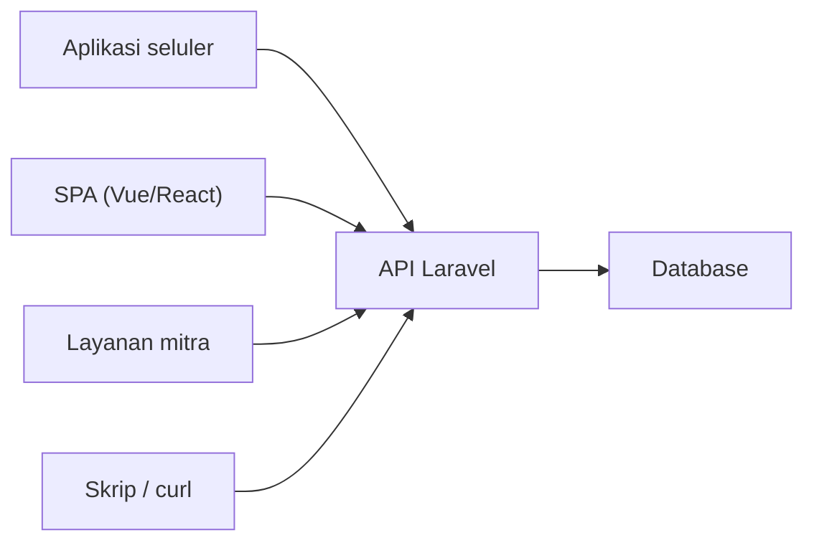
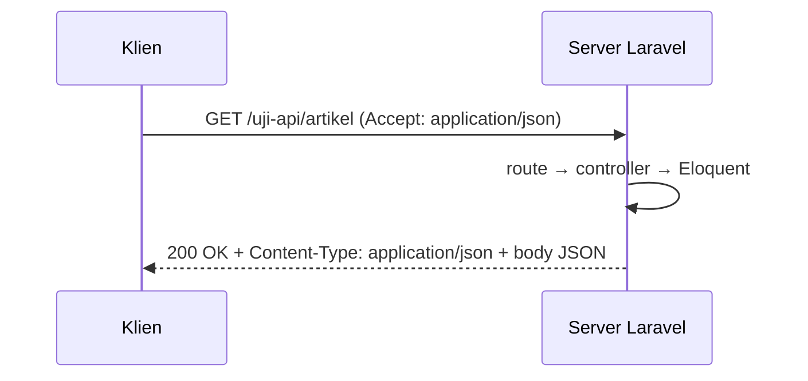

# Pengantar REST API

Sejauh ini aplikasimu mengirim **HTML** untuk dibaca manusia. Aplikasi seluler, halaman JavaScript modern, dan sistem lain tidak membutuhkan HTML; mereka membutuhkan **data**. **API** (*Application
Programming Interface*) adalah pintu bagi program lain untuk memakai fungsi aplikasimu, dan **REST** adalah gaya perancangan API web yang paling umum. Sub bab ini menjelaskan apa itu API, mengapa dibutuhkan,
dan menunjukkan JSON pertama dari proyek `cms-artikel`.

## Tujuan Pembelajaran

Setelah menyelesaikan sub bab ini, kamu dapat:

- [ ] Menjelaskan apa itu API dan perbedaannya dari halaman web biasa.
- [ ] Menyebutkan siapa saja konsumen API (aplikasi seluler, SPA, layanan lain).
- [ ] Menjelaskan REST secara singkat: sumber daya, URL, metode HTTP, dan representasi (JSON).
- [ ] Membedakan aplikasi web berbasis sesi dan API *stateless*.
- [ ] Meminta data JSON dari aplikasi Laravel dengan `curl`.
- [ ] Menyebutkan arsitektur API yang akan dibangun pada bab ini.

## Prasyarat

- Bab utama [Database dan Eloquent ORM](../level-04/index.md) serta [Validasi, Autentikasi, dan Keamanan](../level-05/index.md).
- [HTTP dan HTTPS](../level-00/00-03-http-https-fundamentals.md) dan [JSON Response](../level-02/02-18-json-response.md).
- Proyek `cms-artikel` dengan data contoh.

## Pengantar

Bayangkan tim seluler ingin membuat aplikasi baca artikel. Mereka tidak bisa "mem-parsing" halaman HTML dengan rapi, dan tidak seharusnya. Mereka membutuhkan alamat tetap yang mengembalikan daftar artikel dalam
format yang mudah diolah. Itulah API.

## Penjelasan Konsep

### Apa itu API?

**API** adalah kontrak: "kirim permintaan seperti ini, terima jawaban seperti itu". **Web API** memakai HTTP. Pengirim permintaan disebut **klien** (*client*); yang menjawab adalah **server**.

| Halaman web | Web API |
|---|---|
| Pengguna: manusia di browser | Pengguna: program |
| Respons: HTML + CSS + JS | Respons: data (umumnya JSON) |
| Sesi dan cookie | Biasanya *stateless*, token di header |
| Berubah sesuai desain | Kontrak harus stabil (versi) |

### Siapa pengguna API?



Satu API melayani banyak klien sekaligus, sehingga logika bisnis tidak ditulis ulang untuk setiap klien.

### REST dalam satu paragraf

**REST** (*Representational State Transfer*) memandang aplikasi sebagai kumpulan **sumber daya** (*resource*) seperti artikel dan kategori. Setiap sumber daya punya alamat (URL). Klien melakukan aksi dengan
**metode HTTP** (`GET` baca, `POST` buat, `PUT/PATCH` ubah, `DELETE` hapus) dan menerima **representasi** sumber daya, biasanya JSON. Sub bab berikutnya membahas ini rinci.

| Aksi | Permintaan | Arti |
|---|---|---|
| Daftar artikel | `GET /api/v1/articles` | Ambil kumpulan |
| Satu artikel | `GET /api/v1/articles/5` | Ambil satu |
| Buat artikel | `POST /api/v1/articles` | Tambah baru |
| Ubah artikel | `PUT/PATCH /api/v1/articles/5` | Ubah |
| Hapus artikel | `DELETE /api/v1/articles/5` | Hapus |

### Contoh respons JSON

```json
{
    "data": {
        "id": 5,
        "title": "Belajar REST API",
        "slug": "belajar-rest-api",
        "published_at": "2026-11-10T08:00:00+00:00"
    }
}
```

JSON mudah dibaca manusia dan diolah hampir semua bahasa pemrograman.

### Stateless

Server API biasanya tidak menyimpan "sesi" klien. Setiap permintaan membawa semua yang dibutuhkan (termasuk bukti identitas, mis. token). Ini membuat API mudah diskalakan: permintaan mana pun dapat dilayani server mana pun.

### Yang akan dibangun

Pada bab ini kamu membangun **API Manajemen Artikel**: endpoint untuk artikel, kategori, dan komentar, lengkap dengan validasi, penanganan galat, paginasi, pencarian, autentikasi token, otorisasi,
pembatasan laju, versi, dokumentasi, dan pengujian.

### Keamanan sejak awal

- API terbuka untuk program, termasuk program jahat; setiap endpoint adalah permukaan serangan.
- Semua prinsip bab keamanan tetap berlaku: validasi, otorisasi per objek, mass assignment, rate limiting.
- Jangan mengembalikan data lebih dari yang diperlukan (mis. `password`, email pengguna lain).

## Cara Kerja



## Contoh Praktik

Kamu menambah satu route sementara yang mengembalikan tiga artikel sebagai JSON, memanggilnya dengan `curl`, membaca status, header, dan body, lalu membandingkannya dengan halaman HTML `/artikel`.

## Penjelasan Kode

File: `routes/web.php` (sementara; akan dipindah ke `routes/api.php` pada sub bab 06.06)

```php-inline
use App\Models\Article;

Route::get('/uji-api/artikel', function () {
    return Article::published()->latest('published_at')->limit(3)->get(['id', 'title', 'slug', 'published_at']);
});
```

Mengembalikan koleksi Eloquent dari route otomatis diubah menjadi JSON.

## Implementasi Langkah demi Langkah

### Langkah 1: siapkan data

```bash
cd ~/belajar-laravel/cms-artikel
php artisan migrate:fresh --seed
php artisan serve
```

### Langkah 2: panggil sebagai klien

```bash
curl -i http://127.0.0.1:8000/uji-api/artikel
curl -s -H "Accept: application/json" http://127.0.0.1:8000/uji-api/artikel
```

Di Windows PowerShell tulis `curl.exe`.

### Langkah 3: amati bagian respons

Catat baris status, header `Content-Type`, dan struktur body (array objek).

### Langkah 4: bandingkan dengan HTML

```bash
curl -s http://127.0.0.1:8000/artikel | head -20
```

Perhatikan perbedaan format dan betapa sulitnya mengambil data dari HTML.

### Langkah 5: panggil dari JavaScript (opsional)

Di konsol browser pada halaman aplikasi:

```js
fetch('/uji-api/artikel').then(r => r.json()).then(console.log);
```

### Langkah 6: hapus route sementara

Hapus route `/uji-api/artikel`. Tidak ada yang perlu di-*commit*.

## Eksekusi dan Verifikasi

| Langkah | Cara memverifikasi |
|---|---|
| 2 | Status `200`, `Content-Type: application/json`, body array JSON |
| 4 | Respons HTML panjang tanpa struktur data |
| 5 | Konsol mencetak array objek |

## Hasil yang Diharapkan

| Permintaan | Hasil |
|---|---|
| `GET /uji-api/artikel` | `200 OK` + JSON berisi hingga tiga artikel (`id`, `title`, `slug`, `published_at`) |
| `GET /artikel` | `200 OK` + HTML |

Format tanggal dan urutan kunci bergantung data. Hasil ini diturunkan dari dokumentasi dan belum dijalankan oleh penulis materi; cocokkan dengan hasilmu.

## Kesalahan Umum dan Pemecahan Masalah

| Gejala | Penyebab | Cara mengenali | Solusi | Pencegahan |
|---|---|---|---|---|
| Body kosong `[]` | Tidak ada artikel terbit | Array kosong | Jalankan seeder | Siapkan data uji |
| Respons berisi HTML | Route salah / diarahkan ke halaman | `Content-Type: text/html` | Periksa URL dan route | Gunakan `Accept` |
| `Call to undefined method published()` | Scope belum ada | Galat | Tambahkan scope `published` | Ikuti bab Database |
| Karakter Indonesia rusak di terminal | Pengodean terminal | Teks aneh | Atur UTF-8 | Gunakan terminal UTF-8 |
| CORS galat dari browser asing | Asal berbeda | Konsol: CORS | Dibahas pada sub bab integrasi frontend | Pahami CORS |

## Latihan Praktik

### Latihan dasar

**D1. Web atau API?**
- *Masalah:* klasifikasikan.
- *Persyaratan:* tentukan apakah memakai halaman web atau API untuk (a) blog yang dibaca di browser, (b) aplikasi seluler yang menampilkan artikel yang sama, (c) integrasi sistem akuntansi mitra.
- *Perilaku yang diharapkan:* (a) halaman web, (b) dan (c) API.
- *Tujuan belajar:* memilih bentuk antarmuka.

### Latihan implementasi

**I1. Dua klien, satu data**
- *Masalah:* ingin membuktikan satu API melayani banyak klien.
- *Persyaratan:* panggil route JSON dari `curl` dan dari `fetch` di konsol browser, dan bandingkan hasilnya.
- *Perilaku yang diharapkan:* data identik.
- *Tujuan belajar:* memahami klien yang beragam.

**I2. Kontrak sederhana**
- *Masalah:* tim seluler butuh kesepakatan.
- *Persyaratan:* tulis kontrak (URL, metode, contoh respons) untuk daftar artikel dalam satu tabel.
- *Perilaku yang diharapkan:* kontrak jelas dan dapat diuji.
- *Tujuan belajar:* berpikir kontrak.

### Latihan tantangan

**T1. Data yang tak boleh keluar**
- *Masalah:* sebuah endpoint mengembalikan seluruh model `User`.
- *Persyaratan:* analisis data sensitif yang bocor dan jelaskan cara membatasi keluaran (kolom tertentu, `#[Hidden]`, resource).
- *Perilaku yang diharapkan:* analisis mencakup `password`, `email`, `remember_token`.
- *Tujuan belajar:* membatasi kebocoran data.
- *Catatan:* kerjakan mandiri; tidak ada kunci jawaban.

## Uji Pemahaman

1. Apa itu API?
2. Apa beda respons halaman web dan API?
3. Apa itu sumber daya dalam REST?
4. Apa arti *stateless*?
5. Mengapa satu API melayani banyak klien?
6. Mengapa API tetap perlu validasi dan otorisasi?

??? success "Kunci jawaban singkat"
    1. Antarmuka bagi program lain untuk memakai fungsi aplikasi.
    2. Halaman web mengirim HTML untuk manusia; API mengirim data (JSON) untuk program.
    3. Objek yang dikelola, mis. artikel, dengan URL sendiri.
    4. Server tidak menyimpan sesi klien; tiap permintaan membawa semua yang dibutuhkan.
    5. Logika bisnis tidak perlu ditulis ulang untuk tiap klien.
    6. Setiap endpoint dapat diserang oleh program jahat.

## Ringkasan

- API adalah kontrak antar program; REST memodelkannya sebagai sumber daya, URL, metode HTTP, dan JSON.
- API umumnya stateless dan melayani banyak klien.
- Prinsip keamanan bab sebelumnya tetap berlaku.
- Bab ini membangun API Manajemen Artikel secara bertahap.

Selanjutnya: *Arsitektur REST*, prinsip-prinsip yang membuat API konsisten.

## Referensi Resmi

- [Laravel: Routing, API Routes](https://laravel.com/docs/13.x/routing#api-routes)
- [Laravel: Responses (JSON)](https://laravel.com/docs/13.x/responses#json-responses)
- [MDN: HTTP overview](https://developer.mozilla.org/en-US/docs/Web/HTTP/Overview)
