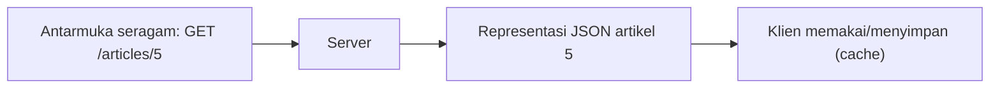

# Arsitektur REST

REST bukan protokol atau pustaka, melainkan sekumpulan **batasan perancangan** (*constraints*) yang, jika diikuti, menghasilkan API yang konsisten, mudah dipelajari, dan mudah diskalakan. Sub bab ini
menjelaskan batasan tersebut, aturan penamaan URL yang baik, kepatuhan nyata di industri (sering disebut "RESTful"), serta tingkat kematangan API.

## Tujuan Pembelajaran

Setelah menyelesaikan sub bab ini, kamu dapat:

- [ ] Menyebutkan enam batasan arsitektur REST.
- [ ] Merancang URL berbasis sumber daya (kata benda, jamak, hierarki).
- [ ] Menjelaskan *idempotent* dan *safe* pada metode HTTP.
- [ ] Menjelaskan HATEOAS dan tingkat kematangan Richardson secara singkat.
- [ ] Mengevaluasi rancangan URL dan memperbaikinya.
- [ ] Merancang peta endpoint API artikel.

## Prasyarat

- [Pengantar REST API](06-01-introduction-to-rest-api.md).
- [Named Route](../level-02/02-05-named-routes.md) dan konvensi URL dari [Pengantar Routing](../level-02/02-01-introduction-to-routing.md).

## Pengantar

Dua tim menulis API yang sama: tim A memakai `/getAllArticles`, `/createArticle`, `/deleteArticle?id=5`; tim B memakai `GET /articles`, `POST /articles`, `DELETE /articles/5`. Tim B lebih mudah ditebak,
didokumentasikan, dan diperluas. Itu intisari arsitektur REST.

## Penjelasan Konsep

### Enam batasan REST

| Batasan | Arti | Dampak praktis |
|---|---|---|
| Klien-server | Pisahkan antarmuka (klien) dari penyimpanan (server) | Klien dan server berkembang mandiri |
| Stateless | Tiap permintaan lengkap, server tidak menyimpan sesi klien | Mudah diskalakan |
| Dapat di-*cache* | Respons menyatakan apakah boleh disimpan | Cepat, hemat beban |
| Antarmuka seragam | Cara berinteraksi konsisten (URL + metode + representasi) | Mudah dipelajari |
| Sistem berlapis | Klien tak perlu tahu ada proxy/gateway di tengah | Fleksibel (CDN, gateway) |
| Kode sesuai permintaan (opsional) | Server dapat mengirim kode yang dijalankan klien | Jarang dipakai di API JSON |

### Antarmuka seragam

Empat unsurnya:

1. **Identifikasi sumber daya** lewat URL (`/articles/5`).
2. **Manipulasi lewat representasi** (klien mengirim/menerima JSON, bukan menyentuh database langsung).
3. **Pesan yang menjelaskan diri** (metode, header, status code cukup bermakna).
4. **HATEOAS**: respons memuat tautan ke aksi berikutnya.

### Aturan URL yang baik

| Aturan | Baik | Buruk |
|---|---|---|
| Kata benda, bukan kata kerja | `/articles` | `/getArticles` |
| Bentuk jamak | `/articles/5` | `/article/5` |
| Huruf kecil, tanda hubung | `/article-categories` | `/ArticleCategories` |
| Hierarki bermakna | `/articles/5/comments` | `/getCommentsOfArticle?id=5` |
| Aksi lewat metode HTTP | `DELETE /articles/5` | `POST /articles/5/delete` |
| Filter lewat *query string* | `/articles?category=teknologi` | `/articles/category/teknologi/list` |
| Hindari kedalaman >2 | `/comments/9` | `/users/1/articles/5/comments/9/likes/3` |

Untuk aksi yang bukan CRUD (mis. "terbitkan artikel"), model sebagai sumber daya atau sub-sumber daya: `POST /articles/5/publication` atau `PATCH /articles/5` dengan `{"is_published": true}`.

### *Safe* dan *idempotent*

| Metode | Safe (tidak mengubah data) | Idempotent (diulang → hasil sama) |
|---|---|---|
| `GET` | Ya | Ya |
| `HEAD`, `OPTIONS` | Ya | Ya |
| `PUT` | Tidak | Ya |
| `DELETE` | Tidak | Ya |
| `PATCH` | Tidak | Tidak selalu |
| `POST` | Tidak | Tidak |

Idempotensi penting untuk keandalan: klien yang tidak yakin permintaannya sampai dapat mengulang `PUT`/`DELETE` dengan aman, tetapi mengulang `POST` dapat membuat data ganda.

### Tingkat kematangan Richardson (ringkas)

| Level | Ciri |
|---|---|
| 0 | Satu URL, semua lewat `POST` (gaya RPC) |
| 1 | Banyak URL (sumber daya) |
| 2 | Metode HTTP dan status code dipakai benar |
| 3 | HATEOAS: respons memuat tautan |

Kebanyakan API produksi berada di level 2 dan menyebut dirinya RESTful; itu target materi ini. Level 3 bermanfaat tetapi jarang diperlukan.

### Representasi dan negosiasi

Klien menyatakan format yang diinginkan dengan header `Accept: application/json`; server menyatakan format yang dikirim dengan `Content-Type: application/json`. Untuk mengirim JSON, klien memakai
`Content-Type: application/json` pada body permintaan.

### Peta endpoint API artikel

| Metode | URI | Aksi |
|---|---|---|
| GET | `/api/v1/articles` | Daftar (paginasi, filter) |
| POST | `/api/v1/articles` | Buat |
| GET | `/api/v1/articles/{id}` | Detail |
| PUT/PATCH | `/api/v1/articles/{id}` | Ubah |
| DELETE | `/api/v1/articles/{id}` | Hapus |
| GET | `/api/v1/articles/{id}/comments` | Komentar artikel |
| POST | `/api/v1/articles/{id}/comments` | Tambah komentar |
| GET | `/api/v1/categories` | Daftar kategori |

### Keamanan

- URL jangan memuat data sensitif (token, kata sandi) karena tercatat di log dan riwayat.
- Hindari ID berurutan yang mudah ditebak untuk data sensitif tanpa otorisasi (IDOR).
- Sistem berlapis (proxy/CDN) tidak boleh men-*cache* respons pribadi secara publik.

## Cara Kerja



## Contoh Praktik

Kamu mengevaluasi sepuluh rancangan URL, memperbaikinya menjadi gaya REST, dan menyusun peta endpoint lengkap untuk API artikel yang akan dibangun, termasuk status code yang diharapkan.

## Penjelasan Kode

Tidak ada kode aplikasi baru. Hasil sub bab ini adalah dokumen rancangan `docs/api-rancangan.md` (di proyek, bukan di MkDocs materi) berisi tabel endpoint di atas dan keputusan penamaan.

## Implementasi Langkah demi Langkah

### Langkah 1: evaluasi URL berikut

| URL | Masalah |
|---|---|
| `GET /getArticleList` | ? |
| `POST /article/delete/5` | ? |
| `GET /articles/5/getComments` | ? |
| `GET /Articles` | ? |
| `GET /articles?id=5` | ? |

### Langkah 2: perbaiki

Tulis versi RESTful dari tiap URL.

### Langkah 3: susun peta endpoint

Perluas tabel peta endpoint dengan kolom "kode status sukses" dan "kode status galat umum".

### Langkah 4: tentukan format respons

Putuskan bentuk pembungkus (`data`, `meta`, `links`) dan format tanggal (ISO 8601) dan catat.

### Langkah 5: simpan sebagai dokumen

Simpan di `docs/api-rancangan.md` dan commit.

```bash
git add docs/api-rancangan.md
git commit -m "Tambah rancangan API artikel"
```

## Eksekusi dan Verifikasi

| Langkah | Cara memverifikasi |
|---|---|
| 2 | Semua URL kata benda jamak berhuruf kecil dan memakai metode HTTP yang tepat |
| 3 | Setiap endpoint memiliki status sukses dan galat |
| 4 | Format respons konsisten di seluruh endpoint |

## Hasil yang Diharapkan

| URL buruk | Perbaikan |
|---|---|
| `GET /getArticleList` | `GET /articles` |
| `POST /article/delete/5` | `DELETE /articles/5` |
| `GET /articles/5/getComments` | `GET /articles/5/comments` |
| `GET /Articles` | `GET /articles` |
| `GET /articles?id=5` | `GET /articles/5` |

Hasil ini adalah latihan rancangan; tidak ada keluaran yang dijalankan.

## Kesalahan Umum dan Pemecahan Masalah

| Gejala | Penyebab | Cara mengenali | Solusi | Pencegahan |
|---|---|---|---|---|
| URL memuat kata kerja | Gaya RPC | `/createUser` | Pakai `POST /users` | Pikir sumber daya |
| Semua lewat `POST` | Level 0 | Satu endpoint | Gunakan metode tepat | Kuasai tabel metode |
| Bentuk jamak/tunggal campur | Tidak konsisten | `/article` dan `/users` | Selalu jamak | Panduan gaya |
| URL terlalu dalam | Hierarki berlebihan | Panjang tak wajar | Tautkan lewat ID/query | Maksimal dua tingkat |
| `GET` mengubah data | Kesalahan desain | Efek samping | Pakai `POST/PUT/DELETE` | Safe = tidak mengubah |
| Aksi non-CRUD canggung | Memaksa kata kerja | `/articles/5/publish` | Model sebagai sumber daya | Bahas dalam tim |

## Latihan Praktik

### Latihan dasar

**D1. Safe dan idempotent**
- *Masalah:* ingin memahami sifat metode.
- *Persyaratan:* isi tabel safe/idempotent untuk `GET`, `POST`, `PUT`, `PATCH`, `DELETE` dari ingatan lalu periksa.
- *Perilaku yang diharapkan:* sesuai tabel konsep.
- *Tujuan belajar:* memahami sifat metode.

### Latihan implementasi

**I1. Rancang sumber daya baru**
- *Masalah:* fitur "tag" ditambahkan.
- *Persyaratan:* rancang endpoint untuk tag dan relasinya dengan artikel (`GET /tags`, `POST /articles/{id}/tags`, dan seterusnya) termasuk status code.
- *Perilaku yang diharapkan:* konsisten dengan aturan URL.
- *Tujuan belajar:* menerapkan rancangan.

**I2. Aksi non-CRUD**
- *Masalah:* "terbitkan artikel".
- *Persyaratan:* usulkan dua rancangan (`PATCH /articles/5` vs `POST /articles/5/publication`) dan pilih satu dengan alasan.
- *Perilaku yang diharapkan:* alasan jelas.
- *Tujuan belajar:* menangani aksi non-CRUD.

### Latihan tantangan

**T1. Tinjau API publik**
- *Masalah:* ingin belajar dari API nyata.
- *Persyaratan:* pilih satu API publik terkenal, nilai dengan daftar batasan REST dan aturan URL, dan tulis dua hal baik dan dua yang tidak ideal.
- *Perilaku yang diharapkan:* penilaian beralasan.
- *Tujuan belajar:* menilai rancangan API.
- *Catatan:* kerjakan mandiri; tidak ada kunci jawaban.

## Uji Pemahaman

1. Sebutkan empat dari enam batasan REST.
2. Mengapa URL memakai kata benda jamak?
3. Apa arti idempotent?
4. Metode mana yang safe?
5. Apa itu Richardson level 2?
6. Mengapa stateless memudahkan skala?

??? success "Kunci jawaban singkat"
    1. Misalnya klien-server, stateless, dapat di-cache, antarmuka seragam.
    2. Mewakili kumpulan sumber daya secara konsisten.
    3. Diulang beberapa kali memberi efek akhir yang sama.
    4. `GET`, `HEAD`, `OPTIONS`.
    5. Memakai metode HTTP dan status code dengan benar.
    6. Server mana pun dapat melayani permintaan mana pun.

## Ringkasan

- REST adalah sekumpulan batasan: klien-server, stateless, cache, antarmuka seragam, berlapis.
- URL: kata benda jamak, huruf kecil, hierarki dangkal; aksi lewat metode HTTP.
- `GET` safe; `PUT`/`DELETE` idempotent; `POST` tidak.
- Target materi: level 2 Richardson dengan peta endpoint konsisten.

Selanjutnya: *Metode HTTP*, memakai tiap metode dengan tepat.

## Referensi Resmi

- [Laravel: Resource Controllers](https://laravel.com/docs/13.x/controllers#resource-controllers)
- [MDN: HTTP request methods](https://developer.mozilla.org/en-US/docs/Web/HTTP/Methods)
- [Fowler: Richardson Maturity Model](https://martinfowler.com/articles/richardsonMaturityModel.html)
