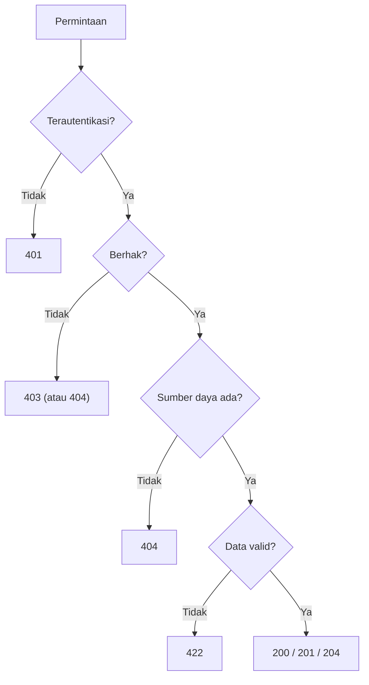

# Kode Status HTTP

Kode status adalah cara tercepat API memberi tahu klien apa yang terjadi: berhasil, perlu tindakan, salah klien, atau salah server. Kode yang tepat memungkinkan klien bereaksi otomatis tanpa membaca pesan.
Sub bab ini membahas kelompok kode, kode yang paling sering dipakai API, cara mengembalikannya di Laravel, dan kesalahan umum seperti selalu membalas `200`.

## Tujuan Pembelajaran

Setelah menyelesaikan sub bab ini, kamu dapat:

- [ ] Menyebutkan lima kelompok kode status dan artinya.
- [ ] Memilih kode yang tepat: 200, 201, 204, 400, 401, 403, 404, 405, 409, 415, 422, 429, 500.
- [ ] Mengembalikan kode dengan `response()->json($data, $status)` dan `response()->noContent()`.
- [ ] Menjelaskan perbedaan 400 dan 422, serta 401 dan 403.
- [ ] Menambahkan header `Location` pada respons 201.
- [ ] Menghindari anti-pola "200 untuk semuanya".

## Prasyarat

- [Metode HTTP](06-03-http-methods.md) dan [Penanganan Error dan HTTP Status Code](../level-02/02-20-error-handling-and-http-status-codes.md).
- [JSON Response](../level-02/02-18-json-response.md).

## Pengantar

Respons `200 OK` berisi `{"error": "artikel tidak ditemukan"}` menyesatkan: klien, proxy, dan alat pemantau menganggap semuanya berhasil. Kode status yang benar adalah bagian dari kontrak API.

## Penjelasan Konsep

### Kelompok kode

| Kelompok | Arti | Contoh |
|---|---|---|
| 1xx | Informasi | 100 Continue |
| 2xx | Berhasil | 200, 201, 204 |
| 3xx | Pengalihan | 301, 304 |
| 4xx | Kesalahan klien | 400, 401, 403, 404, 422, 429 |
| 5xx | Kesalahan server | 500, 502, 503 |

### Kode yang paling sering dipakai API

| Kode | Nama | Kapan |
|---|---|---|
| 200 | OK | Baca/ubah berhasil dengan body |
| 201 | Created | Sumber daya baru dibuat (sertakan `Location`) |
| 202 | Accepted | Diterima, diproses nanti (antrean) |
| 204 | No Content | Berhasil tanpa body (hapus, ubah) |
| 304 | Not Modified | Cache klien masih valid |
| 400 | Bad Request | Permintaan cacat (mis. JSON rusak) |
| 401 | Unauthorized | Belum/tidak terautentikasi |
| 403 | Forbidden | Terautentikasi tetapi tidak berhak |
| 404 | Not Found | Sumber daya tidak ada |
| 405 | Method Not Allowed | Metode tak didukung (sertakan `Allow`) |
| 409 | Conflict | Bentrok keadaan (mis. duplikat unik, versi usang) |
| 415 | Unsupported Media Type | `Content-Type` tidak didukung |
| 422 | Unprocessable Content | Sintaks benar tetapi data gagal validasi |
| 429 | Too Many Requests | Melewati batas laju (`Retry-After`) |
| 500 | Internal Server Error | Kesalahan tak terduga di server |
| 503 | Service Unavailable | Sedang pemeliharaan / kelebihan beban |

### 400 atau 422?

- **400**: permintaan tidak dapat dipahami (JSON rusak, parameter hilang secara struktural).
- **422**: permintaan dapat dipahami tetapi isinya tidak valid (email salah format). Laravel memakai 422 untuk kegagalan validasi permintaan JSON.

### 401 atau 403?

- **401**: "kamu siapa?" (token hilang/kedaluwarsa).
- **403**: "aku tahu kamu, tapi tidak boleh" (Policy menolak).

### Mengembalikan kode di Laravel

```php-inline
return response()->json($article, 201)
    ->header('Location', route('articles.show', $article));     // 201 + Location

return response()->json(['data' => $articles]);                 // 200 (bawaan)
return response()->noContent();                                  // 204
return response()->json(['message' => 'Tidak ditemukan'], 404);
abort(403, 'Tidak berhak');                                      // pengecualian HTTP
```

Kegagalan validasi, `findOrFail`, dan otorisasi otomatis menjadi 422, 404, dan 403 bila klien meminta JSON.

### Header yang menyertai

| Kode | Header |
|---|---|
| 201 | `Location: <URL sumber daya baru>` |
| 405 | `Allow: GET, POST` |
| 429 | `Retry-After: <detik>` |
| 401 | `WWW-Authenticate` (opsional, bergantung skema) |

### Keamanan

- 404 dapat dipakai menggantikan 403 untuk menyembunyikan keberadaan data.
- Pesan 500 jangan membocorkan jejak tumpukan; matikan `APP_DEBUG` di produksi.
- Pesan 401 pada login tidak membedakan akun ada/tidak.

## Cara Kerja



## Contoh Praktik

Kamu membuat route sementara yang menjawab dengan kode berbeda sesuai parameter, lalu memeriksa baris status, header `Location`, dan body dengan `curl -i`.

## Penjelasan Kode

File: `routes/web.php` (sementara)

```php-inline
Route::get('/uji-api/status/{kode}', function (int $kode) {
    return match ($kode) {
        200 => response()->json(['data' => ['id' => 1]]),
        201 => response()->json(['data' => ['id' => 2]], 201)->header('Location', url('/uji-api/artikel/2')),
        204 => response()->noContent(),
        401 => response()->json(['message' => 'Belum terautentikasi.'], 401),
        403 => response()->json(['message' => 'Tidak berhak.'], 403),
        404 => response()->json(['message' => 'Tidak ditemukan.'], 404),
        422 => response()->json(['message' => 'Data tidak valid.', 'errors' => ['email' => ['Format salah.']]], 422),
        429 => response()->json(['message' => 'Terlalu banyak permintaan.'], 429)->header('Retry-After', 30),
        default => abort(404),
    };
})->whereNumber('kode');
```

| Bagian | Fungsi |
|---|---|
| `match ($kode)` | Memilih respons berdasarkan kode |
| `->header('Location', ...)` | Header tambahan pada 201 |
| `response()->noContent()` | 204 tanpa body |
| `Retry-After` | Petunjuk waktu tunggu pada 429 |

## Implementasi Langkah demi Langkah

### Langkah 1: tambahkan route

Tambahkan route di atas.

### Langkah 2: panggil tiap kode

```bash
for k in 200 201 204 401 403 404 422 429; do echo "== $k"; curl -s -i -H "Accept: application/json" http://127.0.0.1:8000/uji-api/status/$k | head -12; done
```

### Langkah 3: catat

Isi tabel: kode, header penting (`Location`, `Retry-After`), dan apakah ada body.

### Langkah 4: uji alami

Dengan data nyata: `GET /artikel/slug-tidak-ada` dengan `Accept: application/json` (404), `POST` form tanpa isian (422), dan `GET /admin/artikel` sebagai tamu (401).

### Langkah 5: hapus route sementara

Hapus route; tidak ada yang di-*commit*.

## Eksekusi dan Verifikasi

| Langkah | Cara memverifikasi |
|---|---|
| 2 | Baris status sesuai; 201 memuat `Location`; 204 tanpa body; 429 memuat `Retry-After` |
| 4 | 404, 422, 401 muncul pada skenario nyata |

## Hasil yang Diharapkan

| Permintaan | Hasil |
|---|---|
| `/uji-api/status/201` | `HTTP/1.1 201 Created` + `Location` |
| `/uji-api/status/204` | `204 No Content`, body kosong |
| `/uji-api/status/429` | `429` + `Retry-After: 30` |

Hasil ini diturunkan dari dokumentasi dan belum dijalankan oleh penulis materi; cocokkan dengan hasilmu.

## Kesalahan Umum dan Pemecahan Masalah

| Gejala | Penyebab | Cara mengenali | Solusi | Pencegahan |
|---|---|---|---|---|
| Galat selalu `200` | Mengembalikan pesan galat tanpa status | Klien bingung | Beri status 4xx/5xx | Anti-pola "200 semuanya" |
| 204 berisi body | Tidak memakai `noContent` | Body tidak kosong | `response()->noContent()` | Pakai helper |
| 500 untuk input buruk | Tidak ditangani sebagai 4xx | Log penuh galat | Validasi → 422 | Validasi di awal |
| 403 vs 404 membingungkan | Tidak ada kebijakan | Respons tidak konsisten | Tetapkan kebijakan | Dokumentasi API |
| `Location` tidak ada pada 201 | Lupa header | Klien tak tahu URL baru | Tambahkan | Pola baku |
| Redirect 302 untuk API | Validasi HTML (tanpa `Accept`) | Klien menerima HTML | Kirim `Accept: application/json` | Header wajib |

## Latihan Praktik

### Latihan dasar

**D1. Pilih kode**
- *Masalah:* tentukan kode.
- *Persyaratan:* (a) artikel dibuat, (b) artikel dihapus, (c) token kedaluwarsa, (d) bukan pemilik artikel, (e) slug tidak ditemukan, (f) judul kosong, (g) 100 permintaan per menit, (h) database mati.
- *Perilaku yang diharapkan:* 201, 204, 401, 403, 404, 422, 429, 500/503.
- *Tujuan belajar:* memilih kode.

### Latihan implementasi

**I1. Peta galat**
- *Masalah:* dokumentasi galat API.
- *Persyaratan:* untuk tiap endpoint pada peta sub bab 06.02, tuliskan kode sukses dan semua kode galat yang mungkin beserta sebabnya.
- *Perilaku yang diharapkan:* tabel lengkap.
- *Tujuan belajar:* mendokumentasikan kontrak.

**I2. Conflict**
- *Masalah:* slug duplikat.
- *Persyaratan:* rancang apakah duplikat slug mengembalikan 409 atau 422 dan beri alasan; implementasikan dengan Tinker/route sementara.
- *Perilaku yang diharapkan:* keputusan beralasan dan konsisten.
- *Tujuan belajar:* memilih antara 409 dan 422.

### Latihan tantangan

**T1. Audit kode status**
- *Masalah:* API lama menjawab `200` untuk semuanya.
- *Persyaratan:* tulis rencana migrasi tanpa merusak klien lama (versi baru, masa transisi, komunikasi) dan contoh respons sebelum/sesudah.
- *Perilaku yang diharapkan:* rencana memperhatikan kompatibilitas.
- *Tujuan belajar:* memperbaiki kontrak.
- *Catatan:* kerjakan mandiri; tidak ada kunci jawaban.

## Uji Pemahaman

1. Apa beda 401 dan 403?
2. Kapan memakai 422 dan kapan 400?
3. Apa kode untuk sumber daya yang berhasil dibuat?
4. Apa fungsi header `Location`?
5. Apa kode untuk penghapusan berhasil tanpa body?
6. Mengapa jangan membalas `200` untuk galat?

??? success "Kunci jawaban singkat"
    1. 401: belum terautentikasi; 403: tidak berhak.
    2. 422 untuk data gagal validasi; 400 untuk permintaan cacat/tak terbaca.
    3. 201 Created.
    4. Menunjuk URL sumber daya baru.
    5. 204 No Content.
    6. Klien dan alat pemantau menganggap berhasil.

## Ringkasan

- Kode status adalah bagian kontrak: 2xx sukses, 4xx salah klien, 5xx salah server.
- 201 + `Location` untuk buat, 204 untuk tanpa body, 422 untuk validasi, 401/403/404 untuk akses.
- Gunakan `response()->json($data, $status)` dan `noContent()`.
- Jangan membocorkan detail pada 5xx.

Selanjutnya: *Format Data JSON*, menyusun struktur respons yang konsisten.

## Referensi Resmi

- [Laravel: HTTP Responses](https://laravel.com/docs/13.x/responses)
- [Laravel: HTTP Exceptions (abort)](https://laravel.com/docs/13.x/errors#http-exceptions)
- [MDN: HTTP response status codes](https://developer.mozilla.org/en-US/docs/Web/HTTP/Status)
