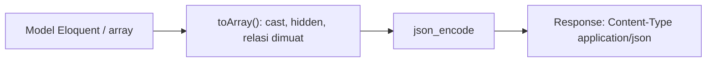

# Format Data JSON

JSON adalah bahasa bersama klien dan server API. Menguasai sintaksnya, tipe datanya, dan keputusan struktur (pembungkus `data`, format tanggal, penamaan kunci) membuat API mudah dipakai dan stabil.
Sub bab ini membahas JSON secara praktis, cara Laravel mengubah model dan array menjadi JSON (dan sebaliknya), serta konvensi respons yang akan dipakai sepanjang bab ini.

## Tujuan Pembelajaran

Setelah menyelesaikan sub bab ini, kamu dapat:

- [ ] Menulis dan membaca JSON: objek, array, string, angka, boolean, `null`.
- [ ] Menjelaskan bagaimana Eloquent dan array PHP diubah menjadi JSON.
- [ ] Memakai `json_encode`/`json_decode` dan opsi penting (`JSON_UNESCAPED_UNICODE`, `JSON_PRETTY_PRINT`).
- [ ] Memilih konvensi: pembungkus `data`, penamaan `snake_case`, tanggal ISO 8601, `null` vs kunci hilang.
- [ ] Menangani JSON rusak dan tipe tak sesuai.
- [ ] Mengenali masalah umum: angka besar, desimal, dan zona waktu.

## Prasyarat

- [Metode HTTP](06-03-http-methods.md) dan [Kode Status HTTP](06-04-http-status-codes.md).
- [Array](../level-00/00-13-arrays.md) PHP dan [Casting Atribut](../level-04/04-13-creating-models.md).
- Proyek `cms-artikel`.

## Pengantar

Dua API menjawab dengan `{"Judul":"X","Terbit":"1"}` dan `{"title":"X","is_published":true}`. Yang kedua konsisten, bertipe benar, dan mudah dipakai di JavaScript. Pilihan kecil di sini dikalikan seluruh klien
dan tahun pemeliharaan.

## Penjelasan Konsep

### Sintaks JSON

```json
{
    "id": 5,
    "title": "Belajar JSON",
    "is_published": true,
    "rating": 4.5,
    "category": null,
    "tags": ["php", "laravel"],
    "author": { "id": 1, "name": "Ani" }
}
```

| Tipe | Contoh | Catatan |
|---|---|---|
| Objek | `{ "k": "v" }` | Kunci selalu string dalam tanda kutip ganda |
| Array | `[1, 2, 3]` | Berurutan |
| String | `"teks"` | Tanda kutip ganda; escape `\"` |
| Angka | `42`, `4.5` | Tanpa tanda kutip |
| Boolean | `true`, `false` | Huruf kecil |
| Null | `null` | Nilai kosong |

JSON tidak mengenal komentar, tanda kutip tunggal, atau koma di akhir daftar.

### PHP ↔ JSON

```php-inline
json_encode(['a' => 1, 'b' => [true, null]]);            // '{"a":1,"b":[true,null]}'
json_decode('{"a":1}', true);                             // ['a' => 1]
json_encode($data, JSON_UNESCAPED_UNICODE | JSON_PRETTY_PRINT);
```

Array PHP berindeks berurutan dari 0 menjadi array JSON; array asosiatif menjadi objek JSON. Array kosong `[]` menjadi `[]`, bukan `{}` (hati-hati bila klien mengharapkan objek).

### Laravel menyederhanakan

```php-inline
return response()->json(['data' => $article]);       // objek JSON
return $article;                                      // model → JSON otomatis
return Article::all();                                // koleksi → array JSON
```

Model Eloquent diubah lewat `toArray()`/`toJson()`: atribut ber-*cast* dikonversi (boolean menjadi `true/false`, tanggal menjadi string ISO 8601 UTC dengan akhiran `Z` atau offset, tergantung konfigurasi),
atribut `#[Hidden]` dihilangkan, dan relasi yang sudah dimuat ikut. Pengaturan mana yang dipakai untuk API sebaiknya dikendalikan dengan **API Resource** (sub bab 06.09), bukan langsung dari model.

### Konvensi respons

| Keputusan | Konvensi materi ini | Alasan |
|---|---|---|
| Pembungkus | Objek dengan kunci `data` | Memberi ruang untuk `meta`, `links`, dan `message` |
| Penamaan kunci | `snake_case` | Selaras kolom database dan banyak API Laravel |
| Tanggal | ISO 8601 (`2026-11-10T08:00:00+00:00`) | Tak ambigu, mudah diurai |
| Boolean | `true`/`false`, bukan `1`/`"1"` | Tipe benar |
| Kosong | `null` untuk nilai tak ada; kunci tetap ada | Bentuk respons stabil |
| Uang | Bilangan bulat satuan terkecil atau string desimal | Hindari galat pecahan |
| ID | Angka atau string konsisten | Jangan campur |

Contoh bentuk daftar:

```json
{
    "data": [ { "id": 1, "title": "A" }, { "id": 2, "title": "B" } ],
    "links": { "next": "http://127.0.0.1:8000/api/v1/articles?page=2" },
    "meta": { "current_page": 1, "per_page": 15, "total": 40 }
}
```

### Menerima JSON

```php-inline
$request->json()->all();
$request->input('author.name');
```

Body JSON rusak menghasilkan galat 400 pada pengurai; beri pesan jelas melalui penanganan galat (sub bab 06.11).

### Masalah umum

| Masalah | Penyebab | Solusi |
|---|---|---|
| Angka besar dibulatkan di JavaScript | JS memakai double (presisi 53 bit) | ID sangat besar kirim sebagai string |
| `0.1 + 0.2` tak tepat | Desimal biner | Uang sebagai integer atau string |
| Tanggal bergeser | Zona waktu | Simpan UTC, kirim ISO 8601 dengan offset |
| Karakter Unicode ter-escape (`é`) | Opsi bawaan | Aman; dekoder JSON memulihkannya |
| `[]` vs `{}` | Array kosong PHP | Gunakan `(object) []` bila perlu objek kosong |
| Rujukan melingkar | Relasi saling menunjuk | Muat relasi terkontrol, gunakan Resource |

### Keamanan

- Jangan menyerialisasi seluruh model tanpa kontrol (kolom sensitif).
- Batasi ukuran body yang diterima dan kedalaman JSON.
- Anggap data JSON dari klien tidak tepercaya sama seperti form.
- Hindari `JSONP` dan menaruh JSON di `<script>` tanpa `Js::from`.

## Cara Kerja



## Contoh Praktik

Kamu mengamati bagaimana model diserialisasi, mengubah cast dan atribut tersembunyi, membandingkan array berurutan dan asosiatif, dan mengirim JSON rusak untuk melihat responsnya.

## Penjelasan Kode

Di Tinker:

```php-inline
use App\Models\Article;

$a = Article::published()->first();
$a->toJson(JSON_PRETTY_PRINT);
$a->makeHidden(['body'])->toArray();
json_encode([1, 2, 3]);
json_encode([1 => 'a', 2 => 'b']);
json_encode([]);
json_encode((object) []);
json_encode(['judul' => 'Café'], JSON_UNESCAPED_UNICODE);
```

## Implementasi Langkah demi Langkah

### Langkah 1: serialisasi model

Jalankan `toJson` dan perhatikan tipe `is_published` (boolean) dan format `published_at`.

### Langkah 2: sembunyikan kolom

Gunakan `makeHidden(['body'])` dan bandingkan.

### Langkah 3: array berurutan vs asosiatif

Jalankan empat `json_encode` pada bagian kode dan catat `[]` vs `{}`.

### Langkah 4: Unicode

Bandingkan `json_encode(['judul' => 'Café'])` dengan opsi `JSON_UNESCAPED_UNICODE`.

### Langkah 5: validasi JSON di terminal

```bash
echo '{"a": 1,}' | php -r 'var_dump(json_decode(stream_get_contents(STDIN)), json_last_error_msg());'
```

Amati pesan `Syntax error` pada JSON dengan koma di akhir.

### Langkah 6: catat konvensi

Tulis konvensi respons (pembungkus, penamaan, tanggal) ke `docs/api-rancangan.md` dan commit.

## Eksekusi dan Verifikasi

| Langkah | Cara memverifikasi |
|---|---|
| 1 | `is_published` berupa `true/false`, tanggal ISO 8601 |
| 2 | `body` tidak muncul |
| 3 | `[1,2,3]`, `{"1":"a","2":"b"}`, `[]`, `{}` |
| 5 | `json_decode` mengembalikan `NULL` dan pesan galat |

## Hasil yang Diharapkan

| Perintah | Hasil |
|---|---|
| `json_encode([1,2,3])` | `[1,2,3]` |
| `json_encode([1=>'a',2=>'b'])` | `{"1":"a","2":"b"}` |
| `json_encode([])` | `[]` |
| `json_encode((object) [])` | `{}` |

Hasil ini diturunkan dari perilaku PHP dan dokumentasi; format tanggal bergantung konfigurasi. Cocokkan dengan hasilmu.

## Kesalahan Umum dan Pemecahan Masalah

| Gejala | Penyebab | Cara mengenali | Solusi | Pencegahan |
|---|---|---|---|---|
| Klien menerima `"1"` bukan `true` | Tidak ada cast boolean | Tipe salah | Cast di model/Resource | Cast semua boolean |
| `Malformed UTF-8 characters` | Data bukan UTF-8 | `json_encode` gagal | Bersihkan/konversi pengodean | Simpan UTF-8 |
| `[]` padahal butuh `{}` | Array kosong | Struktur salah | `(object) []` | Perhatikan tipe |
| Tanggal berbeda di klien | Zona waktu | Selisih jam | Kirim ISO 8601 dengan offset/UTC | Standarkan |
| Kolom sensitif muncul | Serialisasi model langsung | `password` terlihat | `#[Hidden]`/Resource | Gunakan Resource |
| ID besar rusak di JS | Presisi angka | Digit berubah | Kirim string | Pertimbangkan sejak awal |

## Latihan Praktik

### Latihan dasar

**D1. Tulis JSON**
- *Masalah:* ingin berlatih sintaks.
- *Persyaratan:* tulis JSON untuk artikel dengan kategori, dua tag, dan penulis (objek bersarang), lalu validasi dengan `json_decode`.
- *Perilaku yang diharapkan:* JSON valid.
- *Tujuan belajar:* sintaks JSON.

### Latihan implementasi

**I1. Pilih konvensi**
- *Masalah:* tim berselisih soal format.
- *Persyaratan:* tulis keputusan untuk penamaan kunci, tanggal, uang, boolean, dan `null`, dengan alasan, dan terapkan pada contoh respons.
- *Perilaku yang diharapkan:* dokumen konvensi satu halaman.
- *Tujuan belajar:* menetapkan standar.

**I2. Uji JSON rusak**
- *Masalah:* klien mengirim JSON cacat.
- *Persyaratan:* kirim JSON rusak ke route yang membaca `$request->json()` dan catat respons; rencanakan pesan yang lebih jelas (diimplementasikan pada sub bab 06.11).
- *Perilaku yang diharapkan:* respons tercatat dan rencana dibuat.
- *Tujuan belajar:* menghadapi input cacat.

### Latihan tantangan

**T1. Evolusi respons**
- *Masalah:* kunci `title` perlu berganti nama menjadi `headline`.
- *Persyaratan:* rancang cara perubahan tanpa merusak klien (menambah kunci baru sementara, versi, deprekasi) dan jelaskan alasannya.
- *Perilaku yang diharapkan:* rencana kompatibel.
- *Tujuan belajar:* mengelola perubahan kontrak.
- *Catatan:* kerjakan mandiri; tidak ada kunci jawaban.

## Uji Pemahaman

1. Tipe data apa saja yang ada di JSON?
2. Apa beda array berurutan dan asosiatif saat di-`json_encode`?
3. Mengapa memakai pembungkus `data`?
4. Mengapa tanggal sebaiknya ISO 8601?
5. Mengapa uang jangan `float`?
6. Mengapa tidak menyerialisasi model langsung?

??? success "Kunci jawaban singkat"
    1. Objek, array, string, angka, boolean, null.
    2. Berurutan menjadi array `[]`; asosiatif menjadi objek `{}`.
    3. Memberi ruang untuk `meta`, `links`, dan pesan.
    4. Tidak ambigu dan mudah diurai.
    5. Desimal biner tidak presisi.
    6. Dapat membocorkan kolom sensitif dan membekukan struktur ke skema database.

## Ringkasan

- JSON memiliki tipe sederhana; PHP ↔ JSON lewat `json_encode`/`json_decode`.
- Laravel mengonversi model dan koleksi otomatis; kendalikan bentuknya dengan Resource.
- Tetapkan konvensi: pembungkus `data`, `snake_case`, ISO 8601, `null` konsisten.
- Waspadai angka besar, desimal, zona waktu, dan kebocoran kolom.

Selanjutnya: *Routing API*, menyiapkan `routes/api.php` dan awalan versi.

## Referensi Resmi

- [Laravel: Serialization](https://laravel.com/docs/13.x/eloquent-serialization)
- [Laravel: JSON Responses](https://laravel.com/docs/13.x/responses#json-responses)
- [PHP: json_encode](https://www.php.net/manual/en/function.json-encode.php)
- [RFC 8259: JSON](https://www.rfc-editor.org/rfc/rfc8259)
