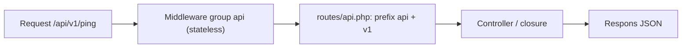

# Routing API

Route API berbeda dari route web: tanpa sesi, tanpa cookie, tanpa CSRF, dan responsnya JSON. Laravel memisahkannya dalam berkas `routes/api.php` dengan grup middleware `api` dan awalan URL `/api`.
Sub bab ini mendaftarkan berkas itu pada proyek `cms-artikel`, menyusun awalan versi `/api/v1`, dan memakai `Route::apiResource`.

## Tujuan Pembelajaran

Setelah menyelesaikan sub bab ini, kamu dapat:

- [ ] Menjelaskan perbedaan route `web` dan `api` (sesi, CSRF, awalan, middleware).
- [ ] Mendaftarkan `routes/api.php` secara manual di `bootstrap/app.php`.
- [ ] Menyusun grup route versi (`/api/v1`) dengan awalan dan nama.
- [ ] Memakai `Route::apiResource` dan memeriksa hasilnya dengan `route:list`.
- [ ] Menjelaskan fungsi header `Accept: application/json` bagi klien API.
- [ ] Mengubah awalan API di `bootstrap/app.php`.

## Prasyarat

- [Kode Status HTTP](06-04-http-status-codes.md) dan [Format Data JSON](06-05-json-data-format.md).
- [Grup Route](../level-02/02-06-route-groups.md), [Prefix Route](../level-02/02-07-route-prefix.md), dan [Resource Controller](../level-02/02-13-resource-controllers.md).
- Proyek `cms-artikel` dan berkas `bootstrap/app.php`.

## Pengantar

Route web cocok untuk browser yang menyimpan cookie. Klien API (aplikasi seluler, skrip) tidak punya sesi browser dan tidak bisa menyertakan token CSRF; memperlakukan mereka seperti browser hanya
menimbulkan masalah. Memisahkan route API menyelesaikannya dengan rapi.

## Penjelasan Konsep

### Web vs API

| Aspek | `routes/web.php` | `routes/api.php` |
|---|---|---|
| Grup middleware | `web` | `api` |
| Sesi dan cookie | Ya | Tidak (stateless) |
| Perlindungan CSRF | Ya | Tidak |
| Awalan URL | Tidak ada | `/api` |
| Respons galat bawaan | HTML/redirect | JSON bila klien meminta JSON |

### Mendaftarkan `routes/api.php`

Dokumentasi menyatakan `php artisan install:api` membuat berkas itu **sekaligus memasang Laravel Sanctum**. Untuk saat ini kita hanya membutuhkan routing, tanpa menambah paket (autentikasi API dibahas
pada sub bab 06.14 dan seterusnya). Daftarkan berkas secara manual:

File: `routes/api.php` (buat)

```php
<?php

use Illuminate\Support\Facades\Route;

Route::get('/ping', fn () => response()->json(['pong' => true, 'waktu' => now()->toIso8601String()]));
```

File: `bootstrap/app.php` (ubah `withRouting`)

```php
->withRouting(
    web: __DIR__.'/../routes/web.php',
    api: __DIR__.'/../routes/api.php',
    commands: __DIR__.'/../routes/console.php',
    health: '/up',
)
```

Awalan `/api` otomatis ditambahkan; ubah dengan `apiPrefix: 'api/admin'` bila perlu.

### Versi pada URL

Pisahkan versi sejak awal agar perubahan yang merusak klien dapat dirilis sebagai versi baru:

```php
Route::prefix('v1')->name('api.v1.')->group(function () {
    Route::get('/ping', fn () => response()->json(['pong' => true]))->name('ping');
    // route sumber daya v1 di sini
});
```

URL akhirnya `/api/v1/ping` dan nama route `api.v1.ping`. Pembahasan strategi versi ada pada sub bab 06.19.

### `Route::apiResource`

Seperti `Route::resource` tetapi tanpa rute `create` dan `edit` (form HTML tidak diperlukan):

```php
use App\Http\Controllers\Api\V1\ArticleController;

Route::apiResource('articles', ArticleController::class);
```

| Metode | URI | Aksi controller | Nama |
|---|---|---|---|
| GET | `/api/v1/articles` | `index` | `api.v1.articles.index` |
| POST | `/api/v1/articles` | `store` | `api.v1.articles.store` |
| GET | `/api/v1/articles/{article}` | `show` | `api.v1.articles.show` |
| PUT/PATCH | `/api/v1/articles/{article}` | `update` | `api.v1.articles.update` |
| DELETE | `/api/v1/articles/{article}` | `destroy` | `api.v1.articles.destroy` |

Gunakan `->only([...])` atau `->except([...])` untuk membatasi, dan `Route::apiResources([...])` untuk beberapa sumber daya sekaligus. Controller dibuat di sub bab berikutnya.

### Header `Accept`

Untuk galat (validasi, 404, 401) Laravel memilih bentuk respons dari header `Accept`. Klien API wajib mengirim `Accept: application/json`; tanpa itu, kegagalan validasi menghasilkan redirect HTML (302). Pada sub bab 06.11
kamu mengatur agar semua URL `api/*` selalu dijawab sebagai JSON.

### Keamanan

- Karena route API tidak memakai CSRF, otentikasi harus berbasis token di header (bukan cookie sesi) agar tidak rentan CSRF.
- Jangan menaruh route API yang mengubah data tanpa autentikasi; sampai autentikasi tersedia, lindungi sementara (sub bab 06.08).
- Lindungi `routes/api.php` dari kesalahan: salah menaruh route sensitif di `web` dan sebaliknya mengubah perlindungan yang berlaku.

## Cara Kerja



## Contoh Praktik

Kamu mendaftarkan `routes/api.php`, membuat endpoint `ping` ber-versi, memeriksa daftar route, dan membuktikan bahwa `POST` ke route API tidak memerlukan token CSRF.

## Penjelasan Kode

File: `routes/api.php`

```php
<?php

use Illuminate\Support\Facades\Route;

Route::prefix('v1')->name('api.v1.')->group(function () {
    Route::get('/ping', fn () => response()->json([
        'pong' => true,
        'versi' => 'v1',
        'waktu' => now()->toIso8601String(),
    ]))->name('ping');

    Route::post('/echo', fn (\Illuminate\Http\Request $request) => response()->json(['diterima' => $request->all()]))->name('echo');
});
```

Route `echo` hanya untuk percobaan dan dihapus setelahnya.

## Implementasi Langkah demi Langkah

### Langkah 1: buat berkas dan daftarkan

Buat `routes/api.php` dan ubah `withRouting` di `bootstrap/app.php`.

### Langkah 2: periksa route

```bash
php artisan route:list --path=api
php artisan route:list --path=api -v
```

Perhatikan kolom middleware: `api` (bukan `web`).

### Langkah 3: panggil endpoint

```bash
curl -s -i http://127.0.0.1:8000/api/v1/ping
```

### Langkah 4: uji `POST` tanpa CSRF

```bash
curl -s -i -X POST -H "Content-Type: application/json" -H "Accept: application/json" -d '{"nama":"Budi"}' http://127.0.0.1:8000/api/v1/echo
```

Respons `200`, bukan `419`, karena route API tidak memakai CSRF.

### Langkah 5: bandingkan dengan route web

`POST` ke route web tanpa token menghasilkan `419` (sub bab sebelumnya). Catat perbedaannya.

### Langkah 6: hapus `echo`, catat di Git

```bash
git add bootstrap routes
git commit -m "Daftarkan routes/api.php dan endpoint ping v1"
```

## Eksekusi dan Verifikasi

| Langkah | Cara memverifikasi |
|---|---|
| 2 | `api/v1/ping` dan `api/v1/echo` terdaftar dengan middleware `api` |
| 3 | Status `200` dan JSON `pong` |
| 4 | Status `200`, tanpa 419 |

## Hasil yang Diharapkan

| Permintaan | Hasil |
|---|---|
| `GET /api/v1/ping` | `200` + `{"pong":true,"versi":"v1","waktu":"..."}` |
| `POST /api/v1/echo` | `200` + `{"diterima":{"nama":"Budi"}}` |
| `GET /ping` (tanpa `/api`) | `404` |

Hasil ini diturunkan dari dokumentasi dan belum dijalankan oleh penulis materi; cocokkan dengan hasilmu.

## Kesalahan Umum dan Pemecahan Masalah

| Gejala | Penyebab | Cara mengenali | Solusi | Pencegahan |
|---|---|---|---|---|
| `404` pada `/api/v1/ping` | `api:` belum didaftarkan di `withRouting` | `route:list` kosong untuk `api` | Tambahkan argumen `api:` | Periksa `bootstrap/app.php` |
| Awalan ganda `/api/api` | Menulis `prefix('api')` lagi | URL berlipat | Hapus awalan manual | Ingat awalan otomatis |
| `419` pada POST | Route berada di `web.php` | Status 419 | Pindahkan ke `api.php` | Pisahkan route |
| Validasi menghasilkan redirect | Tidak mengirim `Accept: application/json` | Status 302 | Kirim header | Aturan global di sub bab 06.11 |
| Nama route bentrok | Dua file memakai nama sama | `route:list` ganda | Pakai awalan nama `api.v1.` | Konvensi penamaan |
| `install:api` menambah Sanctum tak sengaja | Menjalankan perintah itu | `composer.json` berubah | Tahan sampai disetujui | Daftarkan manual |

## Latihan Praktik

### Latihan dasar

**D1. Web atau API**
- *Masalah:* tentukan letak route.
- *Persyaratan:* tentukan `web.php` atau `api.php` untuk (a) halaman login, (b) daftar artikel JSON untuk aplikasi seluler, (c) form komentar HTML.
- *Perilaku yang diharapkan:* (a) web, (b) api, (c) web.
- *Tujuan belajar:* memisahkan route.

### Latihan implementasi

**I1. Awalan kustom**
- *Masalah:* API ingin diawali `/layanan`.
- *Persyaratan:* ubah `apiPrefix` di `bootstrap/app.php`, verifikasi dengan `route:list`, lalu kembalikan.
- *Perilaku yang diharapkan:* URL berubah menjadi `/layanan/v1/ping`.
- *Tujuan belajar:* mengonfigurasi awalan.

**I2. Dua versi**
- *Masalah:* siapkan v2.
- *Persyaratan:* tambahkan grup `v2` dengan `ping` yang memberi `versi: v2` dan buktikan kedua versi hidup berdampingan.
- *Perilaku yang diharapkan:* `/api/v1/ping` dan `/api/v2/ping` berbeda.
- *Tujuan belajar:* versi pada URL.

### Latihan tantangan

**T1. Bandingkan middleware**
- *Masalah:* tim ingin tahu beda `web` dan `api`.
- *Persyaratan:* telusuri `route:list -vv` untuk satu route web dan satu route API, daftar middleware masing-masing, dan jelaskan fungsi tiap middleware yang hanya ada pada salah satunya.
- *Perilaku yang diharapkan:* penjelasan benar.
- *Tujuan belajar:* memahami grup middleware.
- *Catatan:* kerjakan mandiri; tidak ada kunci jawaban.

## Uji Pemahaman

1. Apa beda route `web` dan `api`?
2. Mengapa route API tidak memakai CSRF?
3. Bagaimana mendaftarkan `routes/api.php` tanpa Sanctum?
4. Apa fungsi `Route::apiResource`?
5. Mengapa awalan versi dipakai?
6. Apa yang terjadi bila klien lupa header `Accept`?

??? success "Kunci jawaban singkat"
    1. `web`: sesi, cookie, CSRF; `api`: stateless, awalan `/api`, tanpa CSRF.
    2. Tidak ada cookie sesi yang dapat dibajak; autentikasi memakai token di header.
    3. Menambah `api: __DIR__.'/../routes/api.php'` pada `withRouting`.
    4. Mendaftarkan lima route CRUD tanpa `create`/`edit`.
    5. Agar perubahan yang merusak dapat dirilis tanpa memutus klien lama.
    6. Galat validasi menjadi redirect HTML, bukan JSON.

## Ringkasan

- Route API stateless, tanpa CSRF, dengan awalan `/api` dan grup middleware `api`.
- Daftarkan `routes/api.php` lewat `withRouting(api: ...)`; `install:api` juga memasang Sanctum.
- Grup `prefix('v1')->name('api.v1.')` memberi versi; `apiResource` mendaftarkan CRUD.
- Klien wajib mengirim `Accept: application/json`.

Selanjutnya: *Controller API*, menulis endpoint pertama.

## Referensi Resmi

- [Laravel: API Routes](https://laravel.com/docs/13.x/routing#api-routes)
- [Laravel: API Resource Routes](https://laravel.com/docs/13.x/controllers#api-resource-routes)
- [Laravel: Middleware Groups](https://laravel.com/docs/13.x/middleware#laravels-default-middleware-groups)
