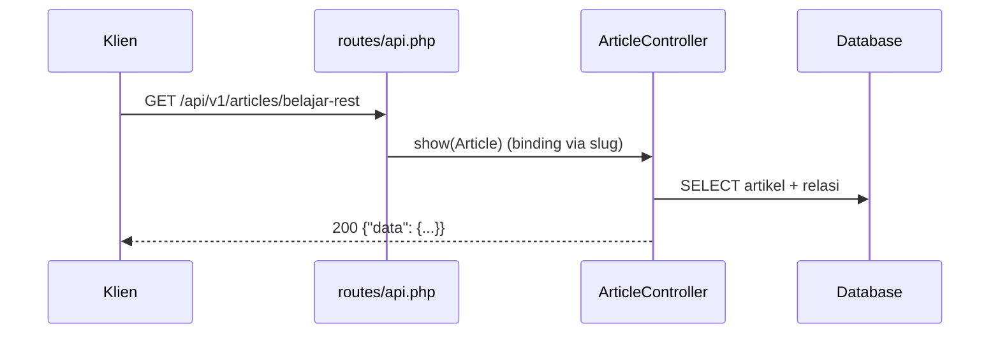

# Controller API

Controller API menerima permintaan, memanggil logika (Eloquent), dan mengembalikan JSON dengan status yang tepat. Bedanya dari controller web: tanpa view, tanpa redirect, dan selalu berpikir dalam
kontrak (bentuk respons dan kode status). Sub bab ini membuat `Api\V1\ArticleController` dengan endpoint baca (daftar dan detail) memakai route model binding, `findOrFail`, dan respons JSON eksplisit.

## Tujuan Pembelajaran

Setelah menyelesaikan sub bab ini, kamu dapat:

- [ ] Membuat controller API ber-namespace `Api\V1` dengan `make:controller`.
- [ ] Menulis `index` dan `show` yang mengembalikan JSON dengan pembungkus `data`.
- [ ] Memakai route model binding dengan slug dan memahami respons 404 otomatis.
- [ ] Menyaring hanya artikel terbit pada endpoint publik.
- [ ] Menjaga controller tetap tipis dan konsisten.
- [ ] Menguji endpoint dengan `curl` dan membaca status serta header.

## Prasyarat

- [Routing API](06-06-api-routing.md).
- [Controller](../level-02/02-12-creating-controllers.md), [Route Model Binding](../level-02/02-10-route-model-binding.md), dan [Query Eloquent](../level-04/04-16-eloquent-queries.md).
- Model `Article` dengan scope `published` dan relasi.

## Pengantar

Endpoint yang baik kecil dan membosankan: ambil data, kembalikan JSON. Keputusan bentuk (kolom mana, dibungkus apa) sebaiknya konsisten di semua endpoint; sub bab 06.09 memusatkannya dengan API Resource, tetapi
memahami versi manual lebih dulu membuat manfaat Resource jelas.

## Penjelasan Konsep

### Membuat controller

```bash
php artisan make:controller Api/V1/ArticleController
```

Berkas: `app/Http/Controllers/Api/V1/ArticleController.php` dengan namespace `App\Http\Controllers\Api\V1`.

### Daftar dan detail

File: `app/Http/Controllers/Api/V1/ArticleController.php`

```php
<?php

namespace App\Http\Controllers\Api\V1;

use App\Http\Controllers\Controller;
use App\Models\Article;
use Illuminate\Http\JsonResponse;

class ArticleController extends Controller
{
    public function index(): JsonResponse
    {
        $articles = Article::published()
            ->with(['category:id,name,slug', 'user:id,name'])
            ->latest('published_at')
            ->limit(20)
            ->get();

        return response()->json([
            'data' => $articles->map(fn (Article $a) => [
                'id' => $a->id,
                'title' => $a->title,
                'slug' => $a->slug,
                'category' => $a->category?->only(['id', 'name', 'slug']),
                'author' => $a->user?->only(['id', 'name']),
                'published_at' => $a->published_at?->toIso8601String(),
            ]),
        ]);
    }

    public function show(Article $article): JsonResponse
    {
        abort_unless($article->is_published, 404);

        $article->load(['category:id,name,slug', 'user:id,name', 'tags:id,name']);

        return response()->json([
            'data' => [
                'id' => $article->id,
                'title' => $article->title,
                'slug' => $article->slug,
                'body' => $article->body,
                'category' => $article->category?->only(['id', 'name', 'slug']),
                'author' => $article->user?->only(['id', 'name']),
                'tags' => $article->tags->pluck('name'),
                'published_at' => $article->published_at?->toIso8601String(),
            ],
        ]);
    }
}
```

| Bagian | Fungsi |
|---|---|
| `Article::published()` | Hanya artikel terbit (scope bab Database) |
| `with([...])` | Eager loading: tidak ada N+1 |
| `category:id,name,slug` | Memilih kolom relasi seperlunya |
| `->limit(20)` | Batas sementara; paginasi di sub bab 06.12 |
| `$a->published_at?->toIso8601String()` | Tanggal ISO 8601; `?->` menangani `null` |
| `abort_unless(..., 404)` | Draf tidak boleh diakses publik |

Memakai `only([...])` memilih kunci tanpa membocorkan kolom lain (mis. email penulis).

### Route

File: `routes/api.php` (di dalam grup `v1`)

```php-inline
use App\Http\Controllers\Api\V1\ArticleController;

Route::get('/articles', [ArticleController::class, 'index'])->name('articles.index');
Route::get('/articles/{article:slug}', [ArticleController::class, 'show'])->name('articles.show');
```

`{article:slug}` mencari artikel berdasarkan slug; bila tidak ada, Laravel otomatis menjawab 404 (JSON bila `Accept: application/json`). Materi ini memakai **slug** sebagai pengenal publik di seluruh API (pada `apiResource` dengan `->scoped(['article' => 'slug'])`, sub bab 06.08).

### Mengapa respons eksplisit lebih baik daripada `return $article`

| Mengembalikan model langsung | Respons eksplisit |
|---|---|
| Semua kolom ikut (termasuk yang tak dimaksudkan) | Hanya kolom yang kamu pilih |
| Bentuk berubah bila skema berubah | Kontrak stabil |
| Relasi tak terkontrol | Relasi dipilih |

Pola ini disempurnakan oleh API Resource (sub bab 06.09).

### Keamanan

- Endpoint publik hanya mengembalikan data terbit; periksa `is_published` pada `show`.
- Jangan menyertakan email atau data pribadi penulis kecuali dibutuhkan dan diizinkan.
- Batasi jumlah hasil pada daftar (jangan `get()` tanpa batas pada tabel besar).

## Cara Kerja



## Contoh Praktik

Kamu membuat controller, dua route, lalu menguji daftar, detail, slug tidak ada (404), dan artikel draf (404), serta memverifikasi bahwa jumlah query tetap saat jumlah artikel bertambah.

## Penjelasan Kode

Kode ada pada bagian konsep. Pastikan model `Article` memakai relasi `category()`, `user()`, dan `tags()` dari bab Database.

## Implementasi Langkah demi Langkah

### Langkah 1: buat controller dan isi

```bash
cd ~/belajar-laravel/cms-artikel
php artisan make:controller Api/V1/ArticleController
```

### Langkah 2: tambah route

Tambahkan dua route ke grup `v1` pada `routes/api.php`.

### Langkah 3: uji

```bash
php artisan migrate:fresh --seed
php artisan serve
```

```bash
curl -s -H "Accept: application/json" http://127.0.0.1:8000/api/v1/articles
SLUG=$(curl -s -H "Accept: application/json" http://127.0.0.1:8000/api/v1/articles | php -r '$d=json_decode(stream_get_contents(STDIN),true); echo $d["data"][0]["slug"];')
curl -s -i -H "Accept: application/json" http://127.0.0.1:8000/api/v1/articles/$SLUG
```

### Langkah 4: uji 404

```bash
curl -s -i -H "Accept: application/json" http://127.0.0.1:8000/api/v1/articles/slug-tidak-ada
```

Lalu ambil slug sebuah draf dari database dan panggil: harus 404.

### Langkah 5: periksa query

Di Tinker, bungkus pemanggilan dengan `DB::enableQueryLog()` atau gunakan `DB::listen` sementara dan pastikan jumlah query tetap kecil (artikel + 2 relasi).

### Langkah 6: catat di Git

```bash
git add app routes
git commit -m "Tambah endpoint baca artikel API v1"
```

## Eksekusi dan Verifikasi

| Langkah | Cara memverifikasi |
|---|---|
| 3 | Daftar `200` berisi `data` array; detail `200` dengan `body` |
| 4 | Slug tak ada → `404`; draf → `404` |
| 5 | Jumlah query tidak bertambah dengan jumlah artikel |

## Hasil yang Diharapkan

| Permintaan | Hasil |
|---|---|
| `GET /api/v1/articles` | `200` + `{"data":[{"id":..,"title":..,"slug":..,"category":..,"author":..,"published_at":..}]}` |
| `GET /api/v1/articles/{slug}` | `200` + `data` lengkap dengan `body` dan `tags` |
| Slug tak ada / draf | `404` + JSON `{"message":...}` |

Hasil ini diturunkan dari dokumentasi dan belum dijalankan oleh penulis materi; cocokkan dengan hasilmu.

## Kesalahan Umum dan Pemecahan Masalah

| Gejala | Penyebab | Cara mengenali | Solusi | Pencegahan |
|---|---|---|---|---|
| Respons HTML 404 | Tidak mengirim `Accept` | Halaman galat HTML | Kirim `Accept: application/json` | Aturan global di 06.11 |
| Draf bisa dibaca | Lupa `abort_unless` | Draf muncul | Tambahkan pemeriksaan | Uji draf |
| N+1 pada daftar | Relasi tidak dimuat | Query banyak | Pakai `with()` | Aktifkan `preventLazyLoading` |
| `Call to a member function only() on null` | Relasi `null` | Galat | Pakai `?->` | Tangani relasi kosong |
| Kolom sensitif bocor | Mengembalikan model | `email` terlihat | Pilih kolom eksplisit | Gunakan Resource |
| Route tidak ditemukan | Awalan/versi salah | 404 URL | Periksa `route:list` | Ikuti peta endpoint |

## Latihan Praktik

### Latihan dasar

**D1. Endpoint kategori**
- *Masalah:* klien butuh daftar kategori.
- *Persyaratan:* buat `CategoryController@index` yang mengembalikan `id`, `name`, `slug`, dan jumlah artikel terbit (`withCount`), beserta route.
- *Perilaku yang diharapkan:* `200` dengan daftar kategori.
- *Tujuan belajar:* membuat endpoint baca baru.

### Latihan implementasi

**I1. Komentar artikel**
- *Masalah:* klien butuh komentar suatu artikel.
- *Persyaratan:* tambah `GET /api/v1/articles/{article:slug}/comments` yang mengembalikan komentar terbaru (nama dan isi) dengan batas 50.
- *Perilaku yang diharapkan:* `200` dengan data komentar, 404 untuk draf.
- *Tujuan belajar:* sub-sumber daya.

**I2. Kolom yang diminta**
- *Masalah:* klien ingin memilih kolom.
- *Persyaratan:* dukung `?fields=id,title` dengan *allow-list* kolom pada daftar artikel dan uji nilai liar.
- *Perilaku yang diharapkan:* hanya kolom diizinkan yang dikembalikan.
- *Tujuan belajar:* parameter respons yang aman.

### Latihan tantangan

**T1. Penyeragaman**
- *Masalah:* tiga controller mengulang pemetaan JSON serupa.
- *Persyaratan:* identifikasi duplikasi dan rancang cara memusatkannya (metode privat, kelas pemeta, atau Resource) dan bandingkan kompromi.
- *Perilaku yang diharapkan:* rancangan memotivasi sub bab Resource.
- *Tujuan belajar:* mengenali duplikasi.
- *Catatan:* kerjakan mandiri; tidak ada kunci jawaban.

## Uji Pemahaman

1. Apa beda controller API dan controller web?
2. Mengapa respons JSON dibuat eksplisit?
3. Apa yang terjadi bila `{article:slug}` tidak ditemukan?
4. Mengapa `with()` dipakai?
5. Mengapa periksa `is_published` pada `show`?
6. Mengapa membatasi jumlah hasil?

??? success "Kunci jawaban singkat"
    1. Controller API mengembalikan JSON dan status, bukan view/redirect.
    2. Agar hanya kolom tertentu yang keluar dan kontrak stabil.
    3. Laravel otomatis menjawab 404.
    4. Mencegah N+1.
    5. Agar draf tidak terbuka untuk publik.
    6. Mencegah respons raksasa dan beban berlebih.

## Ringkasan

- Controller API tipis: ambil data, kembalikan JSON dan status.
- Route model binding dengan slug memberi 404 otomatis; periksa status terbit.
- Gunakan eager loading dan pilih kolom; jangan kembalikan model mentah.
- Pemusatan bentuk respons dilakukan oleh API Resource.

Selanjutnya: *Controller Resource API*, CRUD lengkap dengan `apiResource`.

## Referensi Resmi

- [Laravel: Controllers](https://laravel.com/docs/13.x/controllers)
- [Laravel: Route Model Binding](https://laravel.com/docs/13.x/routing#route-model-binding)
- [Laravel: JSON Responses](https://laravel.com/docs/13.x/responses#json-responses)
