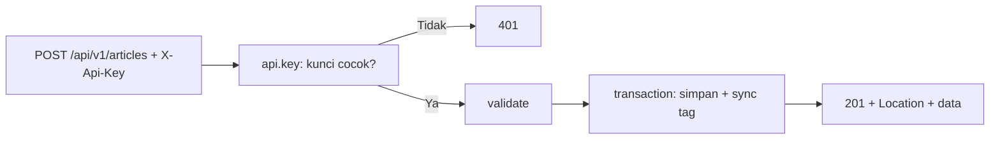

# Controller Resource API

Setelah endpoint baca, saatnya CRUD lengkap: membuat, mengubah, dan menghapus artikel lewat API. Laravel menyediakan `Route::apiResource` dan opsi `--api` pada `make:controller` untuk menghasilkan kerangka
lima metode (`index`, `store`, `show`, `update`, `destroy`). Karena autentikasi token belum tersedia (sub bab 06.14 dan seterusnya), endpoint tulis diberi **pelindung sementara** berupa kunci API di header
supaya tidak terbuka bagi siapa pun.

## Tujuan Pembelajaran

Setelah menyelesaikan sub bab ini, kamu dapat:

- [ ] Membuat controller resource API dengan `make:controller --api --model`.
- [ ] Mendaftarkan `Route::apiResource` dengan `scoped` slug dan mengelompokkan route baca dan tulis.
- [ ] Mengimplementasikan `store`, `update`, dan `destroy` dengan kode status benar (201, 200, 204).
- [ ] Menjaga mass assignment aman pada endpoint tulis.
- [ ] Memasang pelindung sementara dengan middleware kunci API.
- [ ] Menguji CRUD lengkap dengan `curl`.

## Prasyarat

- [Controller API](06-07-api-controllers.md) dan [Kode Status HTTP](06-04-http-status-codes.md).
- [Mass Assignment](../level-05/05-23-mass-assignment-protection.md) dan [Validasi Dasar](../level-05/05-02-basic-validation.md).
- Model `Article` dan `Tag`.

## Pengantar

Endpoint tulis tanpa autentikasi adalah undangan penyalahgunaan. Kita belum membahas token, jadi untuk sementara endpoint tulis dilindungi kunci rahasia di header. Ini **bukan** solusi akhir
(kunci tunggal tidak mengenali pengguna), melainkan pagar sementara selama pengembangan bab ini.

## Penjelasan Konsep

### Membuat kerangka

```bash
php artisan make:controller Api/V1/ArticleController --api --model=Article
```

Opsi `--api` menghasilkan lima metode tanpa `create`/`edit`. Karena controller dari sub bab sebelumnya sudah ada, perluas yang ada dengan tiga metode tulis.

### Route

File: `routes/api.php` (ganti dua route baca dengan `apiResource`)

```php-inline
Route::apiResource('articles', ArticleController::class)
    ->scoped(['article' => 'slug'])
    ->only(['index', 'show']);

Route::middleware('api.key')->group(function () {
    Route::apiResource('articles', ArticleController::class)
        ->scoped(['article' => 'slug'])
        ->only(['store', 'update', 'destroy']);
});
```

`scoped(['article' => 'slug'])` memakai slug sebagai pengenal. Memisahkan baca (publik) dan tulis (terlindungi) dalam dua pemanggilan membuat middleware jelas.

### Pelindung sementara

```bash
php artisan make:middleware EnsureApiKey
```

File: `app/Http/Middleware/EnsureApiKey.php`

```php
<?php

namespace App\Http\Middleware;

use Closure;
use Illuminate\Http\Request;
use Symfony\Component\HttpFoundation\Response;

class EnsureApiKey
{
    public function handle(Request $request, Closure $next): Response
    {
        $kunci = (string) config('services.cms.api_key');

        abort_unless($kunci !== '' && hash_equals($kunci, (string) $request->header('X-Api-Key')), 401, 'Kunci API tidak valid.');

        return $next($request);
    }
}
```

Konfigurasi: tambahkan pada `config/services.php` `'cms' => ['api_key' => env('CMS_API_KEY')]`, isi `CMS_API_KEY=` dengan string acak panjang di `.env` lokal (`php -r "echo bin2hex(random_bytes(24));"`), dan daftarkan alias `'api.key'` di
`bootstrap/app.php`. `hash_equals` mencegah serangan pengukuran waktu. Jangan commit kunci.

### Metode tulis

Tambahkan ke `Api\V1\ArticleController`:

```php-inline
use Illuminate\Http\Request;
use Illuminate\Support\Arr;
use Illuminate\Support\Facades\DB;

public function store(Request $request): JsonResponse
{
    $data = $request->validate([
        'title' => ['required', 'string', 'max:200'],
        'slug' => ['nullable', 'string', 'max:200', 'unique:articles,slug'],
        'body' => ['required', 'string'],
        'user_id' => ['required', 'exists:users,id'],       // sementara; diganti pengguna terautentikasi
        'category_id' => ['nullable', 'exists:categories,id'],
        'tags' => ['nullable', 'array', 'max:10'],
        'tags.*' => ['integer', 'exists:tags,id'],
        'is_published' => ['sometimes', 'boolean'],
    ]);

    $article = DB::transaction(function () use ($data, $request) {
        $article = new Article(Arr::only($data, ['title', 'slug', 'body']));
        $article->is_published = $request->boolean('is_published');
        $article->user()->associate($data['user_id']);
        $article->category()->associate($data['category_id'] ?? null);
        $article->save();
        $article->tags()->sync($data['tags'] ?? []);

        return $article;
    });

    return response()->json(['data' => $this->bentuk($article->fresh(['category', 'user', 'tags']))], 201)
        ->header('Location', route('api.v1.articles.show', $article));
}

public function update(Request $request, Article $article): JsonResponse
{
    $data = $request->validate([
        'title' => ['sometimes', 'required', 'string', 'max:200'],
        'slug' => ['sometimes', 'required', 'string', 'max:200', Rule::unique('articles', 'slug')->ignore($article->id)],
        'body' => ['sometimes', 'required', 'string'],
        'category_id' => ['sometimes', 'nullable', 'exists:categories,id'],
        'tags' => ['sometimes', 'array', 'max:10'],
        'tags.*' => ['integer', 'exists:tags,id'],
        'is_published' => ['sometimes', 'boolean'],
    ]);

    DB::transaction(function () use ($article, $data) {
        $article->fill(Arr::only($data, ['title', 'slug', 'body']));
        if (array_key_exists('is_published', $data)) {
            $article->is_published = $data['is_published'];
        }
        if (array_key_exists('category_id', $data)) {
            $article->category()->associate($data['category_id']);
        }
        $article->save();
        if (array_key_exists('tags', $data)) {
            $article->tags()->sync($data['tags']);
        }
    });

    return response()->json(['data' => $this->bentuk($article->fresh(['category', 'user', 'tags']))]);
}

public function destroy(Article $article): Response
{
    $article->delete();

    return response()->noContent();
}
```

Tambahkan `use Illuminate\Validation\Rule;` dan `use Illuminate\Http\Response;`, serta metode privat `bentuk(Article $a): array` yang memuat pemetaan JSON detail dari sub bab sebelumnya (dipindah agar `show`
dan `store` memakai bentuk yang sama).

| Bagian | Fungsi |
|---|---|
| `validate([...])` | Menolak data buruk dengan 422 (JSON) |
| `sometimes` pada `update` | `PATCH` hanya memvalidasi kolom yang dikirim |
| `associate` | Kunci asing tidak lewat mass assignment |
| `DB::transaction` | Artikel dan tag disimpan bersama |
| 201 + `Location` | Standar pembuatan sumber daya |
| `noContent()` | 204 untuk hapus |

`destroy` melakukan soft delete (model memakai `SoftDeletes`), sehingga dapat dipulihkan.

### Keamanan

- Kunci API di header bersifat sementara; jangan memakainya di produksi nyata (tidak ada identitas pengguna, tidak bisa dicabut per klien).
- Selalu validasi dan jangan menerima kolom sensitif dari body.
- `user_id` dari klien hanya sementara; setelah autentikasi, pemilik ditetapkan dari token (sub bab 06.16).

## Cara Kerja



## Contoh Praktik

Kamu melengkapi CRUD artikel API, memasang pelindung kunci API sementara, dan menguji pembuatan, ubah sebagian, ubah dengan data buruk, penghapusan, dan akses tanpa kunci.

## Penjelasan Kode

Seluruh kode ada pada bagian konsep. Pada `show`/`index`, pastikan pemetaan memakai metode `bentuk` yang sama agar respons konsisten.

## Implementasi Langkah demi Langkah

### Langkah 1: kunci API

```bash
php -r "echo bin2hex(random_bytes(24));"
```

Tulis hasilnya ke `.env` sebagai `CMS_API_KEY=...` dan tambahkan konfigurasi `services.cms.api_key`.

### Langkah 2: middleware dan alias

Buat `EnsureApiKey`, daftarkan alias `api.key` di `bootstrap/app.php`.

### Langkah 3: route dan metode tulis

Ganti route baca menjadi `apiResource` ber-`scoped`, tambahkan grup tulis, dan isi metode controller.

```bash
php artisan route:list --path=api -v
```

### Langkah 4: uji tanpa kunci

```bash
curl -s -i -X POST -H "Accept: application/json" -H "Content-Type: application/json" -d '{"title":"Uji"}' http://127.0.0.1:8000/api/v1/articles
```

Harapan: `401`.

### Langkah 5: buat artikel

```bash
KUNCI=isi_kunci_dari_env
curl -s -i -X POST -H "Accept: application/json" -H "Content-Type: application/json" -H "X-Api-Key: $KUNCI" \
  -d '{"title":"Artikel dari API","body":"Isi artikel","user_id":1,"is_published":true}' http://127.0.0.1:8000/api/v1/articles
```

Harapan: `201`, header `Location`, dan data artikel.

### Langkah 6: ubah sebagian dan data buruk

```bash
curl -s -i -X PATCH -H "Accept: application/json" -H "Content-Type: application/json" -H "X-Api-Key: $KUNCI" \
  -d '{"title":"Judul Diubah"}' http://127.0.0.1:8000/api/v1/articles/artikel-dari-api
curl -s -i -X PATCH -H "Accept: application/json" -H "Content-Type: application/json" -H "X-Api-Key: $KUNCI" \
  -d '{"title":""}' http://127.0.0.1:8000/api/v1/articles/artikel-dari-api
```

Harapan: `200`, lalu `422`.

### Langkah 7: hapus

```bash
curl -s -i -X DELETE -H "Accept: application/json" -H "X-Api-Key: $KUNCI" http://127.0.0.1:8000/api/v1/articles/artikel-dari-api
curl -s -i -H "Accept: application/json" http://127.0.0.1:8000/api/v1/articles/artikel-dari-api
```

Harapan: `204`, lalu `404`.

### Langkah 8: catat di Git

```bash
git add app bootstrap config routes
git commit -m "Tambah CRUD artikel API v1 dengan pelindung kunci sementara"
```

`.env` tidak ikut.

## Eksekusi dan Verifikasi

| Langkah | Cara memverifikasi |
|---|---|
| 3 | Route baca tanpa middleware; route tulis memuat `api.key` |
| 4 | `401` tanpa kunci |
| 5 | `201` + `Location` |
| 6 | `200` untuk ubah sebagian, `422` untuk judul kosong |
| 7 | `204` lalu `404` |

## Hasil yang Diharapkan

| Permintaan | Hasil |
|---|---|
| `POST` tanpa `X-Api-Key` | `401` |
| `POST` valid | `201` + `Location: http://.../api/v1/articles/artikel-dari-api` |
| `PATCH {"title":""}` | `422` + JSON galat `title` |
| `DELETE` lalu `GET` | `204`, lalu `404` |

Hasil ini diturunkan dari dokumentasi dan belum dijalankan oleh penulis materi; cocokkan dengan hasilmu.

## Kesalahan Umum dan Pemecahan Masalah

| Gejala | Penyebab | Cara mengenali | Solusi | Pencegahan |
|---|---|---|---|---|
| `401` walau kunci benar | Kunci `.env` belum dimuat (config ter-cache) / header salah ketik | Selalu 401 | `config:clear`; periksa `X-Api-Key` | Uji dengan `config('services.cms.api_key')` |
| `302` pada validasi | Tidak mengirim `Accept: application/json` | Redirect HTML | Kirim header | Aturan global 06.11 |
| `422` untuk `PUT` padahal kolom opsional | Aturan `required` tanpa `sometimes` | Galat kolom | Sesuaikan untuk `PATCH` | Uji `PUT` dan `PATCH` |
| Slug ganda | Tidak ada pengecekan unik | Galat unik DB | Aturan `unique` | Indeks DB + validasi |
| `MassAssignmentException` | Mengisi `user_id` massal | Galat | `associate` | Allow-list sempit |
| Kunci bocor ke Git | `.env` di-commit | `git status` memuat `.env` | Ganti kunci | `.gitignore` bawaan |

## Latihan Praktik

### Latihan dasar

**D1. Status yang tepat**
- *Masalah:* ingin menguji kode status.
- *Persyaratan:* jalankan CRUD dan catat kode setiap langkah beserta header penting.
- *Perilaku yang diharapkan:* 201, 200, 422, 204, 404.
- *Tujuan belajar:* membaca kontrak.

### Latihan implementasi

**I1. Endpoint komentar**
- *Masalah:* klien menambah komentar.
- *Persyaratan:* `POST /api/v1/articles/{article:slug}/comments` dengan validasi `author_name` dan `body`, 201 + `Location` (publik; tanpa kunci), dan artikel draf → 404.
- *Perilaku yang diharapkan:* komentar tersimpan lewat relasi.
- *Tujuan belajar:* menulis sub-sumber daya.

**I2. `PUT` penuh**
- *Masalah:* `PUT` harus menuntut representasi lengkap.
- *Persyaratan:* buat varian validasi untuk `PUT` (semua kolom wajib) dan `PATCH` (`sometimes`), uji perbedaannya.
- *Perilaku yang diharapkan:* `PUT` parsial ditolak 422.
- *Tujuan belajar:* membedakan `PUT` dan `PATCH`.

### Latihan tantangan

**T1. Pulihkan lewat API**
- *Masalah:* artikel terhapus perlu dipulihkan.
- *Persyaratan:* rancang endpoint pemulihan (`POST /api/v1/articles/{id}/restoration`), alasan pilihan rancangan, dan implementasikan dengan perlindungan kunci.
- *Perilaku yang diharapkan:* artikel kembali muncul.
- *Tujuan belajar:* menangani aksi non-CRUD.
- *Catatan:* kerjakan mandiri; tidak ada kunci jawaban.

## Uji Pemahaman

1. Apa beda `apiResource` dan `resource`?
2. Mengapa `store` mengembalikan 201 + `Location`?
3. Mengapa `PATCH` memakai `sometimes`?
4. Mengapa kunci API ini hanya sementara?
5. Apa fungsi `hash_equals`?
6. Mengapa `associate` dipakai untuk `user_id`?

??? success "Kunci jawaban singkat"
    1. `apiResource` tanpa `create` dan `edit`.
    2. Standar untuk sumber daya baru; klien tahu URL-nya.
    3. Agar hanya kolom yang dikirim yang divalidasi.
    4. Tidak mengenali pengguna dan tidak dapat dicabut per klien.
    5. Perbandingan string tahan serangan pengukuran waktu.
    6. Kunci asing tidak lewat mass assignment.

## Ringkasan

- `apiResource` + `--api` menyediakan CRUD; pakai `scoped` untuk slug.
- `store` 201 + `Location`, `update` 200, `destroy` 204; validasi 422 otomatis.
- Pelindung kunci API bersifat sementara; autentikasi token menyusul.
- Gunakan transaksi, `associate`, dan allow-list.

Selanjutnya: *Transformasi API Resource*, memusatkan bentuk respons.

## Referensi Resmi

- [Laravel: API Resource Routes](https://laravel.com/docs/13.x/controllers#api-resource-routes)
- [Laravel: Scoping Resource Routes](https://laravel.com/docs/13.x/controllers#restful-scoping-resource-routes)
- [Laravel: Validation (JSON)](https://laravel.com/docs/13.x/validation#validation-and-xhr-requests)
