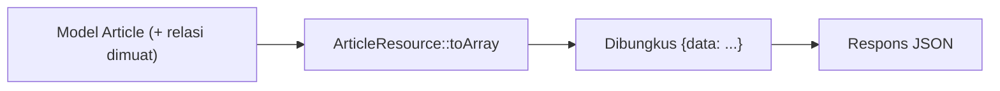

# Transformasi API Resource

Pemetaan model ke array JSON yang kamu tulis di controller mulai berulang di `index`, `show`, `store`, dan `update`. **API Resource** adalah kelas yang memusatkan transformasi itu: satu tempat menentukan
bentuk JSON sebuah model. Ia memberi kontrol atas kolom, relasi bersyarat, tanggal, dan pembungkus `data`. Sub bab ini membuat `ArticleResource`, `CategoryResource`, dan `CommentResource`, lalu memakainya
di seluruh controller.

## Tujuan Pembelajaran

Setelah menyelesaikan sub bab ini, kamu dapat:

- [ ] Membuat resource dengan `php artisan make:resource` dan menulis `toArray`.
- [ ] Mengembalikan satu resource dan koleksi dengan `toResource()` / `toResourceCollection()` atau `Resource::collection()`.
- [ ] Menyertakan relasi hanya bila dimuat dengan `whenLoaded` dan atribut bersyarat dengan `when`.
- [ ] Menambah metadata dengan `additional` dan memahami pembungkus `data`.
- [ ] Mengatur kontrol atas tanggal dan tipe data.
- [ ] Menjelaskan manfaat resource dibanding menyerialisasi model langsung.

## Prasyarat

- [Controller Resource API](06-08-api-resource-controllers.md) dan [Format Data JSON](06-05-json-data-format.md).
- [Eager Loading](../level-04/04-23-eager-loading.md).
- Model `Article`, `Category`, `Comment`, `Tag`, `User`.

## Pengantar

Saat skema database berubah (kolom diganti nama), seharusnya API klien tidak ikut berubah. Resource adalah lapisan penerjemah: model di dalam, kontrak JSON di luar.

## Penjelasan Konsep

### Membuat resource

```bash
php artisan make:resource ArticleResource
php artisan make:resource CategoryResource
php artisan make:resource CommentResource
```

Berkas dibuat di `app/Http/Resources`.

File: `app/Http/Resources/ArticleResource.php`

```php
<?php

namespace App\Http\Resources;

use Illuminate\Http\Request;
use Illuminate\Http\Resources\Json\JsonResource;

class ArticleResource extends JsonResource
{
    public function toArray(Request $request): array
    {
        return [
            'id' => $this->id,
            'title' => $this->title,
            'slug' => $this->slug,
            'excerpt' => str($this->body)->limit(160)->toString(),
            'body' => $this->when($request->routeIs('api.v1.articles.show'), $this->body),
            'is_published' => $this->is_published,
            'published_at' => $this->published_at?->toIso8601String(),
            'category' => new CategoryResource($this->whenLoaded('category')),
            'author' => $this->whenLoaded('user', fn () => ['id' => $this->user->id, 'name' => $this->user->name]),
            'tags' => $this->whenLoaded('tags', fn () => $this->tags->pluck('name')),
            'comments_count' => $this->whenCounted('comments'),
        ];
    }
}
```

| Bagian | Fungsi |
|---|---|
| `$this->id` | Mengakses atribut model langsung (resource meneruskan ke model) |
| `$this->when($kondisi, $nilai)` | Menyertakan kunci hanya bila kondisi benar |
| `whenLoaded('category')` | Menyertakan relasi hanya bila sudah dimuat (hindari N+1 tersembunyi) |
| `whenCounted('comments')` | Menyertakan jumlah bila `withCount('comments')` dipakai |
| `new CategoryResource(...)` | Resource bersarang |
| `toIso8601String()` | Tanggal ISO 8601 |

File: `app/Http/Resources/CategoryResource.php`

```php-inline
public function toArray(Request $request): array
{
    return [
        'id' => $this->id,
        'name' => $this->name,
        'slug' => $this->slug,
        'articles_count' => $this->whenCounted('articles'),
    ];
}
```

File: `app/Http/Resources/CommentResource.php`

```php-inline
public function toArray(Request $request): array
{
    return [
        'id' => $this->id,
        'author_name' => $this->author_name,
        'body' => $this->body,
        'created_at' => $this->created_at->toIso8601String(),
    ];
}
```

### Memakai resource

Dokumentasi 13.x menyediakan jalan pintas pada model dan koleksi yang menemukan resource berdasarkan nama:

```php-inline
return $article->toResource();                      // ArticleResource otomatis
return Article::published()->get()->toResourceCollection();
```

atau secara eksplisit:

```php-inline
return new ArticleResource($article);
return ArticleResource::collection($articles);
```

Hasilnya otomatis dibungkus kunci `data`.

### Controller dengan resource

```php-inline
public function index(): AnonymousResourceCollection
{
    $articles = Article::published()
        ->with(['category:id,name,slug', 'user:id,name'])
        ->withCount('comments')
        ->latest('published_at')
        ->limit(20)
        ->get();

    return ArticleResource::collection($articles);
}

public function show(Article $article): ArticleResource
{
    abort_unless($article->is_published, 404);

    return new ArticleResource($article->load(['category', 'user', 'tags'])->loadCount('comments'));
}

public function store(Request $request): JsonResponse
{
    // ... validasi dan penyimpanan seperti sebelumnya ...
    return (new ArticleResource($article->load(['category', 'user', 'tags'])))
        ->response()
        ->setStatusCode(201)
        ->header('Location', route('api.v1.articles.show', $article));
}
```

Gunakan `use Illuminate\Http\Resources\Json\AnonymousResourceCollection;`. Metode privat `bentuk()` dari sub bab sebelumnya dihapus.

### Metadata tambahan

```php-inline
return ArticleResource::collection($articles)->additional(['meta' => ['versi' => 'v1']]);
```

`additional` menambah kunci di luar `data`. Pada resource tunggal, metode `with()` di kelas resource menambahkan metadata tetap.

### Pembungkus `data`

Secara bawaan semua resource dibungkus `data`. Untuk mematikannya secara global panggil `JsonResource::withoutWrapping()` di `AppServiceProvider::boot()`; materi ini mempertahankan pembungkus.

### Kolom berat dan bersyarat

Hindari menyertakan `body` penuh pada daftar; di contoh, `body` hanya ada pada route `show` dan daftar memakai `excerpt`. Pola ini memperkecil respons daftar.

### Keamanan

- Resource adalah allow-list keluaran: tulis hanya kolom yang boleh keluar.
- Jangan menyertakan `email` penulis atau data pribadi kecuali memang dibutuhkan dan diizinkan.
- `whenLoaded` mencegah resource memicu query tersembunyi; muat relasi di controller.

## Cara Kerja



## Contoh Praktik

Kamu membuat tiga resource, menggantikan pemetaan manual di controller, memverifikasi bahwa respons identik secara struktur, serta membuktikan relasi hanya muncul bila dimuat dan jumlah query tetap.

## Penjelasan Kode

Seluruh kode ada pada bagian konsep. Pada `index`, `body` tidak ada (hanya `excerpt`); pada `show`, `body` ada karena kondisi `routeIs('api.v1.articles.show')`.

## Implementasi Langkah demi Langkah

### Langkah 1: buat resource

Jalankan tiga perintah `make:resource` dan isi `toArray`.

### Langkah 2: ubah controller

Ganti pemetaan manual dengan resource; hapus metode privat lama.

### Langkah 3: uji bentuk respons

```bash
curl -s -H "Accept: application/json" http://127.0.0.1:8000/api/v1/articles | php -r 'echo json_encode(json_decode(stream_get_contents(STDIN)), JSON_PRETTY_PRINT);'
```

Periksa `data`, `excerpt`, `category`, `author`, `comments_count`, dan tidak adanya `body` pada daftar.

### Langkah 4: uji detail

```bash
curl -s -H "Accept: application/json" http://127.0.0.1:8000/api/v1/articles/SLUG
```

`body` dan `tags` muncul.

### Langkah 5: uji `whenLoaded`

Hapus `with(['category', ...])` dari `index` sementara: kunci `category` dan `author` hilang dari respons (tidak ada N+1), lalu kembalikan.

### Langkah 6: catat di Git

```bash
git add app
git commit -m "Tambah API Resource untuk artikel, kategori, dan komentar"
```

## Eksekusi dan Verifikasi

| Langkah | Cara memverifikasi |
|---|---|
| 3 | Daftar tanpa `body`, dengan `excerpt` |
| 4 | Detail dengan `body` dan `tags` |
| 5 | Tanpa `with()`, kunci relasi tidak muncul dan tidak ada query tambahan |

## Hasil yang Diharapkan

| Endpoint | Hasil |
|---|---|
| `GET /api/v1/articles` | `{"data":[{"id":..,"title":..,"excerpt":..,"category":{..},"author":{..},"comments_count":..}]}` |
| `GET /api/v1/articles/{slug}` | `{"data":{...,"body":"..","tags":[..]}}` |

Struktur kunci mengikuti `toArray`. Hasil ini diturunkan dari dokumentasi dan belum dijalankan oleh penulis materi; cocokkan dengan hasilmu.

## Kesalahan Umum dan Pemecahan Masalah

| Gejala | Penyebab | Cara mengenali | Solusi | Pencegahan |
|---|---|---|---|---|
| Relasi selalu `null` | Relasi tidak dimuat di controller | Kunci tidak muncul | `with()` / `load()` | Muat di controller |
| N+1 tersembunyi | Mengakses `$this->user->name` tanpa `whenLoaded` | Banyak query | Pakai `whenLoaded` + eager loading | Aktifkan `preventLazyLoading` |
| `data` ganda (`data.data`) | Membungkus resource dalam `response()->json(['data' => ...])` | Struktur bersarang | Kembalikan resource langsung | Jangan bungkus manual |
| `Call to a member function toIso8601String() on null` | Tanggal `null` | Galat | Pakai `?->` | Tangani null |
| `toResource` tidak menemukan kelas | Penamaan tidak mengikuti konvensi | Galat kelas | Pakai `new ...Resource` atau `UseResource` | Konvensi nama |
| Kolom sensitif bocor | Menambah semua atribut | Respons terlalu banyak | Tulis allow-list | Tinjau resource |

## Latihan Praktik

### Latihan dasar

**D1. Resource tag**
- *Masalah:* butuh resource untuk tag.
- *Persyaratan:* buat `TagResource` (`id`, `name`, `articles_count`) dan endpoint `GET /api/v1/tags`.
- *Perilaku yang diharapkan:* `data` berisi daftar tag.
- *Tujuan belajar:* membuat resource baru.

### Latihan implementasi

**I1. Tautan HATEOAS**
- *Masalah:* klien butuh tautan.
- *Persyaratan:* tambahkan kunci `links` berisi `self` (route `show`) dan `comments` pada `ArticleResource`.
- *Perilaku yang diharapkan:* URL tautan benar.
- *Tujuan belajar:* menyertakan tautan.

**I2. Resource bersyarat**
- *Masalah:* penulis boleh melihat `is_published`, publik tidak.
- *Persyaratan:* gunakan `$this->when(...)` agar kunci `is_published` hanya muncul untuk pemanggil yang memenuhi syarat (sementara: bila header `X-Api-Key` benar) dan uji dua kondisi.
- *Perilaku yang diharapkan:* kunci muncul bersyarat.
- *Tujuan belajar:* atribut bersyarat.

### Latihan tantangan

**T1. Kompatibilitas**
- *Masalah:* kolom `title` diganti menjadi `headline` di database.
- *Persyaratan:* tunjukkan bagaimana Resource menjaga kontrak API tetap `title` tanpa mengubah klien dan bagaimana kamu akan memperkenalkan `headline` secara bertahap.
- *Perilaku yang diharapkan:* contoh kode resource dan rencana.
- *Tujuan belajar:* menjaga kontrak.
- *Catatan:* kerjakan mandiri; tidak ada kunci jawaban.

## Uji Pemahaman

1. Apa fungsi API Resource?
2. Apa beda `when` dan `whenLoaded`?
3. Mengapa `whenLoaded` penting?
4. Bagaimana resource tunggal dan koleksi dikembalikan?
5. Apa fungsi `additional`?
6. Mengapa resource disebut allow-list keluaran?

??? success "Kunci jawaban singkat"
    1. Memusatkan transformasi model menjadi JSON.
    2. `when` berdasarkan kondisi bebas; `whenLoaded` hanya bila relasi dimuat.
    3. Mencegah query tersembunyi (N+1) dan kunci `null` menyesatkan.
    4. `new Resource($model)` / `toResource()` dan `Resource::collection()` / `toResourceCollection()`.
    5. Menambah metadata di luar `data`.
    6. Hanya kolom yang ditulis yang keluar.

## Ringkasan

- Resource memusatkan bentuk JSON; model di dalam, kontrak di luar.
- `when`, `whenLoaded`, `whenCounted` membuat kunci bersyarat tanpa query tersembunyi.
- Hasil dibungkus `data`; metadata lewat `additional`.
- Resource adalah allow-list keluaran dan menjaga kompatibilitas.

Selanjutnya: *Validasi Request API*, memastikan input API sah.

## Referensi Resmi

- [Laravel: Eloquent API Resources](https://laravel.com/docs/13.x/eloquent-resources)
- [Laravel: Conditional Attributes](https://laravel.com/docs/13.x/eloquent-resources#conditional-attributes)
- [Laravel: Conditional Relationships](https://laravel.com/docs/13.x/eloquent-resources#conditional-relationships)
