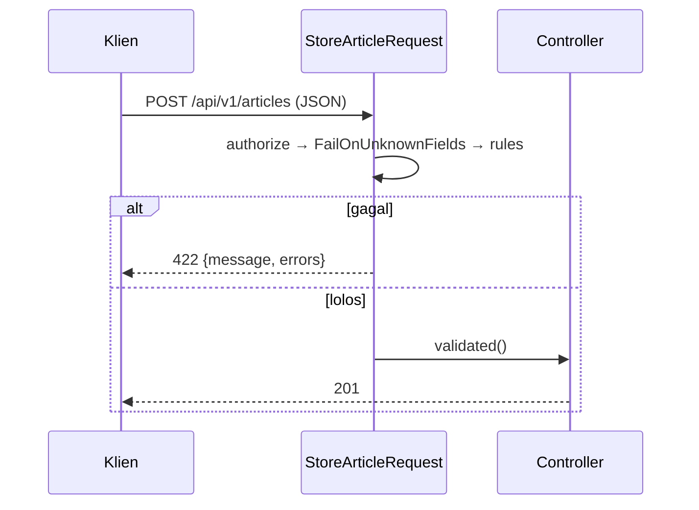

# Validasi Request API

Validasi untuk API memakai mesin yang sama dengan form web, tetapi kontraknya berbeda: kegagalan harus menjadi **422** dengan JSON galat, bukan pengalihan ke halaman form. Sub bab ini memindahkan validasi
endpoint tulis ke Form Request khusus API, memperlihatkan bentuk respons galat, dan membahas hal khas API: tipe data JSON, kolom tak dikenal, dan validasi query string.

## Tujuan Pembelajaran

Setelah menyelesaikan sub bab ini, kamu dapat:

- [ ] Membuat Form Request untuk endpoint API (`Api\V1\StoreArticleRequest`, `UpdateArticleRequest`).
- [ ] Menjelaskan bentuk respons 422 dan kunci `errors` berpola `kolom` atau `kolom.indeks`.
- [ ] Memvalidasi tipe data JSON (boolean sejati, angka, array) dan batas ukuran.
- [ ] Menolak kolom tak dikenal dengan `#[FailOnUnknownFields]`.
- [ ] Memvalidasi parameter query string pada endpoint daftar.
- [ ] Memastikan galat validasi selalu berupa JSON pada route API.

## Prasyarat

- [Validasi Form Request](../level-05/05-05-form-request-validation.md) dan [Validasi Bersyarat](../level-05/05-06-conditional-validation.md).
- [Controller Resource API](06-08-api-resource-controllers.md) dan [Transformasi API Resource](06-09-api-resource-transformation.md).

## Pengantar

Validasi di controller (`$request->validate(...)`) berfungsi, tetapi aturan tulis dan ubah menggelembungkan controller. Form Request memisahkannya, dapat diuji, dan memberi kita tempat untuk menegakkan
aturan khas API seperti penolakan kolom asing.

## Penjelasan Konsep

### Form Request untuk API

```bash
php artisan make:request Api/V1/StoreArticleRequest
php artisan make:request Api/V1/UpdateArticleRequest
```

File: `app/Http/Requests/Api/V1/StoreArticleRequest.php`

```php
<?php

namespace App\Http\Requests\Api\V1;

use Illuminate\Foundation\Http\Attributes\FailOnUnknownFields;
use Illuminate\Foundation\Http\FormRequest;

#[FailOnUnknownFields]
class StoreArticleRequest extends FormRequest
{
    public function authorize(): bool
    {
        return true; // dilindungi middleware; otorisasi per pengguna menyusul (06.17)
    }

    public function rules(): array
    {
        return [
            'title' => ['required', 'string', 'max:200'],
            'slug' => ['nullable', 'string', 'max:200', 'unique:articles,slug'],
            'body' => ['required', 'string', 'max:100000'],
            'user_id' => ['required', 'integer', 'exists:users,id'],
            'category_id' => ['nullable', 'integer', 'exists:categories,id'],
            'tags' => ['nullable', 'array', 'max:10'],
            'tags.*' => ['integer', 'distinct', 'exists:tags,id'],
            'is_published' => ['sometimes', 'boolean'],
        ];
    }
}
```

`UpdateArticleRequest` memakai `sometimes` dan `Rule::unique('articles','slug')->ignore($this->route('article'))`; karena binding memakai slug, `$this->route('article')` adalah model dan `ignore($model)` dipakai:

```php-inline
public function rules(): array
{
    return [
        'title' => ['sometimes', 'required', 'string', 'max:200'],
        'slug' => ['sometimes', 'required', 'string', 'max:200', Rule::unique('articles', 'slug')->ignore($this->route('article'))],
        'body' => ['sometimes', 'required', 'string', 'max:100000'],
        'category_id' => ['sometimes', 'nullable', 'integer', 'exists:categories,id'],
        'tags' => ['sometimes', 'array', 'max:10'],
        'tags.*' => ['integer', 'distinct', 'exists:tags,id'],
        'is_published' => ['sometimes', 'boolean'],
    ];
}
```

Controller menjadi ringkas: `public function store(StoreArticleRequest $request)` dan `$data = $request->validated();`.

### Bentuk respons 422

```json
{
    "message": "The title field is required. (and 1 more error)",
    "errors": {
        "title": ["The title field is required."],
        "tags.1": ["The tags.1 field has a duplicate value."]
    }
}
```

Kunci `errors` memetakan nama kolom ke daftar pesan; elemen array memakai notasi titik. Klien dapat menampilkan galat di sebelah kolom yang tepat. Pesan mengikuti `APP_LOCALE` (terjemahan dari bab Validasi).

### Tipe data JSON

Berbeda dari form (semua string), JSON membawa tipe:

| Aturan | Menerima | Catatan |
|---|---|---|
| `boolean` | `true`, `false`, `1`, `0`, `"1"`, `"0"` | `"true"` (string) ditolak |
| `integer` | `5`, `"5"` | Teks `"5"` dianggap valid |
| `string` | `"teks"` | Angka `5` ditolak |
| `array` | `[...]` | Objek `{}` dianggap array asosiatif |

Bila ingin menegakkan tipe ketat, tambahkan `prepareForValidation()` yang menolak atau menormalkan tipe, atau gunakan aturan `string` untuk teks.

### Menolak kolom tak dikenal

Atribut `#[FailOnUnknownFields]` (13.x) menolak kolom yang tidak ada di `rules()`; kirim `{"is_admin":true}` dan lihat 422. Ini membantu klien menyadari typo (`titel`) dan mengurangi permukaan
mass assignment.

### Validasi query string

Parameter query (paginasi, filter) juga masukan tidak tepercaya:

```php-inline
// Api\V1\IndexArticleRequest
public function rules(): array
{
    return [
        'page' => ['sometimes', 'integer', 'min:1'],
        'per_page' => ['sometimes', 'integer', 'between:1,50'],
        'q' => ['sometimes', 'string', 'max:100'],
        'sort' => ['sometimes', 'in:published_at,-published_at,title,-title'],
    ];
}
```

Dipakai di sub bab paginasi dan pencarian.

### Selalu JSON

Jika klien lupa `Accept: application/json`, kegagalan validasi menghasilkan redirect 302. Sub bab 06.11 mengatur seluruh URL `api/*` agar selalu dijawab sebagai JSON; untuk satu Form Request kamu juga
dapat menimpa `wantsJson()`/`expectsJson()` atau memakai middleware yang menambahkan header.

### Keamanan

- Batasi panjang string dan jumlah elemen array agar tidak ada muatan raksasa.
- Validasi kunci asing dengan `exists` dan selalu otorisasi pemakaiannya.
- Jangan memercayai `user_id` dari klien setelah autentikasi tersedia; tetapkan dari token.

## Cara Kerja



## Contoh Praktik

Kamu memindahkan validasi ke Form Request, memverifikasi 422 untuk berbagai kesalahan JSON (tipe salah, kolom asing, array ganda), dan menambah validasi query pada endpoint daftar.

## Penjelasan Kode

Kode ada pada bagian konsep. Ganti `Request $request` pada `store` dan `update` dengan Form Request dan ambil data dari `$request->validated()`.

## Implementasi Langkah demi Langkah

### Langkah 1: buat dan isi Form Request

Buat dua Form Request dan isi aturan.

### Langkah 2: ubah controller

Ganti tipe parameter dan hapus `validate([...])` di dalam controller.

### Langkah 3: uji galat tipe

```bash
KUNCI=isi_kunci_dari_env
curl -s -X POST -H "Accept: application/json" -H "Content-Type: application/json" -H "X-Api-Key: $KUNCI" \
  -d '{"title":123,"body":"Isi","user_id":"x","is_published":"ya"}' http://127.0.0.1:8000/api/v1/articles
```

Perhatikan tiga kunci galat.

### Langkah 4: uji kolom asing

```bash
curl -s -X POST -H "Accept: application/json" -H "Content-Type: application/json" -H "X-Api-Key: $KUNCI" \
  -d '{"title":"A","body":"B","user_id":1,"is_admin":true}' http://127.0.0.1:8000/api/v1/articles
```

### Langkah 5: uji array ganda dan batas

```bash
curl -s -X POST -H "Accept: application/json" -H "Content-Type: application/json" -H "X-Api-Key: $KUNCI" \
  -d '{"title":"A","body":"B","user_id":1,"tags":[1,1]}' http://127.0.0.1:8000/api/v1/articles
```

### Langkah 6: tanpa header Accept

Ulangi Langkah 3 tanpa `Accept: application/json` dan amati `302`. Catat; perbaikannya ada di sub bab berikutnya.

### Langkah 7: catat di Git

```bash
git add app
git commit -m "Pindahkan validasi API ke Form Request"
```

## Eksekusi dan Verifikasi

| Langkah | Cara memverifikasi |
|---|---|
| 3 | `422` dengan `errors` untuk `title`, `user_id`, `is_published` |
| 4 | `422` karena `is_admin` tidak dikenal |
| 5 | `422` untuk `tags.1` (nilai ganda) |
| 6 | `302` tanpa header `Accept` |

## Hasil yang Diharapkan

| Permintaan | Hasil |
|---|---|
| Tipe salah | `422` + JSON `errors` per kolom |
| Kolom asing | `422` |
| Data benar | `201` |

Teks pesan galat berbahasa sesuai locale. Hasil ini diturunkan dari dokumentasi dan belum dijalankan oleh penulis materi; cocokkan dengan hasilmu.

## Kesalahan Umum dan Pemecahan Masalah

| Gejala | Penyebab | Cara mengenali | Solusi | Pencegahan |
|---|---|---|---|---|
| `302` bukan `422` | Tidak ada `Accept: application/json` | Redirect | Kirim header / aturan global | Wajibkan di klien |
| Update menolak slug sendiri | Lupa `ignore` | Galat unique | `Rule::unique(...)->ignore($this->route('article'))` | Uji update tanpa perubahan |
| `"5"` lolos sebagai integer | Perilaku `integer` | Teks diterima | Normalisasi atau cek tipe tambahan | Pahami aturan |
| Atribut `FailOnUnknownFields` tak dikenal | Namespace salah | Class not found | `Illuminate\Foundation\Http\Attributes\FailOnUnknownFields` | Periksa `use` |
| Galat `user_id` pada update | Aturan `required` dibawa ke update | Tidak perlu diisi | Hapus dari update | Pisahkan aturan |
| Pesan Inggris | Terjemahan belum ada | Teks Inggris | Isi `lang/id/validation.php` | Lokalisasi |

## Latihan Praktik

### Latihan dasar

**D1. Baca galat**
- *Masalah:* ingin memahami struktur galat.
- *Persyaratan:* hasilkan galat pada tiga kolom dan tulis tabel kolom → pesan dari JSON.
- *Perilaku yang diharapkan:* sesuai respons.
- *Tujuan belajar:* membaca 422.

### Latihan implementasi

**I1. Request komentar**
- *Masalah:* endpoint komentar butuh validasi.
- *Persyaratan:* buat `StoreCommentRequest` (`author_name` 2–50, `body` 3–1000) dan pakai di endpoint komentar; uji 422.
- *Perilaku yang diharapkan:* komentar valid dibuat 201.
- *Tujuan belajar:* Form Request pada sub-sumber daya.

**I2. Validasi query**
- *Masalah:* `?per_page=1000` membebani server.
- *Persyaratan:* buat `IndexArticleRequest` dan pakai di `index`; uji nilai liar.
- *Perilaku yang diharapkan:* nilai liar → 422.
- *Tujuan belajar:* memvalidasi query string.

### Latihan tantangan

**T1. Kontrak tertulis**
- *Masalah:* tim butuh dokumen aturan input.
- *Persyaratan:* buat tabel aturan semua endpoint tulis (kolom, tipe, wajib/opsional, batas) langsung dari `rules()`; jelaskan bagaimana menjaga dokumen sinkron dengan kode.
- *Perilaku yang diharapkan:* tabel akurat dan strategi sinkronisasi.
- *Tujuan belajar:* mendokumentasikan kontrak.
- *Catatan:* kerjakan mandiri; tidak ada kunci jawaban.

## Uji Pemahaman

1. Apa respons validasi gagal untuk API?
2. Bagaimana kunci `errors` untuk elemen array?
3. Apa fungsi `#[FailOnUnknownFields]`?
4. Mengapa query string juga divalidasi?
5. Mengapa `Accept: application/json` penting?
6. Apa beda aturan `integer` pada form dan JSON?

??? success "Kunci jawaban singkat"
    1. 422 dengan JSON `message` dan `errors`.
    2. Notasi titik, mis. `tags.1`.
    3. Menolak kolom yang tidak ada di `rules()`.
    4. Termasuk masukan tidak tepercaya (dapat membebani server).
    5. Tanpa itu validasi gagal menjadi redirect HTML.
    6. JSON membawa tipe asli; form selalu string.

## Ringkasan

- Form Request memisahkan validasi dari controller API; kegagalan menjadi 422 JSON.
- Validasi tipe, batas, kunci asing, dan kolom asing (`#[FailOnUnknownFields]`).
- Validasi juga query string.
- Pastikan klien mengirim `Accept: application/json` atau atur secara global.

Selanjutnya: *Penanganan Error API*, format galat yang seragam.

## Referensi Resmi

- [Laravel: Form Request Validation](https://laravel.com/docs/13.x/validation#form-request-validation)
- [Laravel: Validation Error Response Format](https://laravel.com/docs/13.x/validation#validation-error-response-format)
- [Laravel: Failing on Unknown Fields](https://laravel.com/docs/13.x/validation#request-failing-on-unknown-fields)
