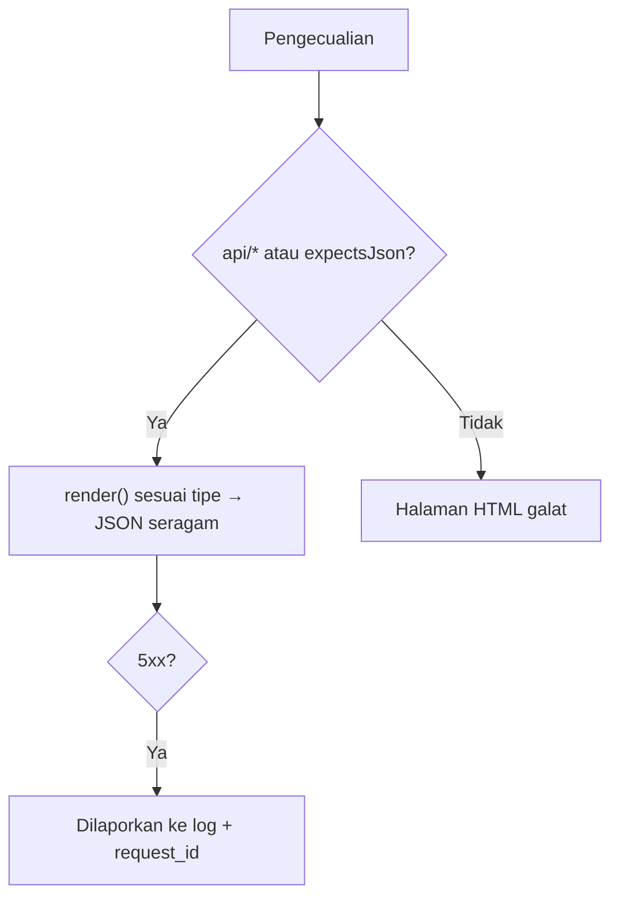

# Penanganan Error API

Klien API membaca galat dengan program, bukan mata. Mereka membutuhkan kode status yang benar, bentuk JSON yang konsisten, dan pesan yang berguna tanpa membocorkan detail internal. Sub bab ini mengatur
`bootstrap/app.php` agar semua URL `api/*` selalu dijawab JSON, menyeragamkan format galat (404, 401, 403, 405, 422, 429, 500), dan menjaga pelaporan serta log tetap berguna.

## Tujuan Pembelajaran

Setelah menyelesaikan sub bab ini, kamu dapat:

- [ ] Memaksa respons JSON untuk URL `api/*` dengan `shouldRenderJsonWhen`.
- [ ] Menyeragamkan format galat dengan `$exceptions->render(...)`.
- [ ] Membedakan galat klien (4xx, tidak perlu dilaporkan) dan galat server (5xx, dilaporkan).
- [ ] Mencegah kebocoran detail (jejak tumpukan, SQL) pada 500.
- [ ] Menambahkan pengenal permintaan (*request id*) untuk melacak galat.
- [ ] Menguji semua jenis galat dari sisi klien.

## Prasyarat

- [Kode Status HTTP](06-04-http-status-codes.md) dan [Validasi Request API](06-10-api-request-validation.md).
- [Penanganan Error dan HTTP Status Code](../level-02/02-20-error-handling-and-http-status-codes.md).
- `bootstrap/app.php` dengan `withExceptions`.

## Pengantar

API yang kadang menjawab JSON dan kadang halaman HTML galat membuat klien harus menangani dua dunia. Satu aturan di tempat yang tepat membuat semua galat konsisten.

## Penjelasan Konsep

### Selalu JSON untuk `api/*`

Menurut dokumentasi, Laravel memilih HTML atau JSON dari header `Accept`. Ubah penentuan itu:

File: `bootstrap/app.php`

```php
use Illuminate\Http\Request;
use Throwable;

->withExceptions(function (Exceptions $exceptions): void {
    $exceptions->shouldRenderJsonWhen(function (Request $request, Throwable $e) {
        return $request->is('api/*') || $request->expectsJson();
    });
})
```

Dengan ini, kegagalan validasi pada URL API menjadi 422 JSON walau klien lupa `Accept`.

### Format galat yang seragam

Konvensi materi ini:

```json
{
    "message": "Penjelasan singkat untuk manusia.",
    "code": "kode_makhluk_mesin",
    "errors": { "kolom": ["pesan"] },
    "request_id": "8f3c..."
}
```

`errors` hanya ada pada validasi; `code` memudahkan klien bereaksi tanpa mem-parsing pesan.

### Menyeragamkan dengan `render`

Closure diberi tipe pengecualian yang ditangani dan mengembalikan respons; bila tidak mengembalikan apa pun, bentuk bawaan dipakai.

```php
use Illuminate\Auth\Access\AuthorizationException;
use Illuminate\Auth\AuthenticationException;
use Illuminate\Http\Request;
use Illuminate\Validation\ValidationException;
use Symfony\Component\HttpKernel\Exception\MethodNotAllowedHttpException;
use Symfony\Component\HttpKernel\Exception\NotFoundHttpException;
use Symfony\Component\HttpKernel\Exception\TooManyRequestsHttpException;

$galat = fn (string $pesan, string $kode, int $status, array $tambahan = []) => response()->json(
    ['message' => $pesan, 'code' => $kode] + $tambahan + ['request_id' => request()->header('X-Request-Id')],
    $status
);

$exceptions->render(function (NotFoundHttpException $e, Request $request) use ($galat) {
    if ($request->is('api/*')) {
        return $galat('Sumber daya tidak ditemukan.', 'not_found', 404);
    }
});

$exceptions->render(function (MethodNotAllowedHttpException $e, Request $request) use ($galat) {
    if ($request->is('api/*')) {
        return $galat('Metode tidak didukung.', 'method_not_allowed', 405)->withHeaders($e->getHeaders());
    }
});

$exceptions->render(function (AuthenticationException $e, Request $request) use ($galat) {
    if ($request->is('api/*')) {
        return $galat('Belum terautentikasi.', 'unauthenticated', 401);
    }
});

$exceptions->render(function (AuthorizationException $e, Request $request) use ($galat) {
    if ($request->is('api/*')) {
        return $galat('Tidak berhak melakukan aksi ini.', 'forbidden', 403);
    }
});

$exceptions->render(function (ValidationException $e, Request $request) use ($galat) {
    if ($request->is('api/*')) {
        return $galat('Data tidak valid.', 'validation_failed', 422, ['errors' => $e->errors()]);
    }
});

$exceptions->render(function (TooManyRequestsHttpException $e, Request $request) use ($galat) {
    if ($request->is('api/*')) {
        return $galat('Terlalu banyak permintaan.', 'rate_limited', 429)->withHeaders($e->getHeaders());
    }
});
```

Catatan:

- `ModelNotFoundException` dikonversi Laravel menjadi `NotFoundHttpException` sebelum `render`, sehingga satu penangan 404 cukup.
- Menurut dokumentasi, closure yang tidak mengembalikan nilai membuat Laravel memakai perenderan bawaan.
- `AuthorizationException` dikonversi menjadi 403 `AccessDeniedHttpException` oleh Laravel pada beberapa jalur; uji kedua kasus pada versimu (`Gate::authorize`) dan tambah penangan bila perlu.
- Format `errors` mengikuti `ValidationException::errors()`.

### Mencegah kebocoran pada 500

Dengan `APP_DEBUG=false`, galat tak terduga menghasilkan JSON umum `{"message":"Server Error"}`. Dengan `APP_DEBUG=true`, jejak tumpukan dan path ikut tampil; **jangan pernah** di produksi.
Kamu dapat menyeragamkan 500:

```php
$exceptions->render(function (Throwable $e, Request $request) use ($galat) {
    if ($request->is('api/*') && ! config('app.debug')
        && ! $e instanceof \Symfony\Component\HttpKernel\Exception\HttpExceptionInterface
        && ! $e instanceof ValidationException && ! $e instanceof AuthenticationException) {
        return $galat('Terjadi kesalahan pada server.', 'server_error', 500);
    }
});
```

### Pengenal permintaan

Middleware sederhana menambahkan `X-Request-Id` ke permintaan dan respons serta ke konteks log sehingga galat yang dilaporkan klien dapat ditelusuri:

```php
public function handle(Request $request, Closure $next): Response
{
    $id = $request->header('X-Request-Id') ?: (string) \Illuminate\Support\Str::uuid();
    $request->headers->set('X-Request-Id', $id);
    \Illuminate\Support\Facades\Log::withContext(['request_id' => $id]);

    $response = $next($request);
    $response->headers->set('X-Request-Id', $id);

    return $response;
}
```

Pasang pada grup `api` di `bootstrap/app.php` (`$middleware->api(append: [AddRequestId::class]);`).

### Pelaporan

Galat 4xx adalah kesalahan klien dan tidak perlu mengisi log galat. Laravel secara bawaan tidak melaporkan pengecualian HTTP 4xx dan validasi. Galat 5xx dilaporkan ke log (`storage/logs/laravel.log`) dengan konteks
`request_id`. Jangan mencatat kata sandi, token, atau body sensitif.

### Keamanan

- Pesan galat tidak membocorkan keberadaan akun, SQL, atau path.
- Gunakan 404 untuk menyembunyikan data yang tak boleh diketahui keberadaannya.
- Pastikan `APP_DEBUG=false` di produksi.
- Pertimbangkan membatasi laju respons galat (mis. banyak 401) untuk mendeteksi serangan.

## Cara Kerja



## Contoh Praktik

Kamu mengatur penanganan galat API, memicu setiap jenis galat dengan `curl` (tanpa header `Accept`), memeriksa format seragam, dan membuktikan 500 tidak membocorkan detail saat `APP_DEBUG=false`.

## Penjelasan Kode

Seluruh kode ada pada bagian konsep. Taruh penangan di `withExceptions` dan middleware `AddRequestId` pada grup `api`.

## Implementasi Langkah demi Langkah

### Langkah 1: atur `shouldRenderJsonWhen` dan penangan

Tambahkan semua penangan ke `bootstrap/app.php`.

### Langkah 2: tambah middleware pengenal permintaan

Buat `AddRequestId`, daftarkan pada grup `api`.

### Langkah 3: uji semua galat (tanpa `Accept`)

```bash
curl -s -i http://127.0.0.1:8000/api/v1/tidak-ada
curl -s -i http://127.0.0.1:8000/api/v1/articles/slug-tidak-ada
curl -s -i -X DELETE http://127.0.0.1:8000/api/v1/ping
curl -s -i -X POST -H "Content-Type: application/json" -d '{}' http://127.0.0.1:8000/api/v1/articles
curl -s -i -X POST -H "Content-Type: application/json" -H "X-Api-Key: $KUNCI" -d '{}' http://127.0.0.1:8000/api/v1/articles
```

Harapan berurutan: `404`, `404`, `405`, `401`, `422`; semuanya JSON seragam.

### Langkah 4: uji 500

Tambahkan route sementara `Route::get('/rusak', fn () => throw new \RuntimeException('rahasia internal'));` di `routes/api.php`. Panggil dengan `APP_DEBUG=true`, lalu `APP_DEBUG=false` (`php artisan config:clear` bila perlu). Bandingkan:
dengan debug mati pesan umum dan tanpa jejak; periksa `storage/logs/laravel.log` untuk jejak lengkap dan `request_id`. Hapus route.

### Langkah 5: uji 429

Pasang `throttle:2,1` sementara pada `/api/v1/ping` dan panggil tiga kali: respons ketiga `429` JSON dengan `Retry-After`.

### Langkah 6: catat di Git

```bash
git add app bootstrap routes
git commit -m "Seragamkan penanganan error API"
```

## Eksekusi dan Verifikasi

| Langkah | Cara memverifikasi |
|---|---|
| 3 | Lima kode berbeda, semuanya JSON dengan `message`, `code`, `request_id` |
| 4 | Debug mati: pesan umum tanpa jejak; log menyimpan detail |
| 5 | `429` + `Retry-After` |

## Hasil yang Diharapkan

| Kasus | Hasil |
|---|---|
| URL tidak ada | `404` `{"message":"Sumber daya tidak ditemukan.","code":"not_found",...}` |
| Metode salah | `405` + header `Allow` |
| Validasi gagal | `422` + `errors` |
| Galat internal (debug mati) | `500` `{"message":"Terjadi kesalahan pada server.","code":"server_error",...}` |

Hasil ini diturunkan dari dokumentasi dan belum dijalankan oleh penulis materi; urutan konversi pengecualian dapat berbeda antar versi, cocokkan dengan hasilmu.

## Kesalahan Umum dan Pemecahan Masalah

| Gejala | Penyebab | Cara mengenali | Solusi | Pencegahan |
|---|---|---|---|---|
| Penangan tidak terpanggil | Tipe pengecualian salah (mis. model not found) | Bentuk bawaan muncul | Tangani `NotFoundHttpException` | Uji tiap jenis |
| 404 HTML untuk URL API | `shouldRenderJsonWhen` belum diatur | Halaman HTML | Atur kondisi `api/*` | Aturan global |
| Jejak tumpukan di respons | `APP_DEBUG=true` | `exception` di JSON | Matikan debug | Konfigurasi produksi |
| Log galat penuh 404 | Melaporkan 4xx | Log berisik | Jangan laporkan 4xx | Pakai `dontReport` bila perlu |
| `request_id` kosong | Middleware tidak terpasang | Kunci `null` | Pasang pada grup `api` | Uji header |
| 403 tidak seragam | `AuthorizationException` vs `AccessDeniedHttpException` | Bentuk berbeda | Tangani keduanya | Uji Policy |

## Latihan Praktik

### Latihan dasar

**D1. Katalog galat**
- *Masalah:* dokumentasi kode galat.
- *Persyaratan:* buat tabel kode `code` → status → arti untuk semua galat yang kamu tangani.
- *Perilaku yang diharapkan:* tabel lengkap.
- *Tujuan belajar:* mendokumentasikan galat.

### Latihan implementasi

**I1. Galat domain**
- *Masalah:* slug duplikat perlu 409.
- *Persyaratan:* buat pengecualian `SlugSudahDipakai` dengan metode `render()` yang mengembalikan 409 dan `code: slug_conflict`, lemparkan dari controller, dan uji.
- *Perilaku yang diharapkan:* respons 409 seragam.
- *Tujuan belajar:* pengecualian domain.

**I2. Tidak melaporkan 4xx**
- *Masalah:* log berisik.
- *Persyaratan:* verifikasi bahwa 404/422 tidak masuk log dan 500 masuk, dengan satu percobaan tiap jenis.
- *Perilaku yang diharapkan:* hanya 5xx tercatat.
- *Tujuan belajar:* memahami pelaporan.

### Latihan tantangan

**T1. Format standar**
- *Masalah:* tim ingin mengikuti standar.
- *Persyaratan:* pelajari RFC 9457 (*Problem Details for HTTP APIs*), bandingkan dengan format seragam di atas, dan rancang pemetaan tanpa memutus klien yang ada.
- *Perilaku yang diharapkan:* perbandingan dan pemetaan.
- *Tujuan belajar:* mengenal standar galat API.
- *Catatan:* kerjakan mandiri; tidak ada kunci jawaban.

## Uji Pemahaman

1. Apa fungsi `shouldRenderJsonWhen`?
2. Bagaimana menyeragamkan 404 API?
3. Mengapa `APP_DEBUG=false` di produksi?
4. Apa fungsi `request_id`?
5. Kenapa 4xx tidak dilaporkan sebagai kesalahan?
6. Apa yang terjadi bila closure `render` tidak mengembalikan nilai?

??? success "Kunci jawaban singkat"
    1. Menentukan kapan galat dirender sebagai JSON.
    2. `render` untuk `NotFoundHttpException` yang mengembalikan JSON seragam untuk `api/*`.
    3. Mencegah kebocoran jejak dan path.
    4. Melacak satu permintaan lintas klien dan log.
    5. Itu kesalahan klien, bukan bug server.
    6. Laravel memakai perenderan bawaan.

## Ringkasan

- Paksa JSON untuk `api/*` dan seragamkan galat lewat `render`.
- Format: `message`, `code`, opsional `errors`, dan `request_id`.
- 4xx tidak dilaporkan; 5xx dilaporkan dengan konteks; debug mati di produksi.
- Uji setiap jenis galat dari sisi klien.

Selanjutnya: *Paginasi API*, menyajikan data dalam halaman.

## Referensi Resmi

- [Laravel: Error Handling](https://laravel.com/docs/13.x/errors)
- [Laravel: Rendering Exceptions](https://laravel.com/docs/13.x/errors#rendering-exceptions)
- [RFC 9457: Problem Details for HTTP APIs](https://www.rfc-editor.org/rfc/rfc9457)
