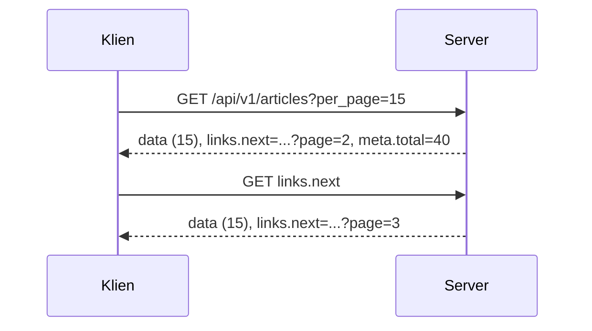

# Paginasi API

Daftar artikel yang mengembalikan semuanya tidak akan bertahan dari ratusan data. Paginasi API membagi hasil menjadi halaman dan menyertakan informasi navigasi (`links`, `meta`) agar klien tahu cara meminta halaman
berikutnya. Laravel memadukan paginator dengan API Resource sehingga `links` dan `meta` muncul otomatis. Sub bab ini menerapkannya pada endpoint daftar, memvalidasi `per_page`, dan memilih antara paginasi offset
dan kursor.

## Tujuan Pembelajaran

Setelah menyelesaikan sub bab ini, kamu dapat:

- [ ] Mengembalikan hasil terpaginasi lewat API Resource (`links` dan `meta` otomatis).
- [ ] Memvalidasi dan membatasi `page` dan `per_page`.
- [ ] Menjelaskan bentuk `links`, `meta`, dan cara klien memakainya.
- [ ] Memilih `paginate`, `simplePaginate`, atau `cursorPaginate` untuk API.
- [ ] Mempertahankan filter pada tautan dengan `withQueryString()`.
- [ ] Menjelaskan risiko paginasi `offset` pada data yang berubah.

## Prasyarat

- [Paginasi (bab Database)](../level-04/04-25-pagination.md) dan [Transformasi API Resource](06-09-api-resource-transformation.md).
- [Validasi Request API](06-10-api-request-validation.md).
- Data minimal 40 artikel terbit.

## Pengantar

Aplikasi seluler yang meminta `GET /api/v1/articles` dan menerima 5.000 artikel akan lambat, boros data seluler, dan membebani server. Dengan paginasi, klien meminta 15 item sekaligus dan mengikuti tautan `next`.

## Penjelasan Konsep

### Resource dan paginator

Mengembalikan hasil `paginate()` melalui resource menghasilkan `data`, `links`, dan `meta`:

```php-inline
public function index(IndexArticleRequest $request): AnonymousResourceCollection
{
    $perPage = (int) $request->integer('per_page', 15);

    $articles = Article::published()
        ->with(['category:id,name,slug', 'user:id,name'])
        ->withCount('comments')
        ->latest('published_at')
        ->paginate($perPage)
        ->withQueryString();

    return ArticleResource::collection($articles);
}
```

`IndexArticleRequest` (sub bab 06.10) membatasi `per_page` antara 1 dan 50.

### Bentuk respons

```json
{
    "data": [ { "id": 40, "title": "..." } ],
    "links": {
        "first": "http://127.0.0.1:8000/api/v1/articles?page=1",
        "last": "http://127.0.0.1:8000/api/v1/articles?page=3",
        "prev": null,
        "next": "http://127.0.0.1:8000/api/v1/articles?page=2"
    },
    "meta": {
        "current_page": 1,
        "from": 1,
        "last_page": 3,
        "path": "http://127.0.0.1:8000/api/v1/articles",
        "per_page": 15,
        "to": 15,
        "total": 40
    }
}
```

Kunci `meta` dapat memuat informasi tambahan (mis. tautan halaman) bergantung versi. Klien sebaiknya mengikuti `links.next` sampai `null`, bukan menyusun URL sendiri.

### Jenis paginasi untuk API

| Jenis | Kelebihan | Kekurangan | Cocok untuk |
|---|---|---|---|
| `paginate` (offset + total) | Nomor halaman, total | `count(*)` tambahan; geser bila data berubah | Daftar kecil-menengah, UI bernomor |
| `simplePaginate` | Tanpa `count` | Tanpa total | Data besar tanpa total |
| `cursorPaginate` | Stabil saat data berubah, efisien pada data besar | Hanya `next`/`prev`; butuh urutan unik | *Infinite scroll*, umpan besar |

Dokumentasi menjelaskan bahwa kursor memakai `where` berdasarkan nilai kolom terurut (bukan `offset`), sehingga lebih efisien dan tidak melewatkan/menggandakan item saat data bertambah di sela-sela halaman.
Syaratnya: ada `orderBy` dengan kolom unik, dan `null` pada kolom urut tidak didukung.

```php-inline
Article::published()->orderByDesc('published_at')->orderByDesc('id')->cursorPaginate(15);
```

Respons kursor memuat `links.next` berisi parameter `cursor` buram (*opaque*); klien tidak menafsirkannya.

### Urutan stabil

Selalu sertakan kolom unik (mis. `id`) sebagai penentu akhir pengurutan agar halaman tidak berubah antarpermintaan:

```php-inline
->latest('published_at')->orderByDesc('id')
```

### Batas dan validasi

- Tetapkan `per_page` bawaan dan maksimum (mis. 15 dan 50).
- `page` di luar jangkauan mengembalikan `data` kosong dengan `meta` yang menunjukkan halaman terakhir.
- Jangan membiarkan klien meminta `per_page` bebas.

### Keamanan dan performa

- Batas `per_page` mencegah penyalahgunaan sumber daya.
- Pastikan kolom pengurutan terindeks (`published_at`, `id`).
- `count(*)` pada tabel sangat besar mahal; pertimbangkan `simplePaginate`/`cursorPaginate`.
- Paginasi berikan data yang boleh dilihat saja: filter akses diterapkan sebelum paginasi.

## Cara Kerja



## Contoh Praktik

Kamu menerapkan paginasi pada daftar artikel, memvalidasi `per_page`, mengikuti `links.next` dengan skrip, mencoba halaman di luar jangkauan, dan membandingkan `paginate` dengan `cursorPaginate`.

## Penjelasan Kode

File: `app/Http/Requests/Api/V1/IndexArticleRequest.php` (aturan dari sub bab 06.10)

```php-inline
public function authorize(): bool
{
    return true;
}

public function rules(): array
{
    return [
        'page' => ['sometimes', 'integer', 'min:1'],
        'per_page' => ['sometimes', 'integer', 'between:1,50'],
    ];
}
```

Controller `index` seperti pada bagian konsep. Pada pengujian, `withQueryString()` memastikan `per_page` tetap ada di `links`.

## Implementasi Langkah demi Langkah

### Langkah 1: siapkan data

```bash
php artisan tinker --execute="App\Models\Article::factory()->count(40)->published()->create();"
```

### Langkah 2: terapkan paginasi

Buat `IndexArticleRequest` dan ubah `index` memakai `paginate($perPage)->withQueryString()`.

### Langkah 3: lihat respons

```bash
curl -s -H "Accept: application/json" "http://127.0.0.1:8000/api/v1/articles?per_page=10" | php -r '$d=json_decode(stream_get_contents(STDIN),true); print_r($d["meta"]); print_r($d["links"]);'
```

### Langkah 4: ikuti `next`

```bash
URL="http://127.0.0.1:8000/api/v1/articles?per_page=10"
while [ -n "$URL" ]; do
  echo "== $URL"
  URL=$(curl -s -H "Accept: application/json" "$URL" | php -r '$d=json_decode(stream_get_contents(STDIN),true); echo $d["links"]["next"] ?? "";')
done
```

Skrip berhenti saat `next` bernilai `null` (string kosong).

### Langkah 5: uji batas

```bash
curl -s -o /dev/null -w "%{http_code}\n" -H "Accept: application/json" "http://127.0.0.1:8000/api/v1/articles?per_page=1000"
curl -s -H "Accept: application/json" "http://127.0.0.1:8000/api/v1/articles?page=999" | head -c 300
```

Harapan: `422` untuk `per_page=1000`; `data` kosong untuk halaman di luar jangkauan.

### Langkah 6: coba kursor

Ubah sementara ke `cursorPaginate(10)` (dengan urutan `published_at` + `id`), amati `links.next` berisi `cursor`, dan bandingkan dengan `paginate`. Kembalikan ke `paginate` bila UI membutuhkan nomor halaman.

### Langkah 7: catat di Git

```bash
git add app
git commit -m "Tambah paginasi pada daftar artikel API"
```

## Eksekusi dan Verifikasi

| Langkah | Cara memverifikasi |
|---|---|
| 3 | `meta` memuat `current_page`, `per_page`, `total`; `links.next` terisi |
| 4 | Skrip menelusuri semua halaman dan berhenti |
| 5 | `422` untuk `per_page` berlebih; halaman kosong untuk `page=999` |
| 6 | `links.next` memuat parameter `cursor` |

## Hasil yang Diharapkan

| Permintaan | Hasil |
|---|---|
| `?per_page=10` (40 artikel) | `meta.total=40`, `meta.last_page=4`, 10 item |
| `?per_page=1000` | `422` |
| `?page=999` | `200` dengan `data: []` |

Hasil ini diturunkan dari dokumentasi dan belum dijalankan oleh penulis materi; cocokkan dengan hasilmu.

## Kesalahan Umum dan Pemecahan Masalah

| Gejala | Penyebab | Cara mengenali | Solusi | Pencegahan |
|---|---|---|---|---|
| `links`/`meta` tidak ada | Tidak mengembalikan paginator lewat resource | Hanya `data` | Gunakan `Resource::collection($paginator)` | Jangan `->get()` |
| `per_page` hilang di `links` | Lupa `withQueryString()` | Tautan tanpa parameter | Tambahkan | Pola baku |
| Item muncul dua kali di halaman berbeda | Urutan tidak stabil / data berubah | Duplikat | Tambah `orderByDesc('id')`; pertimbangkan kursor | Urutan unik |
| `cursorPaginate` galat | Kolom urut `null`/tidak unik | Pengecualian | Pakai kolom unik non-null | Ikuti syarat kursor |
| Lambat pada halaman jauh | `offset` besar | Waktu naik | Kursor | Pilih sesuai skala |
| `422` tak terduga | `per_page` di luar 1–50 | Galat validasi | Sesuaikan | Dokumentasikan batas |

## Latihan Praktik

### Latihan dasar

**D1. Baca meta**
- *Masalah:* ingin menghitung halaman.
- *Persyaratan:* dengan 40 artikel dan `per_page=15`, hitung `last_page`, `from`, `to` untuk halaman 3 lalu cocokkan dengan respons.
- *Perilaku yang diharapkan:* `last_page=3`, `from=31`, `to=40`.
- *Tujuan belajar:* memahami metadata.

### Latihan implementasi

**I1. Paginasi komentar**
- *Masalah:* komentar artikel bisa ratusan.
- *Persyaratan:* terapkan paginasi (bawaan 20, maksimum 50) pada `GET /articles/{slug}/comments` dengan `CommentResource`.
- *Perilaku yang diharapkan:* `links` dan `meta` tersedia.
- *Tujuan belajar:* paginasi sub-sumber daya.

**I2. Kursor untuk umpan**
- *Masalah:* umpan terbaru dengan *infinite scroll*.
- *Persyaratan:* buat `GET /api/v1/feed` dengan `cursorPaginate(15)` berurutan `published_at` + `id`, dan uji bahwa penambahan artikel baru di tengah penelusuran tidak menggandakan item.
- *Perilaku yang diharapkan:* tidak ada duplikasi.
- *Tujuan belajar:* keunggulan kursor.

### Latihan tantangan

**T1. Bandingkan kinerja**
- *Masalah:* tabel 1 juta artikel.
- *Persyaratan:* isi data besar, ukur waktu `page=1`, `page=50000` (offset) vs kursor pada kedalaman setara, dan laporkan SQL serta waktu.
- *Perilaku yang diharapkan:* kursor jauh stabil pada kedalaman.
- *Tujuan belajar:* memilih jenis paginasi berbasis data.
- *Catatan:* kerjakan mandiri; tidak ada kunci jawaban.

## Uji Pemahaman

1. Apa isi `links` dan `meta`?
2. Mengapa membatasi `per_page`?
3. Apa risiko paginasi offset pada data yang berubah?
4. Apa keunggulan `cursorPaginate`?
5. Mengapa klien mengikuti `links.next`?
6. Mengapa urutan perlu kolom unik?

??? success "Kunci jawaban singkat"
    1. `links`: tautan halaman; `meta`: nomor halaman, total, dan sejenisnya.
    2. Mencegah penyalahgunaan sumber daya.
    3. Item bisa terlewat atau ganda.
    4. Efisien pada data besar dan stabil terhadap perubahan.
    5. Tidak perlu menyusun URL sendiri dan mengikuti perubahan server.
    6. Agar urutan antar halaman tidak berubah.

## Ringkasan

- Paginator + Resource memberi `data`, `links`, `meta` otomatis.
- Validasi `per_page`, gunakan urutan stabil, dan pertahankan query dengan `withQueryString()`.
- `paginate` untuk UI bernomor; `cursorPaginate` untuk umpan besar.
- Klien mengikuti `links.next`.

Selanjutnya: *Penyaringan dan Pencarian API*, mempersempit hasil sesuai kebutuhan klien.

## Referensi Resmi

- [Laravel: Resource Collections, Pagination](https://laravel.com/docs/13.x/eloquent-resources#pagination)
- [Laravel: Pagination](https://laravel.com/docs/13.x/pagination)
- [Laravel: Cursor Pagination](https://laravel.com/docs/13.x/pagination#cursor-pagination)
