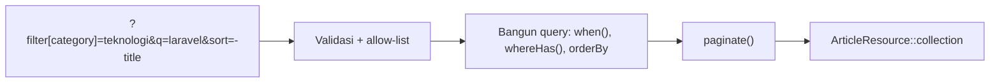

# Penyaringan dan Pencarian API

Klien jarang membutuhkan semua data: mereka ingin artikel dari satu kategori, yang memuat kata tertentu, diurutkan menurut tanggal. Parameter query string (`?kategori=`, `?q=`, `?sort=`) menyediakannya.
Karena masukan ini langsung memengaruhi query database, ia harus dirancang konsisten dan dijaga ketat: *allow-list* kolom, validasi, dan pengindeksan. Sub bab ini menambahkan penyaringan, pencarian, pengurutan,
dan penyertaan relasi pada daftar artikel.

## Tujuan Pembelajaran

Setelah menyelesaikan sub bab ini, kamu dapat:

- [ ] Merancang konvensi parameter: `filter[...]`, `q`, `sort`, `include`.
- [ ] Menerapkan penyaringan dengan `when()` dan scope Eloquent.
- [ ] Menerapkan pengurutan dengan *allow-list* kolom dan arah (`-` untuk menurun).
- [ ] Menerapkan pencarian teks sederhana dengan escape wildcard.
- [ ] Menyertakan relasi opsional lewat `include` dengan *allow-list*.
- [ ] Memvalidasi parameter dan mengindeks kolom yang disaring.

## Prasyarat

- [Paginasi API](06-12-api-pagination.md) dan [Validasi Request API](06-10-api-request-validation.md).
- [Query Eloquent](../level-04/04-16-eloquent-queries.md) dan [Pencegahan SQL Injection](../level-05/05-22-sql-injection-prevention.md).
- Data artikel, kategori, dan tag.

## Pengantar

Tanpa penyaringan, klien mengambil semua halaman lalu menyaring sendiri; boros bagi semua pihak. Dengan penyaringan di server, hanya data relevan yang berjalan lewat jaringan.

## Penjelasan Konsep

### Konvensi parameter

| Kebutuhan | Parameter | Contoh |
|---|---|---|
| Penyaringan | `filter[nama]` | `?filter[category]=teknologi&filter[tag]=php` |
| Pencarian | `q` | `?q=laravel` |
| Pengurutan | `sort` (awalan `-` menurun) | `?sort=-published_at` |
| Relasi | `include` | `?include=category,tags` |
| Paginasi | `page`, `per_page` | `?page=2&per_page=10` |

Konvensi ini mengikuti gaya yang umum pada API JSON. Kunci utamanya: **setiap parameter punya daftar nilai yang diizinkan**.

### Validasi parameter

```php-inline
// IndexArticleRequest::rules()
return [
    'page' => ['sometimes', 'integer', 'min:1'],
    'per_page' => ['sometimes', 'integer', 'between:1,50'],
    'q' => ['sometimes', 'string', 'max:100'],
    'sort' => ['sometimes', 'string', 'in:published_at,-published_at,title,-title'],
    'filter' => ['sometimes', 'array'],
    'filter.category' => ['sometimes', 'string', 'max:100'],
    'filter.tag' => ['sometimes', 'string', 'max:50'],
    'filter.from' => ['sometimes', 'date'],
    'filter.to' => ['sometimes', 'date', 'after_or_equal:filter.from'],
    'include' => ['sometimes', 'string'],
];
```

### Menerapkan di controller

```php-inline
public function index(IndexArticleRequest $request): AnonymousResourceCollection
{
    $filter = $request->input('filter', []);
    [$kolom, $arah] = $this->urutan($request->input('sort', '-published_at'));

    $dibolehkan = ['category', 'tags', 'user'];
    $include = collect(explode(',', (string) $request->input('include')))
        ->filter()->intersect($dibolehkan)->values()->all();

    $articles = Article::published()
        ->search($request->input('q'))
        ->when($filter['category'] ?? null, fn ($q, $slug) => $q->whereHas('category', fn ($c) => $c->where('slug', $slug)))
        ->when($filter['tag'] ?? null, fn ($q, $nama) => $q->whereHas('tags', fn ($t) => $t->where('name', $nama)))
        ->when($filter['from'] ?? null, fn ($q, $d) => $q->whereDate('published_at', '>=', $d))
        ->when($filter['to'] ?? null, fn ($q, $d) => $q->whereDate('published_at', '<=', $d))
        ->with($include ?: ['category:id,name,slug', 'user:id,name'])
        ->withCount('comments')
        ->orderBy($kolom, $arah)
        ->orderByDesc('id')
        ->paginate((int) $request->integer('per_page', 15))
        ->withQueryString();

    return ArticleResource::collection($articles);
}

private function urutan(string $sort): array
{
    $arah = str_starts_with($sort, '-') ? 'desc' : 'asc';
    $kolom = ltrim($sort, '-');

    return [in_array($kolom, ['published_at', 'title'], true) ? $kolom : 'published_at', $arah];
}
```

| Bagian | Fungsi |
|---|---|
| `Article::search()` | Scope pencarian judul (bab Database) |
| `when(...)` | Menerapkan filter hanya bila parameter ada |
| `whereHas` | Menyaring lewat relasi |
| `urutan()` | Memetakan `sort` ke kolom + arah dengan *allow-list* |
| `intersect($dibolehkan)` | `include` hanya relasi yang diizinkan |
| `orderByDesc('id')` | Penentu akhir agar urutan stabil |

Scope `search` mengabaikan istilah kosong; perbaiki agar meng-escape wildcard: di model gunakan `$term = addcslashes($term, '%_\\');` sebelum `like`.

### Pencarian dan kinerja

- `like '%kata%'` tidak memakai indeks biasa; untuk data besar pertimbangkan *full-text* (database mendukung, mis. `whereFullText` di MySQL/PostgreSQL) atau mesin pencari khusus.
- Indeks kolom yang sering disaring/diurutkan: `published_at`, `slug` kategori, kunci asing, dan kolom `name` tag.
- Batasi panjang `q` dan jumlah `include`.

### Respons: `include` dan `whenLoaded`

Resource memakai `whenLoaded`, sehingga relasi muncul hanya bila dimuat (`include`). Klien yang tidak meminta relasi menerima respons ringan.

### Keamanan

- Nama kolom dari `sort` dan `filter` **tidak** di-binding; selalu allow-list.
- Validasi tipe dan panjang; jangan meneruskan array `filter` mentah ke `where`.
- `include` yang tak terbatas dapat memuat data besar atau sensitif; batasi dan otorisasi.
- Batasi kompleksitas query (jumlah filter, kedalaman relasi) untuk mencegah beban berlebihan.

## Cara Kerja



## Contoh Praktik

Kamu menambahkan penyaringan kategori dan tag, rentang tanggal, pencarian, pengurutan, dan `include` pada daftar artikel, lalu menguji kombinasi dan nilai liar, serta memeriksa SQL yang dihasilkan.

## Penjelasan Kode

Kode `IndexArticleRequest` dan controller ada pada bagian konsep. Pastikan model `Article` memiliki scope `search(?string $term)`.

## Implementasi Langkah demi Langkah

### Langkah 1: siapkan data

Buat beberapa kategori dan tag, serta 40 artikel terbit tersebar di antaranya (seeder dari bab Database).

### Langkah 2: perluas request dan controller

Tambahkan aturan dan logika filter/sort/include.

### Langkah 3: uji filter

```bash
curl -s -H "Accept: application/json" "http://127.0.0.1:8000/api/v1/articles?filter[category]=teknologi"
curl -s -H "Accept: application/json" "http://127.0.0.1:8000/api/v1/articles?filter[tag]=php&sort=title"
```

Di PowerShell, kutip URL dan gunakan `curl.exe`; kurung siku dapat perlu di-*encode* (`%5B`, `%5D`).

### Langkah 4: uji pencarian dan rentang tanggal

```bash
curl -s -H "Accept: application/json" "http://127.0.0.1:8000/api/v1/articles?q=laravel"
curl -s -H "Accept: application/json" "http://127.0.0.1:8000/api/v1/articles?filter[from]=2026-01-01&filter[to]=2026-06-30"
```

### Langkah 5: uji nilai liar

```bash
curl -s -o /dev/null -w "%{http_code}\n" -H "Accept: application/json" "http://127.0.0.1:8000/api/v1/articles?sort=password"
curl -s -o /dev/null -w "%{http_code}\n" -H "Accept: application/json" "http://127.0.0.1:8000/api/v1/articles?sort=title;drop%20table%20articles"
curl -s -o /dev/null -w "%{http_code}\n" -H "Accept: application/json" "http://127.0.0.1:8000/api/v1/articles?include=user.password"
```

Harapan: `422` untuk `sort` liar; `include` tak dikenal diabaikan (`200`).

### Langkah 6: periksa SQL

Gunakan `DB::listen` sementara atau `toRawSql()` di Tinker untuk melihat query kombinasi filter; pastikan tidak ada nilai input yang tersambung.

### Langkah 7: catat di Git

```bash
git add app
git commit -m "Tambah penyaringan, pencarian, pengurutan, dan include pada API artikel"
```

## Eksekusi dan Verifikasi

| Langkah | Cara memverifikasi |
|---|---|
| 3 | Hanya artikel kategori/tag yang diminta |
| 4 | Hasil sesuai kata dan rentang tanggal |
| 5 | `sort` liar `422`; `include` liar diabaikan; tabel utuh |
| 6 | SQL memakai binding |

## Hasil yang Diharapkan

| Permintaan | Hasil |
|---|---|
| `?filter[category]=teknologi` | Hanya artikel kategori itu |
| `?sort=-title` | Urut judul menurun |
| `?sort=password` | `422` |
| `?include=category,tags` | Relasi tampil di respons |

Hasil ini diturunkan dari dokumentasi dan belum dijalankan oleh penulis materi; cocokkan dengan hasilmu.

## Kesalahan Umum dan Pemecahan Masalah

| Gejala | Penyebab | Cara mengenali | Solusi | Pencegahan |
|---|---|---|---|---|
| Filter tidak bekerja | Nama parameter salah / `filter` tidak array | Hasil tak berubah | Samakan dengan aturan | Dokumentasikan |
| Hasil campur lintas filter | `orWhere` tidak dikelompokkan | Baris tak terduga | Gunakan `when` terpisah/closure | Uji kombinasi |
| `sort` rawan | Meneruskan input ke `orderBy` | Kolom liar diterima | Allow-list | Validasi `in:` |
| Respons berat | `include` tak dibatasi | Waktu lama | Batasi relasi diizinkan | Allow-list |
| Pencarian lambat | `like '%..%'` | Query lama | Full-text / indeks | Ukur dengan data besar |
| Duplikat setelah `whereHas` tag | Join berulang | Item ganda | Gunakan `whereHas` (bukan join) | Uji dengan banyak tag |

## Latihan Praktik

### Latihan dasar

**D1. Rancang parameter**
- *Masalah:* tentukan konvensi.
- *Persyaratan:* untuk endpoint komentar, tentukan parameter filter (penulis, tanggal), pencarian, dan pengurutan yang diizinkan.
- *Perilaku yang diharapkan:* tabel parameter dengan batas.
- *Tujuan belajar:* merancang kontrak query.

### Latihan implementasi

**I1. Filter multi-nilai**
- *Masalah:* beberapa kategori sekaligus.
- *Persyaratan:* dukung `filter[category]=teknologi,olahraga` (maksimal 5) dengan `whereIn` pada slug, validasi jumlah, dan uji.
- *Perilaku yang diharapkan:* artikel dari salah satu kategori.
- *Tujuan belajar:* filter multi-nilai aman.

**I2. Pencarian aman**
- *Masalah:* `q=100%` mencocokkan semuanya.
- *Persyaratan:* escape wildcard di scope `search`, uji `%`, `_`, dan `\`.
- *Perilaku yang diharapkan:* karakter diperlakukan literal.
- *Tujuan belajar:* pencarian `LIKE` aman.

### Latihan tantangan

**T1. Ekstrak penyaring**
- *Masalah:* logika filter makin panjang di controller.
- *Persyaratan:* ekstrak ke kelas `ArticleFilter` (menerima array parameter, mengembalikan builder) dan tunjukkan bahwa controller kembali ringkas serta pengujian filter menjadi mudah.
- *Perilaku yang diharapkan:* perilaku sama, kode terstruktur.
- *Tujuan belajar:* mengorganisasi logika query.
- *Catatan:* kerjakan mandiri; tidak ada kunci jawaban.

## Uji Pemahaman

1. Mengapa `sort` memakai allow-list?
2. Apa fungsi `include`?
3. Mengapa `whereHas` dipakai untuk filter relasi?
4. Apa risiko `like '%kata%'` pada data besar?
5. Mengapa parameter divalidasi?
6. Bagaimana menjaga urutan stabil?

??? success "Kunci jawaban singkat"
    1. Nama kolom tidak di-binding sehingga rawan injeksi.
    2. Meminta relasi tambahan dalam respons.
    3. Menyaring induk berdasarkan kondisi relasi tanpa duplikasi baris.
    4. Tidak memakai indeks sehingga lambat.
    5. Mencegah nilai liar dan beban berlebih.
    6. Tambahkan kolom unik (`id`) sebagai penentu akhir.

## Ringkasan

- Gunakan konvensi `filter[...]`, `q`, `sort`, `include`, `page`, `per_page`.
- Allow-list kolom, arah, dan relasi; validasi semua parameter.
- Terapkan filter dengan `when`/scope; indeks kolom yang disaring.
- Waspadai pencarian `like` dan kompleksitas query.

Selanjutnya: *Autentikasi API*, bagaimana klien membuktikan identitasnya tanpa sesi.

## Referensi Resmi

- [Laravel: Conditional Clauses](https://laravel.com/docs/13.x/queries#conditional-clauses)
- [Laravel: Querying Relationship Existence](https://laravel.com/docs/13.x/eloquent-relationships#querying-relationship-existence)
- [Laravel: Full Text Where Clauses](https://laravel.com/docs/13.x/queries#full-text-where-clauses)
