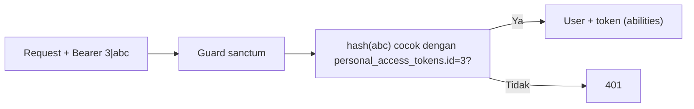

# Laravel Sanctum

**Laravel Sanctum** adalah paket resmi untuk autentikasi API yang ringan: token akses pribadi untuk aplikasi seluler dan pihak ketiga, serta autentikasi sesi berbasis cookie untuk SPA. Sub bab ini memasang
Sanctum pada proyek `cms-artikel`, memeriksa apa yang berubah, dan menyiapkan model `User`. Ini **dependensi tambahan** (`laravel/sanctum`) yang sudah disetujui untuk materi ini.

## Tujuan Pembelajaran

Setelah menyelesaikan sub bab ini, kamu dapat:

- [ ] Menjelaskan apa yang disediakan Sanctum dan tabel `personal_access_tokens`.
- [ ] Memasang Sanctum dengan `php artisan install:api` dan memeriksa perubahan secara aman.
- [ ] Menambahkan trait `HasApiTokens` pada model `User`.
- [ ] Menjelaskan guard `sanctum` dan middleware `auth:sanctum`.
- [ ] Menerbitkan dan memakai token pertama lewat Tinker.
- [ ] Menjelaskan bahwa token disimpan sebagai hash.

## Prasyarat

- [Autentikasi API](06-14-api-authentication.md) dan [Routing API](06-06-api-routing.md).
- Git bersih (semua perubahan sebelumnya sudah di-*commit*), Composer, dan koneksi internet.
- Proyek `cms-artikel` dengan `routes/api.php` yang sudah didaftarkan manual.

## Pengantar

Kunci API tunggal dari sub bab 06.08 hanyalah penahan sementara. Sanctum menggantinya dengan token per pengguna/perangkat yang dapat dicabut dan punya cakupan hak.

## Penjelasan Konsep

### Apa yang disediakan Sanctum

| Fitur | Untuk |
|---|---|
| Token akses pribadi (`createToken`) | Aplikasi seluler, skrip, integrasi |
| Abilities | Membatasi hak per token |
| Autentikasi sesi untuk SPA | SPA sedomain: cookie + CSRF |
| Guard `sanctum` | `auth:sanctum` pada route |

Menurut dokumentasi, token API di-*hash* (SHA-256) di tabel `personal_access_tokens`; nilai polos hanya ditampilkan sekali saat dibuat.

### Pemasangan

Dokumentasi menyatakan `install:api` memasang Sanctum dan membuat `routes/api.php`. Karena proyek ini sudah punya `routes/api.php` dan `withRouting(api: ...)`, periksa perubahan perintah itu dengan hati-hati:

```bash
git status                 # pastikan bersih
php artisan install:api
git diff
```

Hal yang perlu diperiksa pada `git diff`:

| Berkas | Periksa |
|---|---|
| `composer.json` / `composer.lock` | `laravel/sanctum` ditambahkan |
| `bootstrap/app.php` | Hanya **satu** argumen `api:` pada `withRouting` (hapus duplikat bila perintah menambahnya lagi) |
| `routes/api.php` | Route `ping`/`v1` milikmu masih ada dan tidak tertimpa |
| `database/migrations/*personal_access_tokens*` | Migration tabel token baru |
| `config/sanctum.php` | Berkas konfigurasi (bila dipublikasikan) |

Jika perintah menanyakan apakah migrasi dijalankan, jawab ya, atau jalankan sendiri:

```bash
php artisan migrate
php artisan db:table personal_access_tokens
```

Perintah ini memasang paket dari Packagist; pastikan kamu mempercayai sumber dan lisensinya (paket resmi Laravel, MIT).

### Model `User`

File: `app/Models/User.php`

```php
use Laravel\Sanctum\HasApiTokens;

class User extends Authenticatable implements MustVerifyEmail
{
    use HasApiTokens, HasFactory, Notifiable;
    // ...
}
```

Trait menyediakan `createToken()`, relasi `tokens()`, `currentAccessToken()`, `tokenCan()`, dan `tokenCant()`.

### Melindungi route

```php-inline
Route::get('/me', fn (Request $request) => $request->user())->middleware('auth:sanctum');
```

`auth:sanctum` memakai guard `sanctum`: ia mencari token Bearer di header (dan, untuk SPA sedomain, cookie sesi). Bila tidak valid, tamu mendapat `401` JSON.

### Token pertama (Tinker)

```php-inline
$user = App\Models\User::first();
$token = $user->createToken('percobaan', ['articles:read']);
$token->plainTextToken;          // "id|tokenAcak" — simpan; hanya tampil sekali
$user->tokens()->count();
```

Format `id|token`: bagian `id` adalah ID baris di `personal_access_tokens`, bagian setelah `|` adalah rahasia acak yang di-hash di database.

### Konfigurasi penting

| Pengaturan | Fungsi |
|---|---|
| `sanctum.expiration` | Umur token (menit); `null` = tidak kedaluwarsa |
| `sanctum.token_prefix` | Awalan token untuk membantu pemindai rahasia |
| `sanctum.stateful` | Domain SPA yang memakai sesi |

Nilai bawaan tidak membuat token kedaluwarsa; atur `expiration` sesuai kebijakan (sub bab 06.16).

### Keamanan

- Pasang paket hanya dari sumber resmi dan periksa `git diff` perintah instalasi.
- Token polos adalah rahasia: jangan di-*commit*, dicatat di log, atau dikirim lewat URL.
- Jalankan `composer audit` secara berkala untuk memantau kerentanan dependensi.

## Cara Kerja



## Contoh Praktik

Kamu memasang Sanctum dengan hati-hati, memeriksa perubahan, menambah trait, menerbitkan token lewat Tinker, dan memakainya pada route `/me`.

## Penjelasan Kode

Kode ada pada bagian konsep. Tambahkan route sementara `/api/v1/me` seperti di atas untuk menguji token.

## Implementasi Langkah demi Langkah

### Langkah 1: pastikan Git bersih

```bash
cd ~/belajar-laravel/cms-artikel
git status
```

Commit semua perubahan sebelum lanjut.

### Langkah 2: pasang Sanctum

```bash
php artisan install:api
git diff --stat
```

Baca diff dan perbaiki duplikasi `api:` di `bootstrap/app.php` bila ada.

### Langkah 3: migrasi dan periksa tabel

```bash
php artisan migrate
php artisan db:table personal_access_tokens
```

### Langkah 4: tambah trait dan route uji

Tambahkan `HasApiTokens` pada `User` dan route `GET /api/v1/me` dengan `auth:sanctum` di grup `v1`.

### Langkah 5: terbitkan token dan uji

```bash
php artisan tinker --execute="echo App\Models\User::first()->createToken('percobaan', ['articles:read'])->plainTextToken;"
```

```bash
TOKEN=isi_token_lengkap
curl -s -i -H "Accept: application/json" http://127.0.0.1:8000/api/v1/me
curl -s -i -H "Accept: application/json" -H "Authorization: Bearer $TOKEN" http://127.0.0.1:8000/api/v1/me
```

### Langkah 6: periksa penyimpanan hash

```bash
php artisan tinker --execute="dump(DB::table('personal_access_tokens')->first());"
```

Kolom `token` berisi hash (64 karakter heksadesimal), bukan token polos.

### Langkah 7: catat di Git

```bash
git add composer.json composer.lock bootstrap config database app routes
git commit -m "Pasang Laravel Sanctum"
```

## Eksekusi dan Verifikasi

| Langkah | Cara memverifikasi |
|---|---|
| 2 | `composer.json` memuat `laravel/sanctum`; satu `api:` di `bootstrap/app.php` |
| 3 | Tabel `personal_access_tokens` ada |
| 5 | Tanpa token `401`; dengan token `200` berisi data pengguna |
| 6 | Kolom `token` berupa hash |

## Hasil yang Diharapkan

| Permintaan | Hasil |
|---|---|
| `GET /api/v1/me` tanpa token | `401` JSON |
| `GET /api/v1/me` dengan token valid | `200` data pengguna (tanpa `password`) |

Perilaku `install:api` pada proyek yang sudah memiliki `routes/api.php` belum dijalankan oleh penulis; periksa `git diff` dan cocokkan dengan hasilmu.

## Kesalahan Umum dan Pemecahan Masalah

| Gejala | Penyebab | Cara mengenali | Solusi | Pencegahan |
|---|---|---|---|---|
| Dua argumen `api:` | Perintah menambah ulang | Galat sintaks/argumen ganda | Hapus satu | Baca `git diff` |
| `Call to undefined method createToken()` | Trait belum ditambahkan | Galat | `use HasApiTokens` | Periksa model |
| `401` dengan token benar | Token terpotong / spasi | Selalu 401 | Salin token lengkap (bagian id, tanda pipa, dan rahasia) | Gunakan variabel shell |
| Tabel tidak ada | Migrasi belum jalan | Galat SQL | `php artisan migrate` | Cek `migrate:status` |
| Route `/me` mengembalikan HTML | Tidak mengirim `Accept` | Redirect ke login | Kirim header / aturan global | Penanganan 06.11 |
| `composer require` gagal | Jaringan/versi PHP | Galat Composer | Periksa koneksi dan PHP | Gunakan PHP 8.3+ |

## Latihan Praktik

### Latihan dasar

**D1. Anatomi token**
- *Masalah:* ingin memahami format.
- *Persyaratan:* terbitkan token, pisahkan `id` dan bagian rahasia, dan temukan baris yang sesuai di `personal_access_tokens`.
- *Perilaku yang diharapkan:* `id` cocok dengan kolom `id`; rahasia tidak ada di database.
- *Tujuan belajar:* memahami penyimpanan token.

### Latihan implementasi

**I1. Daftar token**
- *Masalah:* pengguna ingin melihat tokennya.
- *Persyaratan:* buat `GET /api/v1/tokens` (auth:sanctum) yang mengembalikan nama, abilities, `last_used_at`, dan `created_at` tanpa token.
- *Perilaku yang diharapkan:* daftar tanpa nilai rahasia.
- *Tujuan belajar:* mengelola token.

### Latihan tantangan

**T1. Tinjau dependensi**
- *Masalah:* tim menilai paket baru.
- *Persyaratan:* periksa `composer show laravel/sanctum`, `composer licenses`, dan `composer audit`, dan tulis catatan keputusan (versi, lisensi, status pemeliharaan).
- *Perilaku yang diharapkan:* catatan singkat yang dapat dipertanggungjawabkan.
- *Tujuan belajar:* mengevaluasi dependensi.
- *Catatan:* kerjakan mandiri; tidak ada kunci jawaban.

## Uji Pemahaman

1. Apa fungsi Sanctum?
2. Mengapa token disimpan sebagai hash?
3. Apa fungsi `HasApiTokens`?
4. Apa yang dilakukan `auth:sanctum`?
5. Mengapa periksa `git diff` setelah `install:api`?
6. Bagaimana format token polos?

??? success "Kunci jawaban singkat"
    1. Autentikasi token pribadi dan sesi SPA.
    2. Agar pencurian database tidak membocorkan token berlaku.
    3. Menyediakan `createToken`, `tokens()`, `tokenCan`, dan lainnya pada `User`.
    4. Mewajibkan autentikasi lewat guard `sanctum`.
    5. Memastikan perubahan tidak menimpa konfigurasi routing yang sudah ada.
    6. `id|tokenAcak`.

## Ringkasan

- Sanctum menyediakan token pribadi (hash di database) dan sesi SPA.
- `install:api` memasang paket dan migrasi; periksa `git diff` pada proyek yang sudah punya `routes/api.php`.
- `HasApiTokens` dan `auth:sanctum` mengaktifkan penerbitan dan pemeriksaan token.
- Atur kedaluwarsa dan jaga kerahasiaan token.

Selanjutnya: *Autentikasi Berbasis Token*, endpoint login, logout, dan pengelolaan token.

## Referensi Resmi

- [Laravel: Sanctum](https://laravel.com/docs/13.x/sanctum)
- [Laravel: Installation of Sanctum](https://laravel.com/docs/13.x/sanctum#installation)
- [Laravel: API Token Authentication](https://laravel.com/docs/13.x/sanctum#api-token-authentication)
