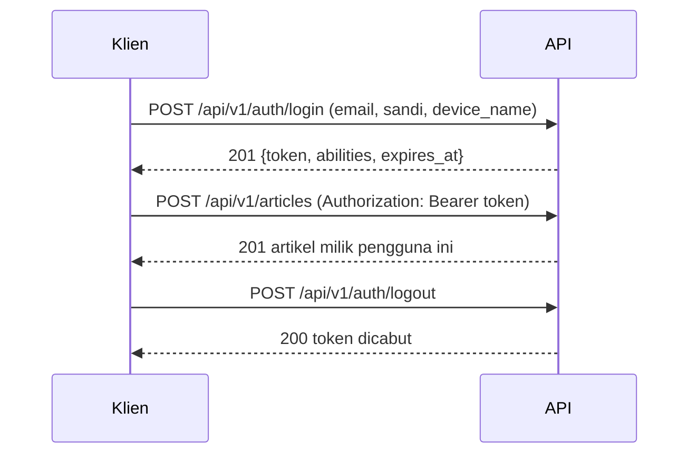

# Autentikasi Berbasis Token

Sanctum sudah terpasang; sekarang kamu membangun alur lengkapnya: endpoint login yang menerbitkan token, endpoint untuk melihat pengguna saat ini, logout yang mencabut token, daftar dan pencabutan token, serta
mengganti kunci API sementara dengan `auth:sanctum` pada endpoint tulis. Pemilik artikel kini ditetapkan dari token, bukan dari input klien.

## Tujuan Pembelajaran

Setelah menyelesaikan sub bab ini, kamu dapat:

- [ ] Membuat endpoint login API yang menerbitkan token dengan nama perangkat, abilities, dan kedaluwarsa.
- [ ] Membuat endpoint `me` dan logout (mencabut token saat ini atau semua token).
- [ ] Mengganti `api.key` dengan `auth:sanctum` pada route tulis.
- [ ] Menetapkan pemilik artikel dari `$request->user()` dan menghapus `user_id` dari input.
- [ ] Menerapkan batas laju dan pesan galat umum pada login.
- [ ] Menguji alur dengan `curl` dan membaca status 401/422/200.

## Prasyarat

- [Laravel Sanctum](06-15-laravel-sanctum.md) dan [Hashing Kata Sandi](../level-05/05-12-password-hashing.md).
- [Pembatasan Laju](../level-05/05-24-rate-limiting.md) dan [Penanganan Error API](06-11-api-error-handling.md).
- Akun uji `ani@contoh.test` (kata sandi `password`, email terverifikasi).

## Pengantar

Klien seluler tidak punya form login Blade. Ia mengirim email dan kata sandi ke endpoint API, menerima token, menyimpannya di penyimpanan aman perangkat, dan mengirimkannya di tiap permintaan berikutnya.

## Penjelasan Konsep

### Login API

File: `app/Http/Controllers/Api/V1/AuthController.php`

```php
<?php

namespace App\Http\Controllers\Api\V1;

use App\Enums\UserRole;
use App\Http\Controllers\Controller;
use App\Models\User;
use Illuminate\Http\JsonResponse;
use Illuminate\Http\Request;
use Illuminate\Support\Facades\Hash;
use Illuminate\Validation\ValidationException;

class AuthController extends Controller
{
    public function login(Request $request): JsonResponse
    {
        $data = $request->validate([
            'email' => ['required', 'email'],
            'password' => ['required', 'string'],
            'device_name' => ['required', 'string', 'max:100'],
        ]);

        $user = User::where('email', $data['email'])->first();

        if (! $user || ! Hash::check($data['password'], $user->password)) {
            throw ValidationException::withMessages(['email' => ['Email atau kata sandi salah.']]);
        }

        abort_unless($user->hasVerifiedEmail(), 403, 'Email belum terverifikasi.');

        $abilities = $user->hasRole(UserRole::Admin, UserRole::Editor)
            ? ['articles:read', 'articles:write', 'comments:moderate']
            : ['articles:read', 'articles:write'];

        $token = $user->createToken($data['device_name'], $abilities, now()->addWeeks(2));

        return response()->json([
            'data' => [
                'token' => $token->plainTextToken,
                'type' => 'Bearer',
                'expires_at' => $token->accessToken->expires_at?->toIso8601String(),
                'abilities' => $abilities,
            ],
        ], 201);
    }

    public function me(Request $request): JsonResponse
    {
        $user = $request->user();

        return response()->json(['data' => [
            'id' => $user->id,
            'name' => $user->name,
            'email' => $user->email,
            'role' => $user->role->value,
        ]]);
    }

    public function logout(Request $request): JsonResponse
    {
        $request->user()->currentAccessToken()->delete();

        return response()->json(['message' => 'Token dicabut.']);
    }

    public function logoutAll(Request $request): JsonResponse
    {
        $request->user()->tokens()->delete();

        return response()->json(['message' => 'Semua token dicabut.']);
    }
}
```

| Bagian | Fungsi |
|---|---|
| `Hash::check` | Verifikasi kata sandi; pesan sama untuk email salah dan sandi salah |
| `ValidationException::withMessages` | Galat 422 seragam (pola dokumentasi Sanctum untuk login seluler) |
| `hasVerifiedEmail()` | Menolak akun belum terverifikasi |
| abilities berdasarkan peran | Hak terkecil per token |
| `now()->addWeeks(2)` | Kedaluwarsa token individual (argumen ketiga) |
| `plainTextToken` | Nilai polos, hanya dikembalikan sekali |
| `currentAccessToken()->delete()` | Logout perangkat ini |
| `tokens()->delete()` | Logout semua perangkat |

### Route

```php-inline
use App\Http\Controllers\Api\V1\AuthController;

Route::prefix('auth')->name('auth.')->group(function () {
    Route::post('/login', [AuthController::class, 'login'])->middleware('throttle:api-login')->name('login');

    Route::middleware('auth:sanctum')->group(function () {
        Route::get('/me', [AuthController::class, 'me'])->name('me');
        Route::post('/logout', [AuthController::class, 'logout'])->name('logout');
        Route::post('/logout-all', [AuthController::class, 'logoutAll'])->name('logout-all');
    });
});

Route::middleware('auth:sanctum')->group(function () {
    Route::apiResource('articles', ArticleController::class)->scoped(['article' => 'slug'])->only(['store', 'update', 'destroy']);
});
```

Pembatas login (di `AppServiceProvider::boot()`):

```php
RateLimiter::for('api-login', function (Request $request) {
    return [
        Limit::perMinute(20)->by($request->ip()),
        Limit::perMinute(5)->by(strtolower((string) $request->input('email'))),
    ];
});
```

### Pemilik dari token

Pada `StoreArticleRequest` hapus aturan `user_id`. Pada controller:

```php
$article->user()->associate($request->user());
```

Klien tidak lagi dapat menentukan pemilik. Kunci API sementara (`EnsureApiKey`) dapat dihapus.

### Kedaluwarsa dan pemangkasan

Selain kedaluwarsa per token, atur `sanctum.expiration` sebagai batas global dan jadwalkan pemangkasan (`Schedule::command('sanctum:prune-expired --hours=24')->daily();` pada `routes/console.php`) agar token kedaluwarsa tidak menumpuk.

### Alur klien



### Keamanan

- Pesan login seragam dan dibatasi laju (per IP dan per email).
- Token hanya muncul sekali dan tidak pernah dicatat di log.
- Kedaluwarsa dan pencabutan wajib tersedia.
- Klien menyimpan token di penyimpanan aman (Keychain/Keystore), bukan teks polos.

## Cara Kerja

Login memverifikasi kredensial lalu membuat baris di `personal_access_tokens` (hash token, abilities, kedaluwarsa). Setiap permintaan berikutnya dicocokkan oleh guard `sanctum`; `logout` menghapus baris itu sehingga token
seketika tidak berlaku.

## Contoh Praktik

Kamu membangun alur login-token-logout, memindahkan perlindungan endpoint tulis ke `auth:sanctum`, menetapkan pemilik dari token, dan menguji skenario sukses serta gagal.

## Penjelasan Kode

Kode ada pada bagian konsep. Ubah `Api\V1\ArticleController@store` agar memakai `$request->user()` sebagai pemilik, dan hapus `api.key` pada grup tulis.

## Implementasi Langkah demi Langkah

### Langkah 1: buat controller, route, dan pembatas

Isi `AuthController`, route, dan `RateLimiter::for('api-login', ...)`.

### Langkah 2: ubah endpoint tulis

Ganti `api.key` dengan `auth:sanctum`, hapus `user_id` dari validasi, dan `associate($request->user())`.

### Langkah 3: login

```bash
curl -s -i -X POST -H "Accept: application/json" -H "Content-Type: application/json" \
  -d '{"email":"ani@contoh.test","password":"password","device_name":"uji-curl"}' http://127.0.0.1:8000/api/v1/auth/login
```

Simpan `token` dari `data.token` ke variabel `TOKEN`.

### Langkah 4: gunakan token

```bash
curl -s -H "Accept: application/json" -H "Authorization: Bearer $TOKEN" http://127.0.0.1:8000/api/v1/auth/me
curl -s -i -X POST -H "Accept: application/json" -H "Content-Type: application/json" -H "Authorization: Bearer $TOKEN" \
  -d '{"title":"Artikel Ani via API","body":"Isi"}' http://127.0.0.1:8000/api/v1/articles
```

Artikel baru berpemilik Ani (periksa `user_id` di database).

### Langkah 5: uji kegagalan

```bash
curl -s -o /dev/null -w "%{http_code}\n" -X POST -H "Accept: application/json" -H "Content-Type: application/json" -d '{"title":"x","body":"y"}' http://127.0.0.1:8000/api/v1/articles
curl -s -i -X POST -H "Accept: application/json" -H "Content-Type: application/json" -d '{"email":"ani@contoh.test","password":"salah","device_name":"x"}' http://127.0.0.1:8000/api/v1/auth/login
```

Harapan: `401` tanpa token; `422` dengan pesan umum untuk kata sandi salah. Ulangi login salah 6 kali untuk melihat `429`.

### Langkah 6: logout

```bash
curl -s -X POST -H "Accept: application/json" -H "Authorization: Bearer $TOKEN" http://127.0.0.1:8000/api/v1/auth/logout
curl -s -o /dev/null -w "%{http_code}\n" -H "Accept: application/json" -H "Authorization: Bearer $TOKEN" http://127.0.0.1:8000/api/v1/auth/me
```

Setelah logout, `me` menghasilkan `401`.

### Langkah 7: catat di Git

```bash
git add app routes
git commit -m "Tambah autentikasi API berbasis token Sanctum"
```

## Eksekusi dan Verifikasi

| Langkah | Cara memverifikasi |
|---|---|
| 3 | `201` dengan token, abilities, dan `expires_at` |
| 4 | `me` mengembalikan pengguna; artikel baru berpemilik Ani |
| 5 | `401` tanpa token; `422` untuk sandi salah; `429` setelah banyak percobaan |
| 6 | Token tidak berlaku setelah logout |

## Hasil yang Diharapkan

| Permintaan | Hasil |
|---|---|
| Login benar | `201` `{"data":{"token":"N|...","type":"Bearer","expires_at":"...","abilities":[...]}}` |
| Login salah | `422` `{"message":"Email atau kata sandi salah.","errors":{"email":[...]}}` |
| `POST /articles` tanpa token | `401` |
| `me` setelah logout | `401` |

Hasil ini diturunkan dari dokumentasi dan belum dijalankan oleh penulis materi; cocokkan dengan hasilmu.

## Kesalahan Umum dan Pemecahan Masalah

| Gejala | Penyebab | Cara mengenali | Solusi | Pencegahan |
|---|---|---|---|---|
| Login `500` | Trait `HasApiTokens` hilang | Galat `createToken` | Tambahkan trait | Ikuti 06.15 |
| Selalu `403` pada login | Email belum terverifikasi | Pesan belum terverifikasi | Verifikasi akun uji | Data uji lengkap |
| Artikel berpemilik `null` | Lupa `associate($request->user())` | `user_id` kosong | Perbaiki controller | Pemilik dari token |
| Token tidak berlaku | Kedaluwarsa / dicabut | `401` | Login ulang | Tampilkan `expires_at` |
| `429` terlalu cepat saat uji | Pembatas aktif | Status 429 | `php artisan cache:clear` | Kenali batas |
| Token tertulis di log | Mencatat body login/respons | Token di `laravel.log` | Hapus pencatatan | Jangan catat rahasia |
| Pesan login berbeda | Dua cabang pesan | Enumerasi | Satu pesan | Uji kedua kasus |

## Latihan Praktik

### Latihan dasar

**D1. Daftar token sendiri**
- *Masalah:* pengguna ingin melihat tokennya.
- *Persyaratan:* buat `GET /api/v1/auth/tokens` yang mengembalikan nama, abilities, `last_used_at`, dan `expires_at` tanpa nilai token.
- *Perilaku yang diharapkan:* daftar tanpa rahasia.
- *Tujuan belajar:* mengelola token.

### Latihan implementasi

**I1. Cabut token tertentu**
- *Masalah:* satu perangkat hilang.
- *Persyaratan:* buat `DELETE /api/v1/auth/tokens/{id}` yang hanya mencabut token milik pengguna yang sedang masuk (`$request->user()->tokens()->whereKey($id)->delete()`), 204 bila ada, 404 bila tidak.
- *Perilaku yang diharapkan:* token orang lain tidak dapat dicabut.
- *Tujuan belajar:* otorisasi pengelolaan token.

**I2. Ganti kata sandi mencabut token lain**
- *Masalah:* keamanan akun.
- *Persyaratan:* buat `PUT /api/v1/auth/password` yang memeriksa sandi lama, mengubah sandi, dan mencabut semua token selain token saat ini.
- *Perilaku yang diharapkan:* token lain tidak berlaku.
- *Tujuan belajar:* menanggapi perubahan kredensial.

### Latihan tantangan

**T1. Token pembaruan**
- *Masalah:* token berumur pendek mengharuskan login ulang.
- *Persyaratan:* rancang alur token akses berumur pendek + token penyegar (*refresh*) dengan rotasi dan pendeteksian penggunaan ulang, serta jelaskan kompromi dibanding token berumur panjang.
- *Perilaku yang diharapkan:* rancangan konsisten.
- *Tujuan belajar:* memahami rotasi token.
- *Catatan:* kerjakan mandiri; tidak ada kunci jawaban.

## Uji Pemahaman

1. Mengapa pesan login seragam?
2. Apa beda `logout` dan `logout-all`?
3. Mengapa pemilik artikel dari `$request->user()`?
4. Apa fungsi argumen ketiga `createToken`?
5. Mengapa membatasi laju login per email dan per IP?
6. Mengapa token hanya tampil sekali?

??? success "Kunci jawaban singkat"
    1. Mencegah enumerasi akun.
    2. `logout` mencabut token saat ini; `logout-all` semua token pengguna.
    3. Agar klien tidak dapat memalsukan pemilik.
    4. Waktu kedaluwarsa token.
    5. Melindungi dari brute force terarah dan serangan massal.
    6. Server hanya menyimpan hash dan tidak dapat menampilkannya lagi.

## Ringkasan

- Login API menerbitkan token (dengan nama perangkat, abilities, kedaluwarsa); `me` dan `logout` melengkapi alur.
- Ganti kunci API sementara dengan `auth:sanctum`; pemilik ditetapkan dari token.
- Pesan seragam, batas laju, dan pencabutan menjaga keamanan.
- Pangkas token kedaluwarsa dan jangan catat rahasia.

Selanjutnya: *Otorisasi API*, memadukan abilities token dan Policy.

## Referensi Resmi

- [Laravel: Issuing API Tokens](https://laravel.com/docs/13.x/sanctum#issuing-api-tokens)
- [Laravel: Mobile Application Authentication](https://laravel.com/docs/13.x/sanctum#mobile-application-authentication)
- [Laravel: Revoking Tokens](https://laravel.com/docs/13.x/sanctum#revoking-tokens)
- [Laravel: Token Expiration](https://laravel.com/docs/13.x/sanctum#token-expiration)
