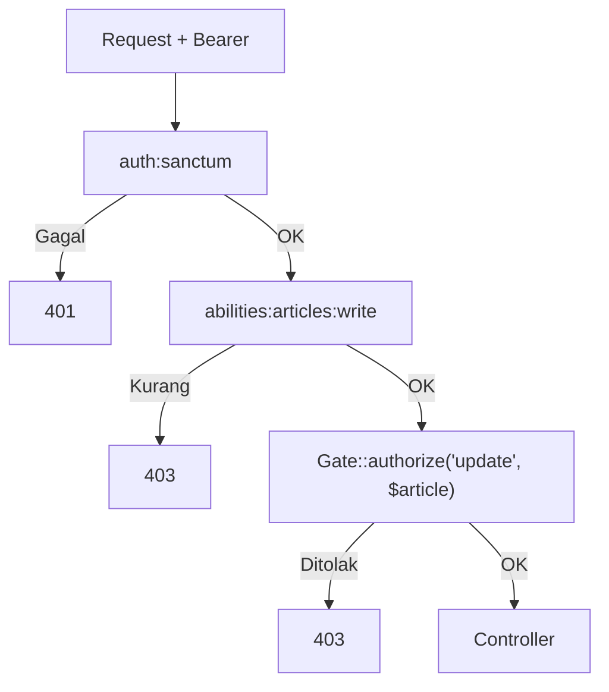

# Otorisasi API

Autentikasi memastikan siapa pemanggilnya; otorisasi memastikan apa yang boleh ia lakukan. Pada API ada dua lapis: **abilities token** (apa yang boleh dilakukan token ini) dan **Policy** (apa yang boleh
dilakukan pengguna ini pada objek ini). Sub bab ini memadukan keduanya pada endpoint artikel dan komentar, serta menangani artikel draf yang hanya boleh dilihat pemilik atau admin.

## Tujuan Pembelajaran

Setelah menyelesaikan sub bab ini, kamu dapat:

- [ ] Memasang middleware `abilities` dan `ability` dan memahami perbedaannya.
- [ ] Menerapkan Policy yang sama (`ArticlePolicy`) pada controller API dengan `Gate::authorize`.
- [ ] Memahami bahwa token membatasi, bukan menambah, hak pengguna.
- [ ] Menangani akses opsional (guard `sanctum`) pada endpoint publik.
- [ ] Memastikan 401, 403, dan 404 dipakai dengan benar pada API.
- [ ] Menguji matriks hak akses API untuk beberapa peran dan token.

## Prasyarat

- [Autentikasi Berbasis Token](06-16-token-based-authentication.md) dan [Policy](../level-05/05-18-policies.md).
- [Role-Based Access Control](../level-05/05-19-role-based-access-control.md) dan [Otorisasi](../level-05/05-16-authorization.md).
- Akun `admin@contoh.test`, `ani@contoh.test`, `budi@contoh.test`.

## Pengantar

Token dengan ability `articles:write` milik Ani tetap tidak boleh mengubah artikel Budi. Dan token Ani yang hanya berability `articles:read` tidak boleh menulis sama sekali walau Ani sendiri pemilik artikelnya.
Kedua pemeriksaan harus lolos.

## Penjelasan Konsep

### Dua lapis

| Lapis | Pertanyaan | Alat |
|---|---|---|
| Ability token | Apakah token ini diberi izin untuk jenis aksi ini? | `abilities:`/`ability:` middleware, `tokenCan()` |
| Policy | Apakah pengguna ini berhak atas objek ini? | `Gate::authorize`, `->can(...)` |

Hak efektif = irisan keduanya (aksi harus diizinkan token **dan** Policy).

### Middleware abilities

Daftarkan alias (dokumentasi Sanctum) di `bootstrap/app.php`:

```php
use Laravel\Sanctum\Http\Middleware\CheckAbilities;
use Laravel\Sanctum\Http\Middleware\CheckForAnyAbility;

->withMiddleware(function (Middleware $middleware): void {
    $middleware->alias([
        'abilities' => CheckAbilities::class,    // semua ability harus ada
        'ability' => CheckForAnyAbility::class,  // minimal satu ability
    ]);
})
```

Terapkan:

```php-inline
Route::middleware(['auth:sanctum', 'abilities:articles:write'])->group(function () {
    Route::apiResource('articles', ArticleController::class)->scoped(['article' => 'slug'])->only(['store', 'update', 'destroy']);
});
```

Token tanpa ability itu mendapat `403` (pengecualian `MissingAbilityException` atau sejenisnya; seragamkan di penanganan galat bila perlu). Karena nilai ability mengandung `:`, tulis penuh setelah `abilities:`
dengan pemisah koma untuk beberapa ability.

### Policy di controller API

```php
use Illuminate\Support\Facades\Gate;

public function update(UpdateArticleRequest $request, Article $article): ArticleResource
{
    Gate::authorize('update', $article);
    // ...
}

public function destroy(Article $article): Response
{
    Gate::authorize('delete', $article);
    $article->delete();

    return response()->noContent();
}

public function store(StoreArticleRequest $request): JsonResponse
{
    Gate::authorize('create', Article::class);
    // ...
}
```

`ArticlePolicy` dari bab 05 digunakan apa adanya, termasuk aturan peran. `Gate::authorize` melempar `AuthorizationException` → `403` JSON seragam (sub bab 06.11).

### Pemeriksaan ability di kode

```php-inline
abort_unless($request->user()->tokenCan('comments:moderate'), 403);
```

Menurut dokumentasi, `tokenCan` selalu `true` untuk permintaan SPA yang diautentikasi sesi (bukan token); karena itu **Policy tetap wajib** sebagai penentu hak pengguna.

### Akses opsional pada endpoint publik

Draf hanya boleh dilihat pemilik atau admin. Endpoint `show` publik namun dapat menerima token opsional:

```php
public function show(Request $request, Article $article): ArticleResource
{
    $user = $request->user('sanctum');   // null bila tidak ada token valid

    abort_unless($article->is_published || ($user && $user->can('view', $article)), 404);

    return new ArticleResource($article->load(['category', 'user', 'tags'])->loadCount('comments'));
}
```

`$request->user('sanctum')` membaca guard `sanctum` tanpa mewajibkan autentikasi. Draf yang tidak boleh dilihat dijawab `404`, menyembunyikan keberadaannya.

### Kode status yang benar

| Situasi | Kode |
|---|---|
| Tanpa token / token tidak valid / kedaluwarsa | 401 |
| Token valid tetapi ability kurang | 403 |
| Policy menolak | 403 |
| Data tak boleh diketahui keberadaannya (draf orang lain) | 404 |

### Keamanan

- Beri ability sempit saat menerbitkan token; jangan `['*']` kecuali terpaksa.
- Jangan pernah mengandalkan ability saja; selalu Policy untuk hak per objek.
- Daftar (`index`) harus memfilter data sesuai hak agar tidak membocorkan draf lewat daftar atau paginasi.
- Uji IDOR dengan dua akun berbeda pada setiap endpoint yang menerima ID/slug.

## Cara Kerja



## Contoh Praktik

Kamu menambahkan middleware ability dan Policy pada endpoint artikel, mengizinkan penulis melihat drafnya sendiri via token, dan menguji matriks: token read-only, token write, pemilik, bukan pemilik, editor, dan admin.

## Penjelasan Kode

Kode ada pada bagian konsep. Terbitkan token uji dengan ability berbeda untuk Ani lewat Tinker: `createToken('baca', ['articles:read'])` dan `createToken('tulis', ['articles:read','articles:write'])`.

## Implementasi Langkah demi Langkah

### Langkah 1: daftarkan alias dan pasang middleware

Tambahkan alias `abilities`/`ability` dan terapkan pada grup tulis.

### Langkah 2: tambahkan `Gate::authorize`

Terapkan pada `store`, `update`, dan `destroy`; ubah `show` seperti di atas.

### Langkah 3: siapkan token dan data

```php-inline
$ani = App\Models\User::where('email','ani@contoh.test')->first();
$baca = $ani->createToken('baca', ['articles:read'])->plainTextToken;
$tulis = $ani->createToken('tulis', ['articles:read', 'articles:write'])->plainTextToken;
```

Pastikan ada artikel Ani (draf) dan artikel Budi.

### Langkah 4: uji matriks

| Pelaku (token) | Aksi | Harapan |
|---|---|---|
| Ani `baca` | `POST /articles` | 403 (ability) |
| Ani `tulis` | `PATCH` artikel Ani | 200 |
| Ani `tulis` | `PATCH` artikel Budi | 403 (Policy) |
| Ani `tulis` | `DELETE` artikel Ani | 204 |
| Ani `tulis` | `PATCH /articles/{slug draf Budi}` | 403 atau 404 sesuai kebijakan |
| Tanpa token | `GET` draf Ani | 404 |
| Ani `baca` | `GET` draf Ani | 200 |
| Admin | `PATCH` artikel Budi | 200 |

### Langkah 5: periksa daftar

Pastikan `GET /articles` tanpa token tidak memuat draf, dan (opsional) endpoint `GET /api/v1/my/articles` untuk pengguna masuk mengembalikan artikelnya termasuk draf.

### Langkah 6: catat di Git

```bash
git add app bootstrap routes
git commit -m "Tambah otorisasi API: abilities token dan Policy"
```

## Eksekusi dan Verifikasi

| Langkah | Cara memverifikasi |
|---|---|
| 4 | Semua baris matriks sesuai harapan |
| 5 | Daftar publik tanpa draf |

## Hasil yang Diharapkan

| Uji | Hasil |
|---|---|
| Token read-only menulis | `403` |
| Ani mengubah artikel Budi | `403` |
| Draf Ani oleh tamu | `404` |
| Admin mengubah artikel Budi | `200` |

Teks pesan 403 mengikuti penanganan galat seragam. Hasil ini diturunkan dari dokumentasi dan belum dijalankan oleh penulis materi; cocokkan dengan hasilmu.

## Kesalahan Umum dan Pemecahan Masalah

| Gejala | Penyebab | Cara mengenali | Solusi | Pencegahan |
|---|---|---|---|---|
| `Target class [abilities] does not exist` | Alias belum didaftarkan | Galat | Tambahkan alias | Ikuti dokumentasi |
| Token `baca` bisa menulis | Middleware tak terpasang | Penulisan berhasil | Pasang `abilities:` | Uji matriks |
| Semua dapat mengubah artikel siapa pun | Tanpa `Gate::authorize` | IDOR | Tambahkan Policy | Uji dengan dua akun |
| `403` tidak seragam | `MissingAbilityException` tak ditangani | Bentuk berbeda | Tambahkan penangan render | Seragamkan galat |
| Draf tampil di daftar | Daftar tidak disaring | Draf muncul | `published()` pada daftar publik | Uji daftar |
| `user('sanctum')` selalu `null` | Token tidak dikirim / salah guard | Draf tak pernah terbuka | Kirim Bearer; periksa guard | Uji dengan token |

## Latihan Praktik

### Latihan dasar

**D1. Pilih lapisan**
- *Masalah:* tentukan lapisan pemeriksaan.
- *Persyaratan:* untuk (a) token tak boleh menulis, (b) bukan pemilik tak boleh menghapus, (c) hanya admin memulihkan, tentukan ability atau Policy.
- *Perilaku yang diharapkan:* (a) ability, (b) Policy, (c) Policy.
- *Tujuan belajar:* membedakan lapisan.

### Latihan implementasi

**I1. Moderasi komentar**
- *Masalah:* hanya admin/editor dan pemilik artikel boleh menghapus komentar.
- *Persyaratan:* buat `DELETE /api/v1/comments/{comment}` dengan `abilities:comments:moderate` untuk admin/editor, dan jalur pemilik artikel melalui Policy; uji matriks.
- *Perilaku yang diharapkan:* sesuai spesifikasi.
- *Tujuan belajar:* menggabungkan ability dan Policy.

**I2. Daftar milikku**
- *Masalah:* penulis ingin melihat semua artikelnya termasuk draf.
- *Persyaratan:* buat `GET /api/v1/my/articles` (auth:sanctum) yang hanya memuat artikel pengguna, terpaginasi.
- *Perilaku yang diharapkan:* tidak memuat artikel orang lain.
- *Tujuan belajar:* data sesuai hak.

### Latihan tantangan

**T1. Matriks otomatis**
- *Masalah:* tim ingin yakin tidak ada celah.
- *Persyaratan:* tulis skrip Bash yang menerbitkan token uji untuk tiap peran/ability, menjalankan matriks otorisasi penuh, dan mencetak `OK/GAGAL`.
- *Perilaku yang diharapkan:* semua `OK`.
- *Tujuan belajar:* mengotomasi uji otorisasi.
- *Catatan:* kerjakan mandiri; tidak ada kunci jawaban.

## Uji Pemahaman

1. Apa beda ability token dan Policy?
2. Mengapa Policy tetap wajib walau ada ability?
3. Apa beda `abilities` dan `ability`?
4. Mengapa draf orang lain dijawab 404?
5. Apa fungsi `$request->user('sanctum')`?
6. Mengapa `['*']` sebaiknya dihindari?

??? success "Kunci jawaban singkat"
    1. Ability membatasi jenis aksi untuk token; Policy menentukan hak pengguna atas objek.
    2. Ability tidak mengenal kepemilikan objek.
    3. `abilities`: semua ability harus ada; `ability`: minimal satu.
    4. Menyembunyikan keberadaannya.
    5. Mengambil pengguna dari guard sanctum tanpa mewajibkan autentikasi.
    6. Memberi hak penuh pada token sehingga dampak kebocoran besar.

## Ringkasan

- Hak efektif = ability token ∩ Policy pengguna.
- `abilities`/`ability` untuk token; `Gate::authorize` untuk objek.
- Akses opsional lewat `user('sanctum')`; gunakan 404 untuk menyembunyikan draf.
- Uji matriks hak dengan beberapa akun dan token.

Selanjutnya: *Pembatasan Laju API*, melindungi API dari penyalahgunaan.

## Referensi Resmi

- [Laravel: Sanctum, Token Abilities](https://laravel.com/docs/13.x/sanctum#token-abilities)
- [Laravel: Authorization, Policies](https://laravel.com/docs/13.x/authorization#creating-policies)
- [Laravel: Authorizing Actions](https://laravel.com/docs/13.x/authorization#authorizing-actions)
