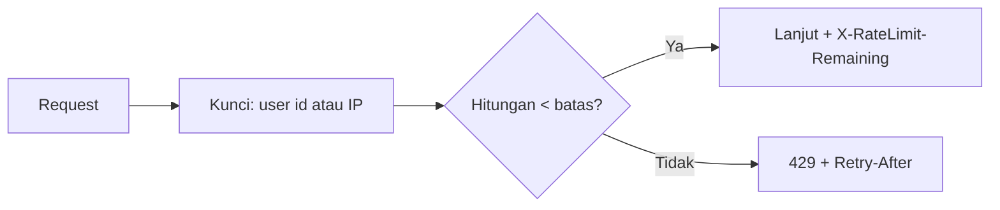

# Pembatasan Laju API

API terbuka untuk program, dan program dapat mengirim ribuan permintaan per detik. Tanpa batas, satu klien yang salah tulis (atau berniat jahat) dapat melumpuhkan layananmu. Konsep rate limiting sudah dikenal dari bab
keamanan; di sini kamu menerapkannya khusus untuk API: pembatas bernama per pengguna/token, tingkat berbeda untuk baca dan tulis, header yang membantu klien, dan respons 429 seragam.

## Tujuan Pembelajaran

Setelah menyelesaikan sub bab ini, kamu dapat:

- [ ] Mendefinisikan pembatas API (`api`, `api-write`) dengan kunci pengguna/token atau IP.
- [ ] Menerapkan tingkat berbeda untuk baca, tulis, dan unggah.
- [ ] Membaca header `X-RateLimit-Limit`, `X-RateLimit-Remaining`, dan `Retry-After`.
- [ ] Menyeragamkan respons 429 dengan format galat API.
- [ ] Menjelaskan perilaku klien yang baik: menghormati `Retry-After` dan *backoff*.
- [ ] Menguji pembatas dengan skrip.

## Prasyarat

- [Pembatasan Laju (bab Keamanan)](../level-05/05-24-rate-limiting.md) dan [Penanganan Error API](06-11-api-error-handling.md).
- [Otorisasi API](06-17-api-authorization.md).
- Cache terpusat (`CACHE_STORE=database` bawaan).

## Pengantar

Aplikasi seluler yang bug-nya mengulang permintaan tanpa henti akan membanjiri server. Batas laju membuat satu klien rusak tidak merugikan semua pengguna lain.

## Penjelasan Konsep

### Pembatas bernama untuk API

Di `AppServiceProvider::boot()`:

```php
use Illuminate\Cache\RateLimiting\Limit;
use Illuminate\Http\Request;
use Illuminate\Support\Facades\RateLimiter;

RateLimiter::for('api', function (Request $request) {
    return Limit::perMinute(60)->by($request->user()?->id ?: $request->ip());
});

RateLimiter::for('api-write', function (Request $request) {
    return [
        Limit::perMinute(20)->by('tulis:'.($request->user()?->id ?: $request->ip())),
        Limit::perHour(300)->by('tulis-jam:'.($request->user()?->id ?: $request->ip())),
    ];
});
```

Menurut dokumentasi, `by()` menentukan kunci penghitungan; menggabungkan pengguna masuk dan IP tamu membuat batas adil. Array `Limit` membuat beberapa jendela waktu berlaku bersamaan.

### Memasang

```php-inline
Route::middleware('throttle:api')->prefix('v1')->name('api.v1.')->group(function () {
    // route baca
    Route::middleware(['auth:sanctum', 'throttle:api-write'])->group(function () {
        // route tulis
    });
});
```

Urutan: `throttle:api` pada seluruh grup, `throttle:api-write` tambahan pada endpoint tulis. Menggunakan `auth:sanctum` lebih dulu membuat `$request->user()` tersedia untuk kunci pembatas.

### Header respons

| Header | Arti |
|---|---|
| `X-RateLimit-Limit` | Batas pada jendela ini |
| `X-RateLimit-Remaining` | Sisa permintaan |
| `Retry-After` | Detik menunggu (pada 429) |

### Respons 429 seragam

Penanganan galat dari sub bab 06.11 sudah menangani `TooManyRequestsHttpException` dengan `Retry-After`. Anda juga dapat menyesuaikan per pembatas dengan `->response(function (Request $request, array $headers) {...})`.

### Perilaku klien yang baik

| Praktik | Alasan |
|---|---|
| Hormati `Retry-After` | Menghindari memperparah beban |
| *Exponential backoff* + jitter | Mencegah serbuan serempak |
| Batasi percobaan ulang | Hindari perulangan tanpa akhir |
| Cache respons baca | Mengurangi permintaan |
| Gabungkan permintaan (batch) bila API mendukung | Hemat kuota |

### Kebijakan batas

| Jenis | Contoh | Alasan |
|---|---|---|
| Baca anonim | 60/menit per IP | Konsumsi publik |
| Baca terautentikasi | 120/menit per pengguna | Lebih longgar |
| Tulis | 20/menit per pengguna | Perubahan data mahal |
| Login | 5/menit per email + IP | Brute force |
| Unggah | 10/jam | Sumber daya berat |

### Keamanan dan batasan

- Batas per IP merugikan pengguna di balik NAT dan mudah dihindari penyerang dengan banyak IP; kombinasikan dengan batas per akun/token.
- Atur *trusted proxies* agar IP asli terbaca di belakang load balancer.
- Rate limiting bukan pertahanan DDoS; itu tugas infrastruktur (CDN/WAF).
- Gunakan cache terpusat (`database`/`redis`) agar batas konsisten antar server.

## Cara Kerja



## Contoh Praktik

Kamu mendefinisikan pembatas `api` dan `api-write`, memasangnya, memicu 429 dengan skrip, membaca header, dan menguji bahwa batas pengguna terpisah dari batas IP.

## Penjelasan Kode

Kode ada pada bagian konsep. Untuk uji cepat, turunkan sementara batas tulis menjadi `perMinute(3)`.

## Implementasi Langkah demi Langkah

### Langkah 1: definisikan pembatas

Tambahkan dua `RateLimiter::for` ke `AppServiceProvider`.

### Langkah 2: pasang pada route

Terapkan `throttle:api` pada grup `v1` dan `throttle:api-write` pada route tulis.

### Langkah 3: lihat header

```bash
curl -s -i -H "Accept: application/json" http://127.0.0.1:8000/api/v1/articles | grep -i -E "^HTTP/|x-ratelimit|retry-after"
```

### Langkah 4: picu 429

```bash
for i in $(seq 1 70); do curl -s -o /dev/null -w "%{http_code} " -H "Accept: application/json" http://127.0.0.1:8000/api/v1/articles; done; echo
```

Setelah permintaan ke-60 status berubah menjadi `429`.

### Langkah 5: periksa format 429

```bash
curl -s -i -H "Accept: application/json" http://127.0.0.1:8000/api/v1/articles | head -20
```

Pastikan JSON seragam dan header `Retry-After` ada.

### Langkah 6: uji pemisahan kunci

Dengan token Ani, picu 429 pada endpoint tulis; lalu coba dengan token Budi: tidak terpengaruh.

### Langkah 7: reset dan catat di Git

```bash
php artisan cache:clear
git add app routes
git commit -m "Tambah pembatas laju API"
```

## Eksekusi dan Verifikasi

| Langkah | Cara memverifikasi |
|---|---|
| 3 | Header `X-RateLimit-Limit: 60` dan `Remaining` berkurang |
| 4 | Status `200` lalu `429` |
| 6 | Budi tetap `200` saat Ani `429` |

## Hasil yang Diharapkan

| Kondisi | Hasil |
|---|---|
| ≤ 60 permintaan/menit | `200` + sisa kuota |
| > 60 | `429` + `Retry-After` + JSON seragam |
| Pengguna lain | Tidak terpengaruh |

Hasil ini diturunkan dari dokumentasi dan belum dijalankan oleh penulis materi; cocokkan dengan hasilmu.

## Kesalahan Umum dan Pemecahan Masalah

| Gejala | Penyebab | Cara mengenali | Solusi | Pencegahan |
|---|---|---|---|---|
| Batas tak berlaku | Middleware tak terpasang / cache `array` | Tidak ada header | Pasang; pakai cache terpusat | Periksa `route:list -v` |
| Semua pengguna berbagi batas | IP proxy sama | 429 bersamaan | Konfigurasi trusted proxies | Uji di belakang proxy |
| `$request->user()` null di pembatas | `throttle` sebelum `auth` | Kunci IP dipakai | Urutkan `auth` dulu | Perhatikan urutan |
| 429 HTML | Tidak mengirim `Accept` | Halaman HTML | Penanganan galat `api/*` | 06.11 |
| Batas terlalu ketat bagi klien sah | Tidak diukur | Keluhan pengguna | Ukur beban nyata dan sesuaikan | Pantau dan dokumentasikan |
| Penyerang menghindari batas IP | Banyak IP | Serangan tetap berhasil | Batas per akun + WAF | Pertahanan berlapis |

## Latihan Praktik

### Latihan dasar

**D1. Hitung kuota**
- *Masalah:* ingin memahami kuota.
- *Persyaratan:* hitung berapa permintaan per jam diizinkan oleh `perMinute(60)` dan oleh `perHour(300)`, dan mana yang lebih ketat dalam pemakaian terus-menerus.
- *Perilaku yang diharapkan:* 3.600 vs 300; jam lebih ketat.
- *Tujuan belajar:* membaca batas ganda.

### Latihan implementasi

**I1. Klien dengan backoff**
- *Masalah:* klien harus tahan 429.
- *Persyaratan:* tulis skrip Bash yang memanggil API, membaca `Retry-After` saat 429, menunggu, dan mencoba ulang maksimal 3 kali.
- *Perilaku yang diharapkan:* skrip pulih otomatis.
- *Tujuan belajar:* perilaku klien baik.

**I2. Batas per token**
- *Masalah:* token integrasi diberi batas lebih tinggi.
- *Persyaratan:* buat pembatas yang membaca ability `high-rate` dari token (`$request->user()?->tokenCan('high-rate')`) dan beri 300/menit, selain itu 60/menit.
- *Perilaku yang diharapkan:* batas berbeda per token.
- *Tujuan belajar:* batas dinamis.

### Latihan tantangan

**T1. Anggaran kuota**
- *Masalah:* sebuah aplikasi seluler 100.000 pengguna.
- *Persyaratan:* perkirakan permintaan puncak per detik, tentukan batas yang menyeimbangkan pengalaman dan beban, dan tuliskan asumsi serta rencana pemantauan.
- *Perilaku yang diharapkan:* perhitungan masuk akal.
- *Tujuan belajar:* merancang kuota.
- *Catatan:* kerjakan mandiri; tidak ada kunci jawaban.

## Uji Pemahaman

1. Apa fungsi `by()` pada `Limit`?
2. Mengapa batas tulis lebih ketat dari baca?
3. Apa fungsi `Retry-After`?
4. Mengapa batas per IP saja kurang?
5. Apa itu *exponential backoff*?

??? success "Kunci jawaban singkat"
    1. Menentukan siapa/apa yang dihitung.
    2. Menulis lebih mahal dan berisiko.
    3. Memberi tahu klien berapa detik menunggu.
    4. Pengguna berbagi IP, penyerang memakai banyak IP.
    5. Jeda yang makin panjang antar percobaan ulang.

## Ringkasan

- Definisikan pembatas API bernama dengan kunci pengguna/token atau IP; tingkatkan keketatan untuk tulis.
- Header membantu klien; respons 429 seragam dan membawa `Retry-After`.
- Klien yang baik menghormati `Retry-After` dengan backoff.
- Cache terpusat dan trusted proxies diperlukan agar batas akurat.

Selanjutnya: *Konsep Versi API*, mengelola perubahan tanpa memutus klien.

## Referensi Resmi

- [Laravel: Rate Limiting](https://laravel.com/docs/13.x/routing#rate-limiting)
- [Laravel: Defining Rate Limiters](https://laravel.com/docs/13.x/routing#defining-rate-limiters)
- [RFC 6585: 429 Too Many Requests](https://www.rfc-editor.org/rfc/rfc6585#section-4)
