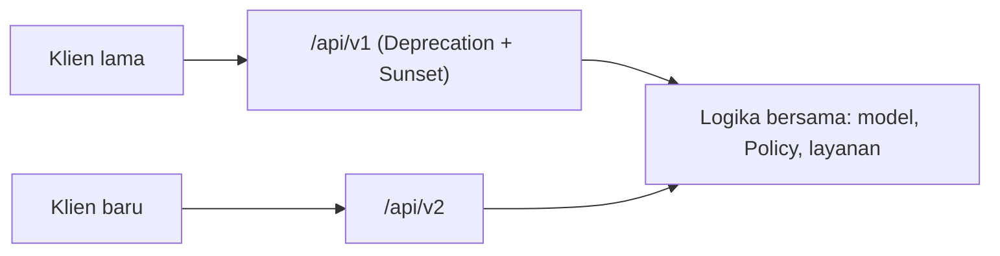

# Konsep Versi API

Setelah klien (aplikasi seluler yang sudah dipasang di ribuan ponsel) bergantung pada API-mu, kamu tidak bisa mengubah bentuk respons sesukamu. Perubahan yang merusak harus dirilis sebagai **versi baru**
sementara versi lama tetap berjalan selama masa transisi. Sub bab ini membahas apa yang termasuk perubahan merusak, strategi pemberian versi, cara mengorganisasi kode di Laravel, dan cara mengumumkan penghentian.

## Tujuan Pembelajaran

Setelah menyelesaikan sub bab ini, kamu dapat:

- [ ] Membedakan perubahan yang kompatibel mundur dan yang merusak.
- [ ] Membandingkan versi lewat URL, header, dan parameter.
- [ ] Mengorganisasi `v1` dan `v2` dalam routing, controller, dan resource.
- [ ] Menandai versi usang dengan header `Deprecation` dan `Sunset`.
- [ ] Menyusun kebijakan versi dan *changelog*.
- [ ] Mengimplementasikan `v2` yang berdampingan dengan `v1`.

## Prasyarat

- [Routing API](06-06-api-routing.md), [Transformasi API Resource](06-09-api-resource-transformation.md), dan [Format Data JSON](06-05-json-data-format.md).
- Endpoint artikel `v1` yang berfungsi.

## Pengantar

Tim memutuskan bahwa `author` pada artikel menjadi objek berisi `id`, `name`, dan `avatar_url` (sebelumnya `id` dan `name`), dan `title` berganti nama `headline`. Perubahan kedua merusak klien lama.
Tanpa versi, aplikasi seluler lama berhenti bekerja pada hari rilis.

## Penjelasan Konsep

### Merusak atau kompatibel?

| Perubahan | Kompatibel mundur? |
|---|---|
| Menambah kunci baru pada respons | Umumnya ya (klien menolak kunci tak dikenal jarang) |
| Menambah parameter opsional | Ya |
| Menambah endpoint | Ya |
| Mengganti nama atau menghapus kunci | **Tidak** |
| Mengubah tipe (string → angka) | **Tidak** |
| Mengubah arti nilai/kode status | **Tidak** |
| Menjadikan parameter opsional wajib | **Tidak** |

Perubahan kompatibel dapat dirilis di versi yang sama; perubahan merusak butuh versi baru.

### Strategi pemberian versi

| Strategi | Contoh | Kelebihan | Kekurangan |
|---|---|---|---|
| URL | `/api/v1/articles` | Jelas, mudah di-*cache*, mudah diuji | URL berubah antar versi |
| Header | `Accept: application/vnd.cms.v2+json` | URL stabil | Sulit diuji di browser, rumit |
| Parameter | `?version=2` | Mudah | Mudah terlupa, kurang rapi |

Materi ini memakai **versi di URL** (paling umum dan sederhana).

### Mengorganisasi di Laravel

```text
app/Http/Controllers/Api/V1/ArticleController.php
app/Http/Controllers/Api/V2/ArticleController.php
app/Http/Resources/V1/ArticleResource.php
app/Http/Resources/V2/ArticleResource.php
routes/api.php           (grup v1 dan v2)
```

File: `routes/api.php`

```php-inline
Route::prefix('v1')->name('api.v1.')->group(base_path('routes/api_v1.php'));
Route::prefix('v2')->name('api.v2.')->group(base_path('routes/api_v2.php'));
```

Pisahkan berkas rute per versi agar mudah dibaca. Gunakan kembali logika bersama (model, scope, Policy, layanan) dan bedakan hanya lapisan presentasi (Resource) dan kontrak input (Form Request) bila memungkinkan.

### Contoh `v2`

```php-inline
// app/Http/Resources/V2/ArticleResource.php
public function toArray(Request $request): array
{
    return [
        'id' => $this->id,
        'headline' => $this->title,              // berganti nama
        'slug' => $this->slug,
        'author' => $this->whenLoaded('user', fn () => [
            'id' => $this->user->id,
            'name' => $this->user->name,
        ]),
        'published_at' => $this->published_at?->toIso8601String(),
    ];
}
```

`v1` tetap mengembalikan `title`; kedua versi hidup berdampingan dan dites terpisah.

### Mengumumkan penghentian

Tambahkan header pada respons `v1` setelah `v2` rilis:

```php-inline
$response->headers->set('Deprecation', 'true');
$response->headers->set('Sunset', 'Sat, 31 Oct 2027 00:00:00 GMT');
$response->headers->set('Link', '</api/v2/articles>; rel="successor-version"');
```

| Header | Arti |
|---|---|
| `Deprecation` | Versi ini sudah usang |
| `Sunset` | Tanggal versi dimatikan |
| `Link ... successor-version` | Versi penerus |

Middleware sederhana yang menambah header untuk grup `v1` memusatkannya.

### Kebijakan versi

- Tentukan berapa lama versi lama didukung (mis. 12 bulan setelah rilis versi baru).
- Umumkan lewat changelog, email pengembang, dan header.
- Pantau penggunaan per versi (log atau metrik) sebelum mematikan.
- Hindari terlalu banyak versi aktif sekaligus; beban perawatan berlipat.

### Changelog

Dokumen berisi tanggal, versi, perubahan (Ditambah/Diubah/Dihapus), dan petunjuk migrasi. Contoh format "Keep a Changelog".

### Keamanan

- Versi lama yang dibiarkan tak terawat menjadi celah; terapkan tambalan keamanan ke semua versi aktif.
- Matikan versi usang sesuai jadwal.
- Pastikan Policy dan validasi berlaku sama di semua versi.

## Cara Kerja



## Contoh Praktik

Kamu membuat `v2` untuk artikel dengan `headline`, menyalin routing ke berkas per versi, menambah header penghentian pada `v1`, dan membuktikan kedua versi berjalan berdampingan.

## Penjelasan Kode

Bagian konsep memuat inti. Untuk menghindari duplikasi, `Api\V2\ArticleController` boleh mewarisi `Api\V1\ArticleController` dan hanya mengganti resource yang dipakai.

## Implementasi Langkah demi Langkah

### Langkah 1: pisahkan berkas rute

Pindahkan isi grup `v1` ke `routes/api_v1.php`, daftarkan lewat `Route::prefix('v1')->group(base_path(...))`.

### Langkah 2: buat `v2`

Buat `Api\V2\ArticleController`, `Resources\V2\ArticleResource`, dan `routes/api_v2.php` (untuk `index` dan `show`).

### Langkah 3: header penghentian pada `v1`

Buat middleware `DeprecatedApi` (parameter tanggal) dan pasang pada grup `v1`.

### Langkah 4: uji berdampingan

```bash
curl -s -i -H "Accept: application/json" http://127.0.0.1:8000/api/v1/articles | grep -i -E "^HTTP/|deprecation|sunset|link"
curl -s -H "Accept: application/json" http://127.0.0.1:8000/api/v1/articles | head -c 200
curl -s -H "Accept: application/json" http://127.0.0.1:8000/api/v2/articles | head -c 200
```

### Langkah 5: tulis changelog

Buat `docs/api-changelog.md` yang mencatat `v2` (headline) dan jadwal penghentian `v1`.

### Langkah 6: catat di Git

```bash
git add app routes docs
git commit -m "Tambah API v2 dan penghentian v1"
```

## Eksekusi dan Verifikasi

| Langkah | Cara memverifikasi |
|---|---|
| 4 | `v1` memuat `title` + header `Deprecation`/`Sunset`; `v2` memuat `headline` |
| 5 | Changelog tercatat |

## Hasil yang Diharapkan

| Permintaan | Hasil |
|---|---|
| `/api/v1/articles` | `title` + `Deprecation: true` + `Sunset: ...` |
| `/api/v2/articles` | `headline`, tanpa header penghentian |

Hasil ini diturunkan dari dokumentasi dan belum dijalankan oleh penulis materi; cocokkan dengan hasilmu.

## Kesalahan Umum dan Pemecahan Masalah

| Gejala | Penyebab | Cara mengenali | Solusi | Pencegahan |
|---|---|---|---|---|
| Nama route bentrok | Dua versi memakai nama sama | Galat `route:list` | Awalan nama `api.v1.`/`api.v2.` | Konvensi penamaan |
| `v2` memakai Resource `v1` | Namespace salah | Respons tak berubah | Perbaiki `use` | Periksa import |
| Header tidak muncul | Middleware tak terpasang | Tidak ada `Deprecation` | Pasang pada grup | Uji dengan `curl -i` |
| Perubahan kompatibel dikira merusak | Salah klasifikasi | Versi bertambah tanpa perlu | Pahami tabel | Tinjau sebelum rilis |
| Versi lama tak pernah dimatikan | Tanpa kebijakan | Beban perawatan | Tetapkan jadwal | Dokumentasi kebijakan |
| Tambalan keamanan hanya di versi baru | Duplikasi kode | Celah di versi lama | Berbagi logika; terapkan ke semua versi | Satu sumber logika |

## Latihan Praktik

### Latihan dasar

**D1. Klasifikasikan perubahan**
- *Masalah:* tentukan merusak atau tidak.
- *Persyaratan:* klasifikasikan (a) menambah `slug_pendek`, (b) mengganti `published_at` dari ISO 8601 ke timestamp, (c) menghapus `tags`, (d) menambah parameter `?lang=`.
- *Perilaku yang diharapkan:* (a) tidak, (b) ya, (c) ya, (d) tidak.
- *Tujuan belajar:* menilai kompatibilitas.

### Latihan implementasi

**I1. Pemantauan versi**
- *Masalah:* ingin tahu siapa masih memakai `v1`.
- *Persyaratan:* buat middleware yang mencatat `X-Client-Name` (dari header) dan versi ke log pada setiap permintaan, dan ringkas penggunaan.
- *Perilaku yang diharapkan:* data penggunaan per klien/versi.
- *Tujuan belajar:* mendukung keputusan penghentian.

### Latihan tantangan

**T1. Rencana migrasi**
- *Masalah:* 50.000 pengguna masih di `v1`.
- *Persyaratan:* tulis rencana migrasi (pengumuman, masa transisi, bantuan klien, pemantauan, tanggal akhir) dan kriteria menunda tanggal akhir.
- *Perilaku yang diharapkan:* rencana lengkap.
- *Tujuan belajar:* mengelola penghentian.
- *Catatan:* kerjakan mandiri; tidak ada kunci jawaban.

## Uji Pemahaman

1. Sebutkan dua perubahan merusak.
2. Apa keunggulan versi di URL?
3. Apa fungsi header `Sunset`?
4. Mengapa logika bersama harus satu sumber?
5. Mengapa memantau penggunaan sebelum mematikan versi?

??? success "Kunci jawaban singkat"
    1. Mengganti nama kunci; mengubah tipe nilai.
    2. Jelas, mudah di-cache dan diuji.
    3. Menyatakan tanggal versi dimatikan.
    4. Agar tambalan dan aturan berlaku sama di semua versi.
    5. Memastikan tidak ada klien penting yang terputus.

## Ringkasan

- Perubahan merusak (rename, ubah tipe, hapus) butuh versi baru; penambahan umumnya kompatibel.
- Versi di URL paling praktis; pisahkan route, controller, dan resource per versi.
- Umumkan penghentian dengan `Deprecation`, `Sunset`, dan changelog; pantau sebelum mematikan.
- Bagikan logika agar keamanan konsisten.

Selanjutnya: *Dokumentasi API*, menjelaskan kontrak kepada pengembang klien.

## Referensi Resmi

- [Laravel: Routing](https://laravel.com/docs/13.x/routing)
- [RFC 8594: The Sunset HTTP Header Field](https://www.rfc-editor.org/rfc/rfc8594)
- [Keep a Changelog](https://keepachangelog.com/id-ID/1.1.0/)
