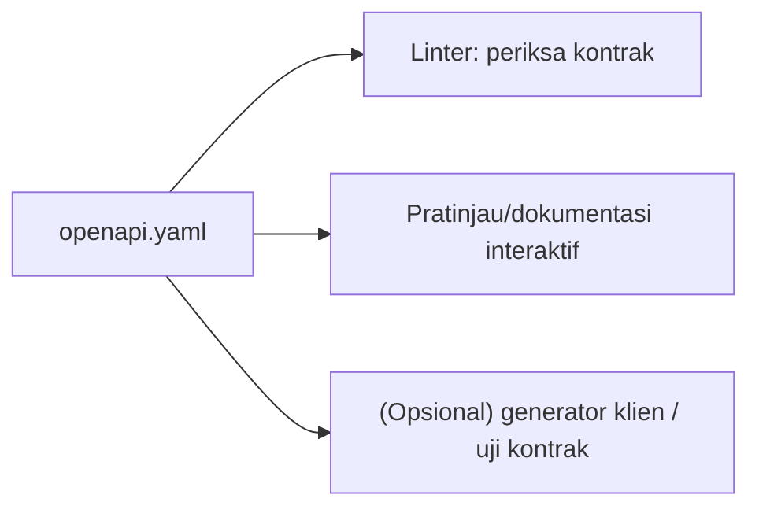

# Dokumentasi API

API yang tidak terdokumentasi hanya bisa dipakai oleh penulisnya. Dokumentasi adalah bagian dari produk: ia menjelaskan endpoint, parameter, contoh permintaan/respons, autentikasi, dan galat. Standar de facto
untuk mendeskripsikan API HTTP adalah **OpenAPI** (sebelumnya Swagger). Sub bab ini menulis spesifikasi OpenAPI untuk API artikel secara manual (tanpa paket tambahan), menjelaskan isi dokumentasi yang baik,
dan cara menjaganya tetap sinkron dengan kode.

## Tujuan Pembelajaran

Setelah menyelesaikan sub bab ini, kamu dapat:

- [ ] Menyebutkan isi dokumentasi API yang baik.
- [ ] Menulis spesifikasi OpenAPI 3.1 (`info`, `servers`, `paths`, `components`, `security`).
- [ ] Memakai `$ref` untuk skema dan respons yang dipakai ulang.
- [ ] Mendokumentasikan autentikasi Bearer, paginasi, dan format galat.
- [ ] Memvalidasi dan menampilkan spesifikasi dengan alat OpenAPI.
- [ ] Menjaga dokumentasi sinkron dengan kode.

## Prasyarat

- [Paginasi API](06-12-api-pagination.md), [Penanganan Error API](06-11-api-error-handling.md), dan [Autentikasi Berbasis Token](06-16-token-based-authentication.md).
- Dasar YAML.
- Rancangan `docs/api-rancangan.md` dari sub bab sebelumnya.

## Pengantar

Bayangkan pengembang aplikasi seluler yang baru bergabung. Tanpa dokumentasi ia harus membaca kode PHP untuk tahu kolom apa yang dikirim. Dengan dokumentasi interaktif, ia dapat membaca kontrak dan mencoba
endpoint dalam beberapa menit.

## Penjelasan Konsep

### Isi dokumentasi yang baik

| Bagian | Isi |
|---|---|
| Pengenalan | Tujuan API, URL dasar, versi |
| Autentikasi | Cara memperoleh dan memakai token; cakupan |
| Konvensi | Format JSON, tanggal, paginasi, galat, batas laju |
| Referensi endpoint | Metode, URL, parameter, body, respons, kode status |
| Contoh | `curl` dan respons nyata |
| Changelog | Perubahan dan penghentian |

### OpenAPI

OpenAPI adalah format YAML/JSON yang dapat dibaca mesin. Dari satu berkas, alat dapat menghasilkan dokumentasi interaktif, klien, dan uji kontrak.

File: `docs/openapi.yaml` (dalam proyek `cms-artikel`)

```yaml
openapi: 3.1.0
info:
  title: API Manajemen Artikel
  version: 1.0.0
  description: API untuk membaca dan mengelola artikel.
servers:
  - url: http://127.0.0.1:8000/api/v1
paths:
  /articles:
    get:
      summary: Daftar artikel terbit
      operationId: listArticles
      parameters:
        - name: page
          in: query
          schema: { type: integer, minimum: 1 }
        - name: per_page
          in: query
          schema: { type: integer, minimum: 1, maximum: 50, default: 15 }
        - name: q
          in: query
          schema: { type: string, maxLength: 100 }
      responses:
        '200':
          description: Daftar artikel terpaginasi
          content:
            application/json:
              schema:
                $ref: '#/components/schemas/ArticleCollection'
        '422':
          $ref: '#/components/responses/ValidationError'
    post:
      summary: Buat artikel
      operationId: createArticle
      security:
        - bearerAuth: []
      requestBody:
        required: true
        content:
          application/json:
            schema:
              $ref: '#/components/schemas/ArticleInput'
      responses:
        '201':
          description: Artikel dibuat
          headers:
            Location:
              schema: { type: string, format: uri }
          content:
            application/json:
              schema:
                $ref: '#/components/schemas/ArticleResponse'
        '401':
          $ref: '#/components/responses/Unauthenticated'
        '422':
          $ref: '#/components/responses/ValidationError'
  /articles/{slug}:
    get:
      summary: Detail artikel
      operationId: getArticle
      parameters:
        - name: slug
          in: path
          required: true
          schema: { type: string }
      responses:
        '200':
          description: Detail artikel
          content:
            application/json:
              schema:
                $ref: '#/components/schemas/ArticleResponse'
        '404':
          $ref: '#/components/responses/NotFound'
components:
  securitySchemes:
    bearerAuth:
      type: http
      scheme: bearer
  schemas:
    Article:
      type: object
      required: [id, title, slug]
      properties:
        id: { type: integer }
        title: { type: string }
        slug: { type: string }
        published_at: { type: [string, 'null'], format: date-time }
    ArticleResponse:
      type: object
      properties:
        data:
          $ref: '#/components/schemas/Article'
    ArticleCollection:
      type: object
      properties:
        data:
          type: array
          items:
            $ref: '#/components/schemas/Article'
        links: { type: object }
        meta: { type: object }
    ArticleInput:
      type: object
      required: [title, body]
      additionalProperties: false
      properties:
        title: { type: string, maxLength: 200 }
        body: { type: string }
        is_published: { type: boolean }
    Error:
      type: object
      required: [message, code]
      properties:
        message: { type: string }
        code: { type: string }
        errors:
          type: object
          additionalProperties:
            type: array
            items: { type: string }
  responses:
    Unauthenticated:
      description: Token tidak ada atau tidak valid
      content:
        application/json:
          schema: { $ref: '#/components/schemas/Error' }
    NotFound:
      description: Sumber daya tidak ditemukan
      content:
        application/json:
          schema: { $ref: '#/components/schemas/Error' }
    ValidationError:
      description: Data tidak valid
      content:
        application/json:
          schema: { $ref: '#/components/schemas/Error' }
```

| Bagian | Fungsi |
|---|---|
| `servers` | URL dasar untuk mencoba endpoint |
| `paths` | Endpoint, metode, parameter, respons |
| `$ref` | Merujuk skema/respons di `components` agar tidak berulang |
| `securitySchemes` + `security` | Mendeklarasikan autentikasi Bearer pada endpoint yang membutuhkannya |
| Skema `ArticleInput` | Mencerminkan aturan Form Request (batas panjang, wajib) |
| Skema `Error` | Format galat seragam dari sub bab 06.11 |

Spesifikasi di atas diverifikasi hanya sintaks YAML-nya; penguji spesifikasi khusus (linter) melaporkan temuan tambahan pada draf awal yang tidak sempat kami uraikan, jadi anggap ini kerangka dan **jalankan linter**
pada salinanmu (lihat langkah 3).

### Menampilkan dan memvalidasi

Alat populer: Swagger UI, Redoc, dan Redocly CLI. Semuanya berupa alat tambahan di luar proyek PHP. Contoh memakai Redocly lewat Node tanpa memasangnya ke proyek:

```bash
npx @redocly/cli lint docs/openapi.yaml
npx @redocly/cli preview-docs docs/openapi.yaml
```

`npx` mengunduh dan menjalankan paket dari registri npm; jalankan hanya bila kamu mempercayai paket tersebut dan tidak keberatan unduhan. Alternatif tanpa pemasangan: tempel berkas ke editor daring, dengan
risiko menyerahkan spesifikasi ke layanan pihak ketiga (jangan untuk API internal yang sensitif).

### Menjaga tetap sinkron

| Pendekatan | Kelebihan | Kekurangan |
|---|---|---|
| Spesifikasi ditulis tangan (materi ini) | Kontrol penuh, tanpa dependensi | Bisa tertinggal dari kode |
| Dihasilkan dari kode/anotasi (paket pihak ketiga) | Lebih sinkron | Menambah dependensi dan anotasi |
| Uji kontrak yang membandingkan respons dengan skema | Menangkap penyimpangan | Perlu perangkat tambahan |

Praktik sederhana: perbarui `openapi.yaml` dalam permintaan penggabungan yang sama dengan perubahan endpoint, dan jadikan "dokumentasi diperbarui" bagian dari daftar periksa review.

### Keamanan

- Jangan menaruh token, kata sandi, atau data sungguhan di contoh dokumentasi.
- Dokumentasi interaktif publik membuka peta endpoint; pertimbangkan membatasinya untuk lingkungan non-produksi atau di balik autentikasi bagi API internal.
- Dokumentasikan batas laju dan kode galat agar klien berperilaku baik.

## Cara Kerja



## Contoh Praktik

Kamu menulis `openapi.yaml` untuk endpoint artikel (daftar, detail, buat), memvalidasi sintaks YAML, menjalankan linter bila kamu memilih, dan melengkapi dokumentasi konvensi dalam `docs/api.md`.

## Penjelasan Kode

Spesifikasi di atas adalah isi berkas. Tambahkan endpoint lain (login, `me`, komentar) mengikuti pola yang sama, dan skema `Comment`, `Category`, serta `LoginRequest`.

## Implementasi Langkah demi Langkah

### Langkah 1: buat berkas

Simpan spesifikasi sebagai `docs/openapi.yaml` di proyek `cms-artikel`.

### Langkah 2: periksa sintaks YAML

```bash
php -r 'var_dump(function_exists("yaml_parse"));'
```

Jika ekstensi YAML tidak ada, gunakan editor dengan pemeriksa YAML atau alat lain yang kamu percayai; atau lewati ke Langkah 3.

### Langkah 3: jalankan linter (opsional)

```bash
npx @redocly/cli lint docs/openapi.yaml
```

Baca temuan dan perbaiki sampai tidak ada galat. Catat aturan yang kamu abaikan beserta alasannya.

### Langkah 4: tambah endpoint lain

Dokumentasikan `POST /auth/login`, `GET /auth/me`, dan `GET /articles/{slug}/comments`, termasuk contoh respons 401, 403, dan 429.

### Langkah 5: tulis `docs/api.md`

Tulis pengantar, cara autentikasi, konvensi (format JSON, tanggal ISO 8601, paginasi, galat), dan tautan ke `openapi.yaml`.

### Langkah 6: catat di Git

```bash
git add docs
git commit -m "Tambah dokumentasi OpenAPI untuk API artikel"
```

## Eksekusi dan Verifikasi

| Langkah | Cara memverifikasi |
|---|---|
| 1 | Berkas ada di `docs/openapi.yaml` |
| 3 | Linter tidak melaporkan galat (peringatan dicatat) |
| 4 | Semua endpoint utama terdokumentasi dengan kode status |
| 5 | Dokumen konvensi lengkap |

## Hasil yang Diharapkan

| Pemeriksaan | Hasil |
|---|---|
| Linter | Tanpa galat; peringatan seperti ketiadaan lisensi dapat diterima dengan alasan |
| Pratinjau | Daftar endpoint dengan skema dan contoh |

Hasil linter bergantung versi alat; kami belum memastikan spesifikasi contoh bebas galat di linter. Cocokkan dengan hasilmu.

## Kesalahan Umum dan Pemecahan Masalah

| Gejala | Penyebab | Cara mengenali | Solusi | Pencegahan |
|---|---|---|---|---|
| YAML tidak terbaca | Indentasi salah / tab | Galat parser | Gunakan spasi, bukan tab | Editor dengan pemeriksa YAML |
| `$ref` tidak ditemukan | Path salah | Galat linter | Periksa `#/components/...` | Salin path persis |
| Dokumentasi tertinggal | Tidak diperbarui bersama kode | Contoh tak cocok respons | Jadikan bagian review | Uji kontrak |
| Contoh memuat token nyata | Menyalin dari terminal | Token di repo | Ganti placeholder; cabut token | Periksa sebelum commit |
| Skema tidak cocok respons | Resource berubah | Klien salah tafsir | Sinkronkan | Uji respons vs skema |
| `npx` unduh paket tak dikenal | Salah ketik nama | Paket asing berjalan | Periksa nama paket | Pasang versi dan nama persis |

## Latihan Praktik

### Latihan dasar

**D1. Baca spesifikasi**
- *Masalah:* ingin memahami struktur.
- *Persyaratan:* dari spesifikasi di atas, sebutkan parameter query `GET /articles`, kode status `POST /articles`, dan skema galat.
- *Perilaku yang diharapkan:* jawaban sesuai berkas.
- *Tujuan belajar:* membaca OpenAPI.

### Latihan implementasi

**I1. Lengkapi dokumentasi**
- *Masalah:* endpoint komentar belum terdokumentasi.
- *Persyaratan:* tambahkan skema `Comment`, `CommentInput`, dan dua operasi pada `/articles/{slug}/comments` (GET terpaginasi, POST publik) beserta kode status.
- *Perilaku yang diharapkan:* spesifikasi tetap valid.
- *Tujuan belajar:* memperluas spesifikasi.

**I2. Cek kecocokan**
- *Masalah:* dokumentasi harus cocok dengan respons.
- *Persyaratan:* panggil `GET /articles` dan bandingkan kunci respons dengan skema `Article`; catat selisih dan perbaiki dokumentasi atau Resource.
- *Perilaku yang diharapkan:* tidak ada selisih.
- *Tujuan belajar:* memverifikasi kontrak.

### Latihan tantangan

**T1. Uji kontrak otomatis**
- *Masalah:* ingin menangkap penyimpangan otomatis.
- *Persyaratan:* rancang (atau implementasikan sederhana dengan skrip) pemeriksaan yang memanggil endpoint dan memvalidasi respons terhadap skema JSON, dan jelaskan kapan dijalankan (CI).
- *Perilaku yang diharapkan:* rancangan jelas.
- *Tujuan belajar:* menjaga sinkron.
- *Catatan:* kerjakan mandiri; tidak ada kunci jawaban.

## Uji Pemahaman

1. Apa itu OpenAPI?
2. Apa fungsi `$ref`?
3. Bagaimana mendokumentasikan autentikasi Bearer?
4. Mengapa dokumentasi harus diperbarui bersama kode?
5. Apa risiko menaruh token nyata pada contoh?

??? success "Kunci jawaban singkat"
    1. Format standar mesin-terbaca untuk mendeskripsikan API HTTP.
    2. Merujuk komponen yang dipakai ulang.
    3. `securitySchemes` bertipe `http` skema `bearer` dan `security` pada operasi.
    4. Agar kontrak tidak menyimpang dari perilaku.
    5. Kebocoran akses bila token masih berlaku.

## Ringkasan

- Dokumentasi API mencakup pengantar, autentikasi, konvensi, referensi endpoint, contoh, dan changelog.
- OpenAPI mendeskripsikan kontrak secara mesin-terbaca; `$ref` menghindari pengulangan.
- Validasi dengan linter dan jaga sinkron dalam alur review.
- Jangan membocorkan rahasia di contoh.

Selanjutnya: *Pengujian API dengan Postman*, mencoba dan mengotomasi pemanggilan endpoint.

## Referensi Resmi

- [OpenAPI Specification](https://spec.openapis.org/oas/latest.html)
- [Laravel: Routing](https://laravel.com/docs/13.x/routing)
- [Redocly CLI](https://redocly.com/docs/cli/)
