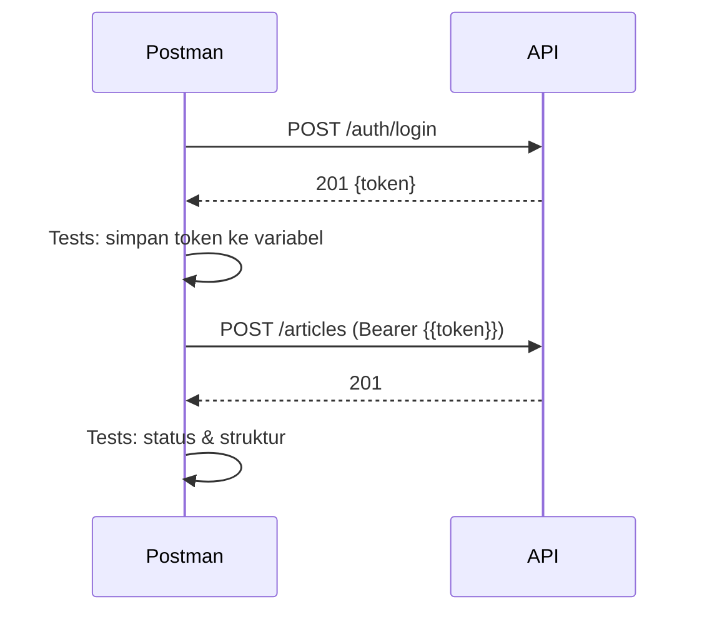

# Pengujian API dengan Postman

Sebelum menulis uji otomatis di kode (bab Testing), kamu perlu cara cepat untuk **mencoba** API: mengirim permintaan, melihat respons, menyimpan token, dan mengulang skenario. **Postman** adalah aplikasi populer
untuk itu. Sub bab ini memandu membuat koleksi, variabel lingkungan, otorisasi Bearer, dan skrip pengujian sederhana; sebagai alternatif ringan disajikan juga berkas `.http` dan `curl`. Postman adalah alat
eksternal (aplikasi desktop/web), bukan dependensi proyek.

## Tujuan Pembelajaran

Setelah menyelesaikan sub bab ini, kamu dapat:

- [ ] Mengimpor atau membuat koleksi Postman untuk API artikel.
- [ ] Memakai variabel (`base_url`, `token`) pada lingkungan atau koleksi.
- [ ] Mengatur otorisasi Bearer dan menyimpan token otomatis dari respons login.
- [ ] Menulis uji sederhana (status, struktur JSON) di tab *Tests*.
- [ ] Menjalankan koleksi berurutan (Collection Runner) dan membaca hasilnya.
- [ ] Menyebutkan alternatif: berkas `.http` dan `curl`, serta risiko membagikan koleksi berisi rahasia.

## Prasyarat

- [Autentikasi Berbasis Token](06-16-token-based-authentication.md) dan [Dokumentasi API](06-20-api-documentation.md).
- Server berjalan (`php artisan serve`) dengan akun uji `ani@contoh.test`.
- Postman terpasang (aplikasi desktop dari situs resmi) atau akses ke versi web; boleh melewatkan Postman dan memakai alternatif `.http`/`curl`.

## Pengantar

Mengetik `curl` panjang berulang kali melelahkan. Postman menyimpan permintaan, mengelola token, dan menjalankan serangkaian pemeriksaan hanya dengan satu klik.

## Penjelasan Konsep

### Struktur Postman

| Konsep | Fungsi |
|---|---|
| Koleksi (*collection*) | Kumpulan permintaan terorganisasi |
| Variabel | Nilai bersama (`{{base_url}}`, `{{token}}`) |
| Lingkungan (*environment*) | Himpunan variabel per lingkungan (lokal, staging) |
| Skrip *Tests* | JavaScript yang berjalan setelah respons |
| Collection Runner | Menjalankan seluruh koleksi berurutan |

### Koleksi siap impor

Simpan sebagai `docs/postman/koleksi-api-artikel.json` lalu impor lewat **Import** di Postman:

```json
{
    "info": {
        "name": "API Manajemen Artikel v1",
        "schema": "https://schema.getpostman.com/json/collection/v2.1.0/collection.json"
    },
    "variable": [
        { "key": "base_url", "value": "http://127.0.0.1:8000/api/v1" },
        { "key": "token", "value": "" }
    ],
    "item": [
        {
            "name": "Login",
            "event": [
                {
                    "listen": "test",
                    "script": {
                        "type": "text/javascript",
                        "exec": [
                            "pm.test('Status 201', () => pm.response.to.have.status(201));",
                            "const json = pm.response.json();",
                            "pm.collectionVariables.set('token', json.data.token);"
                        ]
                    }
                }
            ],
            "request": {
                "method": "POST",
                "header": [
                    { "key": "Accept", "value": "application/json" },
                    { "key": "Content-Type", "value": "application/json" }
                ],
                "url": "{{base_url}}/auth/login",
                "body": {
                    "mode": "raw",
                    "raw": "{\"email\":\"ani@contoh.test\",\"password\":\"password\",\"device_name\":\"postman\"}"
                }
            }
        },
        {
            "name": "Daftar artikel",
            "event": [
                {
                    "listen": "test",
                    "script": {
                        "type": "text/javascript",
                        "exec": [
                            "pm.test('Status 200', () => pm.response.to.have.status(200));",
                            "pm.test('Memuat data dan meta', () => {",
                            "  const j = pm.response.json();",
                            "  pm.expect(j).to.have.property('data');",
                            "  pm.expect(j).to.have.property('meta');",
                            "});"
                        ]
                    }
                }
            ],
            "request": {
                "method": "GET",
                "header": [ { "key": "Accept", "value": "application/json" } ],
                "url": "{{base_url}}/articles?per_page=5"
            }
        },
        {
            "name": "Buat artikel",
            "request": {
                "auth": {
                    "type": "bearer",
                    "bearer": [ { "key": "token", "value": "{{token}}", "type": "string" } ]
                },
                "method": "POST",
                "header": [
                    { "key": "Accept", "value": "application/json" },
                    { "key": "Content-Type", "value": "application/json" }
                ],
                "url": "{{base_url}}/articles",
                "body": {
                    "mode": "raw",
                    "raw": "{\"title\":\"Dari Postman\",\"body\":\"Isi\",\"is_published\":true}"
                }
            }
        }
    ]
}
```

Hanya sintaks JSON-nya yang diperiksa oleh penulis; impor di Postman belum dicoba. Skema impor dapat berbeda antar versi aplikasi.

| Bagian | Fungsi |
|---|---|
| `variable` | Variabel koleksi `base_url` dan `token` |
| Skrip *Tests* pada Login | Memeriksa status 201 dan menyimpan token ke `token` |
| `auth.bearer` memakai `{{token}}` | Otorisasi Bearer otomatis |
| Uji "Daftar artikel" | Memeriksa status dan kunci `data`/`meta` |

### Alur kerja

1. Jalankan **Login**: token tersimpan.
2. Jalankan **Daftar artikel**: uji lolos.
3. Jalankan **Buat artikel**: memakai token tersimpan.
4. Jalankan seluruh koleksi dengan **Runner** dan baca ringkasan lulus/gagal.

### Variabel dan rahasia

Jangan menaruh token atau kata sandi sungguhan pada koleksi yang dibagikan. Gunakan variabel lingkungan dengan nilai **Secret** dan jangan mengekspor lingkungan berisi rahasia ke repositori. Token uji lokal
tetap harus dicabut setelah dipakai.

### Alternatif tanpa Postman

Berkas `.http` (didukung beberapa editor, mis. ekstensi REST Client) menyimpan permintaan sebagai teks yang bisa di-*commit*:

```http
@base = http://127.0.0.1:8000/api/v1

### Login
POST {{base}}/auth/login
Accept: application/json
Content-Type: application/json

{"email":"ani@contoh.test","password":"password","device_name":"http-file"}

### Daftar artikel
GET {{base}}/articles?per_page=5
Accept: application/json
```

`curl` tetap alat paling universal untuk skrip dan CI. Postman unggul untuk eksplorasi, kolaborasi, dan dokumentasi interaktif.

### Bukan pengganti uji otomatis

Postman membantu eksplorasi dan uji manual/semiotomatis. Uji yang berjalan pada setiap perubahan kode sebaiknya ada di suite pengujian proyek (bab Testing) agar hasilnya dapat diulang di CI.

### Keamanan

- Koleksi yang diekspor dapat memuat token; periksa sebelum berbagi.
- Sinkronisasi cloud Postman menyimpan data di layanan pihak ketiga; jangan menyimpan kredensial produksi.
- Gunakan akun dan token khusus pengujian dengan hak terkecil.

## Cara Kerja



## Contoh Praktik

Kamu mengimpor koleksi (atau mengetik ulang permintaannya), menjalankan alur login → daftar → buat, memeriksa hasil uji, menambah uji untuk kasus gagal, dan membuat padanan `.http`.

## Penjelasan Kode

Skrip pada tab *Tests* memakai objek `pm`: `pm.test` membuat pernyataan, `pm.response.to.have.status` memeriksa status, `pm.response.json()` mengurai body, dan `pm.collectionVariables.set` menyimpan nilai.

## Implementasi Langkah demi Langkah

### Langkah 1: siapkan server dan data

```bash
php artisan migrate:fresh --seed
php artisan serve
```

Pastikan akun Ani ada dan terverifikasi.

### Langkah 2: buat koleksi

Simpan JSON di atas dan impor ke Postman, atau buat tiga permintaan manual dengan URL dan header sama.

### Langkah 3: jalankan satu per satu

Jalankan **Login** (token tersimpan), lalu **Daftar artikel** dan **Buat artikel**. Periksa tab *Test Results*.

### Langkah 4: tambah uji gagal

Tambahkan permintaan "Buat artikel tanpa judul" (body `{"body":"x"}`) dengan uji status `422` dan kunci `errors.title`; tambahkan "Buat artikel tanpa token" dengan uji status `401`.

### Langkah 5: jalankan koleksi

Gunakan Collection Runner, jalankan semua, dan catat ringkasan lulus/gagal.

### Langkah 6: padanan `.http` atau `curl`

Tulis ulang dua permintaan sebagai berkas `.http` atau skrip `curl` dan jalankan.

### Langkah 7: bersihkan

Cabut token uji (`POST /auth/logout`) dan hapus nilai rahasia dari lingkungan. Simpan koleksi bersih di `docs/postman/`.

```bash
git add docs/postman
git commit -m "Tambah koleksi Postman untuk API artikel"
```

## Eksekusi dan Verifikasi

| Langkah | Cara memverifikasi |
|---|---|
| 3 | Uji Login dan Daftar artikel lulus |
| 4 | Uji 422 dan 401 lulus |
| 5 | Runner menampilkan semua uji lulus |

## Hasil yang Diharapkan

| Permintaan | Hasil |
|---|---|
| Login | `201`, variabel `token` terisi |
| Daftar artikel | `200` dengan `data` dan `meta` |
| Buat artikel tanpa token | `401` |
| Buat artikel tanpa judul | `422` dengan `errors.title` |

Hasil ini diturunkan dari kontrak API; langkah-langkah Postman belum dijalankan oleh penulis. Cocokkan dengan hasilmu.

## Kesalahan Umum dan Pemecahan Masalah

| Gejala | Penyebab | Cara mengenali | Solusi | Pencegahan |
|---|---|---|---|---|
| `401` pada Buat artikel | Token kosong / kedaluwarsa | Header Bearer kosong | Jalankan Login dulu | Urutkan di Runner |
| Respons HTML | Header `Accept` tidak ada | Halaman HTML | Tambahkan `Accept: application/json` | Header pada koleksi |
| Variabel `{{base_url}}` tak terganti | Variabel tidak terpilih / lingkungan tidak aktif | URL berisi kurung kurawal | Aktifkan lingkungan/variabel | Gunakan variabel koleksi |
| `429` saat Runner | Batas laju | Status 429 | Beri jeda antar permintaan | Sesuaikan batas uji |
| Token ikut ter-*commit* | Ekspor berisi nilai | Token di JSON | Hapus nilai sebelum commit | Variabel Secret |
| Uji lulus tetapi API salah | Uji terlalu longgar | Bug lolos | Perkuat pernyataan | Uji struktur |

## Latihan Praktik

### Latihan dasar

**D1. Variabel**
- *Masalah:* mengganti server.
- *Persyaratan:* ubah `base_url` ke alamat lain dan jelaskan mengapa semua permintaan ikut berubah.
- *Perilaku yang diharapkan:* satu perubahan memengaruhi semua.
- *Tujuan belajar:* memakai variabel.

### Latihan implementasi

**I1. Siklus CRUD**
- *Masalah:* ingin menguji CRUD penuh.
- *Persyaratan:* tambah permintaan Ubah (PATCH) dan Hapus (DELETE) pada artikel yang dibuat, simpan `slug` dari respons Buat ke variabel, dan tulis uji status (200, 204, lalu 404 pada GET).
- *Perilaku yang diharapkan:* runner lulus berurutan.
- *Tujuan belajar:* skenario berantai.

**I2. Uji kasus otorisasi**
- *Masalah:* ingin membuktikan IDOR tertutup.
- *Persyaratan:* login sebagai Budi (variabel `token_budi`), coba mengubah artikel Ani, dan uji status `403`.
- *Perilaku yang diharapkan:* `403`.
- *Tujuan belajar:* uji otorisasi manual.

### Latihan tantangan

**T1. Dari Postman ke CI**
- *Masalah:* ingin menjalankan koleksi di CI.
- *Persyaratan:* telusuri cara menjalankan koleksi lewat baris perintah (alat CLI Postman), tulis rencana integrasi CI (variabel rahasia, data uji, hasil), dan bandingkan dengan menulis uji di Laravel.
- *Perilaku yang diharapkan:* perbandingan beralasan.
- *Tujuan belajar:* menghubungkan uji manual dan otomatis.
- *Catatan:* kerjakan mandiri; tidak ada kunci jawaban.

## Uji Pemahaman

1. Apa fungsi variabel koleksi?
2. Bagaimana token disimpan otomatis dari respons login?
3. Apa fungsi Collection Runner?
4. Mengapa koleksi yang dibagikan harus bersih dari rahasia?
5. Apa alternatif Postman?

??? success "Kunci jawaban singkat"
    1. Berbagi nilai (URL, token) di semua permintaan.
    2. Skrip *Tests* menyimpan `json.data.token` ke variabel.
    3. Menjalankan seluruh koleksi berurutan dan merangkum hasil.
    4. Token dan kata sandi dapat bocor.
    5. Berkas `.http`, `curl`, atau klien lain.

## Ringkasan

- Postman menyimpan permintaan, variabel, dan uji sederhana; Runner menjalankan koleksi.
- Simpan token dari respons login ke variabel dan pakai otorisasi Bearer.
- `.http` dan `curl` adalah alternatif ringan yang bisa di-*commit*.
- Jaga rahasia; uji manual melengkapi, bukan menggantikan, uji otomatis.

Selanjutnya: *Integrasi API dengan Frontend*, memanggil API dari halaman JavaScript.

## Referensi Resmi

- [Postman: Learning Center](https://learning.postman.com/)
- [Laravel: Sanctum, API Token Authentication](https://laravel.com/docs/13.x/sanctum#api-token-authentication)
- [MDN: HTTP Authentication (Bearer)](https://developer.mozilla.org/en-US/docs/Web/HTTP/Authentication)
