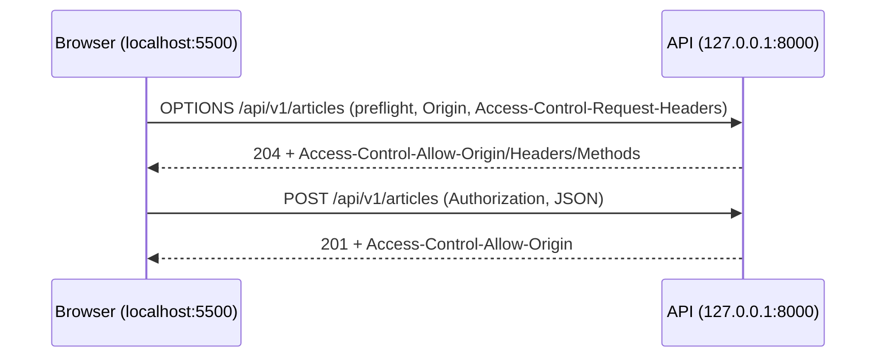

# Integrasi API dengan Frontend

Tujuan akhir API adalah dipakai. Sub bab ini membuat klien kecil berbasis HTML dan JavaScript murni (`fetch`) yang berjalan dari **asal berbeda** dari server Laravel: login, menampilkan daftar artikel
berpaginasi, dan membuat artikel. Kamu akan berhadapan dengan masalah nyata integrasi: **CORS**, penyimpanan token, penanganan galat 401/422/429, dan paginasi di sisi klien.

## Tujuan Pembelajaran

Setelah menyelesaikan sub bab ini, kamu dapat:

- [ ] Menjelaskan *same-origin policy*, CORS, dan permintaan *preflight* `OPTIONS`.
- [ ] Mengonfigurasi CORS Laravel dengan `config:publish cors` untuk asal yang diizinkan.
- [ ] Memanggil API dengan `fetch`, mengirim JSON dan header `Authorization`.
- [ ] Menangani respons sukses dan galat (401, 422, 429) di sisi klien.
- [ ] Mengimplementasikan paginasi di klien dengan `links.next`.
- [ ] Menjelaskan kompromi menyimpan token (memori, `sessionStorage`, `localStorage`, cookie).

## Prasyarat

- [Autentikasi Berbasis Token](06-16-token-based-authentication.md), [Penanganan Error API](06-11-api-error-handling.md), dan [Paginasi API](06-12-api-pagination.md).
- Dasar JavaScript (fungsi, `async/await`, DOM).
- Server API berjalan di `http://127.0.0.1:8000`.

## Pengantar

Browser melindungi pengguna dengan *same-origin policy*: halaman dari `http://localhost:5500` tidak boleh membaca respons dari `http://127.0.0.1:8000` kecuali server yang bersangkutan mengizinkannya lewat
header CORS. Tanpa konfigurasi yang benar, `fetch` gagal walau API-nya sehat.

## Penjelasan Konsep

### Asal (*origin*) dan CORS

Asal = skema + host + port. `http://localhost:5500` dan `http://127.0.0.1:8000` berbeda asal. Untuk permintaan lintas asal tertentu (mis. dengan header `Authorization` atau `Content-Type: application/json`), browser
mengirim *preflight* `OPTIONS` lebih dulu; server menjawab dengan header `Access-Control-Allow-*`. Jika tidak, browser memblokir respons. CORS dijalankan **oleh browser**: `curl` tidak terpengaruh.

### Konfigurasi di Laravel

Menurut dokumentasi, Laravel menjawab `OPTIONS` CORS lewat middleware `HandleCors`; ubah nilainya dengan:

```bash
php artisan config:publish cors
```

File: `config/cors.php`

```php-inline
return [
    'paths' => ['api/*'],
    'allowed_methods' => ['GET', 'POST', 'PUT', 'PATCH', 'DELETE', 'OPTIONS'],
    'allowed_origins' => ['http://localhost:5500'],
    'allowed_origins_patterns' => [],
    'allowed_headers' => ['Accept', 'Authorization', 'Content-Type', 'X-Requested-With'],
    'exposed_headers' => ['Retry-After', 'X-RateLimit-Remaining', 'X-Request-Id'],
    'max_age' => 600,
    'supports_credentials' => false,
];
```

| Kunci | Arti |
|---|---|
| `paths` | URL yang diberi header CORS |
| `allowed_origins` | Asal yang diizinkan (jangan `*` bila memakai kredensial; hindari `*` di produksi bila tak perlu) |
| `allowed_headers` | Header yang boleh dikirim klien |
| `exposed_headers` | Header respons yang boleh dibaca JavaScript (mis. `Retry-After`) |
| `supports_credentials` | `true` hanya bila memakai cookie lintas asal (tidak untuk token Bearer) |

Karena aplikasi ini memakai token di header (bukan cookie), `supports_credentials` tetap `false`.

### Klien `fetch`

File: `frontend/index.html` (di luar proyek Laravel, atau folder `frontend` di dalamnya)

```html
<!DOCTYPE html>
<html lang="id">
<head><meta charset="UTF-8"><title>Klien API Artikel</title></head>
<body>
<h1>Klien API Artikel</h1>

<form id="login">
    <input id="email" value="ani@contoh.test">
    <input id="password" type="password" value="password">
    <button>Masuk</button>
</form>
<p id="status"></p>

<ul id="daftar"></ul>
<button id="lagi" hidden>Muat lebih banyak</button>

<form id="baru" hidden>
    <input id="judul" placeholder="Judul">
    <textarea id="isi" placeholder="Isi"></textarea>
    <button>Buat artikel</button>
</form>

<script>
const BASE = 'http://127.0.0.1:8000/api/v1';
let token = null;      // disimpan di memori: hilang saat halaman dimuat ulang
let nextUrl = null;

async function api(url, opsi = {}) {
    const res = await fetch(url, {
        ...opsi,
        headers: {
            'Accept': 'application/json',
            ...(opsi.body ? { 'Content-Type': 'application/json' } : {}),
            ...(token ? { 'Authorization': 'Bearer ' + token } : {}),
        },
    });
    const body = res.status === 204 ? null : await res.json().catch(() => null);

    if (res.status === 429) {
        const tunggu = res.headers.get('Retry-After');
        throw new Error('Terlalu banyak permintaan. Coba lagi dalam ' + tunggu + ' detik.');
    }
    if (!res.ok) {
        const pesan = body?.errors ? Object.values(body.errors).flat().join(' ') : (body?.message ?? res.statusText);
        const e = new Error(pesan);
        e.status = res.status;
        throw e;
    }
    return body;
}

function tampil(pesan) { document.getElementById('status').textContent = pesan; }

async function muatDaftar(url) {
    const hasil = await api(url);
    for (const a of hasil.data) {
        const li = document.createElement('li');
        li.textContent = a.title;          // textContent: aman dari XSS
        document.getElementById('daftar').appendChild(li);
    }
    nextUrl = hasil.links?.next ?? null;
    document.getElementById('lagi').hidden = !nextUrl;
}

document.getElementById('login').addEventListener('submit', async (e) => {
    e.preventDefault();
    try {
        const r = await api(BASE + '/auth/login', {
            method: 'POST',
            body: JSON.stringify({
                email: document.getElementById('email').value,
                password: document.getElementById('password').value,
                device_name: 'frontend-demo',
            }),
        });
        token = r.data.token;
        document.getElementById('baru').hidden = false;
        tampil('Masuk.');
    } catch (err) { tampil(err.message); }
});

document.getElementById('lagi').addEventListener('click', () => muatDaftar(nextUrl).catch(e => tampil(e.message)));

document.getElementById('baru').addEventListener('submit', async (e) => {
    e.preventDefault();
    try {
        await api(BASE + '/articles', {
            method: 'POST',
            body: JSON.stringify({ title: document.getElementById('judul').value, body: document.getElementById('isi').value, is_published: true }),
        });
        tampil('Artikel dibuat.');
    } catch (err) { tampil(err.message); }
});

muatDaftar(BASE + '/articles?per_page=5').catch(e => tampil(e.message));
</script>
</body>
</html>
```

| Bagian | Fungsi |
|---|---|
| `api()` | Pembungkus `fetch`: header, JSON, galat seragam |
| Penanganan `429` | Membaca `Retry-After` (butuh `exposed_headers`) |
| `body.errors` | Menggabungkan pesan validasi 422 |
| `textContent` | Mencegah XSS saat menampilkan data |
| `links.next` | Paginasi: tombol "Muat lebih banyak" |
| `token` di variabel | Tidak disimpan permanen |

### Menyimpan token

| Tempat | Terbaca XSS? | Bertahan | Catatan |
|---|---|---|---|
| Variabel memori | Terbaca bila skrip berjalan di halaman yang sama | Tidak (hilang saat muat ulang) | Paling aman terhadap pencurian persisten |
| `sessionStorage` | Ya | Selama tab | Kompromi |
| `localStorage` | Ya | Permanen | Risiko XSS tinggi |
| Cookie `HttpOnly` | Tidak terbaca JS | Ya | Butuh CSRF dan desain sesi (Sanctum SPA) |

Untuk SPA sedomain, Sanctum menyediakan autentikasi sesi berbasis cookie yang menghindari penyimpanan token di JavaScript; token Bearer lebih cocok untuk klien seluler dan pihak ketiga.

### Menyajikan klien

Layani folder `frontend` dari asal berbeda, mis. dengan server bawaan PHP:

```bash
cd frontend
php -S localhost:5500
```

### Keamanan

- Batasi `allowed_origins` ke asal yang dikenal; jangan membuka `*` tanpa alasan.
- Jangan menyimpan token permanen di `localStorage` bila bisa dihindari; pastikan tidak ada XSS.
- Tampilkan data dengan `textContent`, bukan `innerHTML`.
- CORS bukan mekanisme keamanan server: ia hanya melindungi pengguna browser; otorisasi tetap di server.

## Cara Kerja



## Contoh Praktik

Kamu mengonfigurasi CORS, menyajikan klien dari `localhost:5500`, masuk, memuat daftar berpaginasi, membuat artikel, dan mensimulasikan galat 422 dan 401.

## Penjelasan Kode

Kode klien dan konfigurasi CORS ada pada bagian konsep. Perhatikan `exposed_headers`: tanpa `Retry-After` di sana, JavaScript tidak dapat membacanya pada respons lintas asal.

## Implementasi Langkah demi Langkah

### Langkah 1: publikasikan konfigurasi CORS

```bash
php artisan config:publish cors
```

Ubah `config/cors.php` seperti di atas, lalu `php artisan config:clear`.

### Langkah 2: buat klien dan sajikan

Simpan `frontend/index.html` dan jalankan `php -S localhost:5500` di folder itu (terminal terpisah dari `php artisan serve`).

### Langkah 3: lihat CORS gagal

Ubah sementara `allowed_origins` ke `['http://contoh-lain.test']`, muat ulang klien, dan lihat galat CORS di konsol browser. Kembalikan.

### Langkah 4: coba alur

Buka `http://localhost:5500`: daftar tampil; klik **Masuk**; buat artikel; klik **Muat lebih banyak** sampai tombol hilang.

### Langkah 5: periksa lalu lintas

Buka tab Network, lihat permintaan `OPTIONS` (preflight) dan header `Access-Control-Allow-Origin`.

### Langkah 6: uji galat

Kirim judul kosong (422 tampil), muat ulang lalu buat artikel tanpa masuk (401 tampil), dan picu 429 (ulangi banyak permintaan) untuk melihat `Retry-After`.

### Langkah 7: catat di Git

```bash
git add config frontend
git commit -m "Tambah klien frontend dan konfigurasi CORS"
```

## Eksekusi dan Verifikasi

| Langkah | Cara memverifikasi |
|---|---|
| 3 | Konsol: akses diblokir kebijakan CORS |
| 4 | Daftar tampil, login berhasil, paginasi bekerja |
| 5 | Ada `OPTIONS` dengan status 204 dan header `Access-Control-*` |
| 6 | Pesan 422/401/429 tampil di halaman |

## Hasil yang Diharapkan

| Aksi | Hasil |
|---|---|
| Asal tidak diizinkan | Browser memblokir; konsol menampilkan galat CORS |
| Asal diizinkan | Daftar artikel tampil |
| Buat artikel valid | `201`; pesan "Artikel dibuat." |
| Judul kosong | Pesan galat validasi dari `errors` |

Hasil ini diturunkan dari dokumentasi dan belum dijalankan oleh penulis materi; perilaku CORS dapat berbeda antar browser. Cocokkan dengan hasilmu.

## Kesalahan Umum dan Pemecahan Masalah

| Gejala | Penyebab | Cara mengenali | Solusi | Pencegahan |
|---|---|---|---|---|
| Galat CORS di konsol | Asal tidak ada di `allowed_origins` / `paths` | `No 'Access-Control-Allow-Origin'` | Tambahkan asal; `config:clear` | Samakan asal persis (host + port) |
| Preflight gagal | Header kustom tidak diizinkan | `OPTIONS` bukan 204 | Tambahkan ke `allowed_headers` | Daftar header lengkap |
| `Retry-After` tidak terbaca | Tidak ada di `exposed_headers` | `null` di JS | Tambahkan | Ekspos header yang dibutuhkan |
| `localhost` vs `127.0.0.1` | Dianggap asal berbeda | CORS gagal | Pakai asal yang sama di konfigurasi | Konsisten |
| Cookie tak terkirim | Memakai `credentials` tanpa konfigurasi | 401 | Gunakan token Bearer atau konfigurasi Sanctum SPA | Pilih satu pendekatan |
| XSS lewat judul artikel | `innerHTML` | Skrip berjalan | `textContent` | Jangan `innerHTML` untuk data luar |
| Token hilang saat refresh | Disimpan di memori | Harus masuk lagi | Terima, atau gunakan sesi cookie | Desain UX |

## Latihan Praktik

### Latihan dasar

**D1. Asal berbeda**
- *Masalah:* tentukan asal.
- *Persyaratan:* nyatakan apakah pasangan berikut satu asal: `http://a.test` & `https://a.test`, `http://a.test` & `http://a.test:8080`, `http://a.test` & `http://b.a.test`.
- *Perilaku yang diharapkan:* ketiganya berbeda asal.
- *Tujuan belajar:* memahami asal.

### Latihan implementasi

**I1. Tampilan detail dan hapus**
- *Masalah:* klien perlu detail dan hapus.
- *Persyaratan:* tambahkan klik pada judul untuk memuat `GET /articles/{slug}` dan tombol hapus yang memanggil `DELETE` (204), menangani 403/404.
- *Perilaku yang diharapkan:* daftar diperbarui setelah hapus.
- *Tujuan belajar:* CRUD dari klien.

**I2. Backoff otomatis**
- *Masalah:* 429 harus ditangani dengan sopan.
- *Persyaratan:* ubah `api()` agar menunggu `Retry-After` lalu mencoba ulang satu kali.
- *Perilaku yang diharapkan:* permintaan sukses setelah menunggu.
- *Tujuan belajar:* klien tangguh.

### Latihan tantangan

**T1. Token vs sesi SPA**
- *Masalah:* tim ingin menghindari token di JavaScript.
- *Persyaratan:* baca dokumentasi autentikasi SPA Sanctum dan tuliskan perbedaan alur (cookie CSRF, domain stateful, `supports_credentials`) dibanding token Bearer, beserta kapan memilih masing-masing.
- *Perilaku yang diharapkan:* perbandingan benar.
- *Tujuan belajar:* memilih strategi autentikasi frontend.
- *Catatan:* kerjakan mandiri; tidak ada kunci jawaban.

## Uji Pemahaman

1. Apa itu *same-origin policy*?
2. Mengapa preflight `OPTIONS` terjadi?
3. Apa fungsi `exposed_headers`?
4. Mengapa `textContent` lebih aman dari `innerHTML`?
5. Apa kompromi menyimpan token di `localStorage`?
6. Apakah CORS melindungi server dari klien jahat?

??? success "Kunci jawaban singkat"
    1. Browser membatasi skrip membaca respons dari asal lain.
    2. Browser menanyakan izin sebelum permintaan lintas asal tertentu.
    3. Menentukan header respons yang boleh dibaca JavaScript.
    4. `textContent` tidak mengurai HTML sehingga skrip tidak berjalan.
    5. Terbaca oleh skrip XSS dan permanen.
    6. Tidak; CORS hanya mengatur perilaku browser.

## Ringkasan

- CORS diatur server tetapi ditegakkan browser; konfigurasikan `config/cors.php` secara sempit.
- Klien `fetch` mengirim JSON dan Bearer, menangani 401/422/429, dan mengikuti `links.next`.
- Simpan token dengan kompromi sadar; tampilkan data dengan `textContent`.
- CORS bukan pengganti autentikasi dan otorisasi.

Selanjutnya: proyek penutup bab ini, *REST API Manajemen Artikel*.

## Referensi Resmi

- [Laravel: CORS](https://laravel.com/docs/13.x/routing#cors)
- [MDN: Cross-Origin Resource Sharing](https://developer.mozilla.org/en-US/docs/Web/HTTP/CORS)
- [MDN: Fetch API](https://developer.mozilla.org/en-US/docs/Web/API/Fetch_API)
- [Laravel: Sanctum SPA Authentication](https://laravel.com/docs/13.x/sanctum#spa-authentication)
