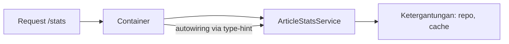

# Service Container

Hampir setiap class Laravel yang kamu tulis, seperti controller, middleware, dan job, dibuat bukan oleh kamu dengan `new`, melainkan oleh **service container**. Memahaminya menjelaskan "keajaiban" injeksi parameter di controller dan menjadi dasar semua bab arsitektur berikutnya.

## Tujuan Pembelajaran

Setelah menyelesaikan sub bab ini, kamu dapat:

- [ ] Menjelaskan masalah ketergantungan yang dipecahkan container.
- [ ] Menjelaskan *autowiring* (resolusi otomatis lewat type-hint).
- [ ] Mendaftarkan binding dengan `bind`, `singleton`, dan `scoped`.
- [ ] Mengikat interface ke implementasi.
- [ ] Mengambil objek dengan `app()` dan `resolve()`, serta tahu kapan tidak perlu.
- [ ] Membedakan binding transien dan singleton lewat percobaan.

## Prasyarat

- Level 01–06, khususnya controller dan Form Request.
- Dasar OOP PHP: class, interface, constructor.

## Pengantar

Misalkan `ArticleController` membutuhkan `ArticleStatsService`, dan service itu membutuhkan `Cache` serta `Logger`. Jika semua dibuat manual dengan `new`, controller harus tahu cara membangun seluruh rantai. Mengganti satu bagian (misalnya logger palsu saat pengujian) berarti mengubah banyak tempat.

## Penjelasan Konsep

### Container

Container adalah "pabrik" objek yang tahu cara membuat class beserta ketergantungannya. Menurut dokumentasi, jika sebuah class tidak punya ketergantungan atau hanya bergantung pada class konkret lain, container dapat meresolusinya **tanpa konfigurasi** lewat refleksi type-hint di constructor.

```php
class ArticleStatsService
{
    public function __construct(private ArticleRepositoryContoh $repo) {}
}
```

Saat controller meminta `ArticleStatsService` di parameter, container membuat `ArticleRepositoryContoh` lebih dulu, menyuntikkannya, lalu mengembalikan service.

### Binding

Binding diperlukan bila container tidak bisa menebak, misalnya untuk **interface** atau objek yang butuh konfigurasi.

| Method | Perilaku |
|---|---|
| `bind` | Objek baru setiap diminta |
| `singleton` | Satu instance untuk seluruh siklus aplikasi |
| `scoped` | Satu instance per siklus permintaan/job |
| `instance` | Mendaftarkan objek yang sudah ada |

Binding biasanya didaftarkan di `register()` pada service provider (bab berikutnya):

```php
$this->app->singleton(Penghitung::class, fn () => new Penghitung());
```

### Mengikat interface

```php
$this->app->bind(PengirimPesan::class, PengirimEmail::class);
```

Setiap class yang meminta `PengirimPesan` mendapat `PengirimEmail`. Untuk mengganti implementasi cukup ubah satu baris.

### Mengambil dari container secara manual

`app(Kelas::class)` dan `resolve(Kelas::class)` mengembalikan instance. Gunakan hanya di tempat container tidak menyuntik otomatis (mis. helper atau file konfigurasi). Di controller, job, dan listener, **suntikkan lewat constructor atau method** karena lebih mudah diuji.

### Keamanan dan kesalahan desain

- Jangan meresolusi class berdasarkan string dari input pengguna (`app($request->input('class'))`): itu memungkinkan pembuatan class sembarang.
- *Service locator* (memanggil `app()` di mana-mana) menyembunyikan ketergantungan; lebih baik injeksi eksplisit.

## Cara Kerja



## Contoh Praktik

Kamu membuat `Penghitung` yang menghitung pemanggilan, mendaftarkannya sebagai `bind` lalu `singleton`, dan melihat perbedaannya melalui route pengujian sementara.

## Penjelasan Kode

File: `app/Services/Penghitung.php`

```php
<?php

namespace App\Services;

class Penghitung
{
    private int $nilai = 0;

    public function tambah(): int
    {
        return ++$this->nilai;
    }
}
```

Class sederhana dengan satu status internal. `tambah()` menaikkan dan mengembalikan nilai.

File: `routes/web.php` (sementara, hapus setelah percobaan)

```php-inline
use App\Services\Penghitung;

Route::get('/uji-container', function (Penghitung $a, Penghitung $b) {
    $a->tambah();
    $a->tambah();

    return ['a' => $a->tambah(), 'b' => $b->tambah()];
});
```

Closure route juga menerima injeksi parameter. `$a` dan `$b` diminta dari container pada satu permintaan.

## Implementasi Langkah demi Langkah

### Langkah 1: buat class

Buat `app/Services/Penghitung.php` seperti di atas.

### Langkah 2: tambah route percobaan

Tambahkan route `uji-container` ke `routes/web.php`.

### Langkah 3: jalankan tanpa binding

```bash
php artisan serve
curl -s http://127.0.0.1:8000/uji-container
```

Tanpa binding, `$a` dan `$b` adalah dua objek berbeda.

### Langkah 4: jadikan singleton

Di `AppServiceProvider::register()`:

```php
$this->app->singleton(\App\Services\Penghitung::class);
```

Ulangi `curl`.

### Langkah 5: hapus percobaan

Hapus route dan binding percobaan, lalu:

```bash
git add app routes
git commit -m "Latihan service container"
```

## Eksekusi dan Verifikasi

| Langkah | Hasil yang diharapkan |
|---|---|
| 3 | `{"a":3,"b":1}`: dua objek terpisah |
| 4 | `{"a":3,"b":4}`: satu objek bersama |

## Hasil yang Diharapkan

Keluaran diturunkan dari perilaku `bind` dan `singleton` di dokumentasi; penulis belum menjalankannya. Cocokkan dengan hasilmu.

## Kesalahan Umum dan Pemecahan Masalah

| Gejala | Penyebab | Cara mengenali | Solusi | Pencegahan |
|---|---|---|---|---|
| `Target [Interface] is not instantiable` | Interface belum diikat | Galat `BindingResolutionException` | Daftarkan `bind` | Ikat interface di provider |
| Parameter primitif tak teresolusi | `string $x` di constructor | `Unresolvable dependency` | Bind dengan closure atau `when()->needs()` | Hindari primitif tanpa nilai bawaan |
| Status bocor antar permintaan | Singleton menyimpan data pengguna | Data pengguna A tampil di B (khususnya Octane) | Pakai `scoped` | Jangan simpan status permintaan di singleton |
| Binding tak berlaku | Provider tidak terdaftar | Binding diabaikan | Periksa `bootstrap/providers.php` | Gunakan `make:provider` |
| `app()` di mana-mana | Service locator | Sulit diuji | Injeksi constructor | Review kode |

## Latihan Praktik

### Latihan dasar

**D1. Autowiring**
- *Masalah:* ingin melihat resolusi otomatis.
- *Persyaratan:* buat `A` yang butuh `B` di constructor, minta `A` di route.
- *Perilaku yang diharapkan:* berjalan tanpa binding.
- *Tujuan belajar:* memahami autowiring.

### Latihan implementasi

**I1. Interface**
- *Masalah:* pengirim pesan perlu diganti tanpa mengubah pemakai.
- *Persyaratan:* buat interface `PengirimPesan`, dua implementasi, ikat salah satu, dan ganti.
- *Perilaku yang diharapkan:* pemakai tidak berubah.
- *Tujuan belajar:* binding interface.

### Latihan tantangan

**T1. `scoped` vs `singleton`**
- *Masalah:* kapan keduanya berbeda?
- *Persyaratan:* jelaskan, tanpa kode, kapan `scoped` menjadi penting (Octane, queue worker).
- *Perilaku yang diharapkan:* jawaban beralasan.
- *Tujuan belajar:* umur objek.
- *Catatan:* kerjakan mandiri; tidak ada kunci jawaban.

## Uji Pemahaman

1. Apa itu autowiring?
2. Apa beda `bind` dan `singleton`?
3. Mengapa interface perlu diikat?
4. Mengapa tidak meresolusi class dari input pengguna?
5. Mengapa injeksi lebih baik dari `app()`?

??? success "Kunci jawaban singkat"
    1. Container membuat ketergantungan lewat type-hint tanpa konfigurasi.
    2. `bind` membuat objek baru tiap diminta; `singleton` berbagi satu instance.
    3. Interface tidak bisa diinstansiasi; container perlu tahu implementasinya.
    4. Menghindari pembuatan class sembarang.
    5. Ketergantungan eksplisit dan mudah diganti saat uji.

## Ringkasan

- Container membuat objek dan menyuntik ketergantungannya.
- Autowiring cukup untuk class konkret; binding untuk interface dan konfigurasi.
- Pilih `bind`, `singleton`, atau `scoped` sesuai umur objek.

Selanjutnya: *Service Providers*, tempat binding didaftarkan.

## Referensi Resmi

- [Laravel: Service Container](https://laravel.com/docs/13.x/container)
