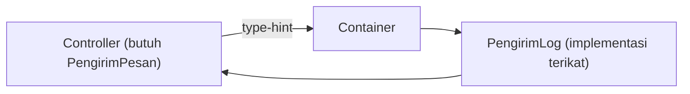

# Dependency Injection

*Dependency Injection* (DI) berarti sebuah class **menerima** ketergantungannya dari luar, bukan membuatnya sendiri. Ini kebiasaan desain yang membuat kode fleksibel dan mudah diuji. Laravel membantu lewat container, sehingga kamu cukup menulis type-hint.

## Tujuan Pembelajaran

- [ ] Membedakan membuat ketergantungan sendiri dan menerimanya (DI).
- [ ] Memakai injeksi constructor dan injeksi method di controller.
- [ ] Menjelaskan manfaat DI untuk pengujian dan penggantian implementasi.
- [ ] Menghindari anti-pola (`new` di dalam class, service locator).
- [ ] Menyuntik konfigurasi lewat binding kontekstual.

## Prasyarat

- [Service Container](07-01-service-container.md) dan [Service Providers](07-02-service-providers.md).

## Pengantar

Perhatikan dua gaya berikut.

```php-inline
// Tanpa DI: terikat pada implementasi tertentu
class LaporanController
{
    public function index()
    {
        $pengirim = new PengirimEmail();
        $pengirim->kirim('ani@contoh.test', 'Laporan');
    }
}
```

Untuk menguji tanpa mengirim email sungguhan, kamu harus mengubah kode. Dengan DI, cukup mengganti objek yang disuntik.

## Penjelasan Konsep

### Injeksi constructor

```php-inline
class LaporanController
{
    public function __construct(private PengirimPesan $pengirim) {}

    public function index(): string
    {
        $this->pengirim->kirim('ani@contoh.test', 'Laporan');

        return 'ok';
    }
}
```

Container melihat type-hint `PengirimPesan`, mencari binding-nya (bab sebelumnya), dan menyuntikkan implementasi. Controller tidak tahu apakah itu email, log, atau palsu.

### Injeksi method

Parameter method controller (selain parameter route) juga disuntik:

```php-inline
public function store(StoreArticleRequest $request, PengirimPesan $pengirim)
```

Gunakan injeksi method bila ketergantungan hanya dipakai satu method.

### Aturan praktis

| Praktik | Alasan |
|---|---|
| Bergantung pada **interface** bila ada pergantian implementasi | Mudah diganti |
| Constructor hanya menerima yang benar-benar dipakai | Menghindari class "serba tahu" |
| Hindari `new` untuk layanan di dalam class | Tidak bisa diganti saat uji |
| Hindari `app()` di dalam logika | Ketergantungan tersembunyi |

### Binding kontekstual

Bila dua class membutuhkan implementasi berbeda untuk interface yang sama:

```php-inline
$this->app->when(LaporanController::class)
    ->needs(PengirimPesan::class)
    ->give(PengirimLog::class);
```

### Keamanan

DI tidak mengubah keamanan secara langsung, tetapi membuat penggantian komponen sensitif (mis. pengirim yang memakai kunci API) terpusat di satu tempat sehingga rahasia tidak tercecer di banyak class.

## Cara Kerja



## Contoh Praktik

Kamu membuat `LaporanController` yang menerima `PengirimPesan`, menjalankannya dengan `PengirimLog`, lalu mengganti implementasi di provider menjadi `PengirimKonsol` tanpa menyentuh controller.

## Penjelasan Kode

File: `app/Http/Controllers/LaporanController.php`

```php
<?php

namespace App\Http\Controllers;

use App\Contracts\PengirimPesan;

class LaporanController extends Controller
{
    public function __construct(private PengirimPesan $pengirim) {}

    public function index(): string
    {
        $this->pengirim->kirim('ani@contoh.test', 'Laporan harian');

        return 'Laporan dikirim lewat '.$this->pengirim::class;
    }
}
```

`private PengirimPesan $pengirim` di constructor adalah *constructor property promotion*: parameter sekaligus menjadi properti. Controller hanya mengenal interface.

File: `routes/web.php`

```php-inline
Route::get('/laporan', [\App\Http\Controllers\LaporanController::class, 'index']);
```

## Implementasi Langkah demi Langkah

### Langkah 1: pastikan binding dari bab sebelumnya aktif

`PengirimPesan` terikat ke `PengirimLog` di `PengirimServiceProvider`.

### Langkah 2: buat controller dan route

Buat controller di atas dan tambahkan route.

### Langkah 3: jalankan

```bash
curl -s http://127.0.0.1:8000/laporan
```

### Langkah 4: ganti implementasi

Buat `PengirimKonsol` (mengembalikan teks tanpa log), ubah `$bindings`, jalankan ulang, dan amati bahwa controller tidak berubah.

### Langkah 5: catat di Git

```bash
git add app routes
git commit -m "Latihan dependency injection"
```

## Eksekusi dan Verifikasi

| Langkah | Hasil |
|---|---|
| 3 | `Laporan dikirim lewat App\Services\PengirimLog` |
| 4 | Nama class berubah; controller tidak diedit |

## Hasil yang Diharapkan

Diturunkan dari dokumentasi container; belum dijalankan penulis.

## Kesalahan Umum dan Pemecahan Masalah

| Gejala | Penyebab | Cara mengenali | Solusi | Pencegahan |
|---|---|---|---|---|
| `Target is not instantiable` | Interface belum diikat | `BindingResolutionException` | Ikat di provider | Cek binding |
| Constructor panjang (7+ parameter) | Class melakukan terlalu banyak | Sulit dibaca | Pecah tanggung jawab | Prinsip tanggung jawab tunggal |
| Selalu `new` di dalam class | Kebiasaan lama | Sulit diuji | Suntik lewat constructor | Review kode |
| Ketergantungan melingkar | A butuh B, B butuh A | Galat rekursi | Rancang ulang | Gambar diagram ketergantungan |

## Latihan Praktik

### Latihan dasar

**D1. Temukan `new`**
- *Masalah:* ada `new PengirimEmail()` di controller.
- *Persyaratan:* tuliskan versi dengan DI.
- *Perilaku yang diharapkan:* constructor menerima interface.
- *Tujuan belajar:* mengubah ke DI.

### Latihan implementasi

**I1. Binding kontekstual**
- *Masalah:* `LaporanController` ingin `PengirimLog`, controller lain `PengirimKonsol`.
- *Persyaratan:* gunakan `when()->needs()->give()`.
- *Perilaku yang diharapkan:* masing-masing mendapat implementasi berbeda.
- *Tujuan belajar:* binding kontekstual.

### Latihan tantangan

**T1. Pengujian tanpa efek samping**
- *Masalah:* ingin menguji controller tanpa mengirim apa pun.
- *Persyaratan:* jelaskan bagaimana DI memungkinkan pengganti palsu (*fake*) di uji, tanpa menulis uji.
- *Perilaku yang diharapkan:* penjelasan benar.
- *Tujuan belajar:* hubungan DI dan pengujian.
- *Catatan:* kerjakan mandiri; tidak ada kunci jawaban.

## Uji Pemahaman

1. Apa itu DI?
2. Apa beda injeksi constructor dan method?
3. Mengapa bergantung pada interface?
4. Apa masalah `app()` di dalam logika?

??? success "Kunci jawaban singkat"
    1. Class menerima ketergantungan dari luar.
    2. Constructor untuk seluruh class; method untuk satu aksi.
    3. Implementasi mudah diganti.
    4. Ketergantungan tersembunyi dan sulit diuji.

## Ringkasan

- DI membuat class fleksibel dan teruji; container mengotomasi penyuntikan.
- Bergantung pada abstraksi dan injeksi lewat constructor.
- Hindari `new` untuk layanan dan service locator.

Selanjutnya: *Contracts dan Interface*.

## Referensi Resmi

- [Laravel: Service Container, Automatic Injection](https://laravel.com/docs/13.x/container#automatic-injection)
