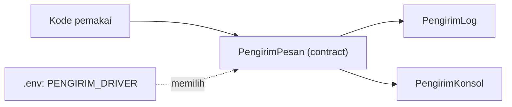

# Contracts dan Interface

*Contract* adalah interface yang mendefinisikan **apa** yang bisa dilakukan sebuah layanan tanpa menentukan **bagaimana**. Laravel menyediakan banyak contract di `Illuminate\Contracts`, dan kamu bisa membuat milikmu sendiri untuk memisahkan kode aplikasi dari detail implementasi.

## Tujuan Pembelajaran

- [ ] Menjelaskan contract dan interface.
- [ ] Membedakan contract Laravel (`Illuminate\Contracts`) dan Facade.
- [ ] Membuat contract aplikasi dan beberapa implementasinya.
- [ ] Memilih implementasi lewat konfigurasi.
- [ ] Menjaga contract kecil dan fokus.

## Prasyarat

- [Dependency Injection](07-03-dependency-injection.md).

## Pengantar

Aplikasi perlu mengirim pemberitahuan: sekarang lewat log, nanti lewat email, mungkin lewat layanan pihak ketiga. Jika kode pemakai bergantung pada contract, pergantian cukup di satu binding.

## Penjelasan Konsep

### Contract Laravel

Setiap layanan inti punya interface, misalnya `Illuminate\Contracts\Cache\Repository` untuk cache dan `Illuminate\Contracts\Queue\ShouldQueue` untuk job. Menurut dokumentasi, contract adalah "satu set interface yang mendefinisikan layanan inti". Kamu dapat meminta contract lewat type-hint, mis. `Illuminate\Contracts\Cache\Repository $cache`.

### Contract vs Facade

| | Contract (type-hint) | Facade |
|---|---|---|
| Ketergantungan | Eksplisit di constructor | Tersembunyi |
| Pengujian | Mudah mengganti | Bisa di-*fake* oleh Laravel |
| Keringkasan | Lebih panjang | Singkat |

Keduanya sah. Contract unggul untuk kode pustaka dan layanan yang ingin dijaga murni.

### Contract aplikasi

Desain contract yang baik:

- Kecil, satu tujuan (*interface segregation*).
- Namanya menyatakan peran: `PengirimPesan`, bukan `EmailManager`.
- Tipe parameter/kembalian eksplisit.

File: `app/Contracts/PengirimPesan.php` (sudah dibuat di 07.02)

### Memilih implementasi lewat konfigurasi

```php-inline
// app/Providers/PengirimServiceProvider.php, di register()
$this->app->bind(PengirimPesan::class, function ($app) {
    return match (config('pengirim.driver')) {
        'log' => new PengirimLog(),
        'konsol' => new PengirimKonsol(),
        default => throw new \InvalidArgumentException('Driver tidak dikenal'),
    };
});
```

`config('pengirim.driver')` dibaca dari `config/pengirim.php`:

```php
<?php

return [
    'driver' => env('PENGIRIM_DRIVER', 'log'),
];
```

`env()` hanya dipanggil di berkas konfigurasi agar tetap bekerja saat `config:cache` dipakai.

### Keamanan

- Kunci API untuk implementasi pihak ketiga dibaca dari konfigurasi/`.env`, jangan ditulis di kode atau di-*commit*.
- Tolak nilai driver tak dikenal (`default => throw`) agar salah ketik tidak diam-diam memilih perilaku berbahaya.

## Cara Kerja



## Contoh Praktik

Kamu menambah `PengirimKonsol`, membuat `config/pengirim.php`, memilih driver lewat `.env`, dan membuktikan pemakai tidak berubah.

## Penjelasan Kode

File: `app/Services/PengirimKonsol.php`

```php
<?php

namespace App\Services;

use App\Contracts\PengirimPesan;

class PengirimKonsol implements PengirimPesan
{
    public array $terkirim = [];

    public function kirim(string $tujuan, string $isi): void
    {
        $this->terkirim[] = [$tujuan, $isi];
    }
}
```

Implementasi ini menyimpan pesan di memori, berguna untuk demonstrasi dan sebagai cikal bakal *fake* untuk pengujian.

## Implementasi Langkah demi Langkah

### Langkah 1: buat `PengirimKonsol` dan `config/pengirim.php`

Seperti di atas.

### Langkah 2: ubah binding

Ganti `$bindings` di provider dengan `bind` berbasis `match` di `register()`.

### Langkah 3: atur driver

Di `.env`: `PENGIRIM_DRIVER=log`. Jalankan `curl http://127.0.0.1:8000/laporan` dan catat nama class.

### Langkah 4: ganti driver

Ubah ke `konsol`, bersihkan konfigurasi, jalankan ulang:

```bash
php artisan config:clear
curl -s http://127.0.0.1:8000/laporan
```

### Langkah 5: driver salah

Isi `PENGIRIM_DRIVER=xyz`; amati galat jelas. Kembalikan ke `log`.

### Langkah 6: catat di Git

```bash
git add app config
git commit -m "Tambah contract pengirim dengan driver konfigurasi"
```

Jangan commit `.env`.

## Eksekusi dan Verifikasi

| Langkah | Hasil |
|---|---|
| 3 | `...lewat App\Services\PengirimLog` |
| 4 | `...lewat App\Services\PengirimKonsol` |
| 5 | `InvalidArgumentException: Driver tidak dikenal` |

## Hasil yang Diharapkan

Diturunkan dari dokumentasi; belum dijalankan penulis.

## Kesalahan Umum dan Pemecahan Masalah

| Gejala | Penyebab | Cara mengenali | Solusi | Pencegahan |
|---|---|---|---|---|
| Perubahan `.env` tak berlaku | Konfigurasi ter-cache | Nilai lama | `config:clear` | Bersihkan setelah ubah |
| `env()` mengembalikan `null` | Dipanggil di luar `config/` saat cache aktif | Nilai kosong | Pindah ke berkas config | Hanya `config()` di aplikasi |
| Contract terlalu besar | Banyak method tak terkait | Implementasi memuat method kosong | Pecah | Interface kecil |
| Lupa `implements` | Class tak memenuhi kontrak | `TypeError` | Tambah `implements` | Static analysis |

## Latihan Praktik

### Latihan dasar

**D1. Contract Laravel**
- *Masalah:* ingin mengenali contract bawaan.
- *Persyaratan:* telusuri `vendor/laravel/framework/src/Illuminate/Contracts` dan sebutkan tiga contract beserta tujuannya.
- *Perilaku yang diharapkan:* tiga contract valid.
- *Tujuan belajar:* mengenali kontrak inti.

### Latihan implementasi

**I1. Contract baru**
- *Masalah:* butuh `PenyimpanLaporan` dengan `simpan(string $nama, string $isi): void`.
- *Persyaratan:* buat contract, implementasi lokal, binding, dan pemakai lewat DI.
- *Perilaku yang diharapkan:* berjalan lewat injeksi.
- *Tujuan belajar:* merancang contract.

### Latihan tantangan

**T1. Kapan tidak perlu contract?**
- *Masalah:* tim membuat interface untuk setiap class.
- *Persyaratan:* tulis kriteria kapan interface layak (beberapa implementasi, batas modul, uji).
- *Perilaku yang diharapkan:* kriteria beralasan.
- *Tujuan belajar:* menghindari abstraksi berlebihan.
- *Catatan:* kerjakan mandiri; tidak ada kunci jawaban.

## Uji Pemahaman

1. Apa itu contract?
2. Apa beda contract dan Facade?
3. Mengapa driver dipilih dari konfigurasi?
4. Mengapa `env()` hanya di berkas config?

??? success "Kunci jawaban singkat"
    1. Interface yang mendefinisikan perilaku tanpa implementasi.
    2. Contract eksplisit lewat type-hint; Facade akses statis ringkas.
    3. Implementasi diganti tanpa mengubah kode pemakai.
    4. Agar tetap terbaca saat konfigurasi di-cache.

## Ringkasan

- Contract memisahkan "apa" dari "bagaimana".
- Pilih implementasi lewat binding dan konfigurasi.
- Jaga contract kecil; hindari abstraksi tanpa alasan.

Selanjutnya: *Facades*.

## Referensi Resmi

- [Laravel: Contracts](https://laravel.com/docs/13.x/contracts)
- [Laravel: Configuration](https://laravel.com/docs/13.x/configuration)
